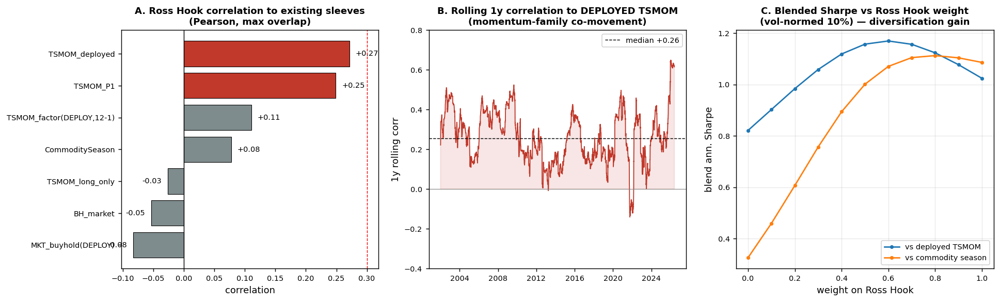

# A.1 — Décorrélation Ross Hook (#76) vs le book existant

*Réponse à la question n°1 du retour d'équipe : « Un sleeve validé mais corrélé n'ajoute rien à la robustesse 50 %. » · 2026-06-07 · `ftmo_lab.py` inchangé (9dea332).*

---

## TL;DR — verdict A.1

**Ross Hook PASSE le test de décorrélation → la stratégie mérite l'investissement data (track B).**

Sa seule corrélation non-triviale est au **TSMOM déployé (+0,27)** ; elle est ~nulle à tout le reste (marché −0,08, trend long-only −0,03, saisonnalité commodités +0,08, facteur TSMOM pur +0,11). En portefeuille vol-normé, l'ajouter au book **augmente le Sharpe mélangé dans les trois cas** (vs TSMOM déployé : 1,02 → **1,17** au poids optimal). Ce n'est **pas un doublon**.

**Nuance honnête (pas de flatterie) :** Ross Hook est un sleeve de **famille momentum**, pas un diversificateur indépendant. Sa corrélation roulante au TSMOM déployé monte à **+0,65 en régime de tendance forte** (médiane +0,26). Le bénéfice de diversification est donc **partiel et concentré hors-tendance** : en krach corrélé au momentum, il ne couvrira pas le TSMOM. À dimensionner comme un cousin rapide/sélectif du trend, pas comme une jambe orthogonale.

---

## 1. Construction de la série Ross Hook

Série de rendements **close-to-close MTM** (la seule honnête, cf. correction #60), config déployable **hors-forex** (indices + commodités + crypto), **délai+1** (`fill='next_open'`), params figés MN/HK/TM = 10/20/10, échelle `RISK_FRAC` = 0,5 %. Strictement la même machinerie que `s076_report_analytics.py` (réutilise `rosshook.py`, `ftmo_lab.py` intact).

- Période : **2000-02-07 → 2026-05-29**, N = 7 745 jours.
- Sharpe annualisé **0,98**, vol annualisée 4,2 % (à 0,5 % de risque/trade) — cohérent avec l'audit (~0,7–1,0).

> Réserve : série calculée sur **mon univers** (commodités proxy Yahoo, crypto). Sur l'univers réel plus étroit de l'équipe (7 instruments, t=2,6), le Sharpe standalone du Ross Hook serait plus bruité ; **la structure de corrélation devrait tenir mais doit être revérifiée sur votre série de réplication** (cf. §5).

## 2. Comparateurs (vos vraies séries de book)

| Série | Source | Période |
|---|---|---|
| **TSMOM_deployed** | `ftmo_research/tsmom/chosen_returns.csv` | 2000–2026 |
| TSMOM_P1 | `skew_research/MERGE_portfolio_returns.csv` (P1_TSMOM_only) | 2018–2026 |
| TSMOM_long_only | `trend_research/g1_sleeves.csv` | 2000–2026 |
| CommoditySeason | `skew_research/session_basic_trend/commodity_seasonality_oos.csv` | 2016–2026 |
| BH_market | `trend_research/g1_sleeves.csv` (BH) | 2000–2026 |
| + facteurs internes (même univers DEPLOY) : MKT buy&hold, TSMOM 12-1 | calculés | 2000–2026 |

## 3. Corrélations (Pearson / Spearman, recouvrement max)

| Sleeve | N | Pearson | Spearman |
|---|---:|---:|---:|
| **TSMOM_deployed** | 7 390 | **+0,271** | +0,221 |
| TSMOM_P1 | 2 094 | +0,249 | +0,236 |
| TSMOM_factor (12-1) | 7 438 | +0,111 | +0,114 |
| CommoditySeason | 2 617 | +0,078 | +0,103 |
| TSMOM_long_only | 6 077 | −0,026 | −0,008 |
| BH_market | 6 273 | −0,054 | −0,040 |
| MKT buy&hold (DEPLOY) | 7 745 | −0,083 | +0,023 |

Lecture : **tout est sous le seuil de redondance 0,30.** Le seul lien réel est au **TSMOM déployé (~0,25–0,27)** — la composante « breakout-momentum générique » identifiée dans l'audit (~60 % de l'edge). La corrélation au **trend long-only est nulle** : Ross Hook est neutre au beta, donc décorrélé de la jambe directionnelle du trend.

## 4. Stabilité (corrélation roulante 1 an au TSMOM déployé)

Médiane **+0,26**, plage **−0,14 → +0,65**. Les pics (~0,65) coïncident avec les régimes de tendance forte (2008-09, 2022, 2024-25) où breakout-momentum et TSMOM co-bougent. **C'est attendu** pour un sleeve momentum-family et c'est la limite du bénéfice de diversification.

## 5. Diversification marginale (le vrai test portefeuille)

Jambes vol-normées à 10 %/an, mélange `(1−w)·book + w·RossHook`. Règle : RH ajoute du Sharpe au margin ssi `corr < Sharpe_RH / Sharpe_book`.

| Book leg | corr | Sh_book | Sh_RH | ajoute ? | Sharpe mélangé (w=0 → optimal) |
|---|---:|---:|---:|:--:|---|
| **TSMOM_deployed** | +0,27 | 0,82 | 1,02 | ✅ | 0,82 → **1,17** (w\*=0,6) |
| CommoditySeason | +0,08 | 0,33 | 1,09 | ✅ | 0,33 → 1,11 (w\*=0,8) |
| TSMOM_P1 | +0,25 | 0,20 | 1,06 | ✅ | 0,20 → 1,06 (w\*=1,0) |

vs **TSMOM déployé** : pic intérieur à w≈0,6 → Sharpe **1,17 > 1,02** standalone. C'est un **vrai gain de diversification** (pic au-dessus des deux jambes seules), pas seulement « RH a un meilleur Sharpe ».

> Garde-fou : une partie de la hausse vient du Sharpe standalone supérieur du Ross Hook *sur ces fenêtres*. La **conclusion de décorrélation repose sur la corrélation (0,25–0,27), pas sur le 1,17.** Sur votre univers réel (Sharpe RH plus bas), le pic sera moins haut ; mais tant que la corrélation reste ~0,25, l'ajout reste net-positif.

## 6. Décision & séquençage

**GO track B (combler les trous data).** Ross Hook n'est pas redondant avec le book : il diversifie le TSMOM (corr 0,27) et est orthogonal à la saisonnalité et au beta. L'investissement data (indices pré-2012, commodités complexes) est justifié — il lèverait le NS indices (t=2,6 → potentiellement la fourchette 4,0) **et** élargirait la base de l'edge décorrélé.

**Trois actions de suivi, par priorité :**

1. **Revérifier la corrélation sur VOTRE série de réplication MTM** (7 instruments réels) vs votre TSMOM déployé. Si corr ≈ 0,25 s'y confirme, A.1 est scellé sur données réelles. *(rapide — vous avez déjà les deux séries)*
2. **Dimensionner comme sleeve momentum-family**, pas comme diversificateur indépendant : plafonner l'exposition jointe Ross Hook + TSMOM pour le cap daily FTMO, puisqu'ils peuvent co-perdre en retournement de tendance (corr → 0,65).
3. **Track B ensuite** : indices pré-2012 d'abord (résout le NS, gain le plus élevé), commodités complexes ensuite.

---

*Repro : `cd oxfordstrat_109/code && python3 s076_A1_decorrelation.py && python3 s076_A1_figure.py`. Sorties : `results/s076_A1_corr.csv`, `results/s076_A1_blend_*.csv`, `results/s076_A1_decorrelation.png`.*
