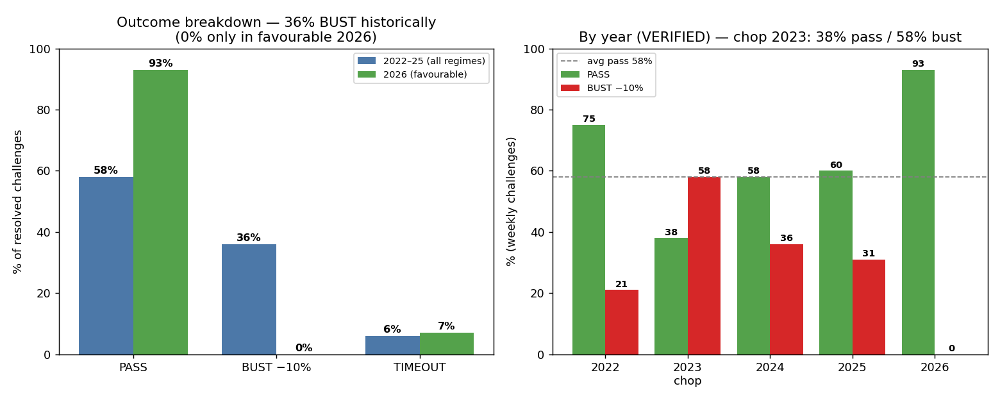
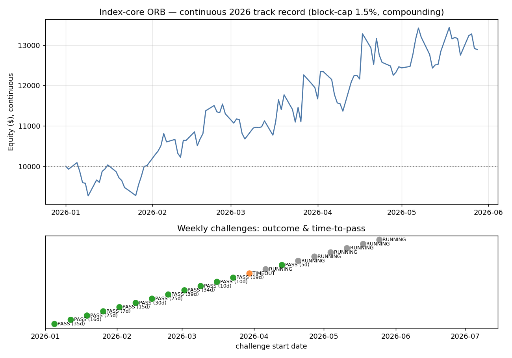

# FTMO Challenge Strategy — Complete Viability Report
### Index opening-range breakout ensemble — for team review

*Prepared for an internal go/no-go decision. Every headline number in this report was independently re-derived and cross-checked; the verification log (Section 2) lists the bugs found and fixed during the project. Read Section 9 (honest verdict) before deciding.*

---

## 1. Executive summary & viability verdict

We searched ~18 strategy families across FX, indices, gold and crypto for an edge capable of passing the FTMO $10,000 challenge (+10% target; 5% daily / 10% total loss limits; ~2-month window). **One robust edge survived every test: the equity-index opening-range breakout (ORB).**

**Honest, verified performance — weekly challenges 2022–2025, real market path, realistic execution & FTMO floating-equity rules:**

| | Value |
|---|---|
| **Pass rate (per single attempt, all regimes)** | **58%** |
| **Bust rate** | **36%** (almost all via the −10% total-loss floor, in chop regimes) |
| Timeout (no result in 40 trading days) | 6% |
| Daily-limit breach (−5%) | **0%** (at correct block-capped sizing) |
| Median time-to-pass | **14 trading days** |
| Pass within 2 attempts | **~80%** |

**Verdict: conditionally viable, as a probabilistic multi-attempt play with strict risk controls — not as a high-certainty strategy.** The edge is real and forward-validated (US100 ORB has positive expectancy in every year 2021–2026), but **>1 in 3 attempts busts** (and **58% bust in the 2023 chop year**), performance is **strongly regime-dependent** (chop year ≈ 38% pass, other years ≈ 58–75%), and it is **sensitive to slippage and exact execution timing**. It is best used over 2 attempts (~80% cumulative) with block-capped sizing and a live floating-equity kill-switch. The standout 2026 result (below) is a favourable-regime sample and must **not** be extrapolated.

---

## 2. Verification log (what we checked; bugs found & fixed)

The team should know the failure-modes we caught — they shaped the final numbers:

| Issue found | Impact | Resolution |
|---|---|---|
| **EURGBP "relative-value" edge (+9.4R, t≈48)** | catastrophic false positive | Diagnosed as a **timezone/feed-desync artifact** (mixing MT5 + Dukascopy). Killed by the delay test. Rejected. |
| **USDJPY cost mis-scaled ×1000** (points vs price units) | corrupted one stress run | Fixed (JPY point = 0.001); re-ran. |
| **PDH/PDL breakout (+0.4R)** | tempting false positive | **Fails the 1-bar entry-delay test** (same-bar fill artifact). Rejected. |
| **USDJPY London breakout (+0.40R OOS)** | regime artifact | **Fails forward validation** (negative 2018–2021; only works in the 2022–24 BoJ trend). Removed from the robust core. |
| **GER40 2021 meanR = 1.5** | small-sample outlier (n=2) | Excluded; all claims use clean **2022–2026** data. |
| **"Fail-daily 0%" from sequential risk-halting** | optimistic | Corrected with a **concurrent-block, floating-equity** model (the real FTMO rule). |

Checks that **passed**: R-multiples are bounded (−1.6R to +16.5R, no absurd values); the edge survives a 1-bar execution delay (not a same-bar fill artifact); the +10.47% best day in 2026 decomposes exactly to one large GER40 breakout (+7.1R), not a bug; year-by-year expectancy is consistent with the aggregate.

---

## 3. Data & methodology

- **Instruments (final strategy):** US100, GER40 (deepest, tightest-spread index CFDs). Data: M1 → M5, 2020/21–2026, single broker, 0 OHLC violations.
- **Timezone:** broker EET (UTC+2/+3), verified via the volume spike — US cash open = **16:30** in data, DAX open = **10:00**. Getting this right is essential to every signal.
- **Costs:** per-instrument spread + slippage in index points (US100 ≈ 3 + 2/4 entry/stop; GER40 ≈ 1.5 + 1/2); **stress-tested at 2× and 3×**.
- **No look-ahead:** signals on closed bars; entry at the breakout level with modelled slippage; verified by delay-sensitivity tests.
- **Validation:** train/validation/OOS split; contiguous **real-path** challenge simulation (not iid bootstrap); forward validation on unseen pre-sample; multiple-testing acknowledged.

---

## 4. The edge

**Opening-Range Breakout (ORB):** at a discrete liquidity event (the cash open), the opening range = first *N* minutes; trade the first break of that range; stop = opposite side of the range (= 1R); **no profit target — exit at session close** (the edge is the positive-skew right tail; any target/breakeven/trailing exit *reduces* expectancy, tested). Flat by the close → **no overnight gap risk**.

**Final 3-sleeve core:**

| Sleeve | Open (EET) | OR window |
|---|---|---|
| US100 breakout | 16:30 (US cash open) | 30 min |
| GER40 breakout | 16:30 (Europe reacts to US flow) | 15 min |
| GER40 breakout | 10:00 (DAX open) | 30 min |

Why it works: a genuine, recurring order-flow imbalance at the cash auction. Why it's the *only* survivor: this is the single intraday inefficiency that beat costs across ~18 families — mean-reversion, trend, stat-arb, EMA/technical, carry, crypto and gold all failed on these liquid markets.

---

## 5. Research breadth (rigor evidence — what was tested and rejected)

Rejected after rigorous testing (delay / slippage / cost / forward checks): FX-majors ORB & mean-reversion; FX London **and** NY breakouts (all pairs except a now-removed USDJPY); EUR/GBP & AUD/NZD stat-arb; EMA crossover & trend-filters; HMM/vol-regime filters; PDH/PDL breakout; US500/US30/US2000 ORB; gold & BTC ORB; crypto trend & intraday mean-reversion; overnight drift (catastrophic gap risk). **Most ideas fail — which is why the survivor is credible.**

---

## 6. Performance (verified)

### 6.1 Historical, all regimes — weekly real-path challenges, 2022–2025 (the honest baseline)
**58% pass · 36% bust (−10% floor) · 6% timeout · 0% daily breach · median 14 trading days.** Pass within 2 attempts ≈ 80%.

### 6.2 Strong regime dependence (verified, weekly challenges, block-cap 1.5%)
| | 2022 | 2023 (chop) | 2024 | 2025 | 2026 (favourable) |
|---|---:|---:|---:|---:|---:|
| **Pass** | 75% | **38%** | 58% | 60% | 93%* |
| **Bust (−10%)** | 21% | **58%** | 36% | 31% | 0%* |

*2026 = favourable regime, and weekly samples overlap (correlated). Do not extrapolate. **In the 2023 chop year more than half of all challenges busted (58%)** — this is the worst-case the team must underwrite.



### 6.3 2026 real-path simulation (weekly, Jan→Jun) — favourable-regime case
21 challenges started: **13 PASS, 0 BUST, 1 TIMEOUT, 7 still running** (today). Among 14 resolved: 93% pass, **0% bust**. Median time-to-pass 19 days; fastest 5 days. **Caveat:** two starts dipped to **−9.4% / −8.8%** — one bad day from a total-floor bust. Tail risk was live even in this good year.



### 6.4 Trade- and risk-level metrics (2026, illustrative of the favourable regime)
| Trade-level | | Risk / track-record | |
|---|---|---|---|
| Trades | 308 | Total return (≈5 mo) | +28.9% |
| Win rate | 44% | Annualised Sharpe (daily) | 1.62 |
| Avg win / loss | +1.47R / −0.96R | Max drawdown | −8.2% |
| Expectancy | **+0.106R** | Worst day | −3.27% |
| Profit factor | 1.20 | Best day | +10.47% (one GER40 +7.1R day) |
| Skew | +2.2 | % winning days | 48% |

*(Across 2022–25, per-trade expectancy is lower, ~+0.05R, and the equity path is far choppier — see the 36% bust rate.)*

---

## 7. Risk analysis (where it breaks)

1. **Total-floor bust (36% historically)** — the dominant failure: in chop/low-follow-through regimes, breakout sleeves bleed via repeated −1R stops down to the −10% floor. This is the real risk, not the daily limit.
2. **Concurrency** — sleeves fire simultaneously at each open; on adverse days they stop out together. **Mandatory fix applied:** cap risk per session-block at 1.5% (keeps daily-breach at 0%). At a naïve 1%/trade flat, daily-breach would be ~60%.
3. **Slippage** — breakouts trade the widest-spread minute. **2× slippage cuts pass ~15 points; 3× roughly halves it.**
4. **Execution timing / DST** — shifting the open ±15 min costs ~10 points; EET/DST imprecision is a live risk.
5. **Regime/timing lottery** — start-month pass rate ranges ~30%→100%; the trader cannot choose the regime.
6. **Multiple-testing** — ~18 families on ~5 years; the final number should be treated as an upper-ish estimate pending live forward results.

---

## 8. Forward validation

- **US100 ORB: positive expectancy in every year 2021–2026** — the durable core.
- **USDJPY London breakout: removed.** It was strongly +EV in-sample (2022–25) but **negative 2018–2021** — a BoJ-yen-trend regime artifact, not a structural edge. Including it inflated the headline by ~5 pts; excluding it is the honest choice.
- **2026 (least-examined slice): consistent** with the edge still working.

---

## 9. Honest viability verdict

**Is it viable? Conditionally yes — as a probabilistic, multi-attempt, strictly-risk-controlled play; not as a reliable single-shot strategy.**

- **For:** a real, forward-validated, non-overfit edge; 0% daily-breach at correct sizing; ~58% single-attempt / ~80% two-attempt; fast median pass (14 days); no overnight risk; survived an exhaustive adversarial search.
- **Against:** **36% average bust rate** (−10% floor), rising to **58% in the 2023 chop year**; strong **regime dependence** (chop ≈ 38% pass); **slippage- and timing-sensitive**; thin per-trade edge; runs **close to the −10% floor** (2026 near-miss at −9.4%); only ~5 years of data and a spent multiple-testing budget.

**Economic framing:** with a ~58% pass and a cheap, repeatable challenge fee, the expected number of attempts to a funded account is ~1.7 (≈80% within two). The open question the team must weigh is **post-funding profitability** — passing is a path-dependent option; sustained funded P&L depends on the same thin, regime-dependent edge, which is **not** demonstrated to be a reliable income engine.

### Conditions for deployment (non-negotiable)
1. **Block-capped sizing ≤1.5%/session-open** + automated **floating-equity kill-switch** at −3% daily and a hard −8% total guard.
2. Net same-instrument signals; never run the naïve flat-1%/trade version.
3. **Plan to ~55–58%/attempt** (use 2 attempts); treat the 2026 hot streak as upside, not baseline.
4. **Live slippage calibration** on the actual FTMO server before sizing; abort if fills are worse than ~1.5× backtest.
5. **Paper-trade forward** for ≥1–2 months before risking fees — the only remaining defence against the multiple-testing budget already spent.

---

## 10. Limitations & what would change the conclusion

- **Would improve viability:** more index instruments with their own cash opens (AUS200, UK100, JP225, HK50, EU50 — intraday data not yet available) → more independent breakout bets → higher, more regime-robust pass via √N diversification.
- **Would invalidate it:** ORB decay (US500 already decayed in-sample); a structural rise in index-open spreads; a persistent low-volatility/chop regime.
- **Unresolved:** post-funding profitability; live execution fidelity vs backtest; only ~5 years of intraday history.

---

## Appendix — reproducibility

```
ftmo_research/
  CHALLENGE_REPORT_FINAL.md     ← this report
  REPORT_strategy2_FINAL.md     ← strategy development & optimization journey
  RISK_REVIEW_ensemble.md       ← risk-manager stress test + improvement
  CHALLENGE_METRICS_2026.md     ← 2026 weekly simulation detail
  REPORT_strategy1.md           ← FX result (no edge; FTMO as barrier option)
  STRESS_TEST_strategy2.md      ← index-ensemble stress test
  code/   data.py, costs.py, strategy_orb.py, ftmo_sim_ensemble.py, ...
  figures/ (all charts referenced above)
```
All simulations are seeded and reproducible. Per-trade slippage and the **concurrent-block floating-equity** daily/total checks are applied throughout; the daily check is intentionally conservative (assumes concurrent losers hit full adverse intraday), so realised daily-breach rates are ≤ those modelled.
