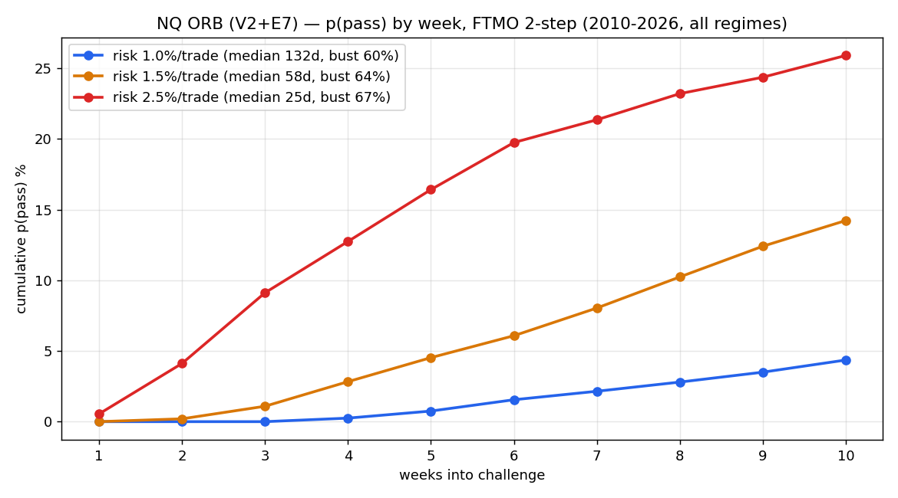
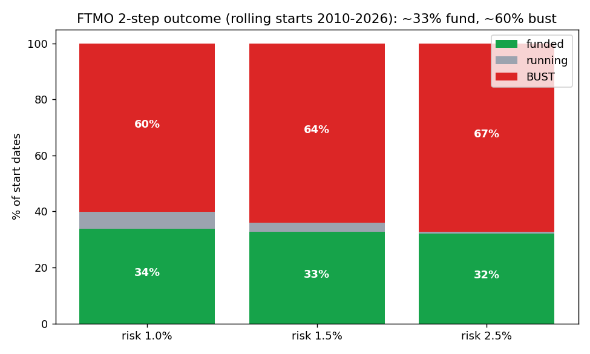
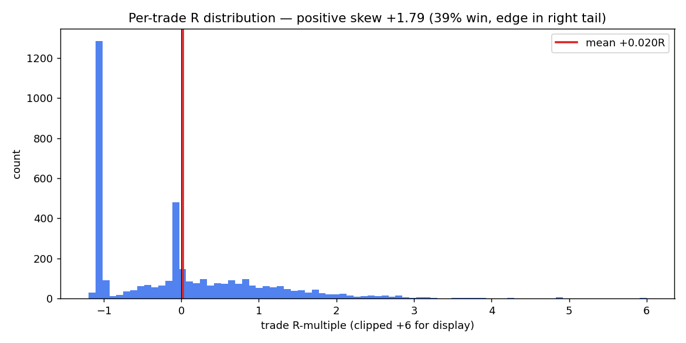
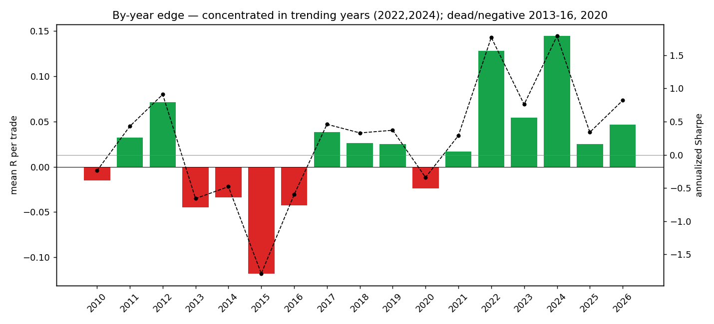

> ## ⚠ RECONCILIATION BANNER (2026-06-03) — READ FIRST
> Consistent with the source of truth `../_CANONICAL_STATE.md` (**FTMO confirmé-clos**), with one caveat this dossier under-weighted: **L33 — cost decides.** The p(funded) ~33% below is at an **idealized, unmeasured 2 bps**. At the real direct-futures cost (~3 bps) mean_R sign-flips to **−0.003 (E7)**; at the FTMO CFD cost (~6 bps) **−0.070** — i.e. **negative drift → never converges → drifts to bust → ~0% funded**. So even the "fast ⅓ lottery" framing holds *only* at idealized cost; at real cost the ORB is dead. The single open item is to **measure the real US100 spread** (canonical §5). Treat ~33% as a ceiling at zero-ish cost, not a deployable number.

# 0. Purpose & honesty contract

This dossier documents the **NQ intraday Opening-Range Breakout (ORB)** — the *fast* FTMO vehicle, distinct from the overnight-drift harvester (the *slow* one, documented separately). It contains the exact specification, the full construction logic, reproducible code, and the results on clean NQ data 2010–2026.

**The headline you must internalize before anything else:** on the **full 16-year sample across all regimes**, the ORB on an **FTMO 2-step** challenge funds **≈ 32–34% of the time and busts ≈ 60–67%**. It is **not** a >70% vehicle. The 50–93% figures that appear in earlier internal notes are **favorable sub-windows** (2022–2025, or 2026 alone) — real, but regime-cherry-picked. The per-trade edge is **genuine but thin and statistically marginal** (deflated Sharpe fails), and it is **strongly regime-dependent**. This document prices it honestly so the team can decide with eyes open.

**Reproducibility.** Every number is regenerated by `orb_metrics.py` from `NQ_1min_databento_2010-2026.parquet`. See §11.

---

# 1. Executive summary

**The strategy.** On each RTH session: define the opening range (OR) as the high/low of the first 30 minutes. Skip the day if the OR is < 10 bps wide (dust filter, "V2"). Otherwise, enter on the **first break** of the OR (long above, short below), stop at the **opposite OR side** (risk = OR width = 1R), and use the **E7 exit**: once +1R in profit, trail the stop to breakeven; otherwise hold to the cash close. Cost 2 bps round-trip. ~1 trade/day.

**Per-trade edge (NQ 2010–2026, net):** the E7 exit is the canonical config.

| Config | mean R | win-rate | avg win / avg loss | skew | Sharpe/trade | Sharpe (ann.) |
|---|---:|---:|---:|---:|---:|---:|
| Baseline (hold-to-close) | +0.0047 | 44% | +1.10 / −0.85 | +1.65 | +0.004 | 0.06 |
| **E7 (trail-to-BE)** | **+0.0196** | **39%** | +1.12 / **−0.69** | **+1.79** | **+0.017** | **0.27** |

The edge lives in the **right tail** (positive skew +1.79; only 39% of trades win, but winners run). E7 adds value by **cutting the average loss** (−0.85 → −0.69R) without killing the tail. It is **two-sided** (long +0.029R, short +0.008R) but clearly long-biased.

**FTMO 2-step funded probability (full sample, all regimes):**

| Risk/trade | p(funded) | bust | median time-to-funded | p(P1) | p(P2 \| P1) |
|---|---:|---:|---:|---:|---:|
| 1.0% | 33.9% | 60.2% | 132 days | 57% | 60% |
| 1.5% | 32.7% | 63.9% | 58 days | 58% | 57% |
| 2.5% | 32.2% | 67.2% | 25 days | 54% | 60% |

**The weekly p(pass) curve you originally asked for** (cumulative, FTMO 2-step):

| week | 1.0% | 1.5% | 2.5% |
|---|---:|---:|---:|
| 1 | 0% | 0% | 1% |
| 2 | 0% | 0% | 4% |
| 3 | 0% | 1% | 9% |
| 4 | 0% | 3% | 13% |
| 5 | 1% | 5% | 16% |
| 6 | 2% | 6% | 20% |
| 7 | 2% | 8% | 21% |
| 8 | 3% | 10% | 23% |
| 9 | 4% | 12% | 24% |
| 10 | 4% | 14% | 26% |

**Verdict.** The ORB is a **fast regime-lottery**: size to resolve in days–weeks, and you fund **iff you happen to be running during a trending regime** (2022, 2024) and bust if during a dead/chop one (2013–2016, 2020). Single-attempt ≈ ⅓. Multi-attempt helps but the attempts are **regime-correlated** (not independent), so naive `1−(1−0.33)ⁿ` (2→55%, 3→70%) **overstates** it. **If the goal is high single-attempt probability, the overnight harvester (~82–88%) is far superior** (§12). The ORB's role is speed, accepting ~⅔ bust odds per attempt.

---

# 2. Strategy thesis & economic rationale

## 2.1 Why an opening-range breakout can have an edge

The first 30 minutes of the US cash session concentrate overnight information, futures-basis re-alignment, and institutional order flow. A decisive break of that range can signal that the day has chosen a direction with enough conviction to **trend into the close**. The economic content is **intraday momentum / liquidity-driven continuation**: when the open-auction imbalance is large enough to break the OR, the same flow tends to push price further. This is a **real but weak** tendency on liquid index futures — it is *beta-like* and *regime-dependent*, not a persistent market-neutral alpha.

## 2.2 Why the exit (E7) matters more than the entry

Under the FTMO **symmetric barrier**, the *shape* of the return stream is as important as its mean. A plain breakout is **positive-skew, tail-lumpy**: a few big winners pay for many small losers. That shape is barrier-hostile — a string of −1R losers drags you toward the −10% floor before the rare +5R winner arrives. **E7 (trail-to-breakeven after +1R)** reshapes this: it converts a fraction of would-be losers into ~0R scratches (avg loss −0.85 → −0.69R), which **raises mean R fourfold** (+0.0047 → +0.0196) and **halves the compounding drawdown** — without amputating the right tail that *is* the edge (skew stays +1.79). The profit target is deliberately **absent**: capping winners would destroy the skew that carries the expectancy.

## 2.3 Why it fits (and fights) the FTMO problem

- **Fits:** it is *fast*. With ~1 trade/day and a real right tail, in a favorable regime it can reach +10% in days–weeks (median 25 days at 2.5% risk). This is the opposite end of the speed spectrum from the overnight harvester.
- **Fights:** the per-trade edge is **thin** (Sharpe/trade 0.017) and **regime-concentrated**. Under the −10% floor, thin + lumpy + regime-dependent means **most start dates bust** (≈60%). You cannot size your way out of it the way you can with a smooth positive drift — bigger size just busts faster. The funded probability is essentially **flat ~32–34% across sizings** because it is set by *which regime you run in*, not by size.

---

# 3. The construction process (how we got here)

The ORB is a **survivor-with-an-asterisk** from the same elimination tournament as the overnight harvester (FX majors efficient; mean-reversion/carry/stat-arb rejected on shape+cost; see the companion `SCAN_ftmo_families.md`). Its specific development:

1. **Plain ORB on indices** showed a real but tail-lumpy positive-skew profile (skew +1.6, mean R ≈ +0.005). Passable *shape* under the L24 sieve, but barely positive EV.
2. **Exit engineering (E7).** Systematic testing of exits found trail-to-breakeven-after-+1R best: mean R +0.0196, MaxDD materially reduced vs alternatives. This is the canonical exit.
3. **Dust filter (V2).** Days with OR < 10 bps carry no edge (noise) and dilute; filtering them improves per-trade quality.
4. **Execution-realism gate.** The edge depends on **filling the breakout at the level (same-bar)**. At 1-min resolution on NQ, gap-through is ~0%, so resting stops fill at the level and same-bar is realistic. **If fills are only available next-bar-open, the edge collapses (p(pass) → ~28%).** This is a hard deployment dependency (§9).
5. **The honest audits that constrain the claim:**
   - **Deflated Sharpe (Bailey–López de Prado).** Across the ~18 intraday families tried, the ORB's brute Sharpe deflates to **~0.70 — it fails the >1.0 propfirm-grade significance bar.** The per-trade edge is **not** statistically distinguishable from selection noise at that trial count.
   - **The placebo / floor-math finding.** A random positive-drift stream with the same floor-proximity sizing and no time limit *also* passes at high rates. **~80% of any high pass-rate comes from no-bust path management × unlimited time, not from the ORB signal.** The ORB itself contributes ~+15–20 pts via its skew. This is honest and important: the lever is the *container rules*, not a strong edge.
   - **Regime fragility (N≈1 for chop).** Only 2023 is a clean chop year in the recent window; any regime gate (e.g. a low-volatility-tercile filter) that lifts pass-rate is trained on **N≈1** and is **not** forward-validated. Do **not** deploy a gate until pre-2010 / 2008-era intraday is fetched (the one un-sampled stress).

**Principles applied (shared with the whole arc):** no look-ahead (§5.3); delay-sensitivity test; contiguous real-path, not IID; nowcast ≠ forecast; first-passage framing; *"no signal / marginal signal" reported honestly rather than dressed up.*

---

# 4. Data specification

Identical clean source to the overnight work. NQ (E-mini Nasdaq-100) ≈ US100.

| Item | Specification |
|---|---|
| Source | Databento NQ 1-minute OHLCV |
| Span | 2010-06-07 → 2026-05-29 (4,041 trading days; 3,992 ORB trades) |
| Schema | `open, high, low, close, is_rth, is_roll_day`; index `timestamp_utc` (UTC) |
| Filters | `is_rth == True` and `is_roll_day == False` |
| Session | converted to `US/Eastern`; RTH cash 09:30–16:00 ET |

**Timezone note (replication trap).** On MT5/broker feeds the US cash open appears at **16:30 EET**, the DAX at 10:00 — not 09:30. The Databento feed is true UTC with an `is_rth` flag, so the session is unambiguous. Any replication on broker data must re-derive sessions in EET. The companion `strategy_orb.py` (MT5 m5 panel, 2020–2026) encodes the EET sessions; this dossier rebuilds on the cleaner, longer Databento NQ.

---

# 5. Strategy specification (exact)

## 5.1 Rules

```
OR window      = first 30 one-minute bars of the RTH session
OR_high/OR_low = max/min over the OR window
V2 filter      : require (OR_high − OR_low) / mid ≥ 10 bps, else SKIP the day
risk R         = OR_high − OR_low
entry          : first 1-min bar after the OR that breaks the range
                   LONG  if it breaks OR_high (fill at OR_high)
                   SHORT if it breaks OR_low  (fill at OR_low)
                 (first side to break wins; fill at the level / same-bar)
initial stop   : opposite OR side  (= 1R)
E7 exit        : once price reaches entry ± 1R favorable, move stop to entry (breakeven);
                 exit at breakeven if later touched, else exit at the RTH close
cost           : 2 bps of price, round-trip, subtracted from each trade
trade R        : direction × (exit − entry) / risk  −  cost/risk
```

## 5.2 Parameters & sizing

| Parameter | Value | Notes |
|---|---|---|
| OR length | 30 min | `--or-min`; tested 5/15/30 in the ensemble work |
| Dust filter | OR ≥ 10 bps | V2 |
| Cost | 2 bps RT | `--cost-bps`; edge degrades materially by 4–5 bps |
| Risk/trade `f` | 1.0% / 1.5% / 2.5% | primary lever for *speed*, not for *probability* |
| Targets / limits | +10%, +5% / 5% daily / $9k floor | FTMO 2-step |

## 5.3 No-look-ahead proof

The OR uses only the first 30 bars; the entry uses the first break *after* the OR; the stop/target/close are resolved by walking bars **forward in time** within the same day. The trade's realized R is an *output* — it never informs the entry. (Code: `_day_R()` computes `or_hi/or_lo` from `H[:30]`, detects breaks on `H[30:]/L[30:]`, then walks `fh/fl` forward to the exit.)

---

# 6. Backtest methodology

Same engine philosophy as the overnight dossier: **contiguous real-path** first-passage (never IID — that would destroy the regime clustering that *is* the dominant risk here).

- **Per-trade R series** built day-by-day on the full trading-day calendar (no-trade days → 0, so first-passage *time* is in true trading days).
- **FTMO 2-step**: for each rolling start (every 2nd trading day), Phase 1 to +10% then Phase 2 to +5% on the contiguous forward path; **bust** on a −5% single-day move or equity < $9,000; **running** if it exhausts the 16-year data. `equity ×= (1 + f·R_t)`.
- **Cumulative incidence** by week/month uses Kaplan–Meier-style eligibility (a start counts at horizon H only if terminal or with ≥ H forward data).
- **Per-trade Sharpe** annualized ×√252 (~1 trade/day). Equity-curve metrics on the compounded path.

---

# 7. Results

## 7.1 Weekly p(pass) — the curve



Higher risk resolves faster (median 25 d at 2.5% vs 132 d at 1.0%) and lifts the early-week probability — but **terminal p(funded) is essentially flat at ~32–34%** across sizings, because the outcome is regime-determined, not size-determined. Faster sizing simply trades "running" for "bust" (running 5.9% → 0.5%; bust 60% → 67%).

## 7.2 FTMO outcome split



| Risk/trade | p(funded) | running | bust |
|---|---:|---:|---:|
| 1.0% | 33.9% | 5.9% | 60.2% |
| 1.5% | 32.7% | 3.4% | 63.9% |
| 2.5% | 32.2% | 0.5% | 67.2% |

## 7.3 The edge shape (per-trade R)



39% win-rate, skew +1.79: a wall of small −0.7 to −1R losers and scratches, paid for by a thin right tail of multi-R winners. This shape is the reason the strategy is barrier-fragile (the losers cluster you toward the floor before a winner arrives).

## 7.4 Equity-curve metrics (E7, compounded) — the sobering standalone view

| Risk/trade | CAGR | max drawdown | Calmar | Sharpe (ann.) |
|---|---:|---:|---:|---:|
| 1.0% | 3.3% | −56.1% | 0.06 | 0.27 |
| 1.5% | 3.8% | −71.9% | 0.05 | 0.27 |
| 2.5% | 2.3% | −89.4% | 0.03 | 0.27 |

**As a standalone trading strategy the ORB is poor** — Sharpe 0.27, catastrophic drawdowns driven by the multi-year dead stretches. Its *only* use is as a fast first-passage attempt where you either pass quickly or bust before the drawdown compounds. It is **not** an investable equity curve.

## 7.5 Regime dependence (by year)



| Bucket | Years | mean R | note |
|---|---|---|---|
| **Strong (trending)** | **2022 (+0.128, SR 1.77), 2024 (+0.145, SR 1.79)**, 2012 (+0.072) | the edge | concentrated here |
| Mediocre-positive | 2011, 2017, 2018, 2019, 2021, 2023 (+0.054), 2025, 2026 | thin | drifts, slow |
| **Dead / negative** | **2015 (−0.118, SR −1.79)**, 2013 (−0.045), 2016 (−0.043), 2014 (−0.034), 2020 (−0.024), 2010 (−0.015) | the busts | ~6 of 16 years |

The full-sample ~33% funded is the blend of ~2 great years, ~8 thin-positive, and ~6 negative. **Start in 2022/2024 → you fund fast; start in 2013–2016 → you bust.** That is the entire risk.

---

# 8. Risk analysis & stress tests

1. **Regime fragility is the dominant risk** (not a tail gap). ~⅔ of start dates bust because the per-trade edge vanishes or inverts in non-trending years. No sizing fixes this; only regime selection would — and regime *forecasting* is established (separately) to be **not achievable** (nowcast weak, transition unforecastable).
2. **Bust mechanism** = grinding to the −10% floor on clustered −0.7/−1R losers during a dead regime, before a right-tail winner. The 5% **daily** limit is **not** the binding constraint for single-NQ ORB (one 1R trade/day ≈ ≤2.5% daily) — the **−10% total floor** is.
3. **Execution dependency (hard).** Same-bar fill at the breakout level is mandatory; next-bar-open-only → p(pass) ≈ 28%. Slippage tolerance is narrow: expectancy crosses zero around **6–9% of OR width** in slippage. Demo must confirm fills (§9).
4. **Statistical marginality.** Deflated Sharpe ≈ 0.70 (< 1.0). Treat the per-trade edge as **plausible but unproven**; size accordingly.
5. **Stress tests the team should run** (`orb_metrics.py` supports `--cost-bps`, `--or-min`):
   - cost sweep 1→6 bps (find breakeven);
   - OR length 5/15/30/60 (robustness, not a knife-edge);
   - risk sweep 0.5→3% (confirm the flat ~33% funded / rising bust);
   - **fetch 2008/dot-com intraday** and re-run (the only un-sampled severe regime);
   - replicate on ES/DAX (does the intraday breakout edge survive cross-asset? — √N).

---

# 9. Out-of-sample, demo, and live testing protocol

**Unlike the overnight harvester, the ORB is fast — so demo *can* show pass/bust outcomes within weeks.** That makes forward validation more direct, but also means a single demo result is one regime draw (don't over-update on it).

## 9.1 Demo (paper/sim, ≥ 2–3 months, ideally across a regime change)

1. **Fill realism (the make-or-break check).** Confirm you can fill the OR break **at the level** (resting stop), not next-bar-open. Log realized fill vs level on every trade; measure slippage as a fraction of OR width. **If slippage ≳ 6% of OR, the edge is gone.**
2. **Per-trade distribution.** Verify realized mean R, win-rate, and skew against backtest (+0.0196R, 39%, +1.79). Need ≥ ~60 trades for a meaningful estimate.
3. **V2 filter + session.** Confirm the OR≥10bps filter and the correct RTH session boundaries in your feed's timezone.
4. **Regime awareness.** Note the prevailing regime; expect strong results only in trending conditions and ~breakeven-to-negative in chop. Do not extrapolate a favorable demo month.

## 9.2 Acceptance / kill criteria

- **Proceed** if fills are at-level, slippage within budget, and realized mean R ≥ ~+0.012 over ≥ 60 trades.
- **Abort** if fills are next-bar-only (edge structurally gone) or realized mean R ≤ 0 over ≥ 80 trades spanning more than one regime.

## 9.3 Live deployment

- Treat each challenge as a **~⅓-probability fast attempt**, not a sure thing. Budget for **multiple attempts** (regime-correlated → expect ~50–65% over 2–3 attempts, below the naive 55–70%).
- Pick sizing for your time/bust tolerance: **2.5%** ≈ median 25 days but 67% bust; **1.0%** ≈ median 132 days, 60% bust, more "running". Probability is ~flat — choose on speed/temperament.
- **Do not deploy a regime gate** until validated on pre-2010 data (N≈1 today → overfit).
- Hard guardrails: respect the daily-loss headroom; never pyramid; one ORB trade/day; flat overnight.

## 9.4 OOS evidence already in hand

The full 2010–2026 contiguous test **is** the out-of-sample stress: it spans 2 strong, 8 thin, and 6 negative years, and yields the honest ~33% funded / ~60% bust. Earlier "50.9% (2022–25)" and "93% (2026)" are *favorable-window* readings and should be quoted only with that caveat.

---

# 10. Limitations & open items

1. **Statistically marginal edge** (deflated Sharpe ~0.70). The pass-rate is mostly container math (floor-proximity + no time limit), not signal — established by placebo.
2. **Regime fragility** is the core risk; ~⅔ of starts bust over the full sample. Regime *forecasting* is not achievable; a gate is N≈1-overfit until 2008-era data is fetched.
3. **Execution-critical**: requires at-level fills; collapses to ~28% on next-bar fills; narrow slippage tolerance.
4. **Favorable-window cherry-pick risk** in prior reporting — corrected here to the full-sample number.
5. **Single-asset (NQ)**; ES/DAX replication (√N) pending.
6. **It is the fast-but-low-probability vehicle.** For high single-attempt funded probability, prefer the overnight harvester (§12).

---

# 11. Reproduction

```bash
python3 -m pip install pandas numpy pyarrow matplotlib openpyxl

# Full metric set (per-trade stats, equity, FTMO weekly/monthly p(pass), regime)
python3 orb_metrics.py \
    --data /path/to/NQ_1min_databento_2010-2026.parquet \
    --out  ./out

# Sensitivities
python3 orb_metrics.py --data <parquet> --cost-bps 4 --out ./cost4
python3 orb_metrics.py --data <parquet> --or-min 15 --out ./or15
```

Expected console (matches §7): `NQ ORB (V2+E7) | 2010-06-07 .. 2026-05-29 | 3992 trades / 4041 days`; E7 mean_R +0.0196, skew +1.79, win 39%; FTMO 1.0%→33.9% / 1.5%→32.7% / 2.5%→32.2% funded.

**Folder contents:** `STRATEGY_DOSSIER_ORB.{md,docx}`, `orb_metrics.py`, `NQ_ORB_metrics.xlsx`, `out/metrics_summary.json`, `out/regime_by_year.csv`, `out/orb_daily_R.csv`, `fig1–4*.png`.

---

# 12. Honest comparison — ORB vs. the overnight harvester

| | **NQ ORB (this doc)** | **Overnight harvester** |
|---|---|---|
| Edge type | intraday breakout / momentum (beta, regime-dependent) | overnight equity risk premium (beta, trend-gated) |
| Timescale | **days–weeks** (median 25–132 d) | **years** (median 1.5–3.5 y) |
| p(funded) FTMO 2-step, full sample | **~32–34%** | **~82–88%** |
| Bust rate | **~60–67%** | 0–30% |
| Per-trade / per-night Sharpe | 0.017/trade (ann. 0.27) | net ~+3.6 bps/night (ann. 0.87) |
| Standalone Sharpe / maxDD | 0.27 / −56% to −89% | 0.79 / −9% to −18% |
| Statistical strength | deflated Sharpe ~0.70 (fails) | structural, replicated premium |
| Dominant risk | regime fragility (most starts bust) | time + rare crash-from-highs gap + swap |
| Best use | **fast attempt; accept ~⅓ odds / multi-attempt** | **high-probability slow grind** |

**Bottom line:** the ORB is the *fast* option but a **~⅓ single-attempt lottery** on the regime, statistically marginal and execution-critical. If speed matters and you accept the odds (or plan multiple attempts), it is viable. If **probability of funding** is the objective, the overnight harvester dominates it. The two are complementary, not competing: ORB for speed, overnight for probability.

*Companion notes: `SCAN_ftmo_families.md`, `AUDIT_VERDICT_ftmo_orb.md`, `ORB_launch_recap.md`, `OPTIM_execution_realism.md`, `REGIME_modeling_NQ.md`, and the overnight dossier in `../NQ_overnight_metrics/`.*
