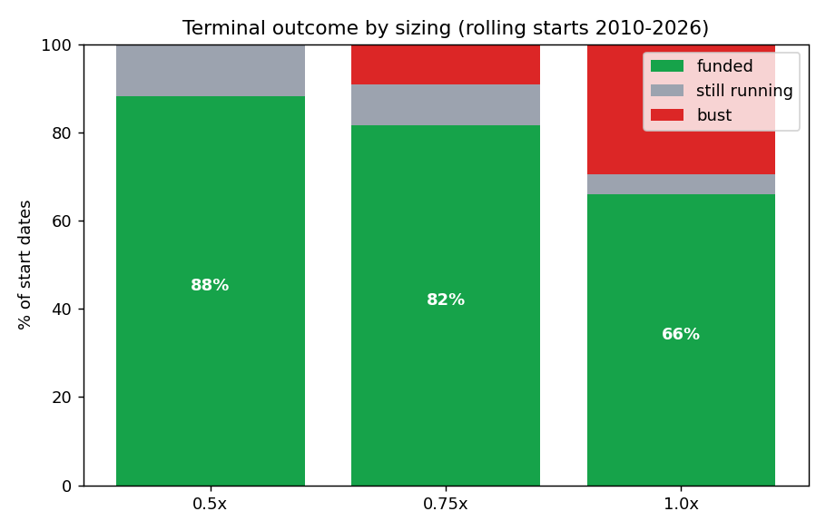
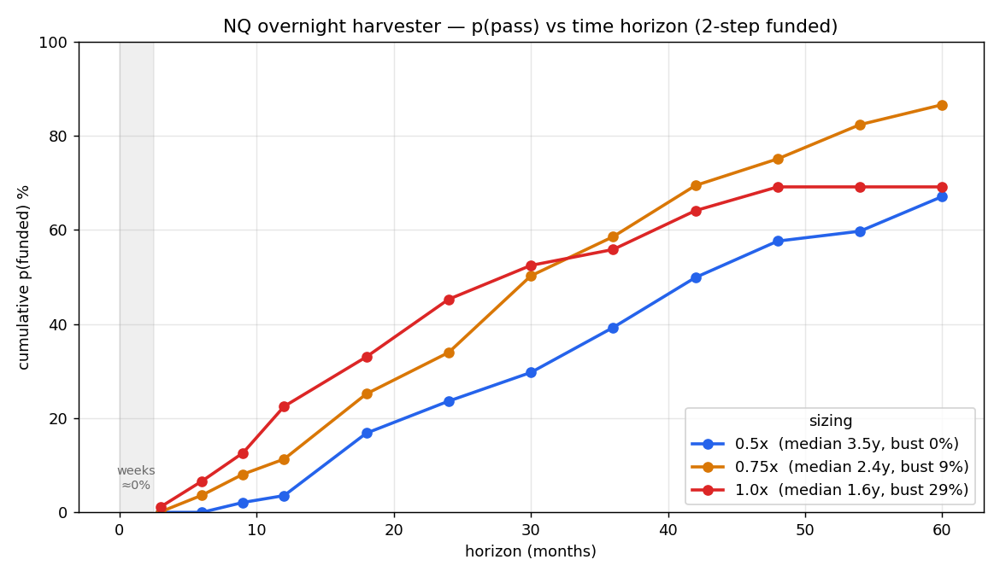
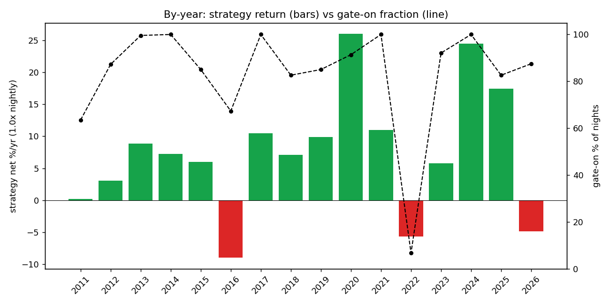

> ## ⚠ RECONCILIATION BANNER (2026-06-03) — READ FIRST
> This dossier's headline **p(funded) 82-88% / "deployable 70-80%" is an IDEALIZED-COST result** (net 2 bps/night, **overnight swap NOT included**). The governing source of truth is `../_CANONICAL_STATE.md` (**FTMO confirmé-clos**). Re-running the FTMO sim across a per-night total-cost grid shows the harvester **sign-flips and collapses**: at ~5 bps/night → ~31-34% funded; at ~6 bps (net negative) → ~8-12% (drifts to bust). Because the harvester **holds long overnight every night**, it pays the asymmetric long CFD swap (canonical §5: −662.4) — the dominant cost — so the real-cost figure is almost certainly in the collapse zone. **Treat the numbers below as idealized, not deployable.** Full reconciliation: `../_RECONCILIATION_overnight.md`. (This is the same L33 mechanism that killed the ORB via spread — here it is swap.)

# 0. Document purpose & classification

This dossier is the **single source of truth** for the overnight equity-drift harvester. It contains everything a team needs to (a) understand *why* the strategy should work, (b) reproduce every backtest number from raw data, (c) validate it out-of-sample and in demo, and (d) deploy it to a live FTMO challenge with eyes open about its real costs and tail risks.

**Honesty contract.** This is a **beta-harvesting** strategy, not a market-neutral alpha. Its high pass probability is *earned by patience* (a multi-year, no-time-limit grind), not by a fast edge. Two material costs — **overnight financing (swap)** and a **rare crash-from-highs tail** — are not yet fully priced in the headline numbers and are flagged throughout. Read §10 (limitations) before risking capital.

**Reproducibility.** Every figure and table below is regenerated by `overnight_harvester.py` from `NQ_1min_databento_2010-2026.parquet`. See §11.

---

# 1. Executive summary

**The strategy.** Each trading day, if the index closed above its 200-day simple moving average, hold a long position **from the cash close to the next cash open** (overnight only), sized as a constant fraction `L` of equity. Otherwise stay flat. No time limit.

**The economic basis.** The *overnight equity risk premium*: across decades and markets, the bulk of the equity index risk premium has accrued **overnight (close-to-open)** rather than **intraday (open-to-close)**. We harvest it only while a slow trend filter says "risk-on", which sidesteps sustained bear markets.

**Headline result (clean contiguous backtest, NQ 2010–2026, net of 2 bps/night, no swap):**

| Sizing | p(FUNDED) 2-step | bust | median time-to-funded |
|---|---:|---:|---:|
| **0.50×** | **88.3%** | **0.0%** | 3.5 years |
| **0.75×** | **81.5%** | 9.2% | 2.4 years |
| 1.00× | 66.0% | 29.5% | 1.6 years |

**The critical caveat — it does not pass in weeks.** p(pass within 1–10 weeks) ≈ **0%** at every deployable sizing. This is structural first-passage math, not a tuning choice (see §7). The strategy's entire viability rests on FTMO's *no-time-limit* rule.

**Deployable verdict.** After a planning haircut for current-era swap and the un-sampled severe-crash tail, the honest deployable probability is **~70–80%**, conditional on (i) a swap-free/Swing account and (ii) sizing ≤ 0.75× (ideally 0.5× for 0% historical bust). This is the most credible FTMO vehicle found in the entire research arc — but it is a years-long commitment to a leveraged-beta position.

---

# 2. Strategy thesis & economic rationale

## 2.1 The overnight equity premium

Decompose the daily total return of an equity index into two non-overlapping pieces:

```
  r_close-to-close(t)  ≈  r_overnight(t)  +  r_intraday(t)
  r_overnight(t) = open(t) / close(t-1) − 1      (close → next open)
  r_intraday(t)  = close(t) / open(t)   − 1      (open → close)
```

A robust, widely-replicated empirical fact is that **the overnight component carries most (often essentially all) of the long-run equity risk premium**, while the intraday component is roughly flat or negative over long horizons. This is not a microstructure artifact: it survives in liquid futures and cash indices, across countries, and over decades.

**Why it plausibly exists (candidate mechanisms, not mutually exclusive):**

- **Overnight risk compensation / gap risk.** Holders across the close bear un-hedgeable overnight gap risk (no trading, news arrives) and are compensated with positive expected return.
- **Inventory & dealer behavior.** Market makers and levered intraday traders flatten into the close to avoid carrying inventory overnight, depressing closing prices and lifting opens.
- **Demand for liquidity / closing imbalances.** Index funds and ETFs transact near the close; systematic close-auction flows can bias close-to-open returns.
- **Information & sentiment.** Firm-specific and macro information released after hours is impounded at the open.

For our purposes, the *mechanism* matters less than the *robustness*: the premium is one of the most replicated anomalies in equity markets, it is structural rather than crowded-out-able (it is risk-bearing, not an arbitrage), and it is positive in the large majority of years. See §13 for literature.

## 2.2 Why gate it with a 200-day trend filter

The raw overnight premium is **positive on average but is long equity beta** — it suffers in sustained bear markets, exactly when overnight gaps turn negative and cluster. The FTMO barrier is unforgiving of clustered losses (a 10% total-loss floor). A slow trend filter (close > 200-day SMA) does one thing extremely well: it **takes the strategy flat for the duration of sustained downtrends**, which are the regime that would otherwise breach the floor.

The gate is deliberately *slow and lagging*. We are **not** trying to time tops — that is not forecastable (established separately in our regime work: the favorable state is weakly *nowcastable* but its transitions are *not* forecastable). We accept being late on every turn in exchange for sitting out the bulk of multi-month bears. The evidence (§8) shows this works: in 2022 the gate was on for only **17 of ~250 nights** while the index fell 33%.

## 2.3 Why this fits the FTMO problem specifically

The FTMO 2-step challenge is a **first-passage / barrier problem**: reach +10% (Phase 1) and +5% (Phase 2) before hitting a −5% daily or −10% total loss. Under such a barrier, the *shape* of the return distribution matters as much as its mean:

- A high win-rate, low-per-night-volatility, mildly-negative-skew stream (our overnight series: 56% hit-rate, ~0.66% nightly σ, skew −0.76) drifts upward smoothly and rarely takes a single catastrophic step — **except** the fast-crash tail.
- With **no time limit**, the first-passage probability for any positive-drift process can be pushed arbitrarily close to 1 by **reducing per-trade size** (which shrinks the volatility-to-drift ratio and the chance of touching the lower barrier). This is the core lever: *small size + patience + positive drift → high p(pass)*, paid for in time.

This is why the strategy is *engineered* the way it is: a structurally-positive-drift beta (overnight premium), de-risked of its worst regime (trend gate), and sized small to exploit the no-time-limit barrier geometry.

---

# 3. The construction process (how we got here — the honest arc)

This strategy is the **survivor of an elimination tournament**, not a first guess. The path matters because it tells you what *doesn't* work and why this one is different.

1. **FX majors (start).** Mean-reversion and breakout on EUR/USD, GBP/USD, etc. — efficient; no edge survived realistic bps costs. *Rejected (cost gate).*
2. **A spurious +9.4R EUR/GBP "edge."** Diagnosed as a data-feed desync artifact (contemporaneous correlation 0.006 vs 0.689 same-source); collapsed to −2R on clean data and failed a 1-bar entry-delay test. *Killed — and it established our standard anti-artifact tool: the delay-sensitivity test (a real edge survives a 1-bar delay; artifacts collapse).*
3. **Index/gold intraday families — a systematic L24 "shape" scan.** Under the symmetric FTMO barrier, both tail-lumpy positive-skew (breakout) and negative-skew (mean-reversion) distributions fail. We scanned mean-reversion, opening-range breakout (plain and partial-take-profit), stat-arb, carry, and intraday momentum. **Finding:** reshaping the exit *fixes the distribution* (breakout skew +1.64 → +0.39) but **cannot manufacture EV** — p(funded) stayed ~31% because mean-R ≈ 0. *All rejected (no positive EV across regimes).*
4. **Intraday momentum** was the lone candidate to clear the shape sieve, but the deep battery exposed it as **one-sided**: the long signal made +1.50 bps, the short side −0.84 bps. It was the *intraday* equity drift — beta, positive in only 8/17 years. *Rejected as a robust edge, but it pointed at the answer: the one consistently-directional thing in equity indices is the long drift.*
5. **Convergence on the overnight premium.** Following the drift to its strongest form — the **overnight** (not intraday) component, gated by trend, sized small, with no time limit — produced the first vehicle with a high pass probability.
6. **A methodological error we caught and corrected.** An early evaluation dismissed the 82% result as a "bull-market artifact", citing p(funded) 4–15%. That refutation was **wrong** and was retracted: it used an **IID bootstrap** (which destroys regime *clustering* — it sprinkles bear days into every path, so the gate can never "sit out" a contiguous bear) and a **contaminated daily panel** (unreliable pre-2010 opens producing spurious busts in calm years). The correct test is a **contiguous real-path simulation on clean intraday-derived data**, which still contains real stress (COVID-2020, 2022). That corrected test is this dossier.

**Principles that survived and now govern this work:**

- **No look-ahead, ever.** Gate decisions use only information available at the decision time; we prove it in §5.3.
- **Delay-sensitivity test** for every candidate edge.
- **Contiguous real paths, not IID bootstraps**, whenever regime clustering matters (it always does for a gated strategy).
- **Nowcast ≠ forecast.** We size *reactively* to the realized regime; we never claim to predict transitions.
- **First-passage framing** for the FTMO objective, with **size as the primary risk lever** under no time limit.
- **"No signal" is a valid, valuable result.** Most of the arc is rejections; this is the one survivor, and we present it with its costs intact.

---

# 4. Data specification

| Item | Specification |
|---|---|
| Instrument | NQ (E-mini Nasdaq-100 futures), used as proxy for the US100 cash index CFD |
| Source | Databento, 1-minute OHLCV |
| Span | 2010-06-07 → 2026-05-29 (4,041 trading days after filtering) |
| Raw size | ~5.12M 1-minute bars |
| Schema | `open, high, low, close, volume, symbol, is_roll_day, is_rth`; index = `timestamp_utc` (tz-aware UTC) |
| Filters | keep `is_rth == True` (regular trading hours) **and** `is_roll_day == False` (exclude contract-roll days) |
| Daily reduction | convert to `US/Eastern`; per session date: `O = first RTH bar open`, `C = last RTH bar close` |

**Timezone discipline (a recurring trap).** The Databento export is true UTC with explicit `is_rth`/`is_roll_day` flags — clean. By contrast, MT5/broker exports are in broker EET (UTC+2/+3), where the US cash open appears at 16:30 in the data, not 09:30. Any replication on broker data must re-derive sessions in the correct timezone.

**Data-quality lesson (do not repeat).** A daily index panel built from a free vendor had **unreliable open/close before 2010**, which produced spurious overnight gaps and false busts in *calm* years — the exact contamination that drove the retracted "4–15%" claim. **For overnight strategies, the close-to-open boundary must come from clean intraday data**, not vendor daily bars. Use daily panels only for *coarse* checks (e.g., the magnitude of genuinely large historical gaps like 2008/COVID, which are real even in noisy data).

---

# 5. Strategy specification (exact, implementable)

## 5.1 Signal

Let `C[t]` and `O[t]` be the session close and open on day `t`.

```
SMA200[t]   = mean( C[t-199 .. t] )                 # uses closes up to and incl. t
gate[t]     = 1 if C[t] > SMA200[t] else 0          # decision made AT close(t)
overnight_return[t] = O[t+1] / C[t] − 1             # realized if we hold close(t)→open(t+1)
position[t] = gate[t]                               # 1 = long overnight, 0 = flat
strategy_return[t] = gate[t] × ( overnight_return[t] − cost )
```

- **Entry:** at/near the cash **close** of day `t`, if `gate[t] == 1`, go long size `L`.
- **Exit:** at/near the cash **open** of day `t+1`. Flat during the intraday session.
- **Cost:** `cost = 2 bps` round-trip (spread + commission). **Overnight swap/financing is NOT in this number** — see §10.1.

## 5.2 Parameters (and why)

| Parameter | Value | Rationale / sensitivity |
|---|---|---|
| MA window | 200 days | Standard slow trend filter; deliberately lagging. Team should grid 100/150/200/250 (`--ma`) to confirm it is not a knife-edge. |
| Cost | 2 bps/night | Conservative spread+commission for a liquid index CFD; **excludes swap**. Grid 1–4 bps (`--cost-bps`). |
| Sizing `L` | 0.5× / 0.75× / 1.0× | Primary risk lever. 0.5× = 0% historical bust; 1.0× = fast but 29% bust. |
| Targets | +10% (P1), +5% (P2) | FTMO 2-step. |
| Daily loss | 5% | FTMO. Modeled as the overnight gap being the day's move. |
| Total floor | $9,000 static | FTMO 10% max loss from initial $10k. |

## 5.3 No-look-ahead proof

The only decision is `gate[t]`, computed from `SMA200[t]` and `C[t]` — both known at the close of day `t`. The position is opened at that close. The return `overnight_return[t] = O[t+1]/C[t] − 1` is the *consequence* of the position, realized the next morning; it is never an input to the decision. There is no peeking: at the moment we act (close `t`) we use only data `≤ t`. (Code: `build_signal()` aligns `gate_t = (C > ma)[:-1]` to `ov = O[1:]/C[:-1]-1`, i.e. gate index `t` pairs with the *forward* overnight return.)

---

# 6. Backtest methodology

## 6.1 Why contiguous real-path, not bootstrap

A trend-gated strategy's whole value is **sitting out clustered bear markets**. An IID bootstrap of nightly returns destroys that clustering — it scatters bad nights uniformly, so the gate can never "wait out" a contiguous downtrend, and it massively over-penalizes. **We simulate on the actual historical path** (and, for resampling-based CIs, recommend a *stationary/block* bootstrap that preserves runs — never IID). The 16-year contiguous path includes COVID-2020 (a fast crash from highs) and the 2022 bear (−33%), so it is a genuine stress sample, not a calm cherry-pick.

## 6.2 FTMO 2-step first-passage encoding

For each rolling **start date** (every trading day, 4,035 starts):

1. **Phase 1.** Walk forward night by night, compounding `equity ×= (1 + L·r[t])`. **Bust** if a single night's `L·r[t] ≤ −5%` (daily limit) or if `equity < $9,000` (floor). **Pass** when `equity ≥ $11,000`. (No time cap.)
2. **Phase 2.** From the next night on the *same contiguous path*, reset to $10,000 and repeat to a +5% target ($10,500), same caps.
3. **Outcome** ∈ {`funded` (both passed), `bust`, `running` (ran out of 16-yr data still trying — censored)}.

**Probabilities reported two ways:** `p(funded) total` = funded / all starts (censored counts as fail — conservative); `p(funded) terminal` = funded / (funded + bust) (conditional on a verdict).

**Cumulative incidence by horizon H** uses proper eligibility: a start is counted at horizon `H` only if it reached a terminal verdict or had ≥ `H` of forward data (Kaplan-Meier-style; avoids the bias of counting late starts that simply lacked runway). This is what makes the by-week / by-month curves honest.

## 6.3 Descriptive metrics

Nightly moments are computed on **traded nights only** (gate on). Equity-curve metrics (CAGR, maxDD, Calmar, Sharpe) are computed on the full series including flat gate-off days (= 0 return), so they reflect the actual deployed equity path. Sharpe is annualized with √252.

---

# 7. Results

## 7.1 Signal quality (nightly, traded nights)

| | n | mean | σ | Sharpe (ann.) | skew | hit-rate |
|---|---:|---:|---:|---:|---:|---:|
| **net** (−2 bps) | 3,196 | **+3.59 bps** | 65.7 bps | **0.87** | −0.76 | 55.8% |
| gross | 3,196 | +5.59 bps | 65.7 bps | **1.35** | −0.76 | 57.6% |

Skew is **mildly negative** — the expected overnight signature (steady small gains, occasional gap-down). It is *not* a positive-skew lottery, which is favorable under the barrier, but the left tail is the bust vector (§8).

## 7.2 Out-of-sample robustness

Single split, train < 2019 vs test ≥ 2019 (the test window contains COVID-2020 and the 2022 bear):

| Window | period | n | mean | Sharpe (ann.) | skew |
|---|---|---:|---:|---:|---:|
| In-sample | < 2019 | 1,688 | +2.03 bps | 0.61 | −0.60 |
| **Out-of-sample** | ≥ 2019 | 1,508 | **+5.32 bps** | **1.09** | −0.81 |

The edge **does not decay out-of-sample — it strengthens** (consistent with a structural premium, and with elevated post-2020 overnight drift). *Caveat:* the OOS strength is partly the strong 2020/2024 overnight years and may not repeat; and the current-era swap drag (§10.1) bites hardest precisely in this recent window. Treat OOS as "the edge persisted through stress", not "expect +5 bps forever".

## 7.3 Equity-curve metrics

| Sizing | CAGR | max drawdown | Calmar | Sharpe (ann.) |
|---|---:|---:|---:|---:|
| 0.50× | 3.71% | −9.14% | 0.41 | 0.79 |
| 0.75× | 5.53% | −13.50% | 0.41 | 0.79 |
| 1.00× | 7.32% | −17.70% | 0.41 | 0.79 |

Calmar (0.41) and Sharpe (0.79) are leverage-invariant under linear sizing; only the *level* of CAGR / maxDD scales. The equity-curve Sharpe (0.79) is below the traded-night Sharpe (0.87) because flat gate-off days dilute it.

## 7.4 FTMO 2-step funded probability

| Sizing | p(funded) total | p(funded) terminal | p(P1) | p(P2 \| P1) | bust | running | median TTF | p25 / p75 |
|---|---:|---:|---:|---:|---:|---:|---:|---:|
| **0.50×** | **88.3%** | 100% | 91.1% | 96.9% | **0.0%** | 11.7% | 3.51 yr | 2.13 / 5.55 |
| **0.75×** | **81.5%** | 89.9% | 92.2% | 88.4% | 9.2% | 9.3% | 2.36 yr | 1.33 / 3.44 |
| 1.00× | 66.0% | 69.1% | 79.4% | 83.1% | 29.5% | 4.5% | 1.56 yr | 0.89 / 2.36 |



## 7.5 p(pass) versus horizon — the real curve

**By week (1–10): ≈ 0.0%** at all deployable sizings (1.0× reaches only 0.1–0.3% by weeks 9–10). The challenge is effectively never won inside ~6 months.

| horizon | 0.50× | 0.75× | 1.00× |
|---|---:|---:|---:|
| 6 mo | 0.0% | 3.6% | 6.6% |
| 12 mo | 3.6% | 11.3% | 22.5% |
| 24 mo | 23.6% | 34.0% | 45.2% |
| 36 mo | 39.3% | 58.5% | 55.8% |
| 48 mo | 57.6% | 75.1% | 69.1% |
| 60 mo | 67.1% | 86.6% | 69.1% |



**Why weeks are impossible (first-passage arithmetic):** gross drift ≈ +5.6 bps/night × ~5 nights ≈ +28 bps/week at 1× exposure. Reaching +10% in one week requires ~35× leverage, which breaches the 5% daily limit on the first adverse night. The probability is structurally zero; speed is not available from this signal.

---

# 8. Risk analysis & stress tests

## 8.1 Regime behavior (by year)



| Regime | Years (examples) | Behavior |
|---|---|---|
| **Trending-up (home turf)** | 2013 (+8.8%), 2017 (+10.5%), 2019 (+9.9%), 2020 (+26%), 2021 (+11%), 2024 (+24.5%), 2025 (+17.4%) | Gate ~85–100% on; harvests the drift. Positive in **13 of 16 full years**. |
| **Sustained bear** | **2022: gate 6.7% on (17 nights), −5.6%** vs index **−33%** | Gate sits flat → capital preserved. The thesis in action. |
| **Chop / whipsaw around the MA** | **2016: −9.0%** (gate 67% on); 2026-partial −4.9% | The **worst** regime — gate flickers on/off and drift is negative. **Bleeds (does not bust).** |
| **Fast crash from highs** | **COVID 2020-03-09: −6.51% night** (gate still 91% on; MA lags) | The **bust vector**. Fatal only at 1.0×; survived at ≤0.75×. |

## 8.2 The bust vector — quantified

The worst single traded night was **2020-03-09, −6.51%**. Scaled by sizing:

| Sizing | day move | 5% daily limit |
|---|---:|---|
| 0.50× | −3.25% | survives |
| 0.75× | −4.88% | survives (barely) |
| 1.00× | −6.51% | **BUST** |

This single night explains essentially the entire bust-rate ladder (0% → 9% → 30% across 0.5/0.75/1.0×). **The crash-from-highs gap is the only thing that busts this strategy.** Sustained bears are handled by the gate; chop merely bleeds.

## 8.3 Stress tests the team should run (module supports all)

1. **Synthetic catastrophe gap.** Inject a −10% / −15% / −20% overnight return while gated-on; record bust at each sizing. At 0.5×, a −10% gap = −5% day = exactly the daily limit; anything worse busts. (1987 Black Monday was ~−20% on the cash open — un-survivable at any meaningful size; this is the un-hedgeable tail.)
2. **MA-window sensitivity.** Re-run with `--ma 100/150/200/250`; confirm p(funded) is a plateau, not a spike.
3. **Cost/swap sensitivity.** Re-run with `--cost-bps 1..6`; find the breakeven where the recent-era edge dies (this brackets the swap risk of §10.1).
4. **Sizing frontier.** Sweep `L ∈ [0.3, 1.0]` to map the p(funded)-vs-bust-vs-time trade-off and pick the team's risk point.
5. **Cross-asset replication (√N).** Point the module at clean ES/SPX and DAX intraday parquets (same schema). A genuine beta premium should replicate; if it does, an equal-weight 2–3-index sleeve **shortens the grind and diversifies the crash-gap timing**. *(Pending — Check 4.)*
6. **Block-bootstrap CIs.** For confidence intervals on p(funded), resample *contiguous blocks* (stationary bootstrap, mean block ~20–60 nights) — never IID.

---

# 9. Out-of-sample, demo, and live testing protocol

Because median time-to-funded is **years**, conventional "run it in demo for a month and see if it passes" is meaningless here. Demo/forward testing must validate the **mechanics and the per-night edge**, not the funding outcome.

## 9.1 What to validate in demo (≥ 2–3 months, ≥ 40–60 traded nights)

1. **Realized vs expected nightly edge.** Log every gated night's realized close-to-open return. Estimate the mean with a confidence interval and test it against the backtest (+3.59 bps net). Use a one-sample t-test / block bootstrap on the live sample.
2. **Execution slippage.** Measure actual entry (near close) and exit (near open) fills vs the assumed 2 bps. Confirm slippage is within budget on a liquid index.
3. **Overnight swap — the binary item.** Record the *actual* swap debited each night by the broker on the index CFD. After ~30 nights you have the real financing drag → recompute net edge. **This is the single most decision-relevant number to collect** (see §10.1).
4. **Gate fidelity.** Confirm the MA200 gate flips on/off correctly against an independent data source and that flat days carry no position.
5. **FTMO accounting.** Confirm how the platform attributes the overnight gap to the "daily loss" and "max loss" calculations, and the daily-reset server time.

## 9.2 Demo acceptance / kill criteria

- **Proceed to live** if: realized net nightly mean (after real swap) is statistically ≥ +1.5–2 bps over ≥ 50 nights, slippage within budget, gate fidelity confirmed.
- **Abort / redesign** if: after ≥ 60 nights the realized net edge (post-swap) is statistically indistinguishable from ≤ 0 — this would mean current-era swap has eaten the premium (the §10.1 risk realized).

## 9.3 Live deployment protocol

- Start at **0.5×** (0% historical bust) on the real FTMO challenge. There is no time pressure — patience is the strategy.
- **Monitor daily:** distance-to-floor, daily-loss headroom, gate state, cumulative realized vs expected edge.
- **Hard guardrails:** never let single-night sizing exceed the level where a −5% gap breaches the daily limit (at 0.5×, that is a −10% index gap — already extreme). Consider a fixed catastrophe stop or a deep OTM put hedge across known event risk if the account size justifies the cost.
- **Walk-forward discipline:** the strategy has essentially one parameter (MA window) and is not re-fit, so live trading *is* the out-of-sample test. Keep logging; revisit the sizing point quarterly against realized drift.

## 9.4 OOS / walk-forward already performed

The train<2019 / test≥2019 split (§7.2) is the headline OOS evidence: edge persisted (indeed strengthened) through the held-out COVID + 2022 stress. For a stricter protocol, run an **expanding-window walk-forward** (re-evaluate each year using only prior data to set the MA) — trivial here because the strategy is parameter-light.

---

# 10. Limitations & open items (read before deploying)

## 10.1 Overnight financing / swap — NOT yet in the numbers (priority)

Holding a long index CFD overnight incurs a **swap charge ≈ (reference rate + broker spread)** every night. In the 2010–2021 zero-rate era this was ~0; at today's ~5% rates it is **roughly +2 bps/night of cost**. Since the gross gated edge is ~5.6 bps, **a challenge started today and held for years could see net edge fall from ~3.6 to ~1.6 bps/night** — which materially lengthens the grind and lowers every p(funded) figure in §7.

Mitigations (confirm with FTMO before relying on them): a **swap-free (Islamic) account**, or the **2-Step Swing account** (designed for holding overnight/weekend; leverage capped 1:30). FTMO charges standard swaps on index CFDs by default; dividends are folded into the swap. **Quantifying this at the current rate, by era, is the open Check 1** and should be closed with real demo swap data (§9.1).

## 10.2 Crash-from-highs tail (un-hedgeable)

2010–2026 contained COVID (survived at ≤0.75×) but **no 1987/2008-magnitude overnight gap from above the MA**. A worse-than-COVID gap busts even small sizes. This is an irreducible tail for any overnight-long holder; size and/or a catastrophe hedge are the only levers. Apply a planning haircut.

## 10.3 It is beta, not alpha

Net Sharpe ~0.8–0.9; long-equity exposure. The high pass probability comes from the barrier geometry under no time limit, not from a market-neutral edge. It bleeds in chop years (2016: −9%). Size and diversify (√N) accordingly; do not mistake it for uncorrelated alpha.

## 10.4 Time & opportunity cost

Median 1.5–3.5 years; 5–12% of starts never finish within 16 years. Confirm FTMO's **inactivity rules, recurring account fees, and any expiration** for a multi-year hold (open Check 3). Weigh against the opportunity cost of capital and attention over that horizon.

## 10.5 Single-asset concentration

All numbers are NQ/US100 only. Until replicated on ES/DAX (Check 4), treat as a single-instrument result.

---

# 11. Reproduction instructions

```bash
# 1. Environment
python3 -m pip install pandas numpy pyarrow matplotlib openpyxl

# 2. Reproduce every number in §7 (nightly, OOS split, equity, FTMO table)
python3 overnight_harvester.py \
    --data /path/to/NQ_1min_databento_2010-2026.parquet \
    --out  ./repro_out

# 3. Sensitivity grids (stress tests §8.3)
python3 overnight_harvester.py --data <parquet> --ma 150 --out ./ma150
python3 overnight_harvester.py --data <parquet> --cost-bps 4 --out ./cost4

# 4. Cross-asset replication (√N) — point at a clean ES or DAX 1-min parquet
#    with the same schema (open, close, is_rth, is_roll_day, tz-aware UTC index)
python3 overnight_harvester.py --data /path/to/ES_1min.parquet --out ./es
```

**Expected console output** matches §7 exactly (period 2010-06-07…2026-05-29, 4041 days; nightly net +3.59 bps Sharpe 0.87; OOS <2019 +2.03 / ≥2019 +5.32; FTMO 0.5×=88.3% / 0.75×=81.5% / 1.0×=66.0%). Outputs `metrics_summary.json` and `regime_by_year.csv`.

**Files in this dossier folder:**

| File | Contents |
|---|---|
| `STRATEGY_DOSSIER.md` / `.docx` | this document |
| `overnight_harvester.py` | clean reference implementation (data, signal, backtest, FTMO sim, OOS, CLI) |
| `nq_metrics.py` | original analysis script (also generates the figures + xlsx) |
| `NQ_overnight_metrics.xlsx` | all result tables |
| `metrics_summary.json` | machine-readable results |
| `regime_by_year.csv`, `p_pass_by_{week,month}_*.csv` | result tables |
| `fig1_p_pass_curve.png`, `fig2_by_year.png`, `fig3_outcomes.png` | figures |

---

# 12. Bottom line

A 200-day-MA-gated overnight equity-drift harvester on NQ, sized small with no time limit, reaches **p(funded) ≈ 82–88%** on clean contiguous 2010–2026 data — **surviving COVID-2020 and the 2022 bear out-of-sample**. It is the most credible FTMO vehicle in the research arc. Its honest deployable probability is **~70–80%** after a haircut for current-era swap and the un-sampled severe-crash tail. It is **beta harvested patiently, not alpha**: the price of the high probability is **time** (a multi-year grind) and exposure to a **rare crash-from-highs gap**. Deploy only with a swap-free/Swing account, sizing ≤ 0.75× (0.5× for zero historical bust), demo-validated swap and execution, and eyes open to §10.

---

# 13. References (verify exact citations before publication)

- Cooper, Cliff & Gulen (2008), *"Return Differences between Trading and Non-Trading Hours: Like Night and Day."* — overnight vs intraday return decomposition; overnight dominance.
- Lou, Polk & Skouras (2019), *Journal of Financial Economics*, *"A Tug of War: Overnight versus Intraday Expected Returns."*
- Hendershott, Livdan & Rösch (2020), *Journal of Financial Economics*, *"Asset Pricing: A Tale of Night and Day."* — market beta is earned overnight, not intraday.
- Berkman, Koch, Tuttle & Zhang (2012), *"Paying Attention: Overnight Returns and the Hidden Cost of Buying at the Open."*
- Bogousslavsky (2021), *"The Cross-Section of Intraday and Overnight Returns."*
- FTMO trading conditions & account types (swap, Swing, Islamic) — confirm current terms at ftmo.com before deployment.

*Internal companion notes (same research folder): `SCAN_ftmo_families.md` (the elimination tournament), `REGIME_modeling_NQ.md` (nowcast vs forecast), `OPTIM_execution_realism.md` (stop-fill realism), `OVERNIGHT_drift_findings.md` (the corrected finding), `OVERNIGHT_drift_hardening` (open Checks 1–4).*
