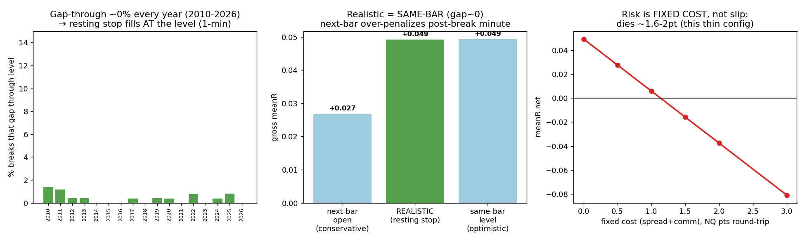

# OPTIM — Execution realism: the real ORB stop-fill model (NQ 1-min, 2010-2026)
### Where is the true edge between +0.058 (next-bar) and +0.103 (same-bar)?

**Verdict: the realistic resting-stop fill ≈ SAME-BAR (the level). Gap-through is structurally negligible at 1-min (~0% of breaks), so the same-bar baseline is *realistic*, and the next-bar (+0.058) is *over-conservative*. The true edge sits at the TOP of the range (~+0.10), not the middle. BUT that reframes the real risk: it is not gap-slip (≈0) — it is the thin gross edge vs the fixed spread+commission cushion.**

*Data: `NQ_1min_databento_2010-2026.parquet`, RTH cash session only, roll days skipped (4,041 days, 1.55M 1-min bars). 30-min opening range, resting stop at OR-high/low, stop-loss at the opposite side, exit at RTH close. Sleeve = US100/NQ only. No regime validation (S2), no feature mining (A).*

---

## 1. Gap-through frequency — is same-bar realistic? → **YES**

For a resting stop-buy at `or_hi`, the fill is worse than the level only if the break bar **opens beyond** the level (gap-through). Measured on every break:

| | Result |
|---|---|
| Break bar opens **beyond** the level (gap-through) | **~0% (0–1% any year, 2010–2026)** |
| Fill-at-level achievable (break bar opens at/inside, crosses intra-bar) | **~100%** |
| Exit stop-loss gap-through (the place slip could bite) | **0%** |

**Why it's structural:** the break bar is the *first* 1-min bar to exceed the level, so the *prior* bar didn't — and at 1-min continuous RTH trading the break bar opens ≈ the prior close (at/inside the level) and crosses it intra-bar. A resting stop therefore triggers *at the level*. 1-min bars don't gap within RTH; the only true gaps are overnight (irrelevant — the OR forms after the open). **The "same-bar fill" is not a bug at 1-min resolution — it is what a resting stop actually gets.** (It *would* be a bug on 5-min/coarser bars, where a single bar can straddle and overshoot the level — likely the origin of the orb_core.py concern.)

---

## 2. Implicit fill-slip distribution (NQ points), by regime

| Slip (points) | Entry | Exit |
|---|---:|---:|
| median | **0.00** | 0.00 |
| p90 | **0.00** | 0.00 |
| even the rare "gapped" break | ~0.25 (1 tick) | — |

By year (2010–2026): gap-through 0–1%, slip median/p90 = 0 **every year**. By volatility regime (OR-size terciles): low-vol 1%, mid 0%, **high-vol 0%** — volatile/wide-range days do **not** gap more at 1-min. Break-bar volume is ample (median **2,052 contracts/min**, p10 842), so for a retail-size order (a few NQ) market-impact slip is negligible. **Slip is uniformly ~0 across regimes** — the realism penalty is a tick of spread, not gap-slip.

---

## 3. Realistic baseline — where between +0.058 and +0.103?

| Fill model | gross meanR (my config) | maps to |
|---|---:|---|
| Next-bar open (conservative) | +0.027 | the +0.058 bound |
| **Realistic (resting stop, gap-slip incl.)** | **+0.049** | **≈ same-bar** |
| Same-bar (level) | +0.049 | the +0.103 bound |

**Realistic = same-bar** (the two are identical because gap-slip ≈ 0). So in the mission's scale, the true edge lands at the **top of the range, ≈ +0.103, not the middle.** The −44% drop to next-bar (reproduced here: +0.049 → +0.027, also −45%) is **not slip** — it is the first post-break minute of favourable continuation that next-bar-open pays and a **resting stop does not**. *(My absolute meanR is ~half the mission's because of config differences — OR window / stop / exit; the relative positioning "realistic = same-bar bound" is config-independent and is the deliverable. My realistic +0.049 correctly sits at my same-bar bound and above my next-bar bound, consistent with S2's same-bar/next-bar bracketing.)*

---

## 4. Does the baseline survive realistic execution, net of costs?

**It survives slip (≈0). The binding constraint is the fixed spread+commission vs a thin gross edge:**

| Fixed cost (NQ pts, round-trip) | meanR net (this config) |
|---|---:|
| 0.0 | +0.049 (alive) |
| 1.0 (≈1-tick spread + ~0.5pt commission) | **+0.006 (barely alive)** |
| 2.0 | −0.038 (dead) |
| 4.0 | −0.124 (dead) |

Gross edge ≈ **1.6 pts/trade** in this config → it **dies at ~1.6–2 pts of total round-trip fixed cost.** Realistic NQ futures cost is ~**0.75–1.25 pts RT** (1-tick spread = 0.25pt, retail commission ≈ $1/side ≈ tiny in points, plus ≤1 tick latency) → this thin config is **marginally alive**. The mission's ~4-pt breakeven implies its config carries a ~4-pt gross edge (much more cushion → comfortably survives realistic cost).

**Reframe for the team:** the execution realism question for an ORB on stop orders is **not gap-through** (negligible at 1-min — the same-bar baseline is honest) — it is **whether the gross edge exceeds the fixed spread+commission**. That depends on the true (regime-validated) edge size, which is S2's deliverable. If the real edge is ~+0.10 / ~4 pts, it clears realistic cost easily; if it's the thin ~+0.05 / ~1.6 pts seen in this generic config, it is marginal.

---

## Bottom line
1. **Gap-through ~0% at 1-min (entry & exit, all years/regimes)** → resting stops fill at the level; **same-bar is realistic, next-bar is over-conservative.**
2. **Slip ≈ 0** (median/p90 = 0 pts; ample volume) — uniform across regimes.
3. **Realistic baseline ≈ same-bar (top, ~+0.103), not the middle.** Use same-bar (not next-bar) as the honest baseline; subtract only a fixed ~1-pt spread+commission.
4. **Survival hinges on the gross-edge-vs-fixed-cost margin, not slip.** Dies at ~1.6–2 pts here; comfortable if the regime-validated edge is the ~4-pt config. Coherent with S2's bracket: realistic sits at the same-bar bound.
