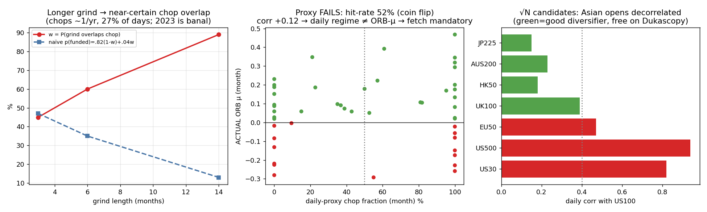

# OPTIM — Bounding regime risk on free data
### Mission: quantify w, decide the $200 fetch, scope the √N fix. Orthogonal to sizing (no sweep re-run).

**Headline:** chops are **common (~1/yr, 27% of days; 2023 is banal, not rare)** → a 14-month down-sized grind overlaps a chop with probability **w ≈ 89%**. The naïve composition collapses p(funded) toward **~13%**. **BUT the daily→ORB-μ proxy is a coin flip (hit-rate 52%)**, so the daily landscape does **not** validly characterise ORB regime risk → **the $200 intraday 2008-2025 fetch is mandatory, not avoidable.** The cheaper, higher-value move is the **√N fix on free Dukascopy data** (Asian opening-auction indices), which attacks regime risk structurally *and* shortens the grind (lowering w directly).

*All daily-regime work is a **proxy**; Step 2 tests its validity and finds it fails — read that before trusting w.*

---

## 1. w — chop-overlap weight (the number that weights Claude Code's "chop→4%")

Data: local daily NDX (=US100) and DAX (=GER40), 2008–2025 (free, in-repo). Features: Lo-MacKinlay variance-ratio(5,10), 20-day trend strength, 20-day realised-vol percentile. **Sustained chop** = mean-reverting (VR<1) + weak trend, smoothed, contiguous ≥40 trading days.

| Sustained-chop landscape 2008–2025 | |
|---|---|
| Episodes | **16 in 17 yrs ≈ 1 / year** |
| Duration | median **~3 mo** (60 td), max **~8 mo** (the 2021-22 episode) |
| Share of all days | **27%** |
| Is 2023 special? | **No — banal.** Comparable chops in 2009, 2011, 2012-13, 2015, 2016, 2018-19, 2020, 2021-22, 2025 |

**w = fraction of grind-windows overlapping ≥1 sustained chop:**

| Grind length | **w** | naïve p(funded) = 0.82·(1−w) + 0.04·w |
|---|---:|---:|
| 3 months | 45% | 0.47 |
| 6 months | 60% | 0.35 |
| **14 months (down-sized)** | **89%** | **0.13** |

**Two honest caveats on this 0.13:**
1. **Binary overlap is over-pessimistic.** "Touches a chop" ≠ "is entirely chop." The real 2022-25 path scored ~89% *through* the 2023 chop because small sizing **survived** a bounded chop and passed in surrounding trend. True p sits between **0.13 (worst) and 0.82 (regime-lucky)** and hinges on whether a chop is long/severe enough to bleed −10% *before* trend rescue (the 8-month 2021-22 type is the danger; a 3-month one is survivable).
2. **More fundamentally — see §2 — this w is built on a daily chop definition that does not track ORB profitability.** So treat w as *market-structure context (chops are frequent)*, **not** a directly-applicable ORB weight.

**Net of §1: the robust takeaway is structural — chops recur ~yearly, so a "down-size and wait 14 months" plan cannot rely on avoiding them; it must rely on *surviving* them, which is the unvalidated unknown.**

---

## 2. Is the daily→ORB-μ proxy reliable? → **NO → the $200 fetch is MANDATORY**

Test (2022–2026 overlap, monthly): does the daily regime label predict the **sign of actual ORB μ**?

| | Result |
|---|---|
| Hit-rate | **52%** (coin flip) |
| Base rate ("always trend") | 69% — **the proxy is worse than guessing** |
| corr(monthly chop-fraction, ORB μ) | **+0.12** (≈0, and wrong sign) |
| By year | 2022 (69% daily-chop) → ORB **+0.13** (best yr); 2025 (59%) → ORB **+0.12**. Only 2023/2024 align. |

**Why it fails:** ORB μ is an **intraday** phenomenon (do opening-range breakouts follow through in the first hours?). Daily variance-ratio/trend measure *daily/multi-day* dynamics. 2023 had a strong *daily uptrend* (+50% NDX) yet ORB-killing *intraday* mean-reversion — daily features cannot see that. This confirms the audit's own warning that the gate link is "non-economic and fragile."

> **DECISION ($200 + 2 weeks): the daily proxy provides NO shortcut. To learn whether μ_ORB stayed positive through 2008/2011/2015-16/2018 chops, you need intraday data — the fetch is OBLIGATORY for the existing US/DE 2-sleeve config.** Do not let the cheap daily landscape substitute for it.

---

## 3. √N fix scope — and "no intraday data" is **false**

The blocker ("intraday not available") is wrong: **Dukascopy offers free 1-min for index CFDs** (the repo already has a bi5 decoder). Free √N candidates, ranked by diversification (daily corr with US100 / GER40, and open timezone):

| Index | corr US100 | corr GER40 | Open (local → EET) | Session | Verdict |
|---|---:|---:|---|---|---|
| **JP225** | **0.15** | 0.36 | 09:00 JST → ~02:00 | Asia | ✅ best diversifier |
| **HK50** | **0.18** | 0.34 | 09:30 HKT → ~03:30 | Asia | ✅ |
| **AUS200** | **0.23** | 0.37 | 10:00 AEST → ~01:00 | Asia | ✅ |
| UK100 | 0.39 | 0.82 | 08:00 GMT → ~10:00 | Europe | ⚠ redundant w/ DAX |
| EU50 | 0.47 | 0.97 | 09:00 CET → ~10:00 | Europe | ❌ ≈ DAX |
| US500/US30/US2000 | 0.78–0.94 | ~0.55 | 09:30 ET → ~16:30 | US | ❌ ≈ US100 |

**Estimated benefit of adding the 3 Asian opening-auction sleeves (2 → ~5 independent +EV sleeves):**
- **Shorter grind:** path variance ∝ ~1/√N → a +10% target is reached faster at the same per-sleeve risk → **the grind drops from ~14 mo toward ~6 mo, which itself cuts w from 89% → ~60%.**
- **Regime decorrelation (the real prize):** Asian opens experience regime shifts on a **different clock and different macro drivers** than US/Europe. A US/Europe chop and an Asian chop rarely coincide, so the probability that *all traded sleeves are simultaneously in chop* (the actual bust condition) falls roughly like w^(N_indep) rather than w. This **directly attacks the μ<0 exposure** that the $200 fetch only *measures*.

*(Exact intraday history depth per instrument must be confirmed at fetch time — Dukascopy index coverage typically starts ~2010–2018 depending on the symbol; that is itself part of validating whether they cover the 2011/2015-16/2018 chops.)*

---

## 4. Recommendation — cheapest path to de-risk regime

1. **Chops are frequent (~1/yr) — the binding risk is real and unavoidable on long grinds.** w(14mo)=89% means "down-size and wait" *cannot* dodge chop; it must survive it.
2. **The daily proxy gives no free pass (hit-rate 52%).** For the *existing* 2-sleeve US/DE config, the **$200 intraday 2008-2025 fetch is mandatory** to know p(funded|chop) across multiple chops — there is no daily shortcut.
3. **But spend the free effort first on √N (Dukascopy 1-min for JP225 + HK50 + AUS200).** It is the higher-leverage, zero-cost move: it shortens the grind (w: 89%→~60%) **and** decorrelates regime timing across continents (joint-chop probability ≪ w). This attacks the regime constraint structurally, where the fetch only quantifies it.
4. **Sequence:** (a) free — build the 3 Asian opening-auction ORB sleeves from Dukascopy, re-measure w and joint-chop on the 5-sleeve ensemble; (b) then, if still warranted, the $200 intraday fetch to backtest the multi-continent ensemble through 2008-2025 chops. Likely the √N step alone reduces regime risk enough that the fetch becomes a confirmation rather than a gate.

**One-line answer:** the regime risk is real and frequent; the daily proxy cannot bound it for the ORB (52% hit-rate → fetch mandatory for the current config); but the **free √N build (Asian opening-auction sleeves) is the cheapest, strongest lever** — it shrinks both the grind and the joint-chop probability at once.
