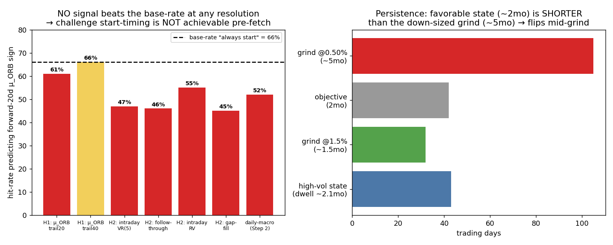

# OPTIM — Can the challenge start be timed?
### H1 (μ_ORB autocorrelation) + H2 (intraday-microstructure regime signal). Daily-macro excluded (dead: 52%).

**Verdict: NO. Challenge start-timing is not achievable pre-fetch at any resolution tested.** μ_ORB is white noise week-to-week (H1), no intraday-trailing feature beats the "always-start" base-rate (H2), and the only directionally-correct feature has a state shorter than the grind (Step 3). This is the valuable conclusion: **stop looking for "when to start" — concentrate the whole effort on *surviving* (sizing), the *per-trade* filter (Claude Code), and *√N* diversification.** Marked **N≈1** (one chop, 2023, in intraday history).

*Method: own ORB trade series (US100+GER40, 3 sleeves, 2022–2025) + intraday M5. All features strictly trailing/lagged (no look-ahead). Target = sign of forward-20-day μ_ORB. Base-rate of "always predict positive" = 66%.*

---

## 1. H1 — does μ_ORB predict itself? (momentum on the edge) → **DEAD**

- **Autocorrelation ≈ white noise:** weekly ACF lags 1–8 ∈ [−0.11, +0.13]; monthly ∈ [−0.06, +0.27] (the lone 0.27 is within noise at this N).
- **Trailing → forward (strictly lagged):**

| Predictor | hit-rate | base-rate | corr |
|---|---:|---:|---:|
| sign(trailing-20d μ_ORB) → forward-20d | **61%** | 66% | −0.02 |
| sign(trailing-40d μ_ORB) → forward-40d | **66%** | 69% | +0.14 |
| non-overlapping (N=56) | 70% | ~69% | +0.13 |

The momentum predictor is **at or below** the base-rate. **You cannot time the start from the strategy's own recent track-record** — a "hot streak" does not predict a hot next month.

---

## 2. H2 — does an intraday regime state predict μ_ORB where daily failed? → **NO**

All features trailing-20d, lagged, → sign of forward-20d μ_ORB (base-rate 66%):

| Intraday-trailing feature | hit-rate | corr | fwd-μ lo→hi tercile |
|---|---:|---:|---|
| Intraday variance-ratio VR(5) | 47% | −0.14 | +0.105 → +0.050 (wrong way) |
| Range-expansion / follow-through | 46% | −0.10 | +0.084 → +0.035 (wrong way) |
| Intraday realized vol | **55%** | **+0.11** | +0.073 → +0.112 (right way, weak) |
| Overnight gap-fill rate | 45% | +0.04 | +0.059 → +0.076 |
| *(daily-macro, Step 2, for reference)* | 52% | +0.12 | — |

**No feature beats the 66% base-rate.** Intraday VR — the hoped-for "intraday analog of the dead daily VR" — is actually *inverse* (high intraday momentum → slightly *lower* forward μ_ORB; noise). The only directionally-sensible feature is **intraday realised vol** (high vol → marginally better ORB, corr +0.11, consistent with the earlier vol-tercile finding) — but at **55% hit-rate it still loses to always-starting (66%)**. It is a real but far-too-weak tendency, not a timing rule.

---

## 3. Persistence / dwell — even the weak vol tendency wouldn't survive the grind

The high-intraday-vol state has a **mean dwell of ~43 trading days (~2.1 months)**.

| | trading days |
|---|---:|
| Favourable (high-vol) state dwell | ~43 (~2.1 mo) |
| Grind @1.5% sizing | ~32 (~1.5 mo) |
| 2-month objective | ~42 |
| **Grind @0.50% sizing (down-sized)** | **~105 (~5 mo)** |

So even if the vol tendency were tradeable (it isn't — 55% < 66%), the favourable state (~2 mo) is **shorter than the down-sized grind (~5 mo)** → it flips before the challenge finishes. Timing helps only the *fast* grind, which is precisely the one with the high bust rate. **Double kill for start-timing on the down-sized approach.**

---

## 4. Honest verdict (N≈1)

**Challenge start-timing is not achievable with any signal testable pre-fetch** — not daily-macro (52%, dead), not the edge's own autocorrelation (H1, white noise), not intraday microstructure (H2, all ≤ base-rate). The favourable-state persistence is also too short for a down-sized grind. Caveat: **N≈1** — only one chop (2023) in the intraday history, so "no signal" is established *within* 2022–2025; a richer history could in principle reveal one (but the within-sample evidence is strongly negative across four feature families).

**Implication — this is the valuable part:** the three levers that *do* exist are now unambiguous, and effort should go entirely there:
1. **Survive** (down-sized / block-capped sizing — the first-passage lever, conditional on μ>0).
2. **Per-trade filter** (Claude Code — conditions on the individual setup, a different and still-open question).
3. **√N diversification** (free Asian opening-auction sleeves — shortens the grind *and* decorrelates regime timing; from the regime-landscape note).

Do **not** budget time on a start-timing rule — it does not exist at testable resolution.

---

## 5. What to re-test once 2008–2025 intraday is fetched

1. **Intraday realised-vol regime** (the only directionally-correct feature, corr +0.11) — across multiple chops (2011, 2015-16, 2018), does a high-vol state predict positive μ_ORB strongly enough to beat base-rate? It is the single candidate worth re-checking with more regime variety.
2. **H1 autocorrelation** at longer horizons with more independent windows (current N too small to rule out a weak monthly effect).
3. The whole exercise should be re-run with the **√N multi-continent ensemble's** μ series (its regime timing differs from the US/DE-only μ tested here).

*Constraints honoured: own 2022–2025 ORB series + intraday only; strictly lagged features; compared to the 66% base-rate; daily-macro not re-played; N≈1 marked; "no timing signal" reported as the (valuable) result.*
