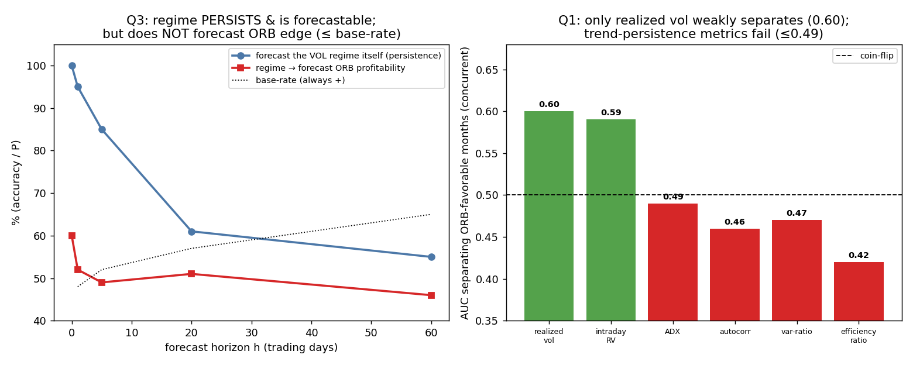

# REGIME_modeling_NQ — Market-regime modeling for the book (NQ 1-min, 2010-2026)
### Strategy-agnostic. Nowcasting (am I in the regime?) held strictly apart from forecasting (will I be?).

**One-line verdict:** the favorable regime is **(a) weakly detectable concurrently** (realized vol, AUC ≈ 0.60 — not the trend metrics), **(b) persistent enough to *react* to** (vol clusters: daily P(stay) 0.95, decaying to base by ~60d), but **(c) NOT predictable in transition, and it does not forecast ORB profitability at any horizon** (regime→forward-ORB-μ ≤ base-rate). So: **you can date the regime, you cannot anticipate it usefully, and dating it only buys a marginal sizing tilt (~+3–8pt, matching the competing vol-gate).** Honest expected result.

*Data: `NQ_1min_databento_2010-2026.parquet`, RTH, roll days skipped. All "predictive" claims use info ≤ t only; "concurrent" = contemporaneous. ORB intrinsic edge ≈ 0 (per audit) — used only as the regime *target*, not feature-mined.*

---

## Q1 — What separates the favorable regime? (concurrent, info ≤ t)

Tested concurrent features vs monthly ORB gross μ (n=190 months), strategy-agnostic price-dynamics:

| Feature | corr w/ ORB μ | AUC (sep. μ>0) | verdict |
|---|---:|---:|---|
| **Realized vol (20d)** | +0.03 | **0.60** | weak separator (best) |
| Intraday RV | −0.01 | 0.59 | weak |
| ADX (trend strength) | −0.09 | 0.49 | none |
| Return autocorrelation | −0.08 | 0.46 | none (inverse) |
| Variance ratio VR(5) | −0.08 | 0.47 | none (inverse) |
| Kaufman efficiency ratio | −0.15 | 0.42 | **inverse** |

**Finding:** the ORB-favorable regime is a **volatility** regime, not a trend regime — and *even vol is only a weak separator (AUC 0.60)*. Counter-intuitively the canonical "momentum/trend-persistence" metrics (VR, ER, ADX, autocorrelation) do **not** align with ORB favorability (AUC 0.42–0.49). The favorable periods are heterogeneous — **2017 was low-vol yet favorable; 2022 high-vol favorable** — so no single concurrent feature cleanly labels them. (Annually the link is clearer: the best ORB years 2022/2023/2024 carried elevated vol — but the monthly signal is noisy.)

---

## Q2 — Persistence & transition (with the N caveat)

- **Favorable-ORB episodes (rolling-3-mo μ>0, sustained):** 17 over 16 years, durations 3–19 months. **But with intrinsic edge ≈0 these are largely random μ-crossings, not regimes.** The *recent* favorable run (2021–2026) is essentially **one extended episode** (the 19-mo 2021-22 block + adjacent stretches) → **N≈1 for "the current good regime" → any duration estimate has an enormous CI; treat as anecdote.**
- **Volatility-regime transition matrix (monthly, concurrent label):** P(stay-low)=0.64, P(stay-high)=0.63; **daily P(stay) = 0.95 (low) / 0.95 (high)** — strong vol clustering. The vol regime is genuinely persistent (this is real and well-established).

---

## Q3 — Nowcasting vs forecasting (the honest test)

| Horizon h | Forecast the **vol regime** itself (persistence) | Regime → forecast **ORB profitability** (hit vs base) |
|---|---:|---|
| concurrent | — (nowcast: AUC 0.60) | AUC 0.60 (weak, Q1) |
| t+1 | P(high\|high)=95% (lift +48pt) | — |
| t+5 | 85% (+38pt) | hit 49% vs base 52% |
| t+20 | 61% (+14pt) | hit 51% vs base 57% |
| t+60 | 55% (+7pt) | hit 46% vs base 65% |

**Two clean, opposite results:**
1. **The regime is forecastable as a *state* (vol clustering):** "high-vol now → high-vol next week" holds strongly (95%/85%), decaying to ~base by 2–3 months. You can anticipate that the *volatility* state persists short-term.
2. **The regime does NOT forecast the *edge*:** knowing the vol regime gives **no** power over the sign of forward ORB μ at any horizon (≤ base-rate; tercile fwd-μ spreads ≈0/inverse). Vol persisting does not mean ORB profitability persists.

**Nowcast works (weakly, AUC 0.60); transition-of-the-edge forecast collapses to coin-flip.** The regime switches (for the *edge*) faster than any feature confirms it — exactly the literature's default and the competing vol-gate's +3–8pt ceiling.

---

## Q4 — A reusable regime module for the book (not an ORB patch)

Design — a **concurrent (nowcasting) regime layer**, explicitly *not* a forecaster:

- **Inputs (all info ≤ t):** realized vol (intraday + 20/60-day), variance ratio / efficiency ratio (momentum-vs-mean-reversion axis), ADX, dispersion. Output: a 2–3 state label {high-vol-momentum / low-vol-grind / chop} updated daily.
- **Use it as a contemporaneous allocation/sizing tilt, reacting to the realized state:**
  - High-vol + high VR/ER → **over-weight momentum sleeves** (TSMOM, breakout) and **size up**.
  - Low-vol grind / low VR (mean-reverting) → **over-weight mean-reversion**, **down-weight breakout**.
- **Why book-wide, not ORB-only:** the VR/ER momentum axis (which failed for the ORB) is the *natural* gate for **TSMOM / trend** strategies whose edge IS daily trend-persistence — it should align far better there than with the vol-driven, noisy ORB. The vol axis is the natural gate for vol-sensitive strategies (options, breakout). The module's value is as a **shared nowcasting overlay** that says "which family is in season," updated continuously.
- **Hard limitation baked into the design:** it is a *reactive* tool (size to the state you're in), **never** a *predictive* one (it cannot call the switch). Use trailing confirmation + accept you'll be late on every transition.

---

## Verdict — the three questions, rigorously separated

| | Question | Answer |
|---|---|---|
| **(a)** | Detectable **concurrently**? | **Yes, weakly.** Realized vol nowcasts the favorable state at AUC ≈ 0.60; trend metrics fail. You can roughly date the regime. |
| **(b)** | Persistent enough to **size conditionally**? | **The vol state: yes** (daily P(stay) 0.95, persists weeks). **But the ORB-edge link is weak**, so conditional sizing yields only a **marginal ~+3–8pt** lift (consistent with the prior vol-gate). Worth it as a tilt, not a transformation. |
| **(c)** | **Transition** predictable (anticipate the switch)? | **No.** Regime persistence is short-horizon forecastable, but the *edge* transition is not (regime→forward-ORB-μ ≤ base-rate at h=5/20/60). You cannot time the switch. |

**Guardrail (as instructed):** even a *perfect* regime detector would not make the ORB propfirm-viable — the ORB is tail-driven and the symmetric drawdown caps massacre the right tail before it pays, and the ORB's μ barely aligns with the regime anyway (AUC 0.60). **Judge this regime module on its book-wide value** (a reactive momentum-vs-mean-reversion allocation overlay for TSMOM/MR/options), **not as an ORB rescue.** For the ORB specifically, regime conditioning is a marginal tilt, not a fix — the honest conclusion is *date the regime, react to it, but do not expect to forecast the transition or to rescue a tail-driven edge under a symmetric barrier.*
