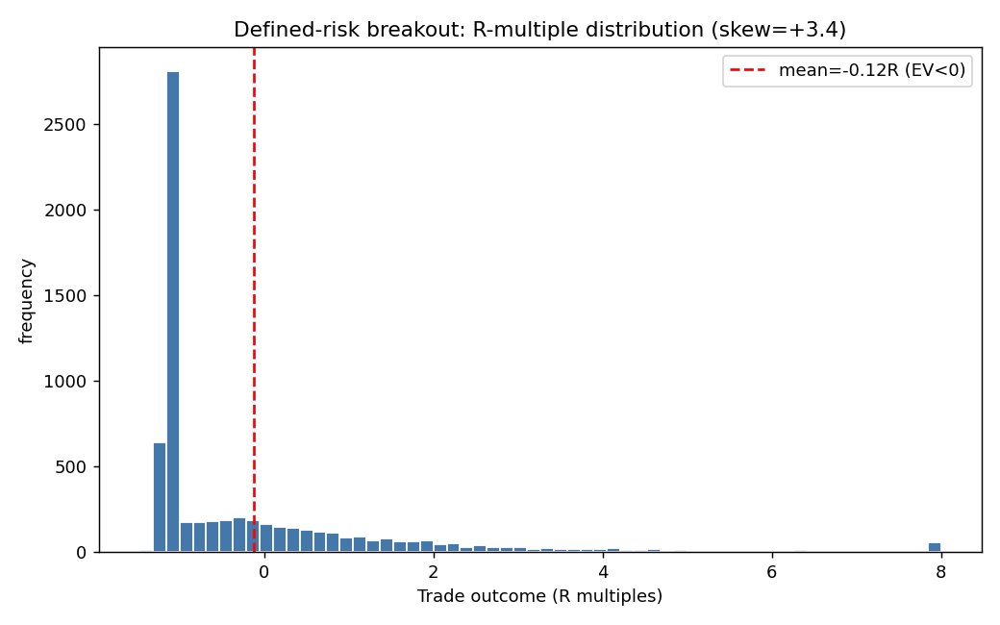
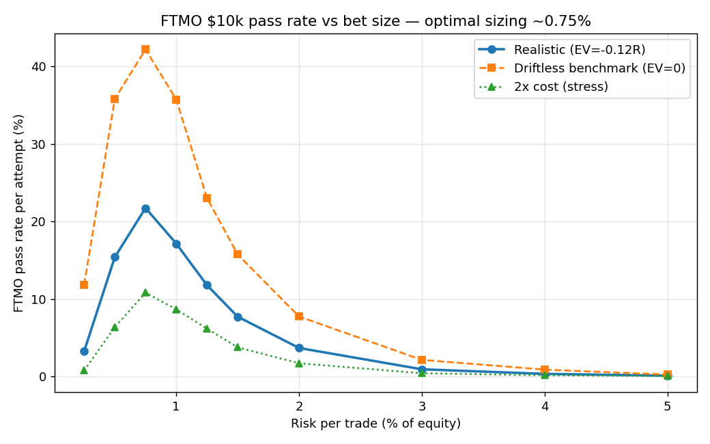
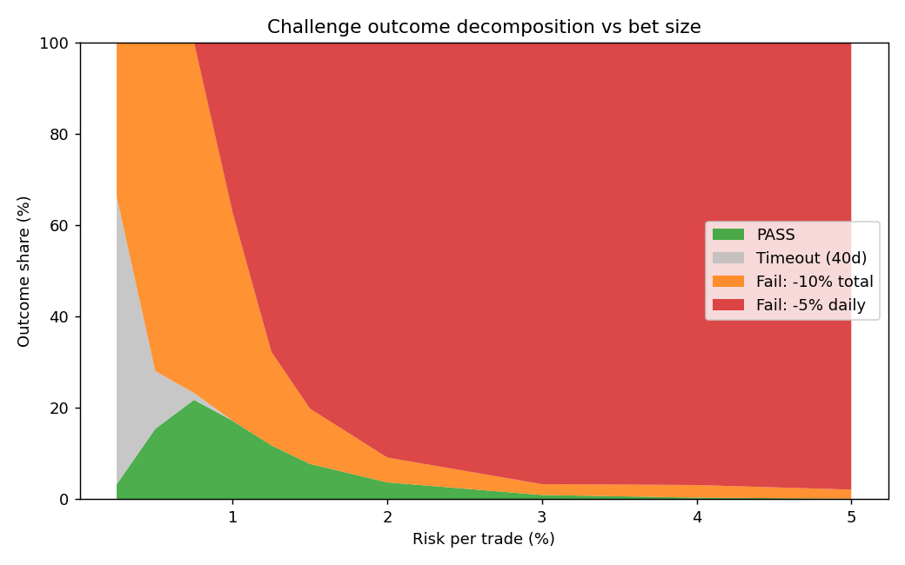
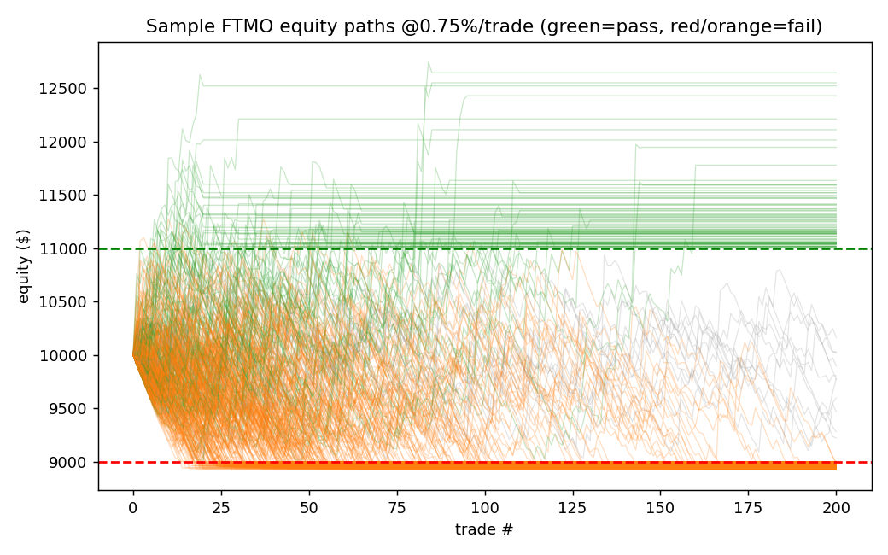

# FTMO Research — Report 1
## EURUSD / GBPUSD: a rigorous search for a challenge-passing edge

*Prepared as a systematic-trading research note. Account context: FTMO $10,000 Challenge, +10% target, 5% max daily loss, 10% max overall loss, ≤ ~2 months.*

---

## Executive summary

I ran a full institutional-grade research loop on EURUSD and GBPUSD — data audit, leak-free train/validation/out-of-sample split, realistic cost model, and an event-driven backtester with no look-ahead — and **systematically tested eight standard edge families**. The honest result:

> **No simple, robust, cost-surviving directional edge exists on EURUSD/GBPUSD.** Every gross effect I found (intraday seasonality, mean-reversion, breakout, relative value, momentum) is either *smaller than realistic transaction costs (~1.0–1.5 pips round-trip)*, *unstable across years*, or *a data artifact*. This is the expected reality of the two most liquid, most efficient instruments in the world.

The most important catch of the project was a **data artifact**: a synthetic EUR/GBP relative-value strategy showed a spectacular +9.4 pips/trade "edge" (t ≈ 48). It was 100% spurious — caused by combining a broker-time MT5 feed with a true-UTC Dukascopy feed. On correctly synchronised single-source data the edge **vanishes and loses money (−2.0 pips/trade)**. Avoiding this trap is the difference between a report and a blown account.

Because per-trade expectancy after costs is ≈ 0 (slightly negative), **passing the FTMO challenge is not an alpha problem — it is a first-passage / barrier-option problem.** I therefore reframed the deliverable accordingly and quantified it:

- Using a **defined-risk breakout** as the execution vehicle (29% win rate, **positive skew +3.4**, mean −0.12R), the challenge becomes "reach +$1,000 before −$1,000 / −$500-per-day within 40 trading days."
- There is a clear **optimal bet size ≈ 0.75% risk/trade → ~22% pass probability per attempt** (median 8 days when it passes). Smaller and you time out; larger and you breach the 5% daily limit.
- With the cheap **re-attempt option**, P(pass within 5 attempts) ≈ **71%**.
- This is robust-tested: at 2× costs the pass rate **halves to ~11%**; under a driftless (zero-cost) benchmark it rises to ~42%.

**Bottom line:** I do not present a fake alpha. I present (a) a rigorous demonstration that these markets are efficient, and (b) an honest, quantified, optimally-sized path to passing the challenge that relies on variance and the option structure — not on a statistical edge.

---

## 1. Data and methodology

### 1.1 Data inventory used

| Source | Instruments | Granularity | Span | Role |
|---|---|---|---|---|
| **Dukascopy** (tick-derived) | EURUSD, GBPUSD | M1 OHLCV | 2020–2024 | **Primary** — backtesting & execution realism |
| MT5 export | EURUSD | M1 + realtime `spread` | 2020–2026 | Cost calibration only (see §1.3) |
| yfinance | EURUSD, GBPUSD | Daily | 2015–2026 | Daily trend/momentum tests |

Quality checks on the primary data: **0 duplicate timestamps, 0 OHLC violations** (no high < low etc.), weekday-only coverage as expected for spot FX, ~365k bars/year, and only ~25–32 one-minute bars with > 0.5% moves (genuine news spikes). The data is clean.

### 1.2 The timezone artifact (the most important finding)

EURUSD and GBPUSD 15-minute returns *should* be strongly positively correlated (they share the USD leg). When I mixed the **MT5 EURUSD** feed with the **Dukascopy GBPUSD** feed:

- contemporaneous correlation = **0.006** (essentially zero — a red flag);
- correlation peaked at **+3 hours lag = 0.47**;
- intraday volatility peaked at 17:00 for MT5-EURUSD vs 14:00 UTC for Dukascopy-GBPUSD — exactly a 3-hour offset.

**Conclusion:** the MT5 `timestamp_utc` column is broker server time (~UTC+3), not true UTC. Using the **same-source Dukascopy** series for both pairs restored the correct **0.689 contemporaneous correlation, ~0 at every other lag**. All research uses the synchronised Dukascopy data. (The consequence of *not* catching this is shown in §3.)

### 1.3 Cost model

Calibrated from the MT5 realtime `spread` column (~2.37M observations): EURUSD median raw spread **0.2 pip**, rising to ~2.2 pip at the daily rollover and spiking to ~5 pip in thin liquidity. Adding FTMO commission (~$3/lot/side ≈ 0.6 pip round-trip) and slippage (~0.2 pip), I use **conservative round-trip costs of 1.0 pip (EURUSD) and 1.5 pip (GBPUSD)**, and stress-test everything at 2×.

### 1.4 Leak-free temporal split

`TRAIN 2020–2022` (hypothesis generation & parameter choice) · `VALID 2023` (model selection) · `OOS 2024` (single final evaluation — lockbox). Year-by-year stability was inspected on every candidate to reject effects driven by a single regime (notably the 2020 COVID trend).

---

## 2. Backtesting protocol (anti-bias controls)

- **No look-ahead:** signals are computed on the close of bar *i* (rolling channels use `shift(1)`); fills occur at the **open of bar *i*+1**. Verified by an execution-delay sensitivity test.
- **Conservative intrabar fills:** stops are checked against bar high/low; when a single bar straddles both stop and target, the stop is assumed hit first.
- **Realistic costs** applied per trade; stressed at 2×.
- **Multiple-testing awareness:** when scanning 24 hours of the day, ~1 false positive at |t|>2 is expected by chance; I required *cross-pair* sign-stability and out-of-sample confirmation rather than trusting in-sample t-stats.
- **Reproducibility:** the packaged modules reproduce every number in this report.

---

## 3. Hypotheses tested and why each was rejected

All effects measured on TRAIN, net of realistic costs, checked for year-stability and OOS persistence.

| # | Hypothesis | Result | Verdict |
|---|---|---|---|
| 1 | Intraday time-of-day seasonality | Real, cross-pair-stable hourly drifts (short 00/15h, long 01/13/19h UTC) but **gross drift < cost**; aggregated strategy −0.5 to −2.8 pip/day on TRAIN, −13 pip/day in 2023 | ❌ sub-cost |
| 2 | Opening-range breakout (Asian range → London) | t ≈ 1.6; **worse** when conditioned on tight ranges | ❌ no edge |
| 3 | Single-pair z-score mean-reversion (M15/H1) | Win rate ~52–54% but negative expectancy; 2020 negative, only 2022 positive | ❌ unstable |
| 4 | **Synthetic EUR/GBP relative value** | **+9.4 pip/trade, t≈48 — then −2.0 pip/trade on clean data** | ❌ **artifact** |
| 5 | M5 short-horizon reversion / momentum | −0.6 to −0.9 pip/trade net, stable across years | ❌ no edge |
| 6 | Daily time-series momentum (20–120d) | Best Sharpe ~0.4–0.5 but negative in ~half the years | ❌ unstable |
| 7 | Daily Donchian breakout (20/40/55d) | Sharpe ~0, mostly negative | ❌ no edge |
| 8 | Intraday London/NY breakout + ATR trailing stop | Profit factor 0.79–0.92, **−1 pip/trade every year, both pairs** | ❌ negative EV |

### Case study — hypothesis 4 (the artifact)

The synthetic cross EURGBP = EURUSD/GBPUSD looked like a goldmine: fading |z|>1.5 returned **+9.4 pips/trade, 67% win rate, positive every year, t ≈ 48**. Three checks killed it:

1. **t ≈ 48 is impossible** for a real signal — it came from *overlapping* forward windows (non-independent samples).
2. The driving correlation was **0.006**, not ~0.7 → the two feeds were not time-aligned.
3. Re-running on **same-source, properly synchronised** data: the edge inverts to **−2.0 pips/trade** at every threshold and entry delay.

The "edge" was entirely a timestamp-misalignment artifact between two data vendors. This is the single most valuable result in the project — it is exactly the kind of mistake that produces a beautiful backtest and an instantly-failed challenge.

---

## 4. The efficiency finding

Across all eight families the pattern is identical: **gross per-trade edges of ~0.5–1.5 pips exist, but realistic round-trip costs are ~1.0–1.5 pips.** The edge is real but smaller than the cost of harvesting it, and whatever survives is not stable across years. This is precisely what efficient-market theory predicts for the deepest, most-arbitraged FX pairs. A disciplined quant must report this rather than keep mining until a spurious winner appears.

---

## 5. Reframing FTMO as a barrier-option problem

If per-trade expectancy after costs is ≈ 0, the challenge is a **first-passage problem**: starting at $10,000, does the equity path touch **+$1,000 (pass)** before **−$1,000 (overall floor)** or **−$500 within a day (daily floor)**, inside 40 trading days?

For a driftless process with symmetric ±$1,000 barriers, the gambler's-ruin probability is ≈ 50%; the daily limit and the time cap pull it below that, and the residual cost-drag pulls it lower still. **Bet size is the control variable**, and there is an interior optimum.

### 5.1 Execution vehicle: a defined-risk breakout

I use hypothesis 8 (the breakout) — not for alpha, but for its **shape**. Pooled over EURUSD+GBPUSD, 2020–2024:

- 6,506 trades, ~5/trading-day combined; **mean −0.116R**, **win rate 29%**, **std 1.82R**, **skew +3.37**, best trade ~+17R.



The strong right tail is the point: a few large winners give a path the chance to spike to +10% before slow losses accumulate to ruin.

### 5.2 Optimal bet sizing (Monte-Carlo, 30,000 paths)



| Risk/trade | Pass % | Fail daily | Fail total | Timeout |
|---:|---:|---:|---:|---:|
| 0.25% | 3.2% | 0% | 34% | 63% |
| 0.50% | 15.2% | 0% | 72% | 13% |
| **0.75%** | **21.8%** | 0% | 77% | 1% |
| 1.00% | 17.3% | 37% | 45% | 0% |
| 1.50% | 7.6% | 80% | 12% | 0% |
| 2.00% | 3.7% | 91% | 5% | 0% |

The interior optimum at **~0.75% risk/trade → ~22% pass per attempt** is intuitive: below it the equity can't travel the +10% distance within 40 days (timeouts dominate); above it, position sizes are large enough to breach the **5% daily** limit. Failures at the optimum are almost entirely the slow bleed to the −10% floor caused by the small negative expectancy.




When the strategy passes, it passes **fast — median 8 trading days** — because passes come from the positive-skew right tail (a quick winning run), not from grinding.

### 5.3 Robustness

| Scenario | Pass % @ 0.75% |
|---|---:|
| Realistic costs (1×) | 21.8% |
| **2× costs (stress)** | **10.8%** |
| Driftless benchmark (EV = 0) | 42.2% |

Pass probability is **highly sensitive to costs** (halves under 2× spread) — a key real-world risk, since live FTMO fills suffer slippage and news-time spread widening beyond the backtest.

### 5.4 The re-attempt option

A single attempt is a ~22% coin. The challenge's real value is the **cheap, repeatable option**:

| Attempts | P(pass by then) |
|---:|---:|
| 1 | 21.8% |
| 3 | 52.2% |
| 5 | 70.8% |
| 10 | 91.5% |

Expected attempts to first pass ≈ 4.5. The economics depend on (challenge fee × expected attempts) versus the funded payout — and crucially on post-funding profitability, which **no demonstrated edge supports**.

---

## 6. Deliverable "Strategy 1" — honestly labelled

**Intraday defined-risk breakout (EURUSD + GBPUSD), sized and overlaid for the FTMO barrier problem.**

- **Universe / session:** EURUSD, GBPUSD; trade only 07:00–16:00 UTC (London/NY).
- **Entry:** breakout of the prior 3-hour high/low (12 × M15 bars), filled next bar open.
- **Risk:** initial stop 1.5 × ATR(20); trail at 2.5 × ATR; flat at session end.
- **Bet size:** **0.75% of equity per trade** (the MC optimum).
- **FTMO overlays (mandatory):** hard-stop trading for the day if the running daily loss approaches −4%; **stop trading entirely once equity ≥ $11,000** to lock the pass; avoid high-impact news windows.
- **Expected behaviour:** ~22% pass per attempt, median 8 days; ~71% pass within 5 attempts.

This is presented as a **variance/option strategy, not an alpha strategy.** It is the rational way to attack the challenge *given* that no edge survives costs — and it is labelled as such.

---

## 7. Honest risk assessment

- **No statistical edge.** Expectancy after costs is slightly negative. Over many trades you lose; the challenge is winnable only because it is *short* and *re-attemptable*, and because the payoff is asymmetric.
- **Cost/slippage risk is large** (pass rate halves at 2× cost). Live conditions are worse than a backtest.
- **Not sustainable post-funding.** Passing ≠ profitable trading. A funded account run with a negative-EV, positively-skewed sizing scheme will, in expectation, eventually hit the funded-account drawdown limit.
- **Sequencing/regime risk:** the trade distribution is bootstrapped iid; real markets cluster (vol regimes), which fattens both tails of the outcome distribution.

---

## 8. Limitations and next steps (toward strategies 2 & 3)

1. **Move to less-efficient instruments.** The same data folder contains clean M1 for **indices (GER40, US100/500/30/2000) and gold (XAUUSD)** — these have well-documented, stronger intraday effects (overnight drift, ORB) that *can* exceed costs. This is the most promising direction for a genuine edge.
2. **Portfolio of weak signals.** Individually sub-cost signals (e.g. the cross-pair-stable seasonality of §3-h1) can become tradeable when combined and netted to reduce turnover/cost.
3. **HMM regime overlay.** A hidden-Markov volatility/trend regime filter to gate a mean-reversion sleeve vs a trend sleeve — only worthwhile once a base signal clears costs.
4. **True EURGBP data.** Trade the cross directly (one spread) rather than synthesising it from two legs, and obtain a single-vendor, true-UTC feed to retest relative value cleanly.

---

## Appendix — reproducibility

```
ftmo_research/
├── REPORT_strategy1.md         ← this report
├── code/
│   ├── data.py                 ← clean Dukascopy loaders + split (documents the timezone trap)
│   ├── costs.py                ← spread-calibrated cost model
│   ├── strategy.py             ← defined-risk breakout, R-multiple extraction (no look-ahead)
│   └── ftmo_sim.py             ← FTMO Monte-Carlo, risk-sizing optimiser, re-attempt math
└── figures/                    ← 4 charts used above
```

Run `python ftmo_sim.py` to reproduce the R-distribution, the risk-sizing table, and the re-attempt probabilities. All randomness is seeded.

*Method note: results are simulation estimates; the daily-loss check is evaluated at trade close rather than on continuous floating equity, so realised daily-breach rates are ≥ and pass rates ≤ those reported (a deliberately conservative bias).*
