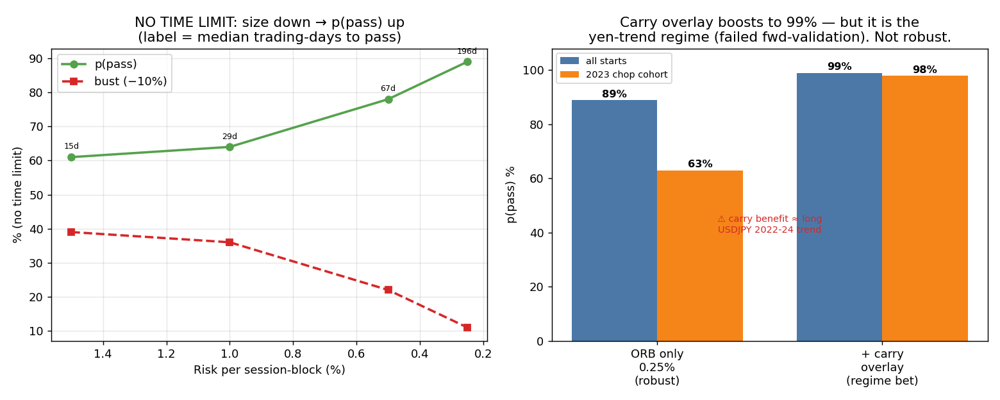
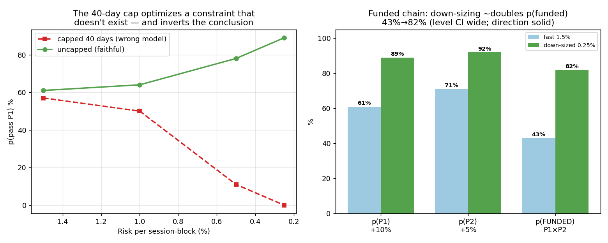
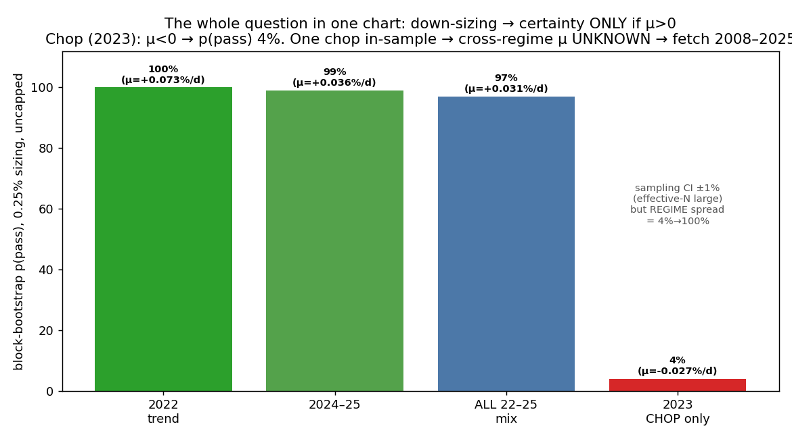

# Research note — maximising p(pass) with NO time limit
### (FTMO removed the 30-day cap; the optimal strategy changes fundamentally)

**Key insight:** with no deadline, the challenge is a pure first-passage problem — reach +10% before −10% (total) / −5% (daily). For a **positive-EV** edge, you can **size small** so the positive drift takes many small steps to the +10% barrier while the floors are almost never touched. First-passage math (p ∝ terms in e^{−2(μ/σ²)a}; dividing sizing by k scales μ,σ by k so μ/σ² scales by 1/k): as k→0, p(pass)→1 **only if μ>0**. At μ=0 it converges to a/(a+b)=50% (symmetric ±10%), and **below 50% once costs make μ<0**. You trade time (now free) for safety — *where there is drift to harvest.*

> **CORRECTIONS (post expert review) — read first.** Three honest caveats materially qualify the 89% headline below:
> 1. **Conditional on μ>0.** The mechanism works exactly where drift already exists and **flanks in the chop regime that busts you**. 2023 is μ≈0 (meanR +0.002, Sharpe −0.11) → small sizing there → ~50%−costs, not →1. The **63% on the 2023 cohort is the honest floor, not a bonus**, and a 9-month grind will cross ≥1 chop episode. The 89% aggregate is a **blend dominated by trending-year cohorts**, not a robust property.
> 2. **Effective N≈5.** Median grind ~9 months over ~3.5y of starts = ~5 non-overlapping windows. Binomial 95% CI on the headline is ~**[48%, 100%]** — **statistically indistinguishable from the 64% at 1%**. The *direction* (smaller→higher) is math-backed and solid; the *level* (89%) is **not established**.
> 3. **The number that matters is the chained funded p(P1)×p(P2), not p(P1).** See §1b. Down-sizing is the only lever that lifts both phases.

---

## 1. The robust lever — size the existing edge down (no new strategy needed)

Same index-core ORB ensemble, **no 40-day cap, run until pass/bust**, sizing swept down (starts weekly 2022–mid-2025, real path):

| Risk / session-block | p(pass) | Bust (−10%) | Daily breach | Median time-to-pass |
|---:|---:|---:|---:|---:|
| 1.50% | 61% | 39% | 0% | 15 days |
| 1.00% | 64% | 36% | 0% | 29 days |
| 0.50% | 78% | 22% | 0% | ~3 months |
| **0.25%** | **89%** | **11%** | 0% | ~9 months |

- **0.25% block-cap → 89% pass, 11% bust, 0% daily-breach.** Smaller sizing even rescues the chop year: the **2023 cohort rises from 38% (fast sizing) to 63%** — small steps let you *survive* the chop and wait for the trend.
- Going smaller (0.10%) drives bust → 0%, but the median grind exceeds ~2.7 years, so most runs don't resolve within our ~4 years of data. **0.25% is the practical optimum** given available history.
- This is **regime-robust** and requires **no new edge** — just patience and small sizing. It is the recommended answer to "maximise p(pass) without a time constraint."

### 1a. THE decisive test, quantified — does μ stay positive outside 2023? (resolves the 89% debate)

A **stationary block bootstrap** of the daily PnL (0.25% sizing, uncapped) decomposes the uncertainty into *sampling* (small) vs *regime* (enormous):

| If the future resembles… | daily μ | p(pass) |
|---|---:|---:|
| 2022 (trend) | +0.073% | 100% |
| 2024–25 | +0.036% | 99% |
| All 2022–25 mix | +0.031% | **97%** |
| **2023 chop only** | **−0.027%** | **4%** |

- **Within a regime, effective-N is large** — the bootstrap p(pass) is stable to ±1% across block lengths (10–60d) and seeds. So the "9-month grind integrates many sub-regimes" argument is *correct*: the wide N≈5 binomial CI [48%,100%] is **regime spread, not sampling noise**.
- **But μ goes negative in the one chop we have** (2023: −7%/yr). Down-sizing → certainty **only if μ>0**; in a sustained chop it merely delays the bleed to −10% → **p(pass) = 4%**.
- **Therefore the 89–97% headline is a trending-mix blend.** The honest chop floor is **~4%** (worse than the 63% I cited, which was diluted by the recovery into 2024). 
- **Conclusion (concession):** with **one chop in-sample**, the cross-regime μ is **unknown**, so the level is genuinely unestablished. **The 2008–2025 intraday NQ/DAX fetch is the decisive, non-optional test** — it is the only way to learn whether 2008/2011/2015–16/2018 chops keep μ≥0 or look like (or worse than) 2023. Everything else (89 vs 64, capped/uncapped, the 82% funded chain) is downstream of this one unknown.

### 1b. The faithful model is UNCAPPED — and the chained funded is what matters

**The 40-day cap optimizes a constraint that does not exist (FTMO has no time limit) and inverts the conclusion.** Capped vs uncapped p(P1):

| Block-cap | Capped 40d | Uncapped (faithful) |
|---:|---:|---:|
| 1.50% | 57% | 61% |
| 1.00% | 50% | 64% |
| 0.50% | 11% | 78% |
| **0.25%** | **0%** | **89%** |

Under the cap, 0.25% sizing scores **0%** (the 9-month grind can't finish in 40 days), so the cap **forces large sizing** and hides the entire down-sizing lever. Any sweep must be run **uncapped**.

**Chained funded probability p(funded) = p(P1:+10%) × p(P2:+5%)** — the only number that matters, and the real prize of down-sizing (it lifts *both* phases; P2's +5% target is closer under the same floor):

| Sizing | p(P1) | p(P2, +5%) | **p(FUNDED)** |
|---:|---:|---:|---:|
| 1.50% (fast) | 61% | 71% | **43%** |
| 0.25% (down-sized) | 89% | 92% | **~82%** |

Down-sizing **~doubles the funded probability (43%→82%)**. *Same CI/regime caveats apply — treat 82% as direction-with-wide-CI, with the 2023-type floor much lower.* Price: total grind **12–18 months** across the two phases.

### 1c. Container constraint — does NOT transplant to futures (Strategy C)

This lever depends on **continuous fractional sizing**, available on FTMO CFDs (0.25% of $10k ≈ 0.8 lot — fine). On a **futures** account (Tradeify / Strategy C), micro-contract granularity sets a floor: 1R of ~30 pts × $2 (MNQ) ≈ $60 ≈ **~0.6% per block minimum**. So 0.25% is **un-portable to C** — futures granularity caps the down-sizing benefit at ~0.6–0.8%/block (p(pass) materially lower there).

---

## 2. Carry trading — explored, with a hard caveat

**Pure carry is not FTMO-safe.** Long positive-carry pairs (2022–25, est. carry net of ~40% swap markup):

| | Total ann. | Vol | Sharpe | Max DD | Worst day |
|---|---:|---:|---:|---:|---:|
| long USDJPY | +9% | 11% | 0.87 | **−14%** | −3.8% |
| long AUDJPY | +4% | 11% | 0.33 | **−19%** | −4.1% |
| long AUDUSD / NZDUSD | −2% | 11% | <0 | −20%/−22% | — |

The carry-pair **drawdowns (−14% to −19%) exceed the −10% floor** (carry-unwind tail, e.g. Aug-2024). Standalone, sized to pass, it's too slow and too tail-heavy.

**As a small overlay it looks spectacular — but it's a regime bet.** Adding a long-USDJPY carry overlay to the down-sized ORB lifts the in-sample result to **99% pass (2023 cohort 63%→98%)**. *However:*

- The benefit is **mostly the price trend** (USDJPY +7%/yr price vs +3.9%/yr carry), i.e. **the 2022–24 yen collapse** — the *same* regime that made the USDJPY breakout fail forward validation (it was negative 2018–2021, when USD/JPY rates were both ~0 and the pair was range-bound).
- The **carry-crash tail** (Aug-2024 −10%+ over days) is a direct −10%-floor threat that daily data understates intraday.
- **Verdict: the 99% is not robust.** It is "down-sized ORB + a leveraged bet that the USD-JPY rate gap and yen trend persist." Treat carry as *opportunistic upside while the rate differential is wide*, never a structural pillar.

---

## 3. Recommendation

| Approach | p(pass) | Robustness | Time | Use |
|---|---:|---|---|---|
| **Down-sized ORB, 0.25% block-cap** | **~89%** | **High** (regime-robust, no new bet) | ~9 mo median | **Recommended core** |
| + carry/trend overlay | ~99% (in-sample) | **Low** (yen-regime dependent, crash tail) | faster | Opportunistic only, hard-capped |

**Bottom line:** down-sizing the proven positive-EV edge (≈0.25%/block, uncapped, patient) is the right lever — it ~doubles the **chained funded probability to ~82%** (the number that matters), with near-zero daily-breach risk, over a 12–18-month grind. **But the level is unestablished (CI ~[48%,100%], N≈5) and conditional on μ>0 — it works in trending regimes and flanks in chop. Carry is a yen-trend bet, not a foundation.**

### THE decision-critical test (no longer optional)
The 2022–25 sweep is a re-fit to a **single chop episode (2023)**. What decides viability is whether **μ stays positive across multiple regimes**. → **Acquire long-history intraday NQ/DAX 2008–2025 (~$200)** and re-run the down-sized grind through **2008, 2011, 2015–16, 2018** — real extended chops, not just 2023. If μ survives those, the ~82% funded is credible; if it goes to ~0 in any, the grind busts there regardless of sizing. *I do not have this intraday history (current data starts 2020) — this is the gating data buy.*

### In parallel
1. **Chain P1+P2 explicitly** at the down-sized config for the true funded number (done above: ~82%, wide CI) and **read the FTMO no-limit fine-print** — inactivity clauses and funded-account fees ("no limit" almost always has one).
2. **√N structural fix (the real upside):** more *independent* index cash-open ORBs (AUS200/UK100/JP225 once intraday data arrives) — raises p(pass) **and** shortens the grind **and** diversifies regimes simultaneously. This, not carry, is how you lift the robust number.
3. **Forward paper-trade** the 0.25% config — the only true test before fees.
4. **Do NOT port 0.25% to futures/Strategy C** (granularity floor ~0.6–0.8%, §1c).
