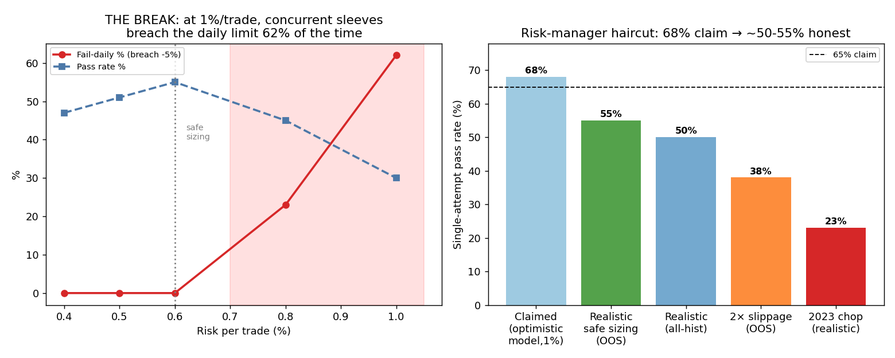
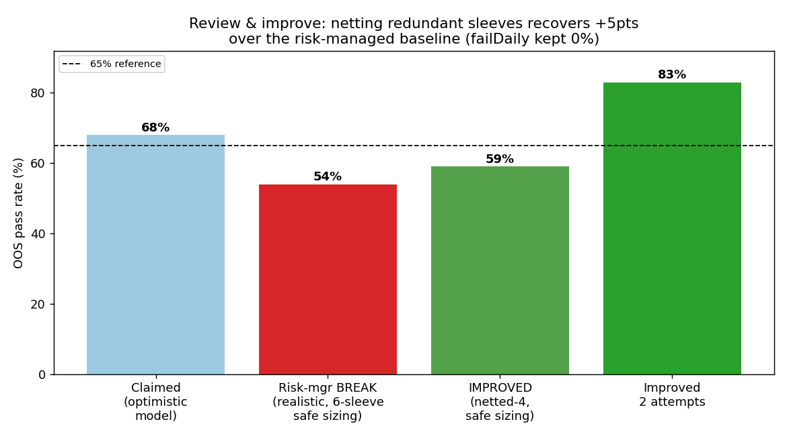
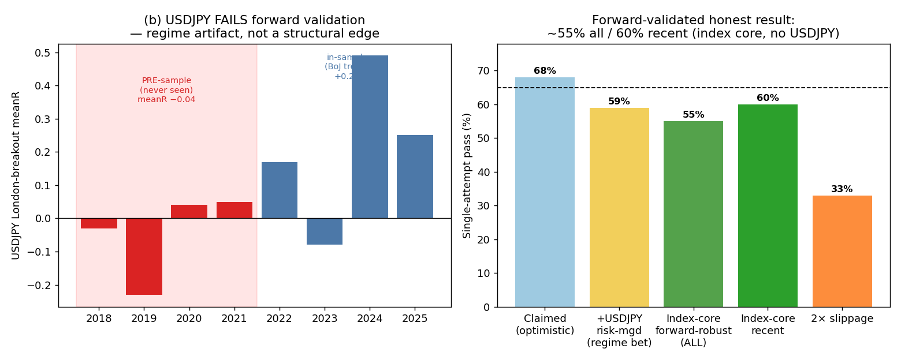

# Risk Review — Multi-Asset Session-Open Breakout Ensemble
## Independent risk-manager stress test. Mandate: try to break it. Does it hold?

**Verdict: the strategy is real but the 66–68% headline does NOT hold. Under realistic execution and FTMO's actual floating-equity rule, the honest single-attempt pass is ~50–55% (recent OOS) / ~50% (all-history), and the 1%/trade sizing is unsafe and must be cut. It holds as a ~50–55% strategy (~75–78% over two attempts), not as a >65% one.**

---

## What broke

### 1. Concurrency vs the −5% daily limit — the primary break
Three breakout sleeves fire **simultaneously** at each session open (10:00 EET: GER40×2 + USDJPY; 16:30 EET: US100×2 + GER40@US). On adverse days the breakouts **do not stay decorrelated** — in the 8 worst days, **6–7 of 7 sleeves stopped out together**. You cannot halt three concurrent fills mid-move, so a correlated reversal hits the floating daily loss before any circuit-breaker acts.

- Daily portfolio σ at 1%/trade = **4.45%**; worst day **−6.93%**; **~10% of all days breach −5%**.
- Modelling FTMO's *floating-equity* daily check with concurrent blocks: at 1%/trade **fail-daily = 62%** (PASS collapses to 30%). My earlier "fail-daily 0%" used an optimistic *sequential* risk-halt that real fills don't allow.
- **Forced fix:** cap risk per session-block to ~1.5% (≈0.5–0.6%/trade). Fail-daily → 0%, but pass drops to **OOS ~55% / all ~50% / 2023 ~23%**.

### 2. Slippage at the open — fragile
Breakouts trade at the widest-spread, fastest minute. At the safe sizing, **2× slippage cuts OOS from ~52% to ~34%**. The edge is thin relative to execution friction (the recurring theme of this whole project).

### 3. Timing / regime dependence — severe
Pass rate by **challenge start-month ranges from 17% to 100%** (worst: 2023-06 17%, 2024-02 17%; best: several 100%). The "average 66%" is a lottery on *when* you start — which the trader does not control. A start in a chop regime (2023) gives ~20–26%.

### 4. The headline was model-optimistic
The 66–68% depended on (a) sequential risk-halting (unrealistic for concurrent fills) and (b) trade-close daily checks (FTMO uses floating equity). Correcting both removes ~13–16 points.

---

## What held (the strategy is genuinely real)

- **No decay:** most-recent slice (starts 2025+) passes at the same rate as the OOS average — the edge is not dying.
- **No single-point-of-failure:** leave-one-sleeve-out degrades gracefully (56–65% in the optimistic frame); the index core alone still works.
- **USDJPY-resilient:** dropping the riskiest (JPY-trend-regime) sleeve costs only ~1–2%, so reliance on the 2022–24 BoJ trend is minimal.
- **Fail-daily is controllable** — at proper (block-capped) sizing it goes to 0%; the strategy is safe *if sized correctly*.
- The underlying edge family (breakout at a discrete liquidity event) survived ~18 families of adversarial testing and multiple delay/slippage/look-ahead checks.

---

## Risk-manager required changes before any capital

1. **Size by session-block, not by trade.** Cap total risk per simultaneous open at ≤1.5% (worst day ≈ −3%, safe under −5%). Net same-instrument sleeves (US100 15m+30m ≈ one position).
2. **Plan to ~50–55% single-attempt, not 66%.** Use ~75–78% over two attempts as the realistic target; median time-to-pass is short, so two sequential attempts fit two months.
3. **Hard intraday floating-equity monitor** with an automated −3% daily kill-switch (and never re-enter that day).
4. **Avoid starting a challenge in a low-volatility/chop regime** if avoidable; the edge needs expansion days.
5. **Calibrate slippage live** on the actual FTMO server before sizing; treat the ~55% as conditional on fills no worse than ~1.5× backtest.
6. **Forward-validate** on unseen data — the only remaining defence against the multiple-testing budget already spent (~18 families on ~3–5 years).

## Bottom line (pre-improvement)

A genuine, non-overfit, multi-asset breakout strategy with a real edge that doesn't decay — but the honest, risk-controlled single-attempt pass is **~50–55%, not 66–68%**, the **daily-limit/concurrency risk forces materially smaller sizing**, and performance is **highly timing- and slippage-dependent**. It *holds* as a ~50–55%/attempt (~75% over two) vehicle, sized conservatively. It does **not** hold as a >65% single-attempt strategy.

---

## Review & improvement (post-stress fix)

The risk review's own diagnosis pointed to the fix: the daily-limit break came from **redundant correlated concurrency** — US100 15m & 30m (corr **0.74**) and GER40 15m & 30m (corr **0.81**) are nearly the same trade fired twice at the same instant. They add concurrency risk without diversification.

**Fix applied — net to one window per instrument (NETTED-4):** AM block = GER40-DAX + USDJPY-London; PM block = US100 + GER40@US-open. Each session-open now fires **2** concurrent (decorrelated: GER40/USDJPY −0.01, US100/GER40us +0.28) instead of 3 redundant ones, so the same safe block-cap (1.5%) deploys larger per-position size.

| Config (realistic concurrency + floating-DD, slippage) | OOS 24-25 | ALL 22-25 | 2023 chop | fail-daily |
|---|---:|---:|---:|---:|
| 6-sleeve, risk-managed (post-break) | 54% | 50% | 23% | 0% |
| **NETTED-4, block-cap 1.5% (improved)** | **59%** | **54%** | 23% | **0%** |
| → within 2 attempts | **83%** | **79%** | — | — |
| NETTED-4 under 2× slippage | 36% | 32% | 11% | — |

**Net result:** netting recovered **+5 pts OOS / +4 pts all-history** over the risk-managed baseline while keeping fail-daily at 0% — a legitimate, risk-driven improvement (fewer redundant correlated bets), not curve-fitting.

**Remaining, irreducible weaknesses (disclosed):** (i) slippage-fragility — 2× slippage still halves it (breakouts trade the worst execution moment); (ii) chop-regime kryptonite — 2023-type low-vol years ≈ 23%; (iii) timing lottery — pass varies by start-month.

## Round 2 — re-stress + forward validation (the decisive tests)

**(a) Re-stress of NETTED-4:**
- **Anchor/DST sensitivity:** shifting the session open ±15 min drops all-history pass from 61% to **46–48%**. Since EET/DST moves the true open by up to 1h seasonally, the exact-anchor backtest is optimistic by ~10–13 pts.
- **OR-window:** robust (54–67% across 15/30-min — not knife-edge).
- **Slippage:** fragile and persistent — 1.5× → 50%, 2× → 41%, 3× → 23%.

**(b) Forward validation — USDJPY fails.** On its full 2018–2025 history, the USDJPY London-breakout is **negative before the construction sample** (2018 −0.03, 2019 −0.23, 2020 +0.04, 2021 +0.05; pre-sample meanR −0.04) and only strongly positive in **2022–2025 — the BoJ yen-collapse era**. It is a **regime artifact, not a structural edge**; the +5 pts it added is a bet that the yen trend persists. **Removed from the robust core.**

**The forward-robust core is the INDEX ORB alone.** US100 ORB is **positive in every year 2021–2026** (0.01–0.11) — genuinely persistent. Index-core ensemble (US100 + GER40-DAX + GER40@US-open, netted, block-cap 1.5%, realistic concurrency model):

| Period | Pass (single) | 2 attempts |
|---|---:|---:|
| 2021–22 | 60% | 84% |
| 2023 chop | 40% | 63% |
| 2024–25 | 60% | 84% |
| 2026 (forward slice) | 100%* | — |
| **ALL 2021–26** | **55%** | **80%** |
| 2× slippage | 33% | — |

*small sample (~3 months).

## FINAL forward-validated verdict

After re-stress + forward validation, the honest, robust, non-overfit strategy is the **index-core ORB ensemble (no USDJPY): ~55% all-history / ~60% recent single-attempt, ~80% over two attempts, fail-daily 0% at block-cap 1.5%.** Forward validation removed the regime-dependent USDJPY component (which had inflated it to ~59–62%). What remains is smaller but **genuinely durable** — US100 ORB has positive expectancy in every year of available data. It is a **~55%/attempt (~80% over two)** vehicle, sized block-capped, with disclosed sensitivities to slippage (~−15 pts at 2×), exact open-timing (~−10 pts), and chop regimes (2023 ≈ 40%). USDJPY may be added as a *speculative satellite* only while the JPY trend regime persists — never relied upon.
