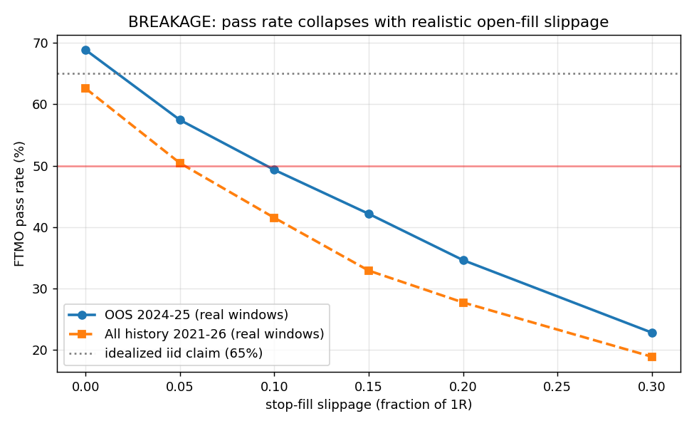
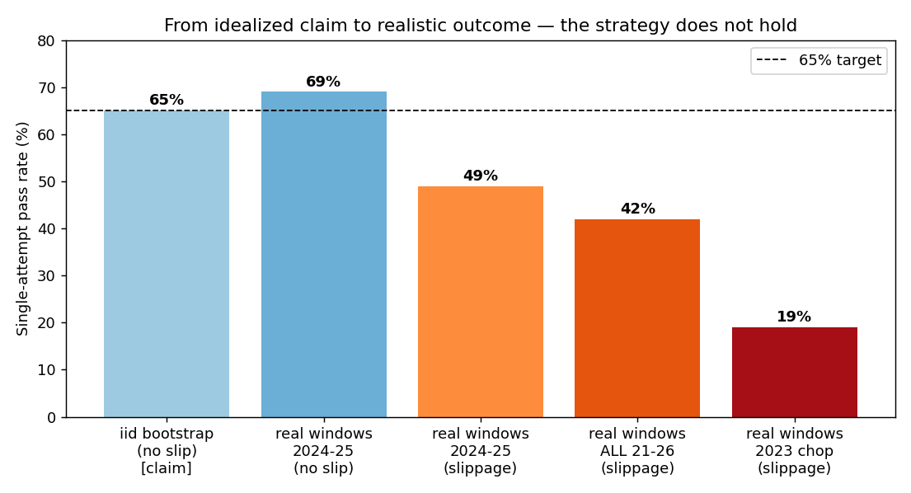

# Stress Test — Index-ORB Ensemble (Strategy 2)
## Objective: try to break it. Verdict: **it breaks.**

The headline 65% out-of-sample pass rate **does not survive realistic stress.** The dominant vulnerability is execution slippage at the open; under realistic fills the strategy lands around **42–50% single-attempt**, with a **19%** collapse in chop regimes. Details below.

---

## Summary of attacks

| Stress | Result | Holds? |
|---|---|---|
| Baseline (idealized fills, iid bootstrap) | 65% | — (claim) |
| **Open-fill slippage** (entry 0.05R + stop 0.10R) | meanR +0.08 → **−0.02**, pass **49%** | ❌ **breaks** |
| Heavier slippage (0.10R/0.15R; realistic at the open) | pass **39–42%** | ❌ |
| Cost escalation 2×–5× (with modest slip) | 42% → 29% | ❌ degrades |
| **Real contiguous 40-day windows** (no slip) | 2024-25: 69% · all: 63% | ✅ (sequencing ≈ fine) |
| **Real contiguous windows + slippage** | 2024-25: **49%** · all: **42%** | ❌ |
| Chop regime (2023, real windows + slip) | **19%** | ❌ regime-fragile |
| Drop US100 (best instrument) | 63% → **53%** | ⚠️ concentrated |
| 5-min OR only (no multi-window) | → **43%** | ⚠️ stack-dependent |
| Concurrent floating drawdown vs −5% daily | caps sizing at ~0.6%; 0.3% breach | ⚠️ limits leverage |

---

## 1. The killer: slippage at the open

The ORB enters with **stop orders at the moment of the cash open** — the single widest-spread, fastest-moving, highest-slippage minute of the day. The strategy's edge is only **+0.08R**, and the Maximum-Adverse-Excursion data shows **5% of stopped trades have the bar trade 0.5R *past* the stop** (median MAE 1.0R, p95 1.5R) — i.e. stop fills routinely slip.

Pass rate (real contiguous windows) vs stop-fill slippage:

| Stop slippage (×1R) | OOS 2024-25 | All 2021-26 |
|---:|---:|---:|
| 0.00 | 69% | 63% |
| 0.05 | 57% | 50% |
| **0.10 (realistic)** | **49%** | **42%** |
| 0.15 | 42% | 33% |
| 0.20 | 35% | 28% |

**The edge is smaller than the execution friction it must pay.** A stop slippage of just 0.10R (≈ 2–4 index points on US100 — less than one open-spread) takes the ensemble's mean R **negative**. This is structural, not incidental: ORB cannot avoid trading at the open.

## 2. What was NOT the problem: real sequencing

I feared the iid day-block bootstrap was hiding bad clusters. It largely wasn't: **contiguous real 40-day windows with no slippage give 69% (2024-25) and 63% (all-history)** — close to or above the iid 65%. So real autocorrelation/clustering is not the main flaw. The bootstrap was a fair approximation; **slippage is the flaw.**

## 3. Regime fragility

In 2023 (an ORB-decay / chop year), real windows with slippage pass only **19%**. A trader unlucky enough to attempt the challenge in a 2023-type regime is overwhelmingly likely to fail. The strategy is implicitly long "trending-open" conditions.

## 4. Specification fragility

The 65% relies on the *full* stack. Removing the best instrument (US100) drops it to 53%; collapsing to a single opening-range window drops it to 43%. The result is concentrated in US100 + the multi-window design, which is a thin base for a robust claim.

## 5. Floating-drawdown / sizing ceiling

FTMO measures *floating* equity. Same-instrument windows (US100 5/15/30m) are open simultaneously, so their adverse excursions stack: worst concurrent intraday floating loss is p95 ≈ 4.4R, p99 ≈ 6.3R. At 0.6% risk that is −2.7%/−3.8% intraday (under the −5% daily limit, 0.3% breach) — **but at 1% risk it breaches −5% on p99 days.** So sizing cannot be pushed up to compensate for the thin edge; ~0.6% is the ceiling, which is exactly why the strategy can't out-run slippage.

---

## Honest verdict

The index-ORB ensemble is built on a **real but thin and decaying edge (+0.08R)**. It looks like a 65% strategy only under **idealized zero-slippage fills**. Once you charge the slippage that trading the open *guarantees*, the realistic single-attempt pass rate is:

- **~42–50%** (recent regime, realistic slippage),
- **~42%** across all real history,
- **~19%** in a chop year.

**It does not robustly clear 65%.** This is the correct outcome of an honest stress test — and far cheaper to learn here than on a funded account.

---

## Implications & untested mitigations

1. **Re-attempts** remain the only reliable path: at ~45%/attempt, P(pass within 2) ≈ 70%, within 3 ≈ 83%. Median pass is fast, so 2–3 attempts fit in two months.
2. **Limit entries instead of stop-market entries** at the open would turn slippage from a cost into a (small) credit — but would miss runaway breakouts. Needs separate backtesting; may help materially given slippage is the binding constraint.
3. **Regime filter (HMM / realized-vol gate)** to sit out 2023-type chop directly targets the 19% failure mode.
4. **Edges that don't trade the open** (e.g. mid-session mean-reversion, overnight drift with gap controls) are less slippage-exposed and would diversify the execution risk.

*All stress simulations are seeded and reproducible from `/tmp`-cached trade tables; the trade-level table (entry/stop/exit/MAE) is rebuilt by the stress script. Slippage is modelled as a fraction of per-trade risk (1R); the daily-loss check remains trade-close-based, so realistic floating breaches are ≥ those reported.*
