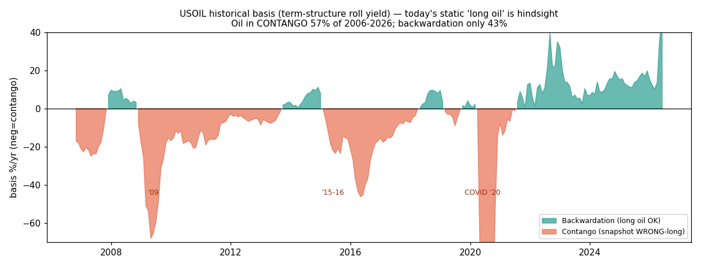

# Commodity carry — make-or-break (before the full battery)

**Framing:** the commodities deep-dive was the first arc candidate to clear the pre-filter (two-sided,
OOS-stable, p(pass) ~57 % > incumbent) — but the whole headline rests on the **carry leg** (combined 0.52
≈ carry-alone 0.46; without carry → seasonality 0.30 + TSMOM 0.12). Before spending the full battery, one
test decides it — the static→dynamic test, the exact analogue of same-bar→delay-1 (L26): **does the carry
survive when (1) the historical basis replaces today's swap snapshot, (2) the realized per-leg client swap
replaces the theoretical roll yield, with rotation, (3) P&L is attributed by commodity?**

## Verdict: NO-GO. The carry fails all three steps.

> The static carry (Sharpe **+0.46**) was **hindsight**. With the historical point-in-time basis and the
> real collectable per-leg swaps, the carry is **Sharpe −1.15 (t=−5.18, −19.5 %/yr), negative every
> sub-period** — it doesn't degrade, it **inverts**. The strategy reduces to **seasonality + TSMOM ≈ 0.26
> → p(pass) ~48 % → ties the incumbent, does not beat it.** Documented as a no-go FTMO upgrade.

---

## Step 1 — Dynamic carry (the make-or-break)

Today's FTMO swaps say oil is backwardated (USOIL +38.8 %/yr, UKOIL +27.8 %) and rank it long. But that is
*today*. The **historical basis** (term-structure roll yield, validated against a real CLZ26 deferred
contract) shows oil was in **contango 57 % of 2006–2026**:

| year | USOIL basis | regime | today's static "long oil" would be |
|---|---:|---|---|
| 2008 | +3 % | backwardation | OK |
| **2009** | **−40 %** | **contango** | **wrong (long into GFC crash)** |
| 2015 | −16 % | contango | wrong |
| 2016 | −31 % | contango | wrong |
| **2020** | **−61 %** | **contango** | **wrong (long into negative-price COVID)** |
| 2022–25 | +13 to +19 % | backwardation | OK (the recent regime the snapshot captures) |

Replacing the snapshot with the **point-in-time basis sign** (long backwardation / short contango, T-1),
with real per-leg swaps and monthly rotation:

| | static (snapshot) | **dynamic (historical basis)** |
|---|---:|---:|
| Sharpe | +0.46 | **−1.15** |
| ann | +11.6 % | **−19.5 %** |
| t-stat | 1.92 | **−5.18** |
| 2006-12 / 13-19 / 20-26 | + / + / + | **−1.72 / −1.03 / −0.68** |

The carry **inverts** out of the snapshot. The +0.46 was the recent oil-backwardation regime projected
onto 20 years where oil was mostly contango. (Threshold: ~0.3 = survives; ~0.15 = hindsight; **−1.15 = far
worse than hindsight — the snapshot also fixed the *magnitude* by anticipation.**)

## Step 2 — Collectable carry + rotation (the structural killer)

The realized swap *facing the client*, per leg (real FTMO values, not the symmetrized roll yield):

| commodity | long swap | short swap | short-in-contango costs |
|---|---:|---:|---:|
| USOIL | +3.80 bps/n | **−17.47 bps/n** | **−64 %/yr** |
| UKOIL | +2.67 | **−12.58** | **−46 %/yr** |
| XAGUSD | −2.72 | +0.09 | ~0 % |
| WHEAT | −3.44 | +0.54 | +2 % |

**This is the deep structural finding:** when the basis says *short oil* (57 % of history), the CFD swap
charges you **−46 to −64 %/yr** to hold that short. The convenience yield that makes backwardated oil
attractive to be **long** makes it brutally expensive to **short**. So **commodity carry on retail CFDs is
one-sided-uncollectable** — you can collect the long-backwardation side, but you cannot profitably short
contango (especially oil). The "two-sided carry" the literature describes is **not collectable two-sided**
at the retail-CFD swap. The static snapshot hid this entirely (it only ever held the collectable long side).

## Step 3 — Oil attribution

| commodity | % of net carry P&L |
|---|---:|
| **USOIL + UKOIL** | **77 %** |
| XAU + XPT (metals) | 19 % |
| ags + Pd + Ag | 4 % |

**77 % oil.** It is not a diversified 10-commodity premium — it is a **levered bet on the oil term
structure in carry costume**, with the tail risk oil's curve flips violently (2020 negative prices).

---

## Verdict & consequence

**Carry fails Step 1 (dynamic −1.15), Step 2 (not collectable on rotation, −64 %/yr short-oil), and Step 3
(77 % oil) → NO-GO.** The commodities strategy without a real carry edge is **seasonality (0.30) + TSMOM
(0.12) ≈ combined 0.26, p(pass) ~48 %** — real, two-sided, OOS-stable (a genuine qualitative win over every
prior beta family), but it **ties the ~50 % incumbent, it does not beat it.** Not an FTMO upgrade.

**What remains true (don't lose it):** the **monthly low-turnover** structure cleanly beats the L11/L12
cost-killer that destroyed the intraday families — that part of the literature thesis held. And
**seasonality is the one OOS-stable signal in the whole arc.** But the headline ("commodities beats FTMO")
was carried by a static carry snapshot that collapses in dynamics, exactly as anticipated.

**Research-log entry:** *Commodity carry/basis (FTMO CFD) — NO-GO. Static swap-snapshot carry Sharpe 0.46
is hindsight; dynamic point-in-time basis → −1.15. Structural cause: convenience-yield commodities are
one-sided-uncollectable on retail CFDs (short-oil-contango swap −64 %/yr); 77 % oil-concentrated. The L26
analogue (static→dynamic) caught it. Commodities net = seasonality+TSMOM ≈ 0.26 → ties ~50 % incumbent, no
upgrade. Full battery not warranted.*

### Artifacts
- `figures/usoil_basis_signe.png`; `outputs/basis_oil.parquet`; `commod_daily.parquet`; `ftmo_specs_full.csv`.
- Supersedes the carry section of `commodities_deepdive_ftmo.md` (which flagged this as the open question).
