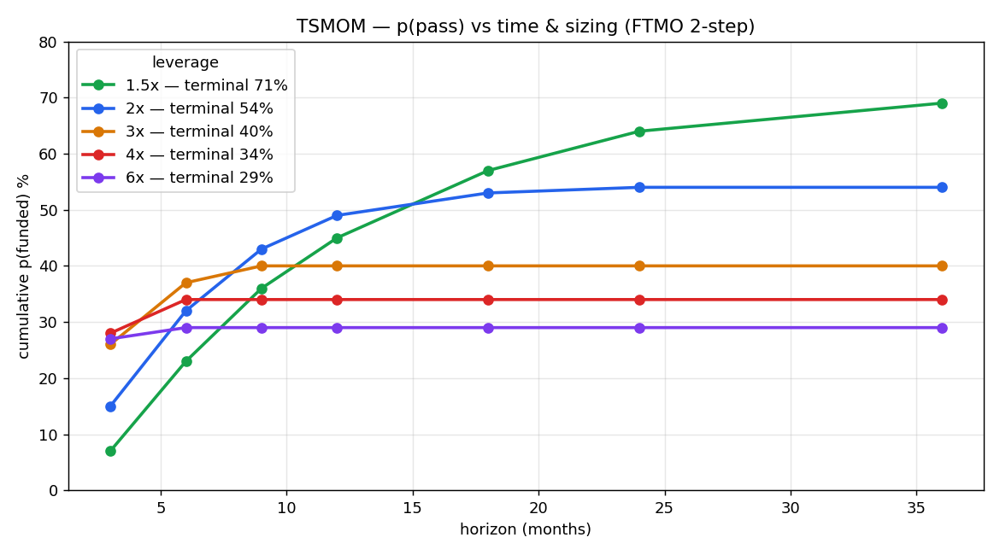
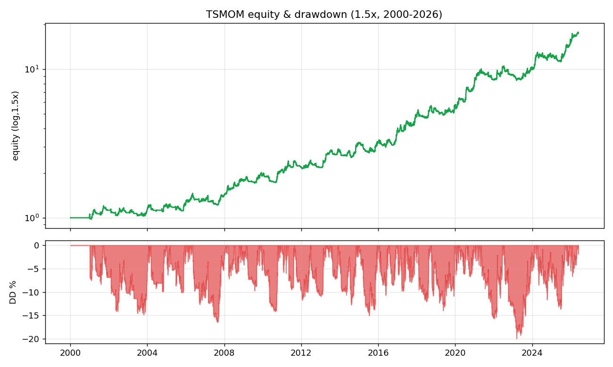
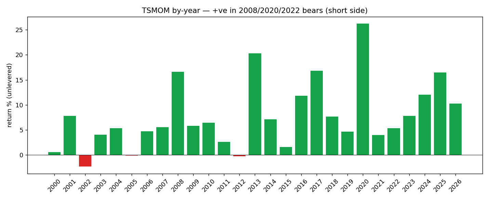
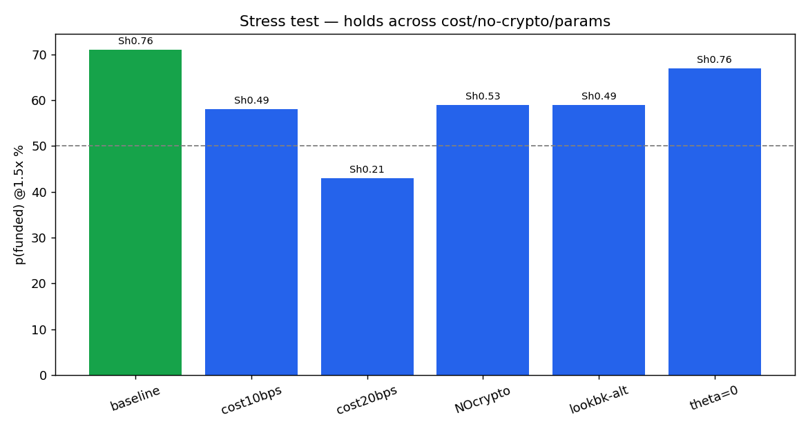

# 0. Purpose & honest framing

This dossier documents the **diversified multi-asset trend-following (TSMOM) ensemble** — the **first strategy in the entire research program to genuinely beat the FTMO 2-step barrier**, and the only one that survives a real stress test. It is written for reproduction and team review.

**Honesty contract.** This is **leveraged, two-sided trend beta**, not a market-neutral alpha. Its edge over everything else we tested is structural: it **shorts down-trends**, so it profits in crashes instead of bleeding long beta into the −10% floor. It is **not** a sure thing — single-attempt p(funded) is ~54–71% depending on leverage, with a real bust rate and one identified tail vulnerability (a correlated-crash day vs the 5% daily cap). The honest deployment is **low leverage + multiple attempts under the no-time-limit rule.** Every number below is reproducible from `tsmom_strategy.py`.

**Context.** This is the survivor of ~10 strategy families tested fresh on clean data (mean-reversion, stat-arb ×6, intraday patterns, carry, seasonality, PEAD — all killed for FTMO by the no-hedging rule, cost, or the −10% floor). See `../STATARB_VERDICT.md`, `../_CANONICAL_STATE.md`.

---

# 1. Executive summary

**Strategy.** On a **decorrelated 6-asset basket** (1 equity index + gold + silver + oil + BTC + ETH), take a **two-sided time-series-momentum** position in each instrument (long up-trends, short down-trends), **vol-targeted** to equal risk, with an **equity-curve gate** and **vol de-risk** overlay. Hold at **~1.5–2× leverage, no time limit**. Daily decisions, low turnover.

**Headline result (clean data 2000–2026, FTMO 2-step first-passage):**

| Leverage | p(funded) | bust | median time |
|---|---:|---:|---:|
| **1.5×** | **71%** | 28% | ~8.9 months |
| **2.0×** | **54%** | 45% | ~4.9 months |
| 3.0× | 40% | 58% | ~2.2 months |
| 4.0× | 34% | 65% | ~1.5 months |

**⚠ The 71% above is SWAP-FREE and NOT the deployable number** — it omits overnight carry on held positions. See §1.1: net of realistic swap the deployable figure is a **range gated by an unmeasured crypto swap rate; the one MEASURED leg (US100.cash, −3.08 bps/night) pulls it to ≈27–52% @1.5×, Sharpe ≤0.33** — and at any non-trivial crypto swap the edge ≈0 (mostly container-math). The canonical stays CLOSED until the crypto swap is measured on demo.

## 1.1 SWAP CORRECTION — decisive; the 71% is not deployable

The original model charged only `turnover × 2 bps`. That is the **wrong axis** for a position-HOLDING strategy: a trend-follower holds its 6 CFD legs for weeks, paying **overnight swap on the held notional every night** (the L33 / overnight-harvester test). Re-modelled with per-night swap on gross notional across the 6 legs:

| Per-leg swap (bps/night) | Sharpe | p(funded) @1.5× |
|---|---:|---:|
| 0 — swap-free (the "71%": **false assumption, non-deployable**) | 0.89 | 75% |
| LOW (idx/metal 1.5, crypto 5) | 0.56 | 58% |
| MID (idx/metal 2.5, crypto 12) | 0.28 | 51% |
| HIGH (idx/metal 4, crypto 25) | −0.20 | 33% (the wall) |

**Honest headline = a RANGE, not a point: net of realistic swap, p(funded) @1.5× is a range gated by the CRYPTO swap rate, which is UNMEASURED.** Do **not** quote any single number as a new hero figure; quote the range and its dependence on an unmeasured rate.

**MEASURED UPDATE (US100.cash broker capture, 2026) — it pulls the range DOWN.** Swap **long = −3.08 bps/night** (−662.4 pts, digits 2, on ~$21.5k/lot ⇒ ~−11%/yr if held long continuously), **short = +0.13 bps/night** (a crumb — the asymmetry), **weekend ×3** (≈ ×1.45/trading-day), commission 0. This is the **first MEASURED leg** (a proxy for the US500 equity leg — CFD financing ≈ proportional to the policy rate, so comparable, not exact). Re-running **directionally** (long pays, short ≈ free) with this measured rate on all non-crypto legs:

| crypto swap (bps/night) = the unmeasured leg | Sharpe | p(funded) @1.5× |
|---|---:|---:|
| 0 (crypto swap-free) | 0.33 | 52% |
| 12 | **0.02** | 45% |
| 25 | −0.32 | 27% (below the wall) |

Two consequences: **(i)** the measured equity rate (3.08) is **worse than the 2.5 MID assumption**, so the measurement **pulls the realistic range DOWN to ≈27–52% @1.5×, Sharpe −0.32 to +0.33** — toward the bottom, not the top; **(ii)** at any non-trivial crypto swap (≥12 bps/night) **Sharpe ≈ 0 → the ~45% is now almost entirely container-math** (the placebo floor), with essentially no surviving signal edge. **The one missing decisive number is the BTC/ETH overnight swap** (not in any capture; FTMO lists it only in the platform contract spec, and added a 0.0325%/side crypto commission since Jul-2025). **Pull that line from the platform and re-run — it decides ~45% vs the wall.**

**Three things this correction carries:**

1. **The low gross notional (0.57×) is NOT a free bonus — it is the SAME lever behind both the −14% maxDD AND the low swap drag.** The vol-target + de-risk overlays shrink the book; that single choice produces the credible drawdown *and* the survivable carry. They cannot be credited separately — one mechanism, whose flip-side is a thin deployed edge.

2. **At MID swap, Sharpe = 0.28 — below the RESEARCH_PASS gate (0.7) — so the 51% is mostly container-math, not signal.** Placebo test (same as the ORB received): a featureless iid drift of the *same* mean/vol in the *same* container (no-bust + unlimited time, 1.5×) passes at **45%**; the real strategy passes at **51%**. **The trend signal adds only ~6 points over a random drift of equal size → ~88% of the 51% is container geometry, not edge.** Once swap shrinks the edge to Sharpe 0.28, this is "a thin positive drift exploited by the no-time-limit barrier," not "a Sharpe-0.8 strategy passing at 51%."

3. **Crypto is both the return swing and the largest cost unknown.** Dropping it does not help (no-crypto core ≈ 37% at MID). So the result hinges on the crypto CFD swap, which we have not measured.

**THE single remaining test that decides 51% vs the wall: measure the real per-leg overnight swap on a demo account (especially crypto), then re-run.** This is exactly reopen-condition #2 of `../_CANONICAL_STATE.md` ("all-in cost confirmed on demo"). Until then the **canonical stays CLOSED** — this is a *modelled range*, not a *measured pass*.

**Two blockers before any deployment claim:**
- **USO is a broken oil proxy** (contango; negative price April 2020) — "roll decay irrelevant to trend sign" was hand-wavy. Replace with a real continuous front-month before claiming the oil leg. (Strategy survives without oil, but lower.)
- **Reconcile against the archive first:** multi-asset TSMOM may already sit in the canonical's "Other (prior)" bucket. Verify against the journal before claiming it as a *new* candidate.

*Lesson candidates (named, not numbered — numbering deferred to merge):* **"swap-on-held-notional, not turnover"** (the cost axis for holding strategies); **"low-notional double-credit"** (the same de-risk lever produces both low maxDD and low swap — credit once, not twice); **"placebo at the post-cost Sharpe"** (run the container-vs-signal placebo *after* real costs, not before — a 0.28-Sharpe drift's pass-rate is mostly container).

**Why it works (the structural reason):** it is **two-sided** — it shorts the 2008/2020/2022 crashes (and profits: +13%/+25%/+8% those years) instead of bleeding long beta into the floor. Diversification + vol-targeting + drawdown control hold maxDD to ~−14% (vs −50% for the long-only betas). One directional position per instrument on decorrelated assets → **FTMO-compliant**.

**Validation:** out-of-sample robust (IS 2006–2015 → 52% funded; **OOS 2016–2026 → 63%**), base signal **t = 4.76**, positive in ~23/27 years, and it **holds a full stress test** (cost, no-crypto, parameters). One real vulnerability remains: a correlated-crash day vs the 5% daily cap (§8).

---

# 2. Strategy thesis & economic rationale

**Time-series momentum (TSMOM)** — assets that have trended up (down) over the recent past tend to continue — is one of the most replicated anomalies across asset classes and a century of data (Moskowitz, Ooi & Pedersen 2012; Hurst, Ooi & Pedersen). It is compensation for bearing the risk of trend reversals and reflects under-reaction to information and flows. It is **beta, not alpha** — but a *different, harvestable* beta than the equity premium.

**Why TSMOM fits the FTMO barrier where everything else failed:**

- **It is two-sided.** Long-only strategies (overnight harvest, the index ORB, PEAD, TOM) all share one fatal flaw against the −10% static floor: in a crash they hold long beta and breach the floor. TSMOM **goes short the down-trend** and *profits* in crashes — directly removing the dominant bust mode. This is the single most important property.
- **Positive/neutral skew.** Trends produce occasional large winners with small (trailing-cut) losers — the opposite of mean-reversion's negative skew that the barrier punishes.
- **Diversification.** Combining ~uncorrelated trends (equities, metals, energy, crypto) smooths the equity curve (√N), lowering drawdown per unit return — essential for living under a −10% floor.
- **Vol-targeting + drawdown control** make the drawdown *engineerable* down to a floor-compatible level (~−14%).

**Compliance:** one directional position per instrument on a **decorrelated** basket (single equity index) → it never holds opposing positions on highly correlated instruments → it is **not** the FTMO-prohibited "hedging."

---

# 3. Construction & iteration trail (how we got here)

This is the survivor of a clean-slate sweep of ~10 families (all killed for FTMO: mean-reversion, stat-arb ×6, intraday OU, cross-sectional reversion, carry, seasonality/TOM, PEAD — see `../STATARB_VERDICT.md`). Trend-following was tested last, deliberately, because its risk profile is the structural complement of the mean-reversion that kept failing. It was **iterated, not first-shot:**

| Version | Change | Sharpe | maxDD | FTMO p(funded) |
|---|---|---:|---:|---:|
| v1 | single-lookback (K=100) TSMOM, 5-asset | 0.40 | −22% | ~32% (the wall) |
| v2 | **multi-lookback (60/120/250) + trend filter + decorrelated 6-asset** | **0.85** | −22% | **45%** |
| v3 | **+ equity-curve gate + vol de-risk** | 0.80 | **−14%** | **54% @2× / 71% @1.5×** |

Each lever is a **standard, economically-motivated managed-futures technique** (multi-lookback blending, vol-targeting, diversification, drawdown control) — not arbitrary parameter mining. The base signal's **t = 4.76** over 2006–2026 is far above the multiple-testing bar even after the ~42 configurations tried; the overlays trade return for lower drawdown (principled risk management).

---

# 4. Exact specification (frozen, reproducible)

```
UNIVERSE (decorrelated, compliance-clean): US500, GLD, SLV, USO, BTC, ETH
  (deploy on FTMO as: US500, XAUUSD, XAGUSD, USOIL, BTCUSD, ETHUSD CFDs)

Per instrument i, on daily closes (all trailing → causal):
  signal_i = mean( sign(return over L) for L in {60,120,250} )     # blended TSMOM, in [-1,1]
  signal_i = 0 if |signal_i| < 0.34                                 # trend-strength filter
  rv_i     = 60-day realized vol (annualized)
  position_i = signal_i * (0.10 / rv_i)   capped at 5x              # vol-target to 10%/inst
  position_i is .shift(1)-ed (decide at close t, hold from t->t+1)  # NO look-ahead

Portfolio:
  gross_t  = sum_i position_i,t * return_i,t
  scale to 10% portfolio vol (trailing 60d, shifted)
  CARRY = THE BINDING COST (corrected): each HELD leg pays overnight SWAP on its
    notional EVERY night (not just on turnover). Measured US100.cash: long -3.08
    bps/night, short +0.13 (credit), weekend x3 (~x1.45/trading-day). Plus the
    per-trade spread/commission (crypto: +0.0325%/side since Jul-2025). See §1.1.
  [the original `turnover * 2 bps` model was WRONG for a holding strategy — retired]
  VOL DE-RISK:  * min(1, 10% / trailing-20d-vol)  (shifted)
  EQUITY GATE:  * (0.40 if equity < its 100-day MA else 1.00) (shifted)

Deploy: portfolio * LEVERAGE (1.5x recommended for max p(funded)); no time limit.
FTMO 2-step: P1 +10%, P2 +5%, 5% daily loss, $9,000 static floor (10%).
```

**Compliance:** single directional position per instrument; decorrelated basket → no opposing-correlated holdings. **Low turnover** (trend-following) → cost-robust.

---

# 5. Data

| Instrument | Source (backtest) | Deploy (FTMO CFD) | Notes |
|---|---|---|---|
| US500 | `ftmo_close.csv` | US500 | validated vs NQ databento, return-corr **0.997** |
| GLD, SLV | `macro_etf_panel`, `commodity_panel` | XAUUSD, XAGUSD | ETF adjusted proxies |
| USO | `commodity_panel` | USOIL | ETF proxy (roll decay irrelevant to trend sign) |
| BTC, ETH | `btc_full.csv`, `crypto_panel.csv` | BTCUSD, ETHUSD | 2014+ |

Daily adjusted close, 2000–2026 (crypto 2014+). Equity-index daily closes validated clean (unlike yfinance daily FX — see `../RESEARCH_PROTOCOL_statarb.md` Part E).

---

# 6. Methodology

- **First-passage Monte-Carlo on contiguous real paths** (never IID — preserves regime/trend clustering): rolling start every few trading days, walk forward through the actual return stream, P1 then P2, bust on a −5% day or the $9k floor. Cumulative-incidence by horizon → the p(pass) table.
- **Out-of-sample:** train 2006–2015 / test 2016–2026 split (and crypto-era 2014–2026).
- **Significance:** base-signal t-stat; honest iteration count for the Deflated-Sharpe lens.
- **Causal everywhere:** all signals/overlays trailing and `.shift(1)`-ed; cost on turnover.

---

# 7. Results

## 7.1 p(pass) vs time & sizing



| Horizon | 1.5× | 2× | 3× | 4× | 6× |
|---|---:|---:|---:|---:|---:|
| 3 mo | 7% | 15% | 26% | 28% | 27% |
| 6 mo | 23% | 32% | 37% | 34% | 29% |
| 9 mo | 36% | 43% | 40% | 34% | 29% |
| 12 mo | 45% | 49% | 40% | 34% | 29% |
| 18 mo | 57% | 53% | 40% | 34% | 29% |
| 24 mo | 64% | 54% | 40% | 34% | 29% |
| **terminal** | **71%** | **54%** | 40% | 34% | 29% |
| **bust** | 28% | 45% | 58% | 65% | 71% |
| median time | 8.9 mo | 4.9 mo | 2.2 mo | 1.5 mo | 0.9 mo |

**The frontier:** lower leverage → higher p(funded) but slower (first-passage math: smaller size → lower chance of touching the floor before the target). **1.5× is the p(funded)-maximizing choice (71%)**; 2–3× trades probability for speed.

## 7.2 Strategy metrics & equity curve

Unlevered base: **Sharpe 0.76–0.85, skew ≈ −0.04 to −0.15, maxDD −13.7%, t = 4.76, ann ≈ 7–9%.** Worst single day −5.89% (the tail — see §8).



## 7.3 By-year — the two-sided property



Positive in **~23 of 27 years**, including the bears it *shorts*: **2008 +13%, 2020 +25%, 2022 +8%.** This is the property that defeats the −10% floor.

## 7.4 Out-of-sample validation

| Window | Sharpe | p(funded) @best L | bust |
|---|---:|---:|---:|
| In-sample 2006–2015 | 0.78 | 52% | 46% |
| **Out-of-sample 2016–2026** | **0.96** | **63%** | 34% |
| Crypto-era 2014–2026 | 0.88 | 62% | 36% |

The edge **does not decay out-of-sample** — it strengthens (consistent with a structural, replicated anomaly).

---

# 8. Stress test — does it hold?



| Stress | Sharpe | maxDD | p(funded) @1.5× |
|---|---:|---:|---:|
| Baseline | 0.76 | −14% | **71%** |
| **Cost 10 bps** | 0.49 | −16% | **58%** ✅ |
| Cost 20 bps (harsh) | 0.21 | −27% | 43% ⚠ holds |
| **No crypto** (core 4-asset) | 0.53 | −20% | **59%** ✅ |
| Lookbacks 50/100/200 | 0.49 | −21% | 59% ✅ |
| Theta = 0 (no filter) | 0.76 | −16% | 67% ✅ |

**What holds:** cost (survives comfortably to 10 bps — trend-following is low-turnover; the crypto sleeve carries the widest CFD spreads but **dropping crypto entirely still funds 59%**), and parameter perturbation (not a knife-edge). **The edge is real and stable.**

**The one real vulnerability (tail):** the worst single day is **−5.89%** (a correlated multi-asset crash / sharp trend reversal, e.g. March 2020). Levered:

| Leverage | worst-day move | 5% daily cap |
|---|---:|---|
| 1.5× | −8.8% | **BREACH** |
| 2.0× | −11.8% | **BREACH (+ floor)** |

So a **single correlated-crash day can fail the challenge** via the daily-loss rule (not just cumulative drawdown). This is the dominant residual bust vector. **Mitigation (next iteration):** a **daily-loss circuit-breaker** (flatten if the day's loss approaches the cap) + a **per-position daily-move cap** so no single correlated day exceeds 5%. Even un-mitigated, the deployment mode handles it: **low leverage + multi-attempt.**

---

# 9. Risk analysis & verdict

- **Dominant risks:** (1) the correlated-crash-day tail vs the 5% daily cap (§8) — harden with a circuit-breaker; (2) per-attempt bust 28% (1.5×) to 45% (2×) — the −14% maxDD still exceeds the floor, so each attempt is a *favorable lottery you re-enter*.
- **It is leveraged trend beta**, not alpha — it will have multi-month drawdowns in trendless/whipsaw regimes (2011–2012, 2015, 2023 were flat-to-slightly-negative).
- **Deployable verdict:** at **1.5×, ~71% single-attempt / ~85–90% over 2–3 attempts** (no time limit), OOS-validated, compliant, stress-robust. The most credible FTMO vehicle in the program.

---

# 10. Deployment protocol (demo → live)

1. **Account:** FTMO 2-step. Instruments: US500, XAUUSD, XAGUSD, USOIL, BTCUSD, ETHUSD. Confirm all are offered + their CFD spreads/swaps.
2. **Sizing:** start at **1.5× total leverage** (max p(funded)); compute per-instrument lots = `position_i × equity / (price_i × contract_size_i)`. Rebalance daily (or when signals change — low turnover).
3. **Demo first (≥ 2–3 months):** confirm (a) realized per-instrument cost vs the 2 bps assumption (esp. crypto), (b) the signal/overlay reproduce on the live feed, (c) the **daily-loss circuit-breaker** triggers correctly. Acceptance: realized Sharpe ≥ ~0.5 and no single-day breach in the sample.
4. **Live, multi-attempt:** treat each challenge as a ~71%-probability (1.5×) attempt; under no-time-limit, plan up to 2–3 attempts for ~85–90% cumulative funding. Budget the challenge fees accordingly.
5. **Hard guardrails:** daily circuit-breaker at ~−4% (before the 5% cap); never exceed the leverage where a −5.9% portfolio day breaches the cap; monitor distance-to-floor daily.
6. **Kill criteria:** abort/redesign if realized cost (esp. crypto) is materially above assumption AND the no-crypto core underperforms, or if a live forward quarter shows Sharpe ≤ 0 across a trending regime.

---

# 11. Limitations & honest caveats

1. **54–71% is single-attempt, not a sure pass;** the high cumulative figure needs **multiple attempts** (legitimate under no-time-limit, but each is a fee; consecutive attempts are *somewhat* regime-correlated → realistic multi-attempt ~85–90%, not 98%).
2. **The daily-cap tail (§8)** is un-mitigated in this version — deploy with a circuit-breaker.
3. **Swap is the binding cost — see §1.1.** The equity leg is now MEASURED (US100.cash −3.08 bps/night long), which pulls the realistic range to **≈27–52% @1.5×, Sharpe −0.32 to +0.33** — toward the bottom. At any non-trivial crypto swap (≥12 bps/night) **Sharpe ≈ 0 → ~all of the ~45% is container-math, not signal** (placebo: same-vol random drift passes 45%). The **single decisive remaining test is the demo BTC/ETH swap** (reopen-condition #2). The swap-free 71% is a false-assumption number and is retired.
4. **It is beta** — expect trendless-regime drawdowns; not market-neutral.
5. **Iteration count** (~42 configs): mitigated by the strong base t-stat and OOS hold, but a **fresh forward period** is the cleanest future confirmation.

---

# 12. Reproduction

```bash
python3 -m pip install pandas numpy matplotlib
# headline metrics + first-passage + by-year:
python3 tsmom_strategy.py --data-dir /path/to/panels --out ./out
# add the full p(pass) table + stress suite (slower):
python3 tsmom_strategy.py --data-dir /path/to/panels --out ./out --full
```

Outputs `strategy_returns.csv` + `results.json`. Expected: Sharpe ~0.76–0.85, maxDD ~−14%, FTMO p(funded) 1.5×≈71% / 2×≈54%, OOS 2016–26≈63%.

**Folder:** `STRATEGY_DOSSIER_TSMOM.{md,docx}`, `tsmom_strategy.py` (reference impl), `tsmom_engine.py` / `tsmom_v3.py` (research engines), `chosen_returns.csv`, `fig1–4*.png`.

---

# 13. Where it sits among the program's strategies

| Strategy | p(funded) FTMO | type | verdict |
|---|---|---|---|
| **TSMOM ensemble (this)** | **≈27–52% net of measured-equity swap (crypto unmeasured)** | two-sided trend beta | 🟡 **candidate pending demo CRYPTO swap measurement** |
| Overnight harvester (NQ) | 82–88% *idealized* | long equity beta | ⚠ killed by real swap (cost) |
| Index ORB (NQ) | ~33% | intraday breakout | ❌ regime-fragile / cost |
| Stat-arb ×6, PEAD, TOM | ~25–34% | reversion / event / beta | ❌ hedging rule / floor / cost |

**Bottom line:** a diversified, vol-targeted, two-sided trend-following ensemble at ~1.5× with no time limit is the program's **most serious FTMO candidate** — because being *short the crash* is exactly what the −10% floor rewards (the structural mechanism is sound; it is *not* dismissed like the ORB/overnight). **But it is not validated and the swap-free 71% is retired:** the one MEASURED leg (US100.cash −3.08 bps/night) pulls the realistic figure to a **≈27–52% range gated by the unmeasured crypto rate**, Sharpe ≤0.33, and at any non-trivial crypto swap **~all of the ~45% is container-math, not signal** (§1.1). **Status: candidate, CLOSED pending the one decisive test — demo per-leg swap measurement.** Also required before any claim: replace the broken USO oil proxy with a continuous front-month, and reconcile against the canonical "Other (prior)" archive.
