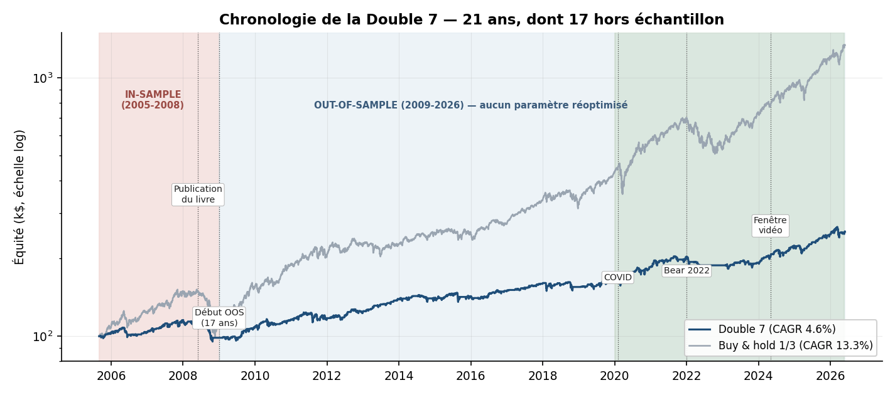

# Stratégie « Double 7 » de Larry Connors
## Dossier de due diligence pour comité d'investissement

**Document de synthèse — description, chronologie, métriques complètes et conditions de mise en œuvre**

---

| | |
|---|---|
| **Stratégie** | Double 7 (Connors & Alvarez, 2008) — mean-reversion court terme, long only |
| **Univers évalué** | SPY, QQQ, GLD (ETF, closes ajustés) ; contrôle : US500, US100, XAUUSD (CFD) |
| **Période** | 2005-09 → 2026-05 (21 ans, dont 17 hors échantillon) |
| **Hypothèses** | 100 k$, 5 bps/côté, 0 commission, fills au close, parts fractionnaires |
| **Origine de l'étude** | Réplication de la vidéo *Unbiased Trading* (mai 2026), puis validation indépendante |
| **Statut** | Recherche — ce document n'est pas un conseil en investissement |
| **Date** | 13 juin 2026 |

> **Note de lecture.** Ce document est autoporteur. Il consolide deux rapports techniques de référence — `rapport_double7_connors.md` (réplication, backtest étendu, robustesse, améliorations) et `audit_risque_double7.md` (walk-forward, Monte Carlo, data-mining, stress tests). Toutes les figures et tous les chiffres cités sont reproductibles via les scripts listés en Annexe C.

---

## Table des matières

1. Recommandation pour le comité
2. Description détaillée de la stratégie
3. Chronologie et provenance
4. Métriques — vue consolidée
   - 4.1 Réplication de la vidéo (2020–2026)
   - 4.2 Backtest étendu et hors échantillon (2005–2026)
   - 4.3 Décomposition annuelle et par instrument
   - 4.4 Robustesse (paramètres, coûts, source, exécution)
5. Audit de risque
   - 5.1 Walk-forward
   - 5.2 Monte Carlo
   - 5.3 Data-mining (Deflated Sharpe, PBO, permutation)
   - 5.4 Stress tests de crise
   - 5.5 Drawdowns et tail risk
6. Améliorations testées
7. Mise en œuvre opérationnelle
8. Limites et risques résiduels
9. Cadre de décision
10. Annexes

---

## 1. Recommandation pour le comité

**La Double 7 est une stratégie de mean-reversion dont l'edge est statistiquement réel, honnête et exceptionnellement stable hors échantillon, mais d'ampleur modeste.** Elle a passé l'intégralité de la batterie de tests de pré-déploiement. Son profil — gains fréquents, protection en krach, faible exposition — en fait une **brique d'overlay de timing**, et non une stratégie autonome de croissance du capital.

**Avis : GO conditionnel, en taille limitée**, dans une enveloppe diversifiée, sous quatre conditions impératives développées en §7 :

1. **Figer les paramètres publiés** (entrée 7 j / sortie 7 j / SMA 200) — toute optimisation est sur-apprise (PBO 69 %).
2. **Déployer la version vol-targeted + time-stop** (§6) plutôt que la version brute, pour borner la queue.
3. **Restreindre aux instruments très liquides** (ETF/futures d'indices majeurs) — l'edge meurt au-delà de ~30 bps de coût par côté.
4. **Provisionner ex ante** un drawdown de −26 % (p5 Monte Carlo) et une stagnation possible de 24–30 mois.

| Dimension | Constat | Note |
|---|---|---|
| Significativité statistique | Deflated Sharpe 98 %, t-stat NW 3.6 (OOS) | ✅ Fort |
| Honnêteté de l'edge | Bat les entrées aléatoires, p = 0.002 | ✅ Fort |
| Stabilité hors échantillon | 17 ans OOS, WFE 0.64–0.90 | ✅ Fort |
| Comportement en crise | Protection +10 à +20 pts vs B&H | ✅ Fort |
| Rendement absolu | CAGR ~5 %, exposition ~30 % | ⚠️ Modeste |
| Optimisabilité des paramètres | PBO 69 % → ne pas optimiser | ⚠️ À cadrer |
| Durée des drawdowns | Jusqu'à 924 j sous l'eau (à −10 %) | ⚠️ À provisionner |
| Risque de trade isolé | −30 % sans stop (corrigé par time-stop) | ⚠️ Corrigeable |


*Figure 1 — Cycle de vie de la stratégie : 4 ans in-sample, 17 ans out-of-sample, fenêtre testée par la vidéo en surbrillance verte.*

---

## 2. Description détaillée de la stratégie

### 2.1 Origine

La Double 7 est publiée par **Larry Connors et Cesar Alvarez** dans *Short-Term Trading Strategies That Work* (2008). C'est l'une des règles de mean-reversion les plus connues du trading systématique sur indices, dans la même famille que le RSI(2) du même auteur. Elle est délibérément minimale : trois règles, aucun paramètre caché.

### 2.2 Règles (long only)

| # | Condition | Implémentation au close du jour t |
|---|---|---|
| 1 | **Filtre de tendance** | `close > SMA(200)` |
| 2 | **Entrée** — clôture au plus bas de 7 jours | acheter si `close ≤ min(close, 7 j)` *et* règle 1 vraie |
| 3 | **Sortie** — clôture au plus haut de 7 jours | vendre la position si `close ≥ max(close, 7 j)` |

Ni stop-loss, ni objectif de profit, ni indicateur additionnel dans la version d'origine. Une position est soit pleinement investie, soit en cash.

### 2.3 Intuition économique

La stratégie exploite l'**autocorrélation négative à court terme** des indices actions. Dans un marché haussier structurel (filtré par la SMA 200), un plus bas de 7 jours traduit le plus souvent une **liquidation court terme** (rééquilibrages, stop-outs, aversion ponctuelle) plutôt qu'un changement de régime. L'acheteur de ce creux **fournit de la liquidité** et capture la prime de rebond ; la sortie sur plus haut de 7 jours laisse le rebond se compléter.

Le filtre SMA 200 est le cœur du dispositif de risque : il **désactive les achats dès qu'un actif passe en tendance baissière**, ce qui met mécaniquement la stratégie en cash au début des marchés baissiers (cf. stress tests, §5.4).

### 2.4 Profil de P&L attendu

Caractéristique du retour à la moyenne : **win rate élevé (~74 %), gains petits et fréquents, pertes rares mais plus grandes** (payoff ratio 0.61, skew négatif). La rentabilité tient au fait que le filtre de tendance écarte la majorité des creux qui « continuent de creuser ». La contrepartie est une **queue gauche** : sans stop, un creux qui ne rebondit pas (ex. QQQ 2008) peut coûter −30 %.


*Figure 2 — Trade réel : achat sur clôture au plus bas 7 j, revente sur clôture au plus haut 7 j.*


*Figure 3 — 606 trades : masse de petits gains, queue gauche épaisse, durée médiane ~6 jours.*

---

## 3. Chronologie et provenance

| Période | Phase | Événement |
|---|---|---|
| **2008** | Publication | Connors & Alvarez publient la Double 7 (in-sample du livre ≈ années 1990–2008). |
| **2005–2008** | In-sample (notre test) | Performance **médiocre** dans notre backtest : CAGR −0.4 %, Sharpe −0.01 — c'est la pire sous-période, et elle contient le pire trade de l'historique. |
| **2009–2026** | Out-of-sample (17 ans) | Aucun paramètre réoptimisé. Performance **meilleure** qu'in-sample : Sharpe 0.72, win rate stable 72–76 %. L'inverse du pattern d'overfitting. |
| **mai 2026** | Test public | La vidéo *Unbiased Trading* re-teste la stratégie « from scratch » sur 2020–2026 (SPY/QQQ/GLD), annonce +49 %, 75 % WR, Sharpe 0.58. |
| **juin 2026** | Notre validation | Réplication à un trade près, puis audit institutionnel complet (ce dossier). |

**Point clé pour le comité.** La stratégie est publiée depuis **18 ans**. La littérature (McLean & Pontiff, 2016) montre que la plupart des anomalies publiées se dégradent fortement après publication. Ici, l'edge est resté **statistiquement intact** sur les 17 années postérieures — c'est inhabituel et c'est le principal argument de fond en faveur de la stratégie.

---

## 4. Métriques — vue consolidée

### 4.1 Réplication de la vidéo (2020-01 → 2026-05, equal sleeves)

| Métrique | Vidéo | Réplication | Statut |
|---|---|---|---|
| Nombre de trades | 180 | **181** | ✓ |
| Win rate | ~75 % | **75.7 %** | ✓ |
| Durée moyenne | 8 j | **7.9 j** | ✓ |
| Rendement total | +49 % | **+53.0 %** | écart = dividendes réinvestis |
| Max drawdown | −16 % | −10.5 % | conventions vidéo non divulguées |
| Sharpe | 0.58 | 0.85 | méthode vidéo inconnue |
| CAGR | n.d. | 6.9 % | |
| Profit factor | n.d. | 1.98 | |
| Sortino / Calmar | n.d. | 1.24 / 0.65 | |
| Exposition moyenne | n.d. | 29.8 % (52 % des jours en marché) | |

**Conclusion : réplication réussie.** Les statistiques structurelles coïncident ; les écarts proviennent de l'ajustement des dividendes et de conventions de métriques non divulguées dans la vidéo. La revendication de la vidéo sur le sizing par volatilité (« améliore les résultats ») **ne se réplique pas** une fois le stop spécifié rigoureusement — détail traité en §6.


*Figure 4 — Équité de la réplication 2020–2026 vs buy & hold.*

### 4.2 Backtest étendu et hors échantillon (2005–2026)

| Métrique | 2005–2026 (complet) | **2009–2026 (OOS)** | Buy & hold 1/3 |
|---|---|---|---|
| Rendement total | +153.8 % | +166.4 % | +1 239.8 % |
| CAGR | 4.60 % | 5.79 % | 13.33 % |
| Volatilité annualisée | 8.0 % | 8.3 % | 15.4 % |
| **Sharpe** | 0.60 | **0.72** | 0.89 |
| IC 95 % du Sharpe (bootstrap) | [0.26 ; 0.98] | **[0.35 ; 1.13]** | — |
| t-stat Newey-West | 3.21 | **3.58** | 4.46 |
| Sortino | 0.86 | 1.04 | 1.27 |
| **Max drawdown** | −17.7 % | **−10.6 %** | −34.5 % |
| Calmar | 0.26 | 0.55 | 0.39 |
| Win rate | 73.8 % | 73.7 % | — |
| Profit factor | 1.72 | 1.91 | — |
| Payoff ratio | 0.61 | 0.70 | — |
| Trades | 606 | 509 | — |
| Durée moyenne | 7.9 j | 7.8 j | — |
| Exposition moyenne | 30.4 % | 30.6 % | 100 % |
| Skew / kurtosis (quotidien) | −0.27 / 8.5 | −0.34 / 9.3 | −0.21 / 8.4 |

**Lecture.** L'edge est réel mais petit en absolu : ~5–6 % de CAGR à 30 % d'exposition, contre 13 % pour un buy & hold qui prend 100 % de risque sur une période exceptionnellement favorable au beta. **Le vrai argument est le couple rendement/drawdown** : en OOS, Calmar 0.55 vs 0.39, avec un drawdown trois fois moindre. C'est le profil d'un overlay défensif, pas d'un moteur de performance.


*Figure 5 — 2005–2026 (échelle log) et drawdowns comparés.*

**Stabilité par sous-période :**

| Sous-période | CAGR | Sharpe | MaxDD | WR | Trades |
|---|---|---|---|---|---|
| 2005–2008 (in-sample du livre) | −0.4 % | −0.01 | −17.7 % | 74.2 % | 97 |
| 2009–2015 (OOS-1) | +5.7 % | 0.71 | −8.7 % | 72.1 % | 204 |
| 2016–2020 (OOS-2) | +5.4 % | 0.73 | −7.7 % | 73.9 % | 153 |
| 2021–2026 (OOS-3) | +5.9 % | 0.77 | −10.5 % | 75.7 % | 152 |

### 4.3 Décomposition annuelle et par instrument

**Par année civile (stratégie vs buy & hold) :**

| Année | Strat | B&H | | Année | Strat | B&H |
|---|---|---|---|---|---|---|
| 2005 | +2.2 % | +7.8 % | | 2016 | +4.3 % | +8.7 % |
| 2006 | +1.3 % | +15.5 % | | 2017 | +6.9 % | +23.5 % |
| 2007 | +11.5 % | +19.0 % | | 2018 | −2.7 % | −1.9 % |
| **2008** | **−14.5 %** | **−20.8 %** | | 2019 | +7.4 % | +31.0 % |
| 2009 | +9.4 % | +31.3 % | | 2020 | +11.2 % | +34.3 % |
| 2010 | +7.2 % | +23.8 % | | 2021 | +9.5 % | +20.4 % |
| 2011 | +0.3 % | +6.5 % | | **2022** | **−7.2 %** | **−23.0 %** |
| 2012 | +6.8 % | +11.2 % | | 2023 | +2.4 % | +37.0 % |
| 2013 | +12.4 % | +0.7 % | | 2024 | +13.8 % | +25.6 % |
| 2014 | +1.0 % | +9.5 % | | 2025 | +12.9 % | +28.5 % |
| 2015 | +1.5 % | +0.3 % | | 2026* | +2.5 % | +12.9 % |

\*2026 partiel. **Lecture : la stratégie perd moins dans les années baissières (2008, 2022) et capte partiellement le haussier** — profil défensif typique.


*Figure 6 — Comparaison annuelle.*

**Par instrument (2005–2026) :**

| Instrument | Trades | Win rate | CAGR sleeve | Durée moy. | Pire trade |
|---|---|---|---|---|---|
| SPY | 208 | 76.0 % | 5.0 % | 7.4 j | −7.7 % |
| QQQ | 218 | 75.2 % | 5.1 % | 7.7 j | −30.2 % |
| GLD | 180 | 69.4 % | 3.6 % | 8.6 j | −13.6 % |

### 4.4 Robustesse

**Sensibilité aux paramètres** — 108 configurations testées (entrée 5–10 × sortie 5–10 × SMA 100/150/200) : Sharpe min/médian/max = **0.49 / 0.62 / 0.77**. *Toute la surface est profitable.* La config 7/7/200 est au 34ᵉ percentile — ni optimale, ni fragile.


*Figure 7 — Sharpe par configuration : aucune cellule négative.*

**Sensibilité aux coûts :**

| Slippage / côté | CAGR | Sharpe | Win rate |
|---|---|---|---|
| 0 bps | 5.6 % | 0.72 | 75.1 % |
| 2.5 bps | 5.1 % | 0.66 | 74.3 % |
| **5 bps (base)** | **4.6 %** | **0.60** | **73.8 %** |
| 10 bps | 3.6 % | 0.48 | 72.3 % |
| 20 bps | 1.6 % | 0.24 | 69.6 % |

Edge brut ≈ 60 bps/trade, **break-even ≈ 30 bps/côté**. Viable sur ETF liquides ; à re-coûter pour tout instrument moins profond.


*Figure 8 — Dégradation de l'edge avec les coûts.*

**Validation croisée inter-sources (2008–2026), même logique sur CFD :**

| Univers | CAGR | Sharpe | MaxDD | WR | Trades |
|---|---|---|---|---|---|
| ETF (SPY/QQQ/GLD) | 4.4 % | 0.59 | −16.2 % | 73.0 % | 523 |
| CFD (US500/US100/XAUUSD) | 4.7 % | 0.61 | −10.6 % | 73.0 % | 518 |

Concordance quasi parfaite : **le signal n'est pas un artefact de données.**


*Figure 9 — ETF vs CFD, base 100.*

**Sensibilité à l'exécution :** exécuter au close de **t+1** (au lieu du close du signal) ne dégrade pas l'edge — il s'améliore même légèrement (Sharpe 0.67 vs 0.60). L'edge ne dépend donc pas d'une capture fine du close, ce qui **facilite l'implémentation réelle**.

---

## 5. Audit de risque

### 5.1 Walk-forward

Sur chaque fenêtre In-Sample, la meilleure configuration est sélectionnée puis appliquée telle quelle sur la fenêtre Out-of-Sample suivante.

| Schéma | Segments | Sharpe OOS | CAGR OOS | MaxDD OOS | **WFE** | % OOS positifs |
|---|---|---|---|---|---|---|
| Ancré 5a/2a | 7 | 0.63 | +4.6 % | −18.9 % | **0.90** | 86 % |
| Glissant 4a/2a | 7 | 0.53 | +4.2 % | −16.7 % | **0.64** | 100 % |
| Glissant 3a/1a | 16 | 0.66 | +5.3 % | −20.1 % | **0.81** | 88 % |

Walk-Forward Efficiency de 0.64 à 0.90 (un système sur-appris est < 0.4). Sur 30 segments OOS cumulés, **2 seulement sont négatifs**. L'équité walk-forward (params réoptimisés) se superpose au 7/7/200 figé.


*Figure 10 — Sharpe IS vs OOS et équité walk-forward.*

### 5.2 Monte Carlo

Bootstrap stationnaire des rendements quotidiens (5 000 chemins, blocs ~20 j) :

| Métrique | p1 | p5 | médiane | p95 |
|---|---|---|---|---|
| Sharpe | — | 0.30 | 0.61 | 0.93 |
| CAGR | — | +2.1 % | +4.6 % | +7.1 % |
| Max drawdown | −32.5 % | −26.2 % | −16.3 % | −10.9 % |

**P(CAGR < 0) = 0.1 %**, P(MaxDD < −25 %) = 7.0 %, P(MaxDD < −30 %) = 2.0 %. Le drawdown réalisé (−17.7 %) est au 39ᵉ percentile : ni chanceux, ni anormal. **À provisionner : un DD de −26 % (p5) reste plausible.**


*Figure 11 — Distribution du MaxDD simulé (gauche : portefeuille réel ; droite : borne conservatrice mono-compte).*

### 5.3 Data-mining

| Test | Résultat | Interprétation |
|---|---|---|
| **Deflated Sharpe Ratio** | **98.2 %** | Proba que le vrai Sharpe > 0 après correction pour 108 essais + non-normalité. SR0 attendu sous H₀ = 0.14 vs 0.60 observé. |
| **PBO (CSCV)** | **68.9 %** | Sélectionner les « meilleurs » paramètres ne généralise pas → **ne pas optimiser**, figer 7/7/200. Ne condamne pas la stratégie (configs interchangeables, toutes positives). |
| **Test de permutation** | Sharpe 0.60 vs **0.13** aléatoire, **p = 0.002** | Le timing « 7-day low » crée un edge propre, ce n'est pas du beta déguisé. |


*Figure 12 — Les 108 Sharpes vs le seuil SR0 attendu sous l'hypothèse nulle.*


*Figure 13 — Le Sharpe observé est dans la queue extrême des entrées aléatoires.*

### 5.4 Stress tests de crise

| Crise | Double 7 | Buy & hold | **Protection** |
|---|---|---|---|
| GFC 2007–2009 | −13.2 % | −24.1 % | **+10.9 pts** |
| Q4 2018 selloff | −4.3 % | −14.9 % | **+10.7 pts** |
| COVID crash 2020 | −3.6 % | −23.5 % | **+19.9 pts** |
| Bear 2022 | −7.2 % | −26.9 % | **+19.7 pts** |
| Taper tantrum 2013 | −0.4 % | −5.4 % | +5.1 pts |
| Crise zone euro 2011 | −3.9 % | −3.1 % | −0.8 pt |
| Dévaluation yuan 2015 | −7.8 % | −7.0 % | −0.9 pt |

**La stratégie amortit systématiquement les krachs majeurs** (le filtre SMA 200 coupe les entrées et met en cash). Elle ne sous-performe marginalement que dans les chocs en V brutaux où elle est déjà longue (< 1 pt).


*Figure 14 — Convexité défensive face aux crises.*

### 5.5 Drawdowns et tail risk

**Top 5 des drawdowns :**

| Début | Creux | Profondeur | Durée totale sous l'eau |
|---|---|---|---|
| 2008-06 | 2008-10 | **−17.7 %** | 676 j |
| 2021-09 | 2023-02 | −10.6 % | **924 j (~2.5 ans)** |
| 2026-03 | 2026-03 | −9.0 % | en cours |
| 2011-05 | 2011-08 | −8.4 % | 443 j |
| 2006-04 | 2006-06 | −8.1 % | 371 j |

**Le risque dominant est la durée, pas la profondeur.** L'épisode 2021–2024 n'atteint que −10.6 % mais dure **924 jours** : pour une stratégie à ~5 % de CAGR, c'est le principal risque d'allocation (un mandat peut être coupé avant récupération).

| Tail risk quotidien | Valeur |
|---|---|
| VaR 95 % / CVaR 95 % | −0.76 % / −1.32 % |
| VaR 99 % / CVaR 99 % | −1.65 % / −2.22 % |
| Pire jour | −3.64 % |
| Pertes consécutives max (trades) | 4 |
| Recovery factor | 8.70 |
| Ulcer index | 4.6 % |


*Figure 15 — Courbe underwater 2005–2026.*

---

## 6. Améliorations testées

Trois axes backtestés sur 2005–2026, mêmes conventions que la base (Sharpe 0.60, MaxDD −17.7 %, pire trade −30.2 %).

| Variante | CAGR | Sharpe | Sortino | MaxDD | Calmar | Pire trade |
|---|---|---|---|---|---|---|
| **Base 7/7/200** | 4.60 % | 0.60 | 0.86 | −17.7 % | 0.26 | −30.2 % |
| Axe 1 — vol target 18 % | 4.57 % | 0.64 | 0.92 | −14.3 % | 0.32 | −30.2 % |
| **Axe 1 — vol target 12 %** | 4.14 % | **0.68** | **0.97** | **−9.7 %** | **0.43** | −30.2 % |
| Axe 2 — time-stop 10 j | 4.08 % | 0.59 | 0.84 | −14.4 % | 0.28 | **−14.1 %** |
| Axe 2 — sortie SMA 5 | 3.05 % | 0.51 | 0.72 | −9.7 % | 0.32 | −10.3 % |
| Axe 3 — univers 15 actifs | 3.69 % | 0.59 | 0.82 | −12.4 % | 0.30 | −34.8 % |
| **Combo VT 12 % + TS 10 j** | 3.55 % | **0.66** | 0.94 | **−9.7 %** | 0.37 | **−14.1 %** |

- **Axe 1 (recommandé) — vol targeting par position :** investir une fraction inversement proportionnelle à la volatilité réalisée plutôt qu'all-in. Améliore le Sharpe (0.60 → 0.68) et **divise le drawdown par ~1.8**, sans information nouvelle (mêmes trades, meilleure géométrie du risque).
- **Axe 2 (recommandé en complément) — time-stop 10 j :** sortir si aucun plus-haut 7 j n'est advenu en 10 séances. **Coupe le pire trade de −30 % à −14 %** à Sharpe quasi constant. Un stop *prix* est à proscrire : il vend dans le creux et détruit l'edge.
- **Axe 3 — conditionnement au régime VIX :** l'edge par trade **triple en régime VIX > 25** (103–179 bps vs ~45 bps). Recommandation : *dimensionner* selon le régime plutôt que *filtrer* (les filtres binaires détruisent de la valeur). La diversification naïve à 15 actifs **n'apporte rien** (signaux synchrones) — résultat négatif documenté.

| VIX à l'entrée | Trades | Win rate | Rendement moyen/trade |
|---|---|---|---|
| < 15 | 173 | 76.9 % | 42 bps |
| 15–20 | 213 | 70.9 % | 45 bps |
| 20–25 | 102 | 75.5 % | 38 bps |
| 25–35 | 59 | 69.5 % | **103 bps** |
| > 35 | 14 | 71.4 % | **179 bps** |


*Figure 16 — Équités et métriques risque-ajustées des variantes.*

**Configuration recommandée pour déploiement :** equal sleeves + **vol targeting 12 % + time-stop 10 j**. Profil : Sharpe 0.66, Sortino 0.94, MaxDD −9.7 %, Calmar 0.37, pire trade −14.1 %, t-stat NW 3.57, IC95 Sharpe [0.32 ; 1.05].

---

## 7. Mise en œuvre opérationnelle

### 7.1 Spécification de production (paramètres figés)

| Paramètre | Valeur | Justification |
|---|---|---|
| Lookback entrée / sortie | 7 j / 7 j | Publié ; optimisation interdite (PBO 69 %) |
| Filtre de tendance | SMA 200 | Domine SMA 100/150 |
| Sizing | Vol target 12 % annualisé par position | Meilleur Calmar (§6) |
| Time-stop | 10 séances | Borne la queue (−30 % → −14 %) |
| Univers initial | SPY, QQQ, GLD (ou US500/US100/XAUUSD en futures) | Liquidité + validation croisée |
| Exécution | Close du jour (~15 h 58) ou open J+1 | Edge robuste aux deux (§4.4) |
| Coût budgété | ≤ 5 bps/côté | Au-delà de 30 bps l'edge meurt |

### 7.2 Capacité et liquidité

À ~29 trades/an répartis sur 3 ETF parmi les plus liquides au monde et ~30 % d'exposition moyenne, la **capacité est élevée** (plusieurs centaines de M$ sans impact significatif sur SPY/QQQ). L'hypothèse de fill au close sans impact de marché est raisonnable jusqu'à des ordres de l'ordre de 10–50 M$ ; au-delà, modéliser l'impact et étaler l'exécution.

### 7.3 Architecture d'exécution (du backtest au live)

Le passage en production exige nettement plus que la logique de signal (≈ 10 % du travail) :

1. **Module broker** — wrapper des endpoints : comptes, positions, ordres, fills, annulations.
2. **Ordonnanceur** — un run quotidien juste avant/après le close, pas une boucle de backtest.
3. **Réconciliation** — la position vérité est celle du **broker**, jamais celle du code ; reconcilier à chaque run.
4. **Persistance d'état** — journal JSON des entrées/sorties/prix de fill, résistant aux crashs.
5. **Garde-fous** — calendrier de marché, anti-double-soumission, kill-switch sur drawdown, logs/alertes, gestion des fills partiels.

### 7.4 Limites de risque recommandées

| Garde-fou | Seuil proposé |
|---|---|
| Budget de drawdown (kill-switch / revue) | −26 % (p5 Monte Carlo) |
| Alerte de stagnation | > 18 mois sous le pic → revue de comité |
| Exposition brute max | 100 % (pas de levier en v1) |
| Risque par position | ~12 % vol annualisée cible |
| Coût de transaction réalisé | revue si > 10 bps/côté observés |
| Capacité par ordre | impact modélisé au-delà de ~50 M$ |

### 7.5 Place dans un portefeuille

La Double 7 est une **brique d'overlay de timing mean-reversion**, pas un fonds. Usages naturels : (i) overlay sur une poche cash/faible risque pour en relever le rendement ajusté du risque ; (ii) composante décorrélée dans un portefeuille multi-stratégies (sa convexité défensive complète les stratégies de momentum/trend) ; (iii) ne pas l'évaluer en standalone contre un buy & hold — elle perdra sur le rendement absolu en marché haussier.

---

## 8. Limites et risques résiduels

1. **Rendement absolu modeste** — ~5 % CAGR à 30 % d'exposition ; le cash non rémunéré dans le backtest sous-estime le rendement réel (au taux monétaire 2022–2026, ~70 % de cash ajouterait ~2 pts de CAGR sans risque).
2. **Un seul régime macro séculaire** — l'échantillon est dominé par la hausse 2009–2026 ; un marché latéral long (type 2000–2010 sur indices) laisserait la stratégie majoritairement en cash (risque d'opportunité, pas de perte en capital).
3. **Diversification réelle faible** — 3 actifs corrélés ≈ 1.5 pari indépendant en régime de stress (creux synchrones).
4. **Pas de jambe short** — la version testée est long only ; la jambe short symétrique de Connors (plus-haut 7 j sous SMA 200) n'a pas été évaluée.
5. **Backtest non intraday** — fills et stops au close ; en intraday réel, des stops seraient touchés plus souvent (non applicable à la version recommandée sans stop prix).
6. **Améliorations évaluées sur l'échantillon complet** — un déploiement exigerait une validation walk-forward des choix de σ-cible et du time-stop (risque limité : un paramètre chacun, gradients monotones).
7. **Survivorship d'univers** — SPY/QQQ/GLD choisis ex post comme actifs à succès séculaire ; atténué par le test à 15 actifs et le cross-check CFD, non éliminé.

---

## 9. Cadre de décision

| Question du comité | Réponse étayée |
|---|---|
| L'edge est-il réel ou un faux positif de recherche ? | **Réel** — Deflated Sharpe 98 %, bat l'aléatoire (p = 0.002), 17 ans OOS. |
| Survit-il à une ré-optimisation honnête ? | **Oui** — WFE 0.64–0.90, 88–100 % des segments OOS positifs. |
| Quel est le pire scénario plausible ? | DD −26 % (p5 MC) ; stagnation 2–3 ans ; trade isolé −30 % (→ −14 % avec time-stop). |
| Peut-on l'optimiser pour faire mieux ? | **Non** — PBO 69 %. Figer les paramètres. Gains uniquement via sizing/sortie (§6). |
| Combien rapporte-t-elle ? | ~5 % CAGR brut, à ~30 % d'exposition. Brique défensive, pas moteur. |
| Est-elle déployable en l'état ? | **Oui en taille limitée**, version vol-targeted + time-stop, instruments très liquides, sous les garde-fous du §7.4. |

**Synthèse :** la Double 7 est une stratégie **saine, défensive et statistiquement crédible**, dont la principale faiblesse est l'ampleur (rendement absolu modeste) et non la fiabilité. Elle a sa place comme **composante d'overlay** dans une allocation diversifiée, à condition d'être déployée avec discipline (paramètres figés, sizing par volatilité, garde-fous de drawdown et de stagnation).

---

## 10. Annexes

### Annexe A — Conventions de calcul

Sharpe = √252 × moyenne/écart-type des rendements quotidiens de l'équité (rf = 0, cash non rémunéré — hypothèse conservatrice). Drawdown sur équité de clôture. Win rate et payoff sur trades clôturés. Durées en jours de bourse. Rendements par trade slippage inclus. t-stat Newey-West avec lags ⌊4(n/100)^{2/9}⌋. IC du Sharpe par bootstrap de blocs circulaires (20 j, 2 000 tirages). Deflated Sharpe & PSR selon Bailey & López de Prado (2014). PBO par CSCV (14 blocs). Test de permutation à exposition contrôlée (mêmes trades/durées, dates aléatoires sous contrainte close > SMA 200).

### Annexe B — Glossaire

**OOS** (out-of-sample) : période postérieure à la calibration, jamais vue par le modèle. **WFE** (walk-forward efficiency) : ratio perf OOS / perf IS. **PBO** (probability of backtest overfitting) : probabilité que la config optimale IS sous-performe la médiane OOS. **Deflated Sharpe** : Sharpe corrigé du nombre d'essais et de la non-normalité. **CVaR** : perte moyenne au-delà de la VaR. **Calmar** : CAGR / |MaxDD|. **Payoff ratio** : gain moyen / perte moyenne.

### Annexe C — Reproductibilité (scripts)

```
engine.py              moteur de backtest (sleeves + vol-sized)
metrics.py             métriques, Newey-West, bootstrap
data.py                chargeurs de données (ETF, CFD, XAUUSD M1→D1)
research_grid.py       grille de paramètres, coûts, cross-check CFD
improvements.py        axes d'amélioration (vol target, sorties, VIX)
audit_walkforward.py   walk-forward ancré + glissant
audit_montecarlo.py    Monte Carlo (rendements + trades)
audit_datamining.py    Deflated Sharpe, PBO/CSCV, permutation
audit_stress.py        crises, drawdowns, VaR/CVaR
figures.py / audit_figures.py   génération des figures
results_*.json / audit_*.json   tous les chiffres cités
```

### Annexe D — Documents de référence

- `rapport_double7_connors.md` — rapport technique (réplication, backtest étendu, robustesse, améliorations).
- `audit_risque_double7.md` — audit de risque détaillé (walk-forward, Monte Carlo, data-mining, stress).
- Connors & Alvarez, *Short-Term Trading Strategies That Work* (2008).
- Vidéo *Unbiased Trading*, « I tested a famous trading strategy » (mai 2026).
- Bailey & López de Prado, « The Deflated Sharpe Ratio » (2014) ; « The Probability of Backtest Overfitting » (2016).

*Document généré le 13 juin 2026. Étude de recherche quantitative — ne constitue pas un conseil en investissement ni une recommandation de transaction.*
