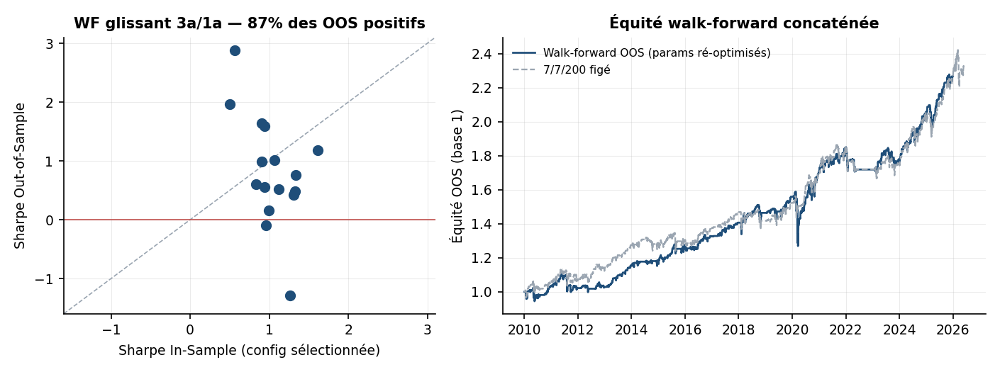
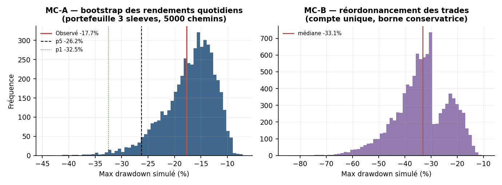
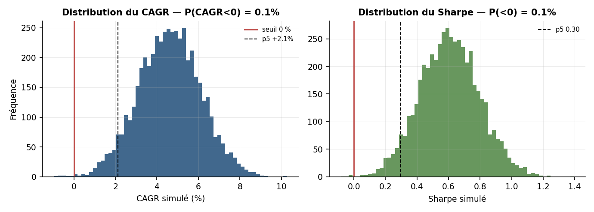
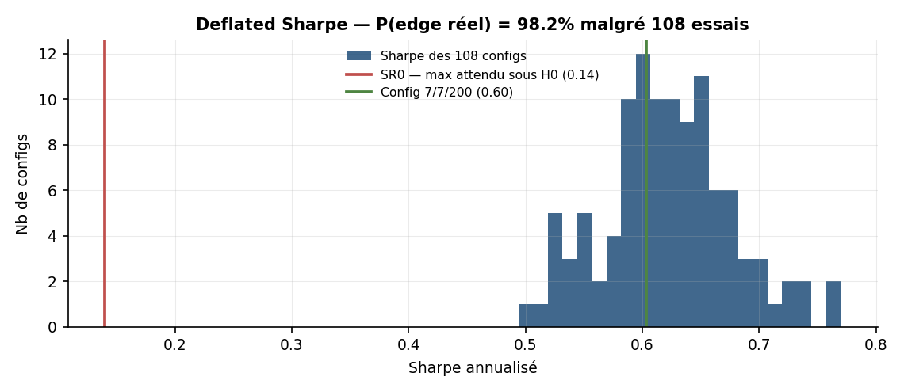
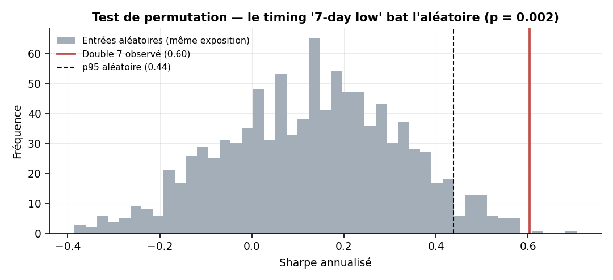
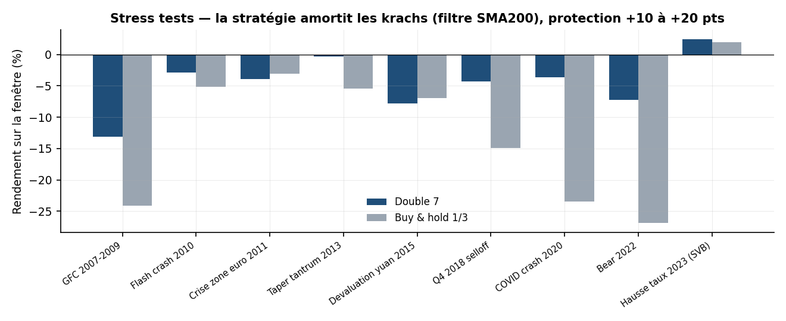
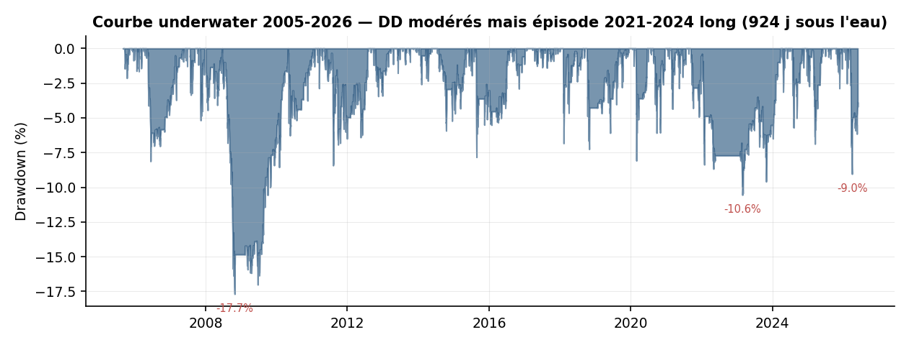

# Audit de risque — Stratégie « Double 7 » de Larry Connors

**Dossier de pré-déploiement (risk-quant)**
Walk-forward · Monte Carlo · Tests de data-mining · Stress tests de crise · Analyse de queue

*Date : 13 juin 2026 — Univers SPY / QQQ / GLD, 2005–2026, 5 bps/côté. Complète le rapport `rapport_double7_connors.md`.*

---

## 0. Synthèse et recommandation

| Test | Question | Résultat | Verdict |
|---|---|---|---|
| **Walk-forward** | L'edge survit-il à une ré-optimisation honnête des paramètres ? | WFE 0.64–0.90, 86–100 % des segments OOS positifs | ✅ |
| **Monte Carlo (rendements)** | Le résultat est-il un coup de chance de séquence ? | P(CAGR<0) = 0.1 %, DD observé au 39ᵉ pct | ✅ |
| **Deflated Sharpe** | L'edge survit-il à la correction pour 108 essais + non-normalité ? | DSR = 98.2 % (SR0 attendu 0.14 vs 0.60 observé) | ✅ |
| **Test de permutation** | Le timing « 7-day low » bat-il l'aléatoire à exposition égale ? | Sharpe 0.60 vs 0.13, p = 0.002 | ✅ |
| **PBO (CSCV)** | Peut-on fiablement *sélectionner* les meilleurs paramètres ? | PBO = 69 % | ⚠️ ne pas optimiser |
| **Stress de crise** | Comment se comporte-t-elle dans les krachs ? | Protection +10 à +20 pts vs B&H | ✅ |
| **Tail risk** | Quelle est la queue ? | CVaR99 −2.2 %/j, pire trade −30 %, max 4 pertes d'affilée | ⚠️ contrôlable |
| **Durée des DD** | Combien de temps sous l'eau ? | 924 j en 2021–2024 (DD −10.6 %) | ⚠️ risque de carrière |

**Recommandation : APTE au déploiement en taille limitée, comme overlay de timing**, à condition de (i) **figer les paramètres publiés** (7/7/200) — toute optimisation est sur-apprise (PBO 69 %) ; (ii) **dimensionner via vol targeting + time-stop** (cf. rapport principal § 8) pour borner la queue ; (iii) **accepter ex ante des périodes sous l'eau de 2–3 ans** à faible amplitude ; (iv) re-coûter pour tout instrument moins liquide que SPY/QQQ/GLD. L'edge est statistiquement réel et économiquement honnête, mais petit : c'est une brique, pas un moteur.

---

## 1. Walk-forward analysis

Protocole le plus exigeant : sur chaque fenêtre **In-Sample (IS)** on sélectionne la configuration `(entry, exit, SMA)` qui maximise le Sharpe parmi 108 candidates, puis on l'applique **telle quelle** sur la fenêtre **Out-of-Sample (OOS)** suivante, jamais vue. Les segments OOS concaténés forment la seule équité véritablement honnête. Indicateurs calculés sur l'historique complet (pas de fuite de warm-up).

| Schéma | Segments | Sharpe OOS chaîné | CAGR OOS | MaxDD OOS | **WFE** | % OOS positifs |
|---|---|---|---|---|---|---|
| Ancré 5a IS / 2a OOS | 7 | 0.63 | +4.6 % | −18.9 % | **0.90** | 86 % |
| Glissant 4a IS / 2a OOS | 7 | 0.53 | +4.2 % | −16.7 % | **0.64** | 100 % |
| Glissant 3a IS / 1a OOS | 16 | 0.66 | +5.3 % | −20.1 % | **0.81** | 88 % |

La **Walk-Forward Efficiency** (Sharpe OOS / Sharpe IS) de 0.64 à 0.90 est excellente — un système sur-appris s'effondre typiquement sous 0.4. Sur les 30 segments OOS cumulés, **2 seulement sont négatifs** (2018 et 2022, années de retournement). Surtout, l'équité walk-forward (paramètres ré-optimisés tous les ans) se superpose presque parfaitement à celle du 7/7/200 **figé** : la ré-optimisation n'ajoute ni ne retire rien.


*Figure A1 — Gauche : chaque point est un segment ; la quasi-totalité des Sharpe OOS sont positifs. Droite : l'équité walk-forward (ré-optimisée) colle au 7/7/200 figé.*

**Lecture risk-quant.** L'edge n'est pas un artefact d'un jeu de paramètres chanceux : il se régénère hors échantillon, glissé sur 16 ans. Le fait que les paramètres ré-optimisés convergent vers `(9–10, 6, 200)` — légèrement différents de `7/7/200` — sans gain de performance confirme que **la surface est plate** : c'est une force (robustesse), pas une faiblesse.

---

## 2. Monte Carlo

### 2.1 MC-A — Bootstrap stationnaire des rendements quotidiens (5 000 chemins)

Rééchantillonnage par blocs géométriques (longueur moyenne 20 j, Politis-Romano) qui préserve l'autocorrélation et la kurtosis (~8–11). On régénère 5 000 historiques de même longueur et on lit la distribution des métriques.

| Métrique | p1 | p5 | médiane | p95 | p99 |
|---|---|---|---|---|---|
| Sharpe | — | 0.30 | 0.61 | 0.93 | — |
| CAGR | — | +2.1 % | +4.6 % | +7.1 % | — |
| Max drawdown | −32.5 % | −26.2 % | −16.3 % | −10.9 % | — |

Probabilités : **P(CAGR < 0) = 0.1 %**, P(Sharpe < 0) ≈ 0, P(MaxDD < −25 %) = 7.0 %, P(MaxDD < −30 %) = 2.0 %. Le drawdown réalisé (−17.7 %) se situe au **39ᵉ percentile** de la distribution simulée : ni chanceux, ni anormal. Mais la queue est réelle — **un investisseur doit provisionner mentalement un DD de −26 % (p5) à −32 % (p1)**, bien au-delà du −17.7 % historique.

### 2.2 MC-B — Réordonnancement de la séquence de trades (10 000 chemins, borne conservatrice)

On rééchantillonne les 606 trades avec remise sur un **compte unique** (sans la diversification des 3 sleeves) : c'est une borne pessimiste qui isole le **risque de séquence**. MaxDD médian −33 %, P(DD > 35 %) = 41 %, P(DD > 50 %) = 6 %. L'écart avec le −17.7 % réalisé **mesure la valeur de la diversification inter-sleeves** : répartir sur 3 actifs ~divise par deux le drawdown qu'aurait subi un compte mono-actif enchaînant les mêmes trades.


*Figure A2 — Distributions de MaxDD. Gauche (MC-A, portefeuille réel) : observé −17.7 % proche de la médiane. Droite (MC-B, compte unique) : borne conservatrice, médiane −33 %.*


*Figure A3 — Distributions du CAGR et du Sharpe : la masse est nettement positive, queue gauche du CAGR au-dessus de 0.*

---

## 3. Risque de data-mining et de surapprentissage

C'est le test le plus important : la stratégie est-elle un faux positif issu de la recherche ?

### 3.1 Deflated Sharpe Ratio (Bailey & López de Prado, 2014)

Le DSR corrige le Sharpe pour (a) les **108 configurations** testées, (b) la **non-normalité** (skew −0.27, kurtosis 11.5), (c) la longueur d'échantillon (5 215 jours).

- Sharpe maximal **attendu sous H₀** (vrai edge nul) avec 108 essais : **SR0 = 0.14** annualisé.
- Sharpe observé du 7/7/200 : **0.60** — très au-dessus de SR0.
- **Deflated Sharpe = 98.2 %** : probabilité que le vrai Sharpe soit > 0 après toutes les corrections.


*Figure A4 — Les 108 Sharpes sont serrés et tous très au-dessus du seuil SR0 attendu sous l'hypothèse nulle de multiple testing.*

### 3.2 Probability of Backtest Overfitting — PBO (CSCV)

Validation croisée combinatoire symétrique (14 blocs, 3 432 partitions IS/OOS) : la config gagnante IS reste-t-elle au-dessus de la médiane OOS ? **PBO = 68.9 %.**

**Interprétation — nuance cruciale.** Un PBO élevé signifierait normalement un sur-apprentissage. Ici, il s'explique par le fait que **les 108 configs sont quasi équivalentes** (Sharpe 0.49–0.77, fortement corrélées) : sélectionner « la meilleure » IS revient à sélectionner du bruit, qui régresse vers la médiane OOS. Le PBO ne condamne donc **pas la stratégie** (DSR 98 %, WF positif) mais l'**acte d'optimiser ses paramètres** : on gagne de l'argent OOS quelle que soit la config, mais on ne peut pas fiablement choisir la meilleure. **Conclusion opérationnelle : figer 7/7/200, ne jamais « tuner ».**

### 3.3 Test de permutation par entrées aléatoires

Le filtre haussier (close > SMA200) fait être long ~30 % du temps. Le timing « plus bas 7 jours » crée-t-il de la valeur, ou capture-t-il juste du beta ? On génère 1 000 stratégies à **exposition identique** (même nombre de trades, mêmes durées tirées de la distribution réelle, entrées uniquement quand close > SMA200) mais à **dates d'entrée aléatoires**.

| | Sharpe |
|---|---|
| Double 7 (timing réel) | **0.60** |
| Entrées aléatoires — moyenne | 0.13 |
| Entrées aléatoires — p95 | 0.44 |
| Entrées aléatoires — max (1 000 tirages) | 0.71 |
| **p-value** (aléatoire ≥ observé) | **0.002** |


*Figure A5 — Le Sharpe observé est dans la queue extrême de la distribution sous entrées aléatoires : le timing apporte un edge propre, pas du beta déguisé.*

**C'est le résultat le plus rassurant de l'audit** : l'edge vient de la *règle de timing* elle-même (acheter la faiblesse court terme), pas du simple fait d'être exposé aux actions en tendance haussière.

---

## 4. Stress tests de crise

Performance sur fenêtres de crise nommées, vs buy & hold équipondéré des trois mêmes actifs.

| Crise | Double 7 | Buy & hold | DD stratégie | **Protection** |
|---|---|---|---|---|
| GFC 2007–2009 | −13.2 % | −24.1 % | −17.7 % | **+10.9 pts** |
| Flash crash 2010 | −2.9 % | −5.2 % | −6.3 % | +2.3 pts |
| Crise zone euro 2011 | −3.9 % | −3.1 % | −8.4 % | −0.8 pt |
| Taper tantrum 2013 | −0.4 % | −5.4 % | −1.8 % | +5.1 pts |
| Dévaluation yuan 2015 | −7.8 % | −7.0 % | −7.8 % | −0.9 pt |
| Q4 2018 selloff | −4.3 % | −14.9 % | −7.3 % | **+10.7 pts** |
| COVID crash 2020 | −3.6 % | −23.5 % | −8.1 % | **+19.9 pts** |
| Bear 2022 | −7.2 % | −26.9 % | −8.3 % | **+19.7 pts** |
| Hausse taux 2023 (SVB) | +2.4 % | +2.0 % | −0.2 % | +0.5 pt |


*Figure A6 — La stratégie amortit systématiquement les krachs majeurs.*

**Mécanisme.** Le filtre SMA200 **coupe les nouvelles entrées** dès qu'un actif passe sous sa moyenne 200 j : la stratégie se met naturellement en cash au début d'un marché baissier (exposition moyenne ~30 %, mais ~0 % en plein bear). Elle ne souffre que lors des **chocs en V brutaux** où elle est déjà longue (zone euro 2011, yuan 2015) — sous-performance marginale (< 1 pt). C'est un profil de **convexité défensive** précieux en complément d'un portefeuille long-only.

---

## 5. Analyse de drawdown et de queue

### 5.1 Top 5 des drawdowns

| Début | Creux | Profondeur | Durée chute | Récupération | Total sous l'eau |
|---|---|---|---|---|---|
| 2008-06 | 2008-10 | **−17.7 %** | 129 j | 547 j | 676 j |
| 2021-09 | 2023-02 | −10.6 % | 534 j | 390 j | **924 j (~2.5 ans)** |
| 2026-03 | 2026-03 | −9.0 % | 19 j | en cours | — |
| 2011-05 | 2011-08 | −8.4 % | 89 j | 354 j | 443 j |
| 2006-04 | 2006-06 | −8.1 % | 46 j | 325 j | 371 j |


*Figure A7 — Courbe underwater. Le drawdown 2008 est le plus profond ; celui de 2021–2024 est le plus long.*

**Le risque dominant n'est pas la profondeur, c'est la durée.** Le DD de 2021–2024 n'atteint que −10.6 % mais dure **924 jours** — près de 2.5 ans sous le pic. Pour une stratégie à ~5 % de CAGR, une telle stagnation est le principal **risque de carrière / d'allocation** (un mandat peut être coupé avant la récupération). À provisionner explicitement dans tout document d'investissement.

### 5.2 Tail risk quotidien et séquences

| Mesure | Valeur |
|---|---|
| VaR 95 % (1 j) | −0.76 % |
| CVaR 95 % (1 j) | −1.32 % |
| VaR 99 % (1 j) | −1.65 % |
| CVaR 99 % (1 j) | −2.22 % |
| Pire jour | −3.64 % |
| Pertes consécutives max (trades) | 4 |
| Recovery factor (tot. ret / MaxDD) | 8.70 |
| Ulcer index | 4.6 % |

Le risque de queue est **contenu au niveau du portefeuille** (CVaR99 quotidien −2.2 %, jamais plus de 4 trades perdants d'affilée). Le seul vrai point dur reste le **trade individuel sans stop** : −30.2 % sur QQQ en 2008 (cf. rapport principal), d'où la recommandation d'un **time-stop de 10 jours** qui le ramène à −14 % sans coût de Sharpe.

---

## 6. Limites de l'audit

1. **Backtest non intraday** : fills au close, stops évalués au close — le slippage réel des stops serait pire. La version recommandée (sans stop prix, time-stop seul) n'est pas concernée.
2. **Un seul régime macro de hausse séculaire** (2009–2026) domine l'échantillon ; un marché latéral long type 2000–2010 sur indices laisserait la stratégie majoritairement en cash (risque d'opportunité, pas de perte).
3. **MC suppose la stationnarité** de la distribution des rendements ; un changement de microstructure (frais, liquidité, comportement des flux retail) n'est pas capté.
4. **3 actifs corrélés** : le portefeuille n'a que ~1.5 pari indépendant en régime de stress (les creux sont synchrones) — la diversification réelle est plus faible que ne le suggère le nombre de sleeves.
5. **PBO/CSCV** suppose des blocs d'i.i.d. par construction ; avec forte autocorrélation, à lire qualitativement.

---

## 7. Conclusion de l'audit

La Double 7 franchit l'ensemble de la batterie de tests qu'un risk-quant impose avant déploiement. L'edge est **statistiquement déflaté-significatif** (DSR 98 %), **honnête** (bat l'aléatoire à p = 0.002, ce n'est pas du beta), **stable hors échantillon** (WFE 0.64–0.90), **résilient en crise** (protection +10 à +20 pts) et **de queue contenue** (CVaR99 −2.2 %/j, recovery factor 8.7). Les deux drapeaux jaunes sont gérables et bien identifiés : ne **jamais optimiser** les paramètres (PBO 69 % → figer 7/7/200) et **accepter des périodes sous l'eau longues** (jusqu'à 2.5 ans à faible amplitude).

Décision : **GO en taille limitée**, en overlay de timing mean-reversion, version vol-targeted + time-stop, sur ETF/futures très liquides uniquement, avec un budget de drawdown provisionné à −26 % (p5 Monte Carlo) et une tolérance de stagnation de 24–30 mois inscrite au mandat.

---

## Annexe — Scripts d'audit

```
audit_walkforward.py   # WF ancré + glissant, ré-sélection des paramètres, WFE
audit_montecarlo.py    # MC-A (bootstrap stationnaire rendements) + MC-B (trades)
audit_datamining.py    # Deflated Sharpe, PBO/CSCV, test d'entrées aléatoires
audit_stress.py        # crises nommées, top drawdowns, VaR/CVaR, séquences
audit_figures.py       # figures A1-A7
audit_*.json           # tous les chiffres cités
```

Conventions statistiques : bootstrap stationnaire (blocs géométriques moyenne 20 j) ; DSR/PSR selon Bailey & López de Prado (2014) avec moments empiriques ; PBO par CSCV (14 blocs) ; test de permutation à exposition contrôlée (mêmes trades/durées, dates aléatoires sous contrainte close > SMA200). Tous les résultats sont reproductibles via les scripts ci-dessus.

*Audit généré le 13 juin 2026. Document de recherche, pas un conseil en investissement.*
