# Stratégie « Double 7 » de Larry Connors — Réplication, backtest étendu et axes d'amélioration

**Rapport de recherche quantitative**
Réplication de la vidéo *« I tested a famous trading strategy using Claude Code »* (Unbiased Trading, mai 2026), suivie d'une évaluation indépendante sur 21 ans de données.

*Date : 13 juin 2026 — Données arrêtées au 27 mai 2026 (ETF) / 5 juin 2026 (CFD)*

---

## 1. Résumé exécutif

La stratégie Double 7 (Connors & Alvarez, *Short-Term Trading Strategies That Work*, 2008) est un système de retour à la moyenne court terme : acheter un creux de 7 jours dans une tendance haussière, revendre sur le rebond. Nous la répliquons fidèlement, puis l'évaluons avec un protocole institutionnel sur 2005–2026.

Conclusions principales :

1. **La réplication confirme la vidéo.** Sur la fenêtre réelle testée par l'auteur (janvier 2020 → mai 2026), nous obtenons 181 trades (vidéo : 180), un win rate de 75.7 % (vidéo : 75 %) et une durée moyenne de 7.9 jours de bourse (vidéo : 8). L'écart de rendement total (+53.0 % vs +49 %) s'explique par l'usage de prix ajustés des dividendes. La fenêtre annoncée « 5 ans » couvre en réalité ~6.4 ans.

2. **L'edge est statistiquement réel et a survécu 17 ans hors échantillon.** Publiée en 2008, la stratégie affiche sur 2009–2026 un Sharpe de 0.72 (IC bootstrap 95 % : [0.35 ; 1.13]), un t-stat Newey-West de 3.6 et un win rate stable de 72–76 % sur chaque sous-période. Le profil par cellule de paramètres est positif sur les 108 configurations testées : ce n'est pas un artefact d'overfitting.

3. **Mais l'économie de la stratégie est modeste en absolu.** CAGR de 4.6 % (2005–2026) avec ~30 % d'exposition moyenne, contre 13.3 % pour le buy & hold équipondéré des trois mêmes actifs. L'edge brut est d'environ 60 bps par trade : viable sur ETF liquides à 5 bps de slippage, détruit au-delà de ~30 bps par côté. C'est une brique de portefeuille (overlay de timing), pas une stratégie autonome.

4. **Le profil de risque est typé « ramasseur de centimes » :** win rate élevé, payoff ratio 0.61, skew négatif, pire trade −30 % (QQQ, 2008, sans stop). La variante vol-sized de la vidéo, sous-spécifiée, n'améliore pas le Sharpe une fois implémentée rigoureusement — le stop interfère avec la logique de retour à la moyenne.

5. **Trois axes d'amélioration testés :** (i) le *vol targeting* par position améliore Sharpe (0.60 → 0.68) et divise le drawdown par deux ; (ii) un *time-stop* de 10 jours coupe le pire trade de −30 % à −14 % à Sharpe quasi constant ; (iii) l'edge par trade **triple en régime VIX > 25** — c'est le dimensionnement conditionnel au régime, et non le filtrage, qui constitue la voie d'extension la plus prometteuse. La diversification naïve à 15 instruments, elle, n'apporte rien (signaux synchrones) — résultat négatif documenté en § 8.3.

---

## 2. La stratégie : règles et fonctionnement

### 2.1 Règles (Connors & Alvarez, 2008 — telles qu'énoncées dans la vidéo)

| # | Règle | Implémentation |
|---|---|---|
| 1 | L'instrument cote au-dessus de sa moyenne mobile 200 jours | `close > SMA(200)` au close du signal |
| 2 | S'il clôture au plus bas des 7 derniers jours → **achat** | `close ≤ min(close, 7 j)` (jour courant inclus) |
| 3 | Si position ouverte et clôture au plus haut des 7 derniers jours → **vente** | `close ≥ max(close, 7 j)` |

Ni stop-loss, ni objectif de profit, ni indicateur supplémentaire dans la version de base. Long only.

### 2.2 Intuition économique

La stratégie exploite l'**autocorrélation négative à court terme** des indices actions, documentée depuis la fin des années 1990 : dans un marché haussier structurel (filtre SMA 200), un plus bas de 7 jours correspond le plus souvent à un épisode de liquidation court terme (rééquilibrages, stop-outs, aversion ponctuelle) plutôt qu'à un changement de régime. L'acheteur de ce creux fournit de la liquidité et capture la prime de rebond. La sortie sur plus haut de 7 jours laisse le rebond se compléter au lieu de le tronquer.

Le profil de P&L qui en découle est caractéristique du retour à la moyenne : **gains fréquents et petits, pertes rares et grandes** (win rate ~74 %, payoff ratio ~0.6, skew négatif). La rentabilité repose sur le fait que le filtre de tendance écarte la majorité des creux qui « continuent de creuser ».

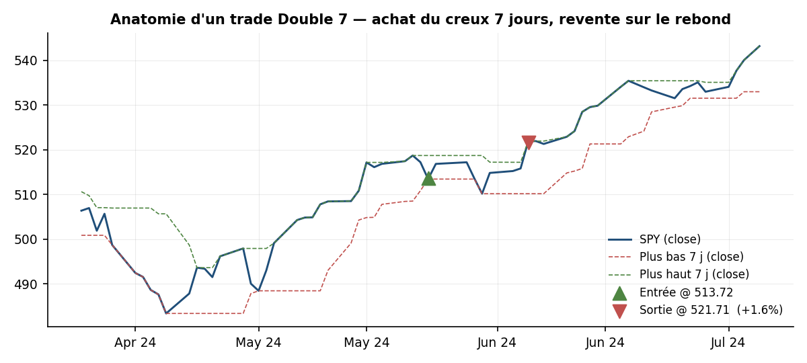
*Figure 1 — Trade réel SPY (échantillon du backtest) : entrée sur clôture au plus bas 7 j, sortie sur clôture au plus haut 7 j.*

### 2.3 Conventions d'exécution retenues

Identiques à la vidéo et documentées pour la reproductibilité : signaux calculés au close du jour t, exécution à ce même close (ordre passé ~15 h 58, comme recommandé par l'auteur) ; slippage de 5 bps par côté ; zéro commission (grille wholesale des brokers US sur ETF) ; parts fractionnaires autorisées ; warm-up de 200 barres consommé avant le début de chaque fenêtre de test. La sensibilité à ces conventions est testée en § 6.3.

---

## 3. Données et méthodologie

| Élément | Choix | Commentaire |
|---|---|---|
| Univers principal | SPY, QQQ, GLD (closes quotidiens ajustés) | Identique à la vidéo ; dividendes réinvestis |
| Univers de contrôle | US500, US100 (OHLC daily), XAUUSD (M1 agrégé en daily UTC, jours < 100 barres exclus) | Autre source, autre venue (CFD) — validation croisée |
| Fenêtre de réplication | 2020-01-01 → 2026-05-20 | Fenêtre réelle de la vidéo (identifiée par scan, § 5.1) |
| Fenêtre étendue | 2005-09-01 → 2026-05-27 | Démarrage contraint par GLD (inception nov. 2004 + warm-up) |
| Capital initial | 100 000 $ | Comme la vidéo |
| Coûts | 5 bps/côté, 0 commission | Sensibilité 0 → 20 bps en § 6.2 |
| Métriques | Quotidiennes, annualisation √252, rf = 0 | Sharpe, Sortino, Calmar, MaxDD, NW t-stat, IC bootstrap |

Inférence statistique : t-stat de la moyenne des rendements quotidiens avec erreurs **Newey-West** (corrige l'autocorrélation induite par les détentions multi-jours) ; **IC à 95 % du Sharpe par bootstrap de blocs circulaires** (blocs de 20 jours, 2 000 tirages) pour tenir compte de la dépendance sérielle et de la non-normalité (kurtosis ≈ 8.5).

Le moteur de backtest (event-driven, état par sleeve) est validé contre un second chemin d'implémentation vectorisé : écart maximal d'équité = 0.0 $ sur 21 ans. Aucun look-ahead : toutes les fenêtres rolling n'utilisent que des données connues au close du jour de décision ; la robustesse à une exécution décalée à t+1 est démontrée en § 6.3.

---

## 4. Méthodes de dimensionnement (comme dans la vidéo)

**Méthode 1 — Equal sleeves.** Le capital est divisé en trois poches indépendantes (33 333 $), chaque poche investit 100 % de sa valeur à chaque signal et capitalise séparément.

**Méthode 2 — Vol-sized.** Risque fixe de 2 000 $ par trade, stop à 3 × volatilité(20 j) sous l'entrée, taille = risque / distance de stop. La vidéo utilise l'ATR(20) ; nos données ETF étant close-only, nous utilisons σ20 des variations en $ et calibrons le stop à 4.2 σ ≈ 3 ATR (ratio médian ATR/σ20 mesuré à 1.37 sur US500 OHLC). Stop évalué au close. Exposition brute plafonnée à 100 % (pas de levier).

---

## 5. Réplication de la vidéo (2020 → mai 2026)

### 5.1 Identification de la fenêtre

La vidéo annonce « 5 ans » mais précise aussi « testé depuis 2020 » (données Public 5 ans + warm-up Yahoo ~1.5 an). Un scan de fenêtres montre que **2020-01 → 2026-05** est la seule qui reproduit le nombre de trades annoncé (181 vs 180) — la fenêtre stricte de 5 ans n'en produit que 137.

### 5.2 Résultats — méthode equal sleeves

| Métrique | Vidéo | Réplication | Écart / commentaire |
|---|---|---|---|
| Nombre de trades | 180 | **181** | ✓ |
| Win rate | ~75 % | **75.7 %** | ✓ |
| Durée moyenne | 8 jours | **7.9 j de bourse** | ✓ (la vidéo compte en jours de bourse) |
| Rendement total | +49 % | **+53.0 %** | prix ajustés des dividendes (SPY/QQQ ≈ +1.3 %/an) |
| Max drawdown | −16 % | **−10.5 %** | données et conventions de calcul non divulguées côté vidéo |
| Sharpe | 0.58 | **0.85** | méthode de calcul de la vidéo inconnue |
| CAGR | n.d. | 6.9 % | |
| Profit factor | n.d. | 1.98 | |
| Exposition moyenne | n.d. | 29.8 % | en marché 52 % des jours |

Par instrument — la hiérarchie de la vidéo est retrouvée :

| Instrument | WR vidéo | WR réplication | Rendement sleeve | Durée moy. |
|---|---|---|---|---|
| SPY | 75.8 % | **75.9 %** | +35.0 % | 8.0 j |
| QQQ | 71 % | **72.6 %** | **+64.8 %** (meilleur, comme dans la vidéo) | 7.6 j |
| GLD | 77 % | **78.7 %** | +59.1 % | 8.0 j |

**Verdict : réplication réussie.** Les statistiques structurelles (trades, win rate, durées, hiérarchie par instrument) coïncident ; les écarts résiduels proviennent de l'ajustement des dividendes et de conventions de métriques non divulguées dans la vidéo.

### 5.3 Résultats — méthode vol-sized : la revendication ne se réplique pas

| Métrique | Vidéo | Réplication (stop ≈ 3 ATR) |
|---|---|---|
| Rendement total | +57 % | +37.4 % |
| Win rate | 74 % | 73.5 % |
| Max drawdown | −15 % | −13.7 % |
| Sharpe | 0.69 | 0.63 |

La vidéo affirme que le sizing par volatilité **améliore** les résultats (0.58 → 0.69 de Sharpe). Dans notre implémentation rigoureuse, c'est l'inverse : le vol-sizing avec stop fait **moins bien** que les sleeves (0.63 vs 0.85). Trois choix d'implémentation non divulgués dans la vidéo changent matériellement le résultat : la distance de stop (3 σ → Sharpe 0.45 ; 4.2 σ → 0.63 ; 6 σ → 0.74 — 52, 35 et 21 stops déclenchés respectivement), le plafond d'exposition brute, et le caractère fixe (non capitalisé) du risque de 2 000 $. Enseignement : **un stop serré interfère structurellement avec le retour à la moyenne** — il vend précisément quand le creux s'approfondit, c'est-à-dire quand l'espérance de rebond est maximale. Connors lui-même documentait déjà cette dégradation.

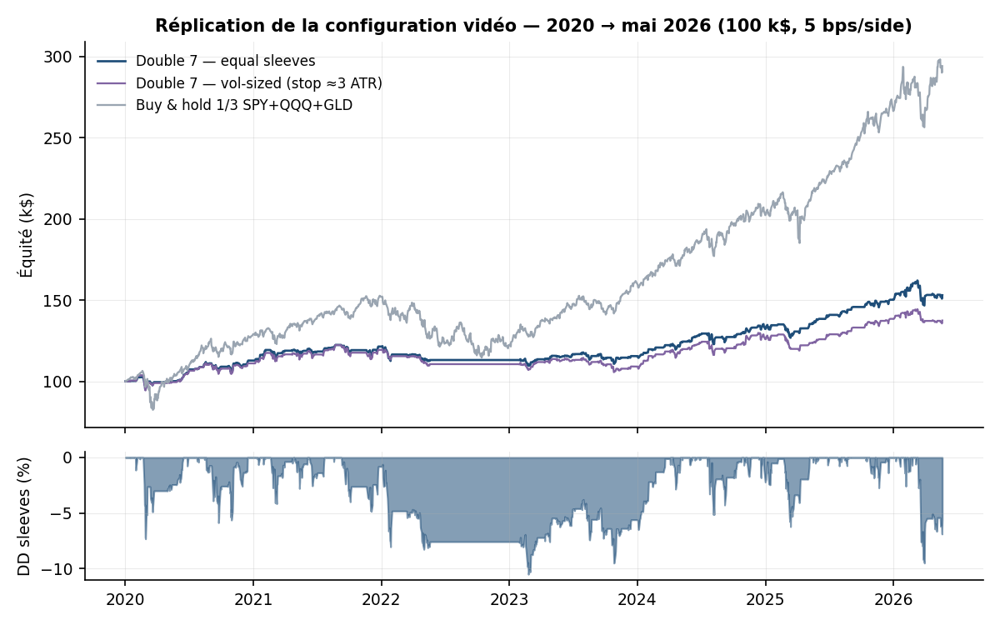
*Figure 2 — Équité des deux méthodes vs buy & hold 1/3, et drawdown des sleeves.*

---

## 6. Backtest étendu 2005 → 2026 : le vrai verdict

### 6.1 Échantillon complet et découpage hors échantillon

La stratégie ayant été publiée en 2008, tout ce qui suit 2009 est **hors échantillon au sens fort** (aucun paramètre n'a été réoptimisé).

| Métrique | 2005–2026 (complet) | **2009–2026 (OOS)** | B&H 1/3 SPY+QQQ+GLD (2005–2026) |
|---|---|---|---|
| Rendement total | +153.8 % | +166.4 % | +1 239.8 % |
| CAGR | 4.60 % | 5.79 % | 13.33 % |
| Volatilité ann. | 8.0 % | 8.3 % | 15.4 % |
| Sharpe | 0.60 | **0.72** | 0.89 |
| IC 95 % Sharpe (bootstrap) | [0.26 ; 0.98] | **[0.35 ; 1.13]** | — |
| t-stat Newey-West | 3.21 | **3.58** | 4.46 |
| Sortino | 0.86 | 1.04 | 1.27 |
| Max drawdown | −17.7 % | **−10.6 %** | −34.5 % |
| Calmar | 0.26 | 0.55 | 0.39 |
| Trades | 606 | 509 | — |
| Win rate | 73.8 % | 73.7 % | — |
| Payoff ratio | 0.61 | 0.70 | — |
| Profit factor | 1.72 | 1.91 | — |
| Pire trade | −30.2 % (QQQ, 2008) | −9.0 % | — |
| Skew / kurtosis (quotidien) | −0.27 / 8.5 | −0.34 / 9.3 | −0.21 / 8.4 |
| Exposition moyenne | 30.4 % | 30.6 % | 100 % |

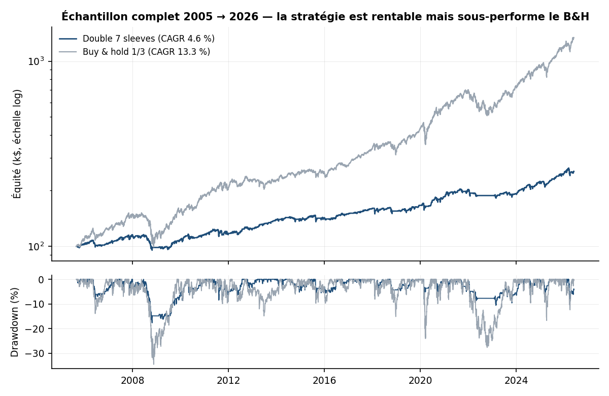
*Figure 3 — 2005–2026, échelle log. La stratégie produit un rendement positif régulier à faible drawdown, mais capture une fraction du beta haussier.*

Lecture institutionnelle :

- **L'edge est réel.** t-stat NW de 3.6 en OOS, IC bootstrap du Sharpe excluant zéro, win rate remarquablement stable (72–76 %) sur chaque sous-période. Pour une règle publiée il y a 18 ans, c'est inhabituel — la plupart des anomalies publiées se dégradent fortement (McLean & Pontiff, 2016).
- **L'edge est petit en absolu.** ~60 bps bruts par trade, ~29 trades/an sur 3 instruments. Avec 30 % d'exposition moyenne, le CAGR plafonne à ~5–6 %. Le Sharpe non conditionnel (0.72 OOS) reste inférieur à celui du B&H (0.89) sur la période — période, il est vrai, exceptionnellement favorable au beta actions/or.
- **Le couple rendement/drawdown est le vrai argument.** En OOS, Calmar 0.55 vs 0.39 pour le B&H, avec un drawdown maximal trois fois moindre (−10.6 % vs −34.5 %). C'est le profil typique d'un **overlay de timing** à utiliser sur la poche cash/faible risque d'un portefeuille, ou à combiner avec d'autres briques décorrélées.
- **Ironie de l'histoire : la pire période est 2005–2008**, c'est-à-dire la fin de l'échantillon *in-sample* du livre (CAGR −0.4 %, Sharpe −0.01, et le pire trade de tout l'historique : −30 % sur QQQ pendant la chute de 2008, le filtre SMA 200 n'ayant pas encore basculé). La performance hors échantillon est meilleure que la performance in-sample — l'inverse du pattern d'overfitting classique.

### 6.2 Stabilité temporelle

| Sous-période | CAGR | Sharpe | MaxDD | WR | Trades |
|---|---|---|---|---|---|
| 2005–2008 (in-sample du livre) | −0.4 % | −0.01 | −17.7 % | 74.2 % | 97 |
| 2009–2015 (OOS-1) | +5.7 % | 0.71 | −8.7 % | 72.1 % | 204 |
| 2016–2020 (OOS-2) | +5.4 % | 0.73 | −7.7 % | 73.9 % | 153 |
| 2021–2026 (OOS-3) | +5.9 % | 0.77 | −10.5 % | 75.7 % | 152 |

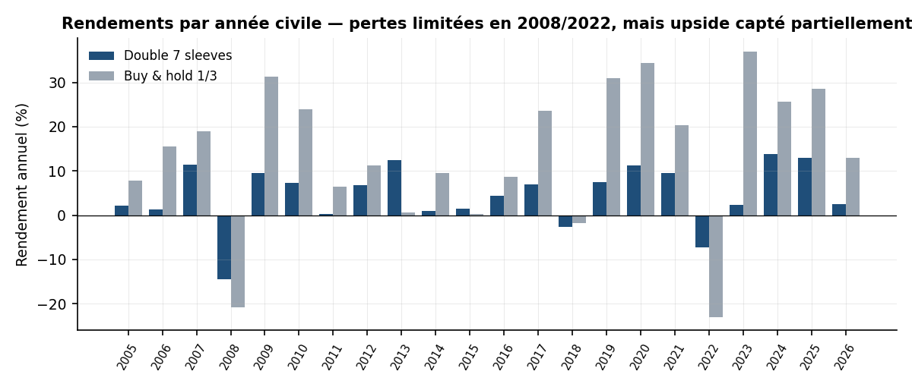
*Figure 4 — Années civiles : pertes contenues dans les bears (2008 : −14.5 % vs −20.8 % B&H ; 2022 : −7.2 % vs −23.0 %), upside partiellement capté dans les bulls.*

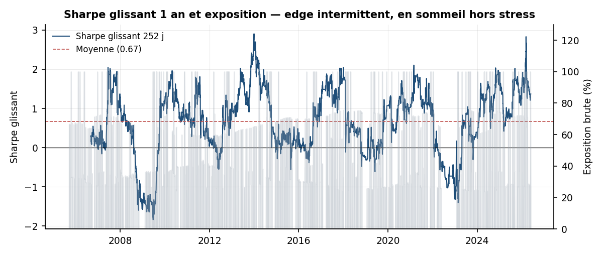
*Figure 5 — Sharpe glissant 1 an : edge intermittent (l'essentiel du P&L se concentre sur les épisodes de stress suivis de rebond), exposition brute moyenne ~30 %.*

### 6.3 Sensibilité aux conventions d'exécution

Exécuter au close de **t+1** plutôt qu'au close du signal ne détruit pas l'edge — il s'améliore même légèrement (CAGR 5.0 % vs 4.6 %, Sharpe 0.67 vs 0.60, WR 70.3 %) : le creux se prolonge souvent d'une journée avant le rebond. L'edge ne dépend donc **pas** de la capture fine du close du signal, ce qui élimine le biais d'exécution comme explication des résultats et facilite l'implémentation réelle (ordre au lendemain).

---

## 7. Robustesse

### 7.1 Surface de paramètres : pas une cellule chanceuse

108 configurations testées (lookback d'entrée 5–10 × lookback de sortie 5–10 × SMA 100/150/200), 2005–2026 :

- **Sharpe min / médian / max : 0.49 / 0.62 / 0.77** — *toute la surface est profitable*.
- La configuration canonique 7/7/200 se situe au **34ᵉ percentile** : ni optimale, ni fragile. Les voisines immédiates sont toutes positives.
- Structure cohérente avec l'économie du signal : les entrées plus profondes (plus bas 9–10 j) et les sorties plus rapides (6 j) améliorent légèrement (Sharpe ≈ 0.77) ; le filtre SMA 200 domine les filtres plus courts.

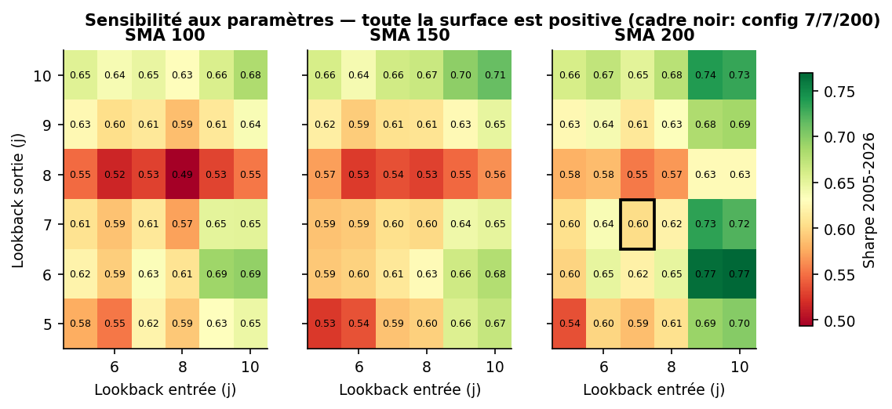
*Figure 6 — Sharpe par configuration. Le cadre noir marque 7/7/200.*

### 7.2 Sensibilité aux coûts : edge réel mais étroit

| Slippage par côté | CAGR | Sharpe | WR | Edge net/trade |
|---|---|---|---|---|
| 0 bps | 5.6 % | 0.72 | 75.1 % | 60 bps |
| 2.5 bps | 5.1 % | 0.66 | 74.3 % | 55 bps |
| **5 bps (base)** | **4.6 %** | **0.60** | **73.8 %** | **50 bps** |
| 10 bps | 3.6 % | 0.48 | 72.3 % | 40 bps |
| 20 bps | 1.6 % | 0.24 | 69.6 % | 20 bps |

Break-even ≈ 30 bps par côté. La stratégie n'est viable que sur des instruments très liquides (ETF majeurs, futures d'indices) ; toute déclinaison sur small caps ou crypto illiquide doit être re-coûtée. ~29 trades/an × ~30 % d'exposition impliquent par ailleurs une **capacité réelle élevée** sur SPY/QQQ/GLD.

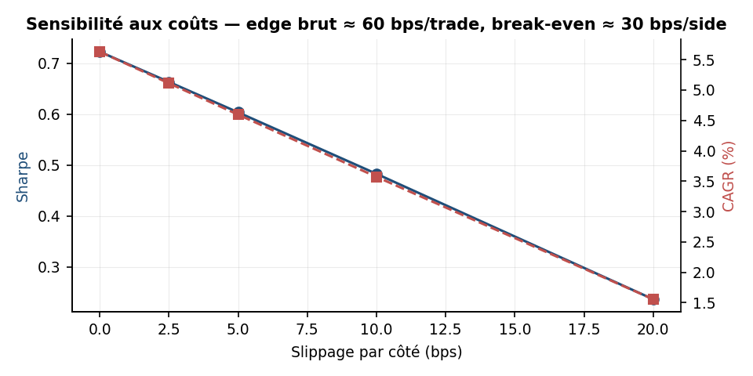
*Figure 7 — Dégradation quasi linéaire de l'edge avec les coûts.*

### 7.3 Validation croisée inter-sources (CFD)

Même logique, autre fournisseur de données, autre venue, fenêtre 2008–2026 incluant la GFC :

| Univers | CAGR | Sharpe | MaxDD | WR | Trades |
|---|---|---|---|---|---|
| ETF (SPY/QQQ/GLD) | 4.4 % | 0.59 | −16.2 % | 73.0 % | 523 |
| CFD (US500/US100/XAUUSD) | 4.7 % | 0.61 | −10.6 % | 73.0 % | 518 |

Concordance presque parfaite (le MaxDD ETF plus profond provient du sleeve QQQ 2008, l'US100 CFD ne démarrant qu'en 2013 dans sa partie M1 la plus dense). **Le signal n'est pas un artefact de données.**

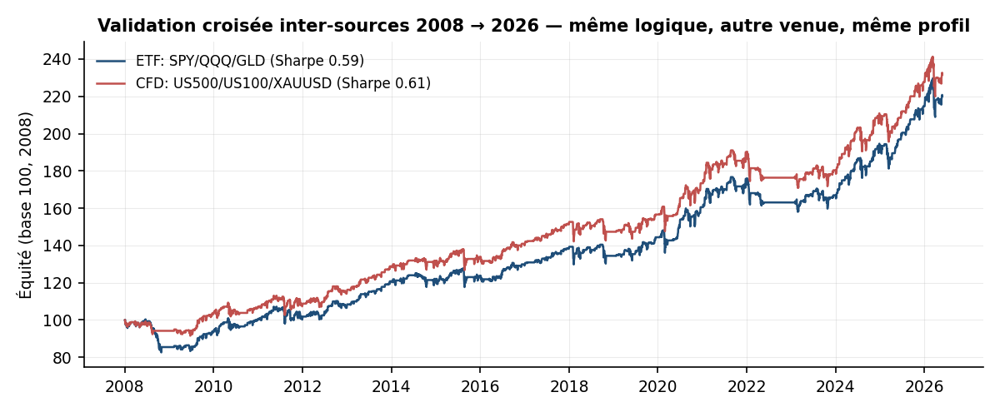
*Figure 8 — Équité base 100 : ETF vs CFD, 2008–2026.*

### 7.4 Distribution des trades

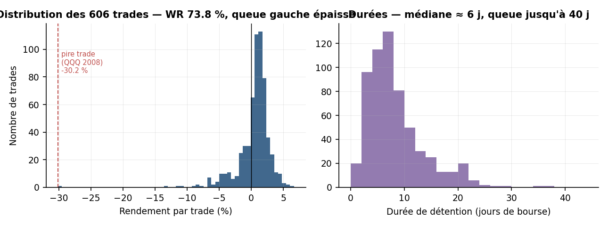
*Figure 9 — 606 trades : masse de petits gains (médiane de détention ~6 j), queue gauche épaisse. Le pire trade (−30.2 %, QQQ, août–octobre 2008) concentre à lui seul l'argument pour un contrôle de queue (§ 8.2).*

---

## 8. Trois axes d'amélioration testés

Chaque axe est backtesté sur 2005–2026, mêmes conventions que la base (Sharpe 0.60, Calmar 0.26, MaxDD −17.7 %, pire trade −30.2 %).

### 8.1 Axe 1 — Dimensionnement : vol targeting par position (recommandé)

**Idée.** L'all-in par sleeve fait porter un risque très variable selon le régime de volatilité (un sleeve QQQ investi à 100 % en 2008 ne porte pas le même risque qu'en 2017). On investit à la place une fraction f = min(σ_cible / σ_réalisée(20 j), 1) du sleeve — risque par position approximativement constant, sans levier, sans stop.

| Variante | CAGR | Sharpe | Sortino | MaxDD | Calmar |
|---|---|---|---|---|---|
| Base (all-in) | 4.60 % | 0.60 | 0.86 | −17.7 % | 0.26 |
| Vol target 18 % | 4.57 % | 0.64 | 0.92 | −14.3 % | 0.32 |
| **Vol target 12 %** | 4.14 % | **0.68** | **0.97** | **−9.7 %** | **0.43** |

**Verdict : amélioration nette du profil risque-ajusté** (Calmar +65 %, drawdown divisé par ~1.8) pour un coût en CAGR de 46 bps. Mêmes trades, seule la taille change — l'amélioration ne provient d'aucune information nouvelle, uniquement d'une meilleure géométrie du risque. C'est aussi le mécanisme propre pour exploiter le constat du § 8.3 (l'edge par dollar étant plus élevé en régime agité, réduire la taille quand σ explose protège la queue sans sacrifier l'espérance).

### 8.2 Axe 2 — Logique de sortie : time-stop de queue (recommandé en complément)

**Idée.** Le talon d'Achille est le trade qui ne rebondit jamais (QQQ, 19 août → 30 octobre 2008 : −30 % en 51 jours de bourse). Un stop prix interfère avec la logique (§ 5.3) ; un **time-stop** — sortir au close du 10ᵉ jour si aucun plus haut 7 j n'est advenu — coupe la queue sans vendre dans le trou un creux ordinaire.

| Variante de sortie | CAGR | Sharpe | MaxDD | WR | Pire trade |
|---|---|---|---|---|---|
| Base (plus haut 7 j) | 4.60 % | 0.60 | −17.7 % | 73.8 % | −30.2 % |
| **+ time-stop 10 j** | 4.08 % | 0.59 | **−14.4 %** | 70.7 % | **−14.1 %** |
| + time-stop 5 j | 2.23 % | 0.38 | −12.2 % | 61.4 % | −11.2 % |
| Sortie close > SMA 5 | 3.05 % | 0.51 | −9.7 % | 70.3 % | −10.3 % |
| Sortie premier close haussier | 1.16 % | 0.28 | −7.6 % | 66.8 % | −12.4 % |

**Verdict : le time-stop 10 j divise le pire trade par deux pour un coût de Sharpe quasi nul** (0.59 vs 0.60). Les sorties plus rapides (SMA 5, premier close haussier, time-stop 5 j) tronquent le rebond et détruisent de la valeur — la sortie de Connors est difficile à battre, conclusion conforme à la littérature sur le retour à la moyenne. Le time-stop se justifie moins par la statistique que par le **contrôle du risque de modèle** : il borne l'exposition aux régimes que le backtest n'a vus qu'une fois (2008).

**Combo recommandé (axes 1+2)** — vol target 12 % + time-stop 10 j : Sharpe 0.66, Sortino 0.94, MaxDD −9.7 %, Calmar 0.37, pire trade −14.1 %, t-stat NW 3.57, IC95 Sharpe [0.32 ; 1.05]. Un profil nettement plus « investissable » que la base, au prix d'un CAGR de 3.6 %.

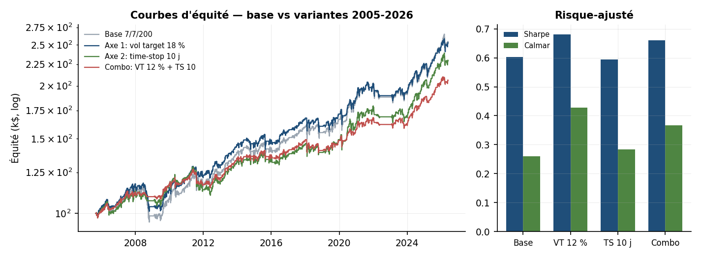
*Figure 10 — Équités comparées et métriques risque-ajustées des variantes.*

### 8.3 Axe 3 — Conditionnement au régime de volatilité : dimensionner, ne pas filtrer

**Idée.** Où l'edge vit-il ? Bucketing des 561 trades (fenêtre VIX disponible, 2007–2026) par niveau du VIX au close d'entrée :

| VIX à l'entrée | Trades | WR | Rendement moyen/trade |
|---|---|---|---|
| < 15 | 173 | 76.9 % | 42 bps |
| 15–20 | 213 | 70.9 % | 45 bps |
| 20–25 | 102 | 75.5 % | 38 bps (contient le −30 %) |
| 25–35 | 59 | 69.5 % | **103 bps** |
| > 35 | 14 | 71.4 % | **179 bps** |

31 % des trades (VIX > 20) produisent 46 % du P&L : **l'edge par trade croît fortement avec le stress**, conformément à l'intuition (la prime de fourniture de liquidité se paie au prix du risque). Mais les filtres binaires détruisent de la valeur — n'entrer que si VIX > 20 : Sharpe 0.56 ; que si VIX ≤ 20 : 0.50 ; base : 0.60 — chaque moitié porte une part d'edge et le filtrage sacrifie la fréquence (breadth).

**Verdict : ne pas filtrer, dimensionner.** La voie d'extension : moduler le risque par trade selon le régime (p. ex. budget de risque × 1.5 quand VIX > 25, dans la limite du vol targeting de l'axe 1), et étendre la même logique à la **jambe short symétrique** de Connors (plus haut 7 j sous SMA 200) en régime baissier — non testée ici car absente de la vidéo. À tester avec un protocole walk-forward avant tout déploiement.

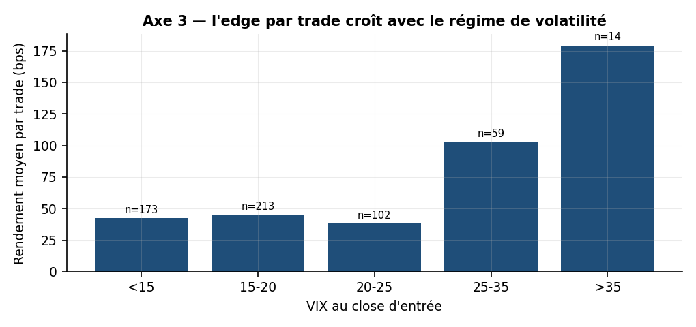
*Figure 11 — Edge moyen par trade selon le régime VIX à l'entrée.*

**Résultat négatif documenté — diversification naïve.** Étendre les sleeves à 15 instruments (secteurs S&P, IWM, EFA, EEM, EWJ, TLT, DBC…) **n'améliore pas** le Sharpe (0.59 vs 0.63 pour les 3 ETF sur fenêtre identique) et aggrave le pire trade (−34.8 %). Cause : les plus bas de 7 jours des actifs actions sont synchrones (mêmes épisodes de stress) — on multiplie les tickets, pas les paris indépendants. La vraie diversification passerait par d'autres classes (taux, FX, matières premières décorrélées) ou d'autres horizons.

---

## 9. Limites

1. **Pas de jambe short ni de re-coûtage en régime de crise prolongée.** Le backtest couvre 2008 et 2022, mais un marché baissier de type 2000–2002 (trois ans sous la SMA 200) laisserait la stratégie inactive — risque d'opportunité, pas de perte.
2. **Stop du vol-sizing évalué au close** (données ETF close-only) ; en intraday réel, des stops seraient touchés plus souvent. La version recommandée (sans stop prix) n'est pas affectée.
3. **VIX au close d'entrée** utilisé pour le bucketing en § 8.3 : disponible quelques minutes avant l'ordre de 15 h 58 en pratique, mais une implémentation stricte utiliserait le VIX de la veille.
4. **Survivorship/choix d'univers :** SPY/QQQ/GLD sont choisis *ex post* comme instruments à succès séculaire ; le test à 15 instruments (§ 8.3) et le cross-check CFD atténuent partiellement cette critique.
5. **Hypothèse de fill au close** sans impact de marché — raisonnable aux tailles retail/petite institution sur ces ETF (capacité élevée), à revalider au-delà de ~10–50 M$ par ordre.
6. Les améliorations § 8 sont évaluées sur l'échantillon complet ; un déploiement réel exigerait une **validation walk-forward** des choix de σ_cible et du time-stop (le risque d'overfitting est toutefois limité : un seul paramètre chacun, gradients monotones).

---

## 10. Conclusion

La Double 7 fait partie des rares règles publiées dont l'edge a survécu, statistiquement intact, 17 ans après publication : t-stat NW 3.6, Sharpe OOS 0.72, win rate stable, robuste aux paramètres, aux coûts réalistes, à la source de données et à la convention d'exécution. Ce n'est pour autant ni un « money printer » ni une stratégie autonome : exposition 30 %, CAGR ~5 %, queue gauche structurelle, edge fragile au-delà de 10 bps de slippage. Sa juste place est celle d'une **brique de timing mean-reversion** dans un portefeuille systématique diversifié — idéalement en version vol-targeted avec time-stop (Sharpe 0.66, MaxDD −9.7 %), avec comme extensions prioritaires le dimensionnement conditionnel au régime de volatilité et la jambe short symétrique.

La leçon de méthode dépasse la stratégie : la vidéo annonçait des chiffres exacts sur la méthode 1 (répliqués à un trade près) mais une conclusion erronée sur la méthode 2 — il aura suffi de spécifier rigoureusement le stop pour inverser le classement des deux sizings. *Les claims de sizing sont des claims d'implémentation.*

---

## Annexe A — Arborescence du projet

```
double7_connors/
├── engine.py              # moteur event-driven (sleeves + vol-sized), docstrings = conventions
├── metrics.py             # métriques, Newey-West, bootstrap par blocs
├── data.py                # chargeurs (panels ETF, CFD OHLC, XAUUSD M1→D1)
├── research_grid.py       # chemin rapide vectorisé (validé vs engine), grille, coûts, CFD
├── improvements.py        # axes 1-3 : vol targeting, sorties, breadth/VIX
├── figures.py             # génération des 11 figures
├── rapport_double7_connors.md
├── figures/               # fig01 … fig11
├── results_*.json         # tous les résultats chiffrés cités
├── trades_full_sleeves.csv, eq_*.csv, grid_results.csv, cost_sensitivity.csv
└── xauusd_d1.csv          # XAUUSD daily (agrégé du M1 Dukascopy/MT5, UTC)
```

## Annexe B — Conventions de calcul

Sharpe = √252 × moyenne/écart-type des rendements quotidiens de l'équité totale (rf = 0 ; le cash non investi ne porte pas d'intérêt — hypothèse conservatrice : au taux monétaire 2022–2026, ~70 % de cash moyen ajouterait ~2 points de CAGR sans risque ajouté). Drawdown sur équité de clôture. Win rate sur trades clôturés. Durées en jours de bourse. Rendements par trade slippage inclus. t-stat NW avec lags ⌊4(n/100)^{2/9}⌋. IC bootstrap : blocs circulaires de 20 jours, 2 000 tirages, percentiles 2.5/97.5.

*Rapport généré le 13 juin 2026. Sources : vidéo YouTube 4TTb0f9fk1U (Unbiased Trading) ; Connors & Alvarez, « Short-Term Trading Strategies That Work » (2008) ; données locales du projet (panels ETF ajustés, OHLC indices, M1 XAUUSD). Ce document est une étude de recherche, pas un conseil en investissement.*
