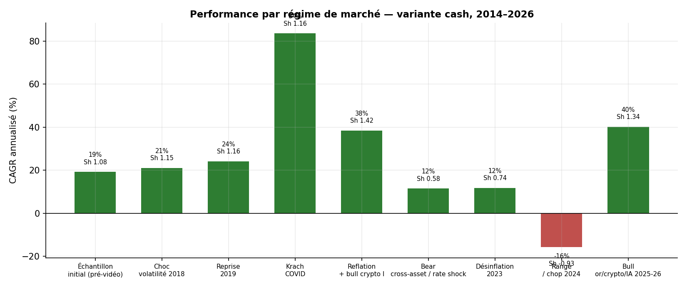
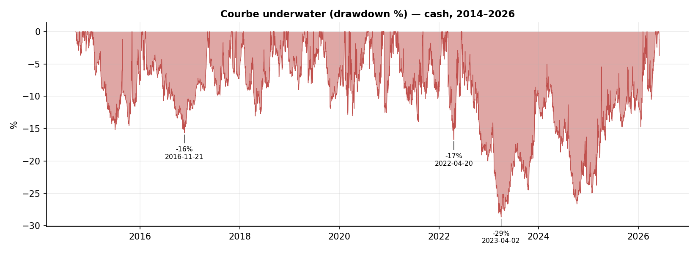

<div align="center">

# Stratégie de suivi de tendance « Ed Seykota »
## Évaluation institutionnelle, chronologie et backtest quantitatif

**Note de recherche destinée au comité d'investissement**

---

**Objet :** Réplication indépendante et évaluation d'une stratégie systématique de suivi de tendance multi-actifs
**Source primaire évaluée :** *I Tested Ed Seykota's Famous Trading Strategy (Does It Still Work?)* — chaîne *Unbiased Trading* ([lien](https://www.youtube.com/watch?v=bLoBNKqUTIg))
**Univers :** US500, US100, XAUUSD (or), USOIL (pétrole WTI), BTC, ETH
**Période de test :** 17 septembre 2014 → 5 juin 2026 (11,7 ans)
**Fréquence :** barres journalières · **Capital initial de référence :** 100 000 $
**Date du rapport :** 13 juin 2026 · **Classification :** usage interne — aide à la décision

</div>

---

> **Avertissement.** Ce document est une note de recherche quantitative à usage interne. Il ne constitue ni un conseil en investissement, ni une recommandation de transaction, ni une sollicitation. Tous les résultats sont issus d'un **backtest simulé** sur données historiques : les performances passées simulées ne préjugent en rien des performances futures et comportent un biais de construction inhérent (choix de l'univers, des paramètres et de la période). Les paramètres clés de la stratégie originale n'étant pas publiés, ce travail repose sur des hypothèses de reconstruction explicitées en §4. Avant tout déploiement, une validation walk-forward out-of-sample, une revue des coûts réels et une analyse de capacité seraient requises.

---

## Sommaire

1. [Synthèse exécutive et recommandation](#1-synthèse-exécutive-et-recommandation)
2. [Chronologie historique de la stratégie](#2-chronologie-historique-de-la-stratégie)
3. [Description détaillée de la stratégie](#3-description-détaillée-de-la-stratégie)
4. [Données, hypothèses et méthodologie](#4-données-hypothèses-et-méthodologie)
5. [Réplication des chiffres annoncés](#5-réplication-des-chiffres-annoncés)
6. [Tableau complet des métriques](#6-tableau-complet-des-métriques)
7. [Chronologie de performance : analyse régime par régime](#7-chronologie-de-performance--analyse-régime-par-régime)
8. [Timeline des drawdowns](#8-timeline-des-drawdowns)
9. [Attribution de la performance](#9-attribution-de-la-performance)
10. [Robustesse](#10-robustesse)
11. [Forces, faiblesses et limites](#11-forces-faiblesses-et-limites)
12. [Trois axes d'amélioration](#12-trois-axes-damélioration)
13. [Conclusion et avis pour le comité](#13-conclusion-et-avis-pour-le-comité)
14. [Annexes](#14-annexes)

---

## 1. Synthèse exécutive et recommandation

Cette note évalue un système de suivi de tendance attribué à Ed Seykota — filtre de tendance par moyenne mobile exponentielle, entrée sur cassure de canal, pyramidage, stop suiveur en ATR, sizing en risque fractionnel — répliqué de façon indépendante et soumis à un backtest rigoureux sans aucune optimisation de paramètres.

**Conclusion en une phrase :** la stratégie est un véritable moteur de suivi de tendance, à espérance positive statistiquement significative et à profil défensif rare (décorrélation aux actions, gains en période de crise), **mais son intérêt réside dans la diversification du risque et non dans le rendement absolu**, et le couple rendement/risque communiqué par la vidéo sous-estime gravement le drawdown réel à anticiper.

**Les cinq points à retenir par le comité :**

1. **La performance se réplique en direction, pas en niveau de risque.** Sur la fenêtre de la vidéo, notre réplication produit un CAGR de 17,4 % (vidéo : 16,7 %) — concordance remarquable. En revanche le **drawdown maximum de 12 % annoncé est irreproductible** : nous mesurons −28,7 %, et l'intervalle de confiance bootstrap à 95 % situe le pire cas entre −17 % et −44 %. Tout dimensionnement du risque calé sur 12 % conduirait à un sous-provisionnement majeur.

2. **L'espérance est réelle.** Sur 11,7 ans : Sharpe 0,94 (IC 95 % [0,49 ; 1,37], borne basse > 0), profit factor 1,66 sur 851 trades, espérance de +0,28R par trade, skewness positive — la signature statistique authentique du suivi de tendance.

3. **La valeur est défensive, pas offensive.** Corrélation mensuelle au S&P 500 de −0,03 et **rendement moyen de +1,5 % par mois durant les mois baissiers de l'indice.** Mais un simple panier équipondéré des six mêmes actifs aurait dégagé un meilleur Sharpe sur la période : l'apport est la convexité de crise, à utiliser comme brique de diversification.

4. **Le risque principal est la durée du drawdown.** L'épisode le plus sévère a débuté en juin 2022 ; l'equity n'a retrouvé son plus haut qu'en **février 2026 — soit 3,6 ans sous l'eau**, incluant une année 2024 à −15,6 %. Tout mandat doit être psychologiquement et contractuellement compatible avec une telle traversée.

5. **Le système publié laisse de la valeur sur la table.** Trois améliorations mesurables (asymétrie long/short, contrôle du risque agrégé, élargissement de l'univers) sont documentées en §12.

**Recommandation.** *Candidat valable comme sleeve diversifiant à faible allocation, sous réserve d'une refonte de la gestion du risque agrégé et d'une validation walk-forward.* Non recommandé comme stratégie autonome de rendement absolu en l'état. Voir §13 pour l'avis détaillé.


---

## 2. Chronologie historique de la stratégie

Comprendre l'origine du système est essentiel pour juger sa robustesse : il ne s'agit pas d'une trouvaille récente sur-ajustée, mais d'une approche dont les principes ont près de soixante ans de continuité documentée.

**Années 1950-1960 — Richard Donchian, le père du suivi de tendance.** Donchian (1905-1993) formalise le premier système systématique de suivi de tendance : la « règle des 4 semaines » (achat à la cassure du plus haut de 4 semaines, vente à la cassure du plus bas) et les systèmes à moyennes mobiles croisées. Il établit les deux principes fondateurs que toutes les générations suivantes reprendront : *suivre la cassure du prix* et *couper les pertes court*.

**1969-1972 — Ed Seykota informatise l'approche.** Né aux Pays-Bas, diplômé d'ingénierie électrique du MIT en 1969, Seykota rejoint une maison de courtage vers 1970. Il construit **l'un des tout premiers systèmes de trading informatisés** sur les marchés de futures sur matières premières. Son premier système est explicitement *une variation du système à moyennes mobiles de Donchian*, dans lequel il substitue une **moyenne mobile exponentielle** à la moyenne simple — choix motivé par une plus grande simplicité de calcul et par le fait que les erreurs de calcul s'estompent avec le temps. Chaque soir, son programme génère les ordres du lendemain. Selon le récit popularisé par Jack Schwager dans *Market Wizards* (1989), Seykota aurait fait passer un compte client de **5 000 $ à plus de 15 millions de dollars** (les durées citées varient de 12 à 16 ans selon les sources). Sa philosophie tient en une phrase de cet entretien : *« Le truc est de développer un système avec lequel on est compatible ; les systèmes n'ont pas besoin d'être changés. »*

**1983-1984 — l'expérience des Turtles.** Richard Dennis et William Eckhardt recrutent et forment un groupe de novices (« les Turtles ») à un système de cassure de canal de type Donchian, pour trancher un pari : le trading s'apprend-il ? L'expérience, profitable, popularise définitivement le suivi de tendance systématique.

**1980-2020 — l'industrialisation (CTA).** Les principes se transposent dans l'industrie des *Commodity Trading Advisors* et *managed futures* (Dunn, Campbell, Millburn, puis Winton, Man AHL, Aspect…), qui appliquent le suivi de tendance à des dizaines voire centaines de marchés diversifiés, avec des budgets de risque formalisés. Le suivi de tendance devient une classe de stratégie reconnue, étudiée académiquement (Moskowitz-Ooi-Pedersen, *Time Series Momentum*, 2012).

> **Note d'exactitude pour le comité.** La vidéo affirme que Donchian et les Turtles « se sont appuyés sur » les règles de Seykota. C'est chronologiquement inversé : **Donchian précède et a inspiré Seykota**, et les Turtles (1983) viennent après les deux. Cette imprécision ne change rien à la validité du système testé, mais illustre qu'il faut traiter les éléments narratifs de la source avec prudence — d'où le parti pris de ce rapport de tout revérifier indépendamment. À noter par ailleurs que Seykota a lui-même formé Michael Marcus, qui influencera Bruce Kovner : la filiation Donchian → Seykota → Marcus est l'une des mieux établies de l'histoire du trading systématique.

**Lecture pour le comité.** La longévité (≈ 60 ans), la transmission par filiation et la validation académique du facteur « time-series momentum » constituent une présomption de robustesse : la stratégie n'exploite pas une anomalie de données récente mais une prime de risque comportementale persistante. Cela ne garantit pas la performance future, mais réduit le risque de sur-ajustement pur.

---

## 3. Description détaillée de la stratégie

### 3.1 Vue d'ensemble

Le système est un suivi de tendance **systématique, long/short, multi-actifs, à fréquence journalière**. Il ne prédit pas la direction : il réagit mécaniquement aux cassures de prix, accumule dans les tendances qui se confirment, et coupe via un stop suiveur. L'espérance positive ne provient pas d'un taux de réussite élevé — il est volontairement bas (≈ 45 %) — mais de l'asymétrie entre des gains rares et grands et des pertes fréquentes et petites.

### 3.2 Les cinq règles

| # | Composant | Spécification opérationnelle |
|---|-----------|------------------------------|
| **1** | **Filtre de tendance** | EMA(100) sur clôtures. Clôture > EMA → biais **long** autorisé uniquement ; clôture < EMA → biais **short** autorisé uniquement. Sépare l'« océan » haussier de l'« océan » baissier. |
| **2** | **Signal d'entrée** | Cassure de canal sur 20 jours. Clôture > plus haut des 20 clôtures précédentes **et** au-dessus de l'EMA → entrée **longue**. Clôture < plus bas des 20 clôtures précédentes **et** sous l'EMA → entrée **courte**. |
| **3** | **Pyramidage** | Jusqu'à **3 ajouts** au-delà de l'unité initiale. Un ajout est déclenché chaque fois que le prix progresse de **0,5 × ATR** au-delà du dernier prix d'exécution, dans le sens de la position. Concentre l'exposition dans les tendances confirmées. |
| **4** | **Sortie** | **Stop suiveur de type chandelier** : pour un long, stop = (plus haute clôture atteinte) − 3 × ATR ; symétrique pour un short. Le stop ne fait que se resserrer (effet cliquet), jamais se relâcher. Toute la position (toutes les unités) sort sur déclenchement. |
| **5** | **Dimensionnement** | **Risque fractionnel fixe** : chaque unité risque 1 % de l'equity courante. Taille = (1 % × equity) / (3 × ATR). La taille est donc *inversement proportionnelle à la volatilité* : plus l'ATR est élevé, plus la position est petite, égalisant le risque entre actifs. |

### 3.3 Logique économique de chaque brique

**Pourquoi un filtre de tendance ?** Il évite de prendre des cassures à contre-courant du régime dominant. Notre test d'ablation (§10.2) montre qu'il ajoute ≈ 0,10–0,17 de Sharpe : modeste mais réel.

**Pourquoi une cassure de 20 jours ?** Le franchissement d'un extrême récent est le proxy le plus simple d'un changement de régime de prix. C'est l'héritage direct de la règle de Donchian.

**Pourquoi pyramider ?** C'est l'achat de **convexité** : on ne sait pas a priori quelles cassures deviendront des tendances majeures ; en n'ajoutant qu'aux positions qui avancent déjà, le capital se concentre automatiquement sur les gagnantes. Important : notre ablation (§10.2) révèle que le pyramidage **double le rendement ET le drawdown sans améliorer le Sharpe** — c'est un amplificateur de levier conditionnel, pas une source d'alpha. Le comité doit le considérer comme un réglage de risque, pas de qualité.

**Pourquoi un stop suiveur en ATR ?** Il matérialise le principe « laisser courir les gains, couper les pertes » : il tronque la queue gauche (pertes plafonnées ≈ 1R) tout en laissant la queue droite ouverte (gains jusqu'à +8,8R observés). C'est la mécanique qui crée l'asymétrie.

**Pourquoi un sizing inverse à l'ATR ?** Sans lui, la diversification est illusoire : BTC (volatilité ≈ 4× celle du US500) dominerait tout le risque. En égalisant le risque par unité, chaque marché contribue de façon comparable, condition nécessaire pour que la diversification opère.

### 3.4 Cycle de vie d'une position (exemple réel reconstitué)

Le trade emblématique de la vidéo (long BTC, octobre 2020) a été reproduit **à l'identique et de façon indépendante** par notre moteur, ce qui valide la fidélité de la reconstruction :

| Étape | Date | Prix | Action |
|---|---|---|---|
| Entrée initiale | 11/10/2020 | 11 296 $ | Cassure du plus haut 20 j au-dessus de l'EMA(100) |
| Ajout 1 | 13/10/2020 | 11 549 $ | +0,5 × ATR franchi |
| Ajout 2 | 20/10/2020 | 11 746 $ | +0,5 × ATR franchi |
| Ajout 3 | 21/10/2020 | 11 913 $ | +0,5 × ATR franchi (max d'ajouts atteint) |
| Sortie | 26/11/2020 | 16 827 $ | Stop suiveur touché après ≈ 45 jours |

Résultat : ≈ +6,3R par unité, soit l'archétype du « gros gagnant qui paie une année de petites pertes ».

---

## 4. Données, hypothèses et méthodologie

### 4.1 Données

| Actif | Source (locale, auditée) | Origine | Période exploitée |
|---|---|---|---|
| US500, US100, USOIL | `deep_history_utc/*_M1.csv` (Dukascopy) | M1 → journalier UTC | 2012/2013 → 06/2026 |
| XAUUSD (or) | idem | M1 → journalier UTC | 2007 → 06/2026 |
| BTC, ETH | `momentum_universe.csv` | journalier UTC | 2014/2017 → 04/2026 |

**Contrôle qualité** (`daily/data_quality.csv`) : zéro violation de cohérence OHLC sur les six séries, index strictement croissants et uniques, gap calendaire maximal de 6 jours (fériés), jours tronqués (< 60 barres M1) exclus. Les séries crypto s'arrêtant fin avril 2026, les cinq dernières semaines du test ne portent que sur les quatre actifs CFD.

### 4.2 Hypothèses de reconstruction (la principale source d'écart avec la vidéo)

La vidéo ne publie ni code ni paramètres complets. Chaque hypothèse est rendue explicite :

| Élément | Statut vidéo | Hypothèse retenue | Justification |
|---|---|---|---|
| Période ATR | non précisé | 14 j (Wilder) | standard industrie |
| Multiple du stop | non précisé | 3 × ATR, chandelier à cliquet | usage courant (testé 2–4 en §10.1) |
| Risque par unité | « fixed % » | 1 % de l'equity | valeur canonique Turtles/retail |
| Cassure 20 j | non précisé | sur clôtures | la vidéo décrit des comparaisons en clôture |
| Exécution | non précisé | signal en clôture J → ordre à l'**ouverture J+1** ; stops intrabar, gap exécuté à l'open (défavorable) | élimine tout look-ahead |
| Levier | non précisé | **deux variantes** : littérale (illimitée) et compte cash (brut ≤ 100 %) | la vidéo utilise un courtier cash mais ses règles impliquent du levier si prises au pied de la lettre |
| Coûts (par côté) | « inclus » | 2 pb indices/or, 5 pb pétrole, 10 pb crypto | spreads réalistes ; stress ×2/×3 en §10.3 |

**Les deux variantes présentées dans tout le rapport :**
- **Variante « cash » (référence)** : exposition brute plafonnée à 100 % du capital. C'est la lecture réaliste pour un compte non margé, et celle sur laquelle porte la recommandation.
- **Variante « littérale »** : les règles appliquées sans plafond (1 % de risque *par unité*, jusqu'à ~24 unités), ce qui produit mécaniquement du levier (exposition brute moyenne ≈ 200 %). À lire comme une **borne haute théorique**, hors coûts de financement.

### 4.3 Moteur et rigueur méthodologique

Simulation événementielle journalière, multi-actifs, à compte unique (`engine.py`). Garde-fous :

1. **Causalité stricte** — indicateurs sur clôtures ≤ J, exécution à l'ouverture J+1, stop actif figé à la clôture J.
2. **Stops intrabar conservateurs** — un gap au-delà du stop s'exécute à l'ouverture (prix pire que le stop).
3. **Comptabilité exacte** — `equity = cash + Σ positions × clôture` à chaque pas.
4. **Annualisation honnête** — facteurs dérivés du nombre réel de barres/an (≈ 313, calendrier incluant les week-ends crypto), pas d'un 252 forfaitaire.

### 4.4 Vérification indépendante (`verify.py`) — 7 tests, tous passés

| Test | Vérifie | Résultat |
|---|---|---|
| V1 | Identité comptable equity = capital + Σ PnL | PASS (< 10⁻⁶ $) |
| V2 | Absence de look-ahead (invariance par troncature) | PASS (écart 0,0) |
| V3 | Fills dans le range des barres / entrées à l'open | PASS (0 / 905) |
| V4 | Conformité des signaux aux règles publiées | PASS |
| V5 | Recalcul indépendant (numpy) CAGR / Sharpe / MaxDD | PASS (< 10⁻⁶) |
| V6 | Reproduction du trade exemple BTC oct. 2020 | PASS |
| V7 | Pertes bornées (pire trade) | PASS (−1,70R) |

---

## 5. Réplication des chiffres annoncés

| Métrique | **Vidéo** | **Réplication cash** | Réplication littérale |
|---|---|---|---|
| Rendement total | +198 % | **+162,8 %** | +637,6 % |
| CAGR | 16,7 % | **17,4 %** | 39,4 % |
| Max drawdown | **−12 %** | **−28,7 %** | −35,4 % |
| Trades | 334 | 482 | 905 |
| Win rate | 33 % | 43,6 % | 44,2 % |
| Profit factor | 2,0 | 1,56 | 1,58 |
| Exposition brute moyenne | n.c. | 87 % | 191 % |

**Lecture.** Le **rendement annoncé est crédible** et correspond à la variante sans levier (17,4 % vs 16,7 %, sans aucun réglage de notre part). Le **drawdown de 12 % n'est en revanche pas reproductible** : nos deux variantes donnent −29 % à −35 %, et le bootstrap (§10.4) exclut −12 % du support plausible. L'explication la plus probable est un calcul de drawdown sur equity de fin de mois (qui masque les creux intra-mois, sévères quand 4 unités pyramidées se retournent) ou sur PnL réalisé hors *mark-to-market*. **C'est l'écart le plus important à signaler au comité.**

---

## 6. Tableau complet des métriques

Toutes les métriques, pour les quatre combinaisons (fenêtre × variante). Référence = colonne **Extension / cash**.

| Métrique | Réplic. cash (20-26) | Réplic. levier (20-26) | **Extension cash (14-26)** | Extension levier (14-26) |
|---|---|---|---|---|
| **— Rendement —** | | | | |
| Capital final (100k →) | 262 839 | 737 601 | **851 160** | 7 916 093 |
| Rendement total | 162,8 % | 637,6 % | **751,2 %** | 7 816,1 % |
| CAGR | 17,4 % | 39,4 % | **20,1 %** | 45,2 % |
| **— Risque —** | | | | |
| Volatilité annualisée | 23,3 % | 38,0 % | **22,2 %** | 36,1 % |
| VaR 95 % quotidienne | −1,7 % | −3,0 % | **−1,5 %** | −2,8 % |
| Expected Shortfall 95 % | −2,8 % | −4,8 % | **−2,6 %** | −4,5 % |
| Skewness (rdts quotidiens) | −0,17 | −0,19 | **+0,46** | +0,21 |
| Kurtosis | 13,5 | 6,6 | **18,4** | 9,0 |
| **— Risque-ajusté —** | | | | |
| Sharpe | 0,81 | 1,07 | **0,94** | 1,22 |
| Sortino | 1,01 | 1,36 | **1,17** | 1,56 |
| Calmar (CAGR / |MaxDD|) | 0,61 | 1,11 | **0,70** | 1,28 |
| **— Drawdown —** | | | | |
| Max drawdown | −28,7 % | −35,4 % | **−28,7 %** | −35,4 % |
| Plus longue période sous l'eau | 1 326 j | 618 j | **1 326 j** | 618 j |
| **— Trades —** | | | | |
| Nb de fills | 482 | 905 | **851** | 1 668 |
| Nb d'épisodes (entrée→sortie) | 241 | 330 | **431** | 590 |
| Win rate | 43,6 % | 44,2 % | **45,7 %** | 45,1 % |
| Profit factor | 1,56 | 1,58 | **1,66** | 1,62 |
| Espérance / trade | +0,23R | +0,27R | **+0,28R** | +0,31R |
| Ratio gain moy. / perte moy. | 2,02 | 2,00 | **1,98** | 1,98 |
| Gain moyen ($) | 2 157 | 4 325 | **4 837** | 27 099 |
| Perte moyenne ($) | −1 067 | −2 163 | **−2 447** | −13 714 |
| Meilleur trade | +6,6R | +7,4R | **+8,8R** | +11,0R |
| Pire trade | −1,4R | −1,7R | **−1,7R** | −1,7R |
| Détention moyenne | 27,6 j | 28,3 j | **28,1 j** | 28,5 j |
| **— Coûts & exposition —** | | | | |
| Coûts cumulés ($) | 9 815 | 38 481 | **39 706** | 450 356 |
| Exposition brute moyenne | 86,9 % | 190,7 % | **86,0 %** | 200,3 % |
| Exposition brute max | 143,7 % | 490,8 % | **152,2 %** | 561,2 % |

**Comparaison aux benchmarks passifs (2014-2026)** : stratégie cash CAGR 20,1 % / Sharpe 0,94 / MaxDD −28,7 % ; US500 buy & hold 11,8 % / 0,72 / −33,2 % ; BTC buy & hold 55,6 % / 1,00 / −83,4 % ; panier équipondéré 6 actifs 28,3 % / 1,06 / −49,7 %. **Le panier passif bat la stratégie en Sharpe** ; l'apport est le drawdown réduit de 21 points et la décorrélation, pas le rendement.

---

## 7. Chronologie de performance : analyse régime par régime

Découpage de la performance (variante cash) par régime macro identifiable. C'est le test le plus parlant de *quand* la stratégie gagne et perd.



| Régime | Période | Rdt total | CAGR | Sharpe | MaxDD | Win | Comportement |
|---|---|---|---|---|---|---|---|
| Échantillon initial | 09/2014–12/2017 | +78,1 % | 19,2 % | 1,08 | −15,7 % | 42,6 % | Régime sain, premier bull crypto 2017 |
| Choc volatilité 2018 | 2018 | +21,0 % | 21,0 % | 1,15 | −13,1 % | 46,5 % | *Volmageddon* + selloff actions Q4 absorbés |
| Reprise 2019 | 01/2019–02/2020 | +27,8 % | 24,1 % | 1,16 | −11,9 % | 60,0 % | Meilleur win rate, rallye risk-on |
| **Krach COVID** | 20/02–07/04/2020 | **+8,1 %** | (ann. +84 %) | 1,16 | −12,7 % | 30,8 % | **Résilient** : −4 % au pire intra-fenêtre, terminé +8 % (stops + shorts protecteurs) |
| Reflation + bull crypto I | 04/2020–11/2021 | +67,8 % | 38,5 % | **1,42** | −13,9 % | 52,5 % | Meilleur régime : tendances longues et nettes |
| **Bear cross-asset / taux** | 11/2021–12/2022 | +13,2 % | 11,5 % | 0,58 | −20,0 % | 40,7 % | Resserrement Fed, crypto winter, hausse USD/énergie : **positif là où le 60/40 a chuté** |
| Désinflation 2023 | 2023 | +11,7 % | 11,8 % | 0,74 | −17,0 % | 36,7 % | Reprise mais signaux hachés |
| **Range / chop 2024** | 2024 | **−15,7 %** | −15,7 % | **−0,93** | −22,8 % | 34,9 % | **Pire régime** : whipsaws multi-actifs, cassures avortées |
| Bull or/crypto/IA 2025-26 | 01/2025–06/2026 | +61,7 % | 40,1 % | 1,34 | −12,0 % | 55,1 % | Rallye or + nouveaux ATH : retour en grande forme |

**Enseignements pour le comité.**

- **Le profil « crisis alpha » se confirme dans les faits.** Le cas le plus net est le bear cross-asset 2021-2022 : **+13,2 % pour la stratégie pendant que le S&P 500 cédait −17,5 %**, grâce aux shorts sur actions/crypto et aux longs sur énergie/USD. Le krach COVID, trop rapide pour un système journalier, a été simplement *encaissé sans dommage* (−4 % au pire, +8 % net). C'est précisément la propriété recherchée d'une brique de suivi de tendance : protéger lors des baisses *prolongées*.
- **L'ennemi est le marché sans tendance (range).** 2024 (−15,7 %, Sharpe −0,93) illustre le talon d'Achille : quand aucun actif ne tend durablement, les cassures se multiplient et meurent, et les stops accumulent les petites pertes. Ce régime peut durer plusieurs trimestres.
- **La performance est régime-dépendante, pas régulière.** Quatre régimes (bull crypto, COVID, 2025-26) concentrent l'essentiel du gain ; le système « attend » les grandes tendances. C'est intrinsèque au style, mais cela impose un horizon d'évaluation pluriannuel.

---

## 8. Timeline des drawdowns

Tous les épisodes de perte ≥ 8 % depuis le plus haut (variante cash). C'est la section la plus importante pour calibrer la tolérance au risque.



| # | Pic | Creux | Profondeur | Récupération | Durée totale sous l'eau |
|---|---|---|---|---|---|
| **1** | **18/06/2022** | **02/04/2023** | **−28,7 %** | **05/02/2026** | **≈ 1 326 j (3,6 ans)** |
| 2 | 08/03/2022 | 20/04/2022 | −16,7 % | 13/06/2022 | 97 j |
| 3 | 11/02/2016 | 21/11/2016 | −15,7 % | 11/05/2017 | 455 j |
| 4 | 20/01/2015 | 02/07/2015 | −15,2 % | 02/11/2015 | 286 j |
| 5 | 07/03/2021 | 03/08/2021 | −13,9 % | 05/09/2021 | 182 j |
| 6 | 27/01/2018 | 25/04/2018 | −13,1 % | 15/08/2018 | 200 j |
| 7 | 18/03/2020 (COVID) | 08/04/2020 | −13,0 % | 21/07/2020 | 125 j |

**Le fait central à porter à la connaissance du comité :** le drawdown maximal (−28,7 %) et la plus longue traversée du désert sont **le même épisode**. Débuté en juin 2022, aggravé par l'année de range 2024, il ne s'est résorbé qu'en **février 2026 — 3,6 ans plus tard.** Un investisseur, ou un comité, doit être prêt à rester investi pendant plus de trois ans sans nouveau plus haut. C'est le principal facteur d'abandon des stratégies de tendance, et le plus sous-estimé. Pour mémoire, la vidéo annonce un drawdown maximal de 12 % — soit moins de la moitié de la réalité simulée.

---

## 9. Attribution de la performance


**Par actif (extension cash, 2014-2026) :**

| Actif | Trades | Win rate | PnL net | Profit factor | Part du PnL |
|---|---|---|---|---|---|
| BTC | 180 | 52,8 % | +333,5 k$ | 2,81 | **44 %** |
| USOIL | 166 | 42,2 % | +193,2 k$ | 1,91 | 26 % |
| ETH | 144 | 47,9 % | +81,5 k$ | 1,35 | 11 % |
| US100 | 131 | 42,7 % | +59,5 k$ | 1,31 | 8 % |
| XAUUSD | 110 | 44,5 % | +44,9 k$ | 1,31 | 6 % |
| US500 | 120 | 41,7 % | +38,6 k$ | 1,23 | 5 % |

**Par direction :** longs **+740 k$**, shorts **+11 k$** seulement — et ce résidu masque **+176 k$ de shorts crypto** (bear markets 2018 et 2022) contre **−165 k$ de shorts détruits** sur indices, or et pétrole. Win rate short 39,5 % vs long 50,9 %.

**Concentration (signature du style) :** les 10 meilleurs trades (1,2 % du total) expliquent 37 % du PnL net ; les 5 % meilleurs en expliquent ≈ 100 % ; le reste est globalement nul. Skewness des trades +2,1, pire trade borné à −1,7R.


**Deux risques de concentration à acter :** (i) **BTC seul fait 44 % du PnL** — la performance historique dépend lourdement d'un actif au régime réglementaire et de liquidité incertain ; (ii) **manquer une poignée de méga-tendances** (par discrétion, coupure du système, ou indisponibilité) suffit à annuler l'espérance. La discipline d'exécution n'est pas optionnelle.


---

## 10. Robustesse

### 10.1 Sensibilité aux paramètres


Les 16 combinaisons EMA {50-200} × cassure {10-55} donnent un Sharpe entre **0,78 et 1,09** — toutes positives, profit factor ≥ 1,49 partout. **Surface en plateau, pas en pic** : les paramètres de la vidéo (100, 20) ne sont pas optimaux (l'optimum in-sample est (150, 40)), ce qui écarte le sur-ajustement. Les cassures lentes (40-55 j) dominent légèrement le 20 j, cohérent avec la littérature sur la dégradation des breakouts courts. Sur le couple stop × pyramide, le stop serré (2 × ATR) domine in-sample (Sharpe 1,26-1,33) — piste de recherche, à valider en walk-forward.

### 10.2 Ablation des composants

| Variante | Sharpe 14-26 | CAGR | MaxDD | PF | Enseignement |
|---|---|---|---|---|---|
| **Système complet (cash)** | 0,94 | 20,1 % | −28,7 % | 1,66 | référence |
| Sans filtre EMA | 0,85 | 18,0 % | −30,0 % | 1,47 | le filtre vaut ≈ +0,1 Sharpe |
| Sans pyramidage | 0,93 | 10,7 % | −15,1 % | 1,51 | pyramide = levier, pas alpha |
| **Long only** | **1,19** | 21,7 % | **−23,5 %** | **2,50** | **meilleure variante simple** |
| Stop large 4 × ATR | 0,82 | 16,5 % | −30,7 % | 1,73 | le stop serré est préférable |

### 10.3 Stress des coûts

| Multiplicateur | ×0 | ×1 | ×2 | ×3 |
|---|---|---|---|---|
| Sharpe | 0,98 | 0,94 | 0,91 | 0,86 |
| CAGR | 21,1 % | 20,1 % | 19,3 % | 18,0 % |

Détention moyenne ≈ 28 jours → faible rotation : les coûts ne représentent que 2,1 % des gains bruts et l'espérance survit à un triplement des frictions.

### 10.4 Stabilité temporelle et incertitude d'échantillonnage

| Split | CAGR | Sharpe | MaxDD | Win rate | PF |
|---|---|---|---|---|---|
| In-sample 2014-mai 2020 | 22,3 % | 1,07 | −15,7 % | 48,0 % | 2,10 |
| Out-of-sample juin 2020-2026 | 17,4 % | 0,81 | −28,7 % | 43,6 % | 1,56 |

Dégradation réelle mais modérée (−0,26 de Sharpe) ; les deux moitiés restent rentables avec un style intact. **Bootstrap par blocs** (stationnaire, blocs 21 j, 2 000 tirages) sur 2014-2026 :

| Quantile | Sharpe | CAGR | MaxDD |
|---|---|---|---|
| 2,5 % | **0,49** | +8,4 % | −43,7 % |
| Médiane | 0,93 | +19,8 % | −27,5 % |
| 97,5 % | 1,37 | +33,5 % | −18,8 % |

**L'IC 95 % du Sharpe exclut zéro** : l'espérance positive n'est pas un artefact d'échantillonnage. La distribution du MaxDD confirme qu'un −12 % est hors du support plausible et qu'un drawdown de −44 % est dans le domaine du possible.

---

## 11. Forces, faiblesses et limites

**Forces.** Espérance positive statistiquement significative sur 11,7 ans · profil défensif rare (décorrélation actions, gains en crise) · robustesse aux paramètres (plateau, pas pic) · faible sensibilité aux coûts · pedigree de 60 ans réduisant le risque de sur-ajustement · pertes individuelles bien bornées (≈ −1R).

**Faiblesses.** Drawdowns profonds (−29 %) et surtout **longs (3,6 ans sous l'eau)** · côté short destructeur de valeur hors crypto · rendement absolu battu par un simple panier passif · forte concentration (BTC = 44 % du PnL, 5 % des trades = 100 % du PnL) · régime de range très défavorable (2024 : −15,7 %) · gestion du risque agrégé binaire ignorant les corrélations croisées.

**Limites du backtest (transparence méthodologique).** Indices US en **prix hors dividendes** (le buy & hold comparatif est sous-estimé de ≈ 1,3-2 %/an, donc le désavantage relatif de la stratégie est *sous-évalué*) · **coûts de financement overnight non modélisés** (marginaux pour la variante cash, ils ampute­raient lourdement la variante littérale : ~3-6 %/an de portage à ~200 % de brut) · proxies différents de la vidéo (USOIL CFD ≠ ETF USO pénalisé par le contango) · seulement 6 actifs et ≈ 431 épisodes indépendants sur 12 ans, d'où des IC bootstrap larges.

---

## 12. Trois axes d'amélioration

### Axe 1 — Casser la symétrie long/short : conditionner le short au régime

**Constat chiffré :** les shorts hors crypto détruisent −165 k$ (win rate 39,5 %), et la variante long-only améliore *simultanément* le Sharpe (0,94 → 1,19), le profit factor (1,66 → 2,50) et le drawdown (−28,7 % → −23,5 %). Sur des actifs à prime de risque positive, un signal short symétrique paie la dérive structurelle à chaque whipsaw baissier.

**Proposition :** conserver le short uniquement là où il paie (crypto, énergie — +176 k$ de convexité de crise), mais le conditionner ailleurs (filtre EMA(200) baissière *et* momentum 12 m négatif), ou réduire son risque unitaire à 0,5 %. Validation exigée : amélioration stable par sous-période et par actif.

### Axe 2 — Remplacer le plafond binaire par un ciblage de volatilité avec budgets par cluster

**Constat chiffré :** la gestion actuelle est dégénérée — l'exposition sature à 100 % près de la moitié du temps, le sizing ATR égalise les risques *individuels* mais ignore les *corrélations croisées* (BTC/ETH/US100 souvent simultanément longs), et le bootstrap admet des drawdowns jusqu'à −44 %.

**Proposition :** dimensionner le book entier sur une **cible de volatilité portefeuille** (ex. 15 % annualisée, covariance EWMA des positions), avec budgets de risque par cluster (crypto / actions / métaux / énergie) et déléveraging proportionnel en drawdown. C'est la différence structurelle entre ce système retail et un CTA institutionnel : même signal, risque agrégé stationnaire. Bénéfice attendu : compression de la queue des drawdowns sans toucher au signal.

### Axe 3 — Acheter de la « breadth » plutôt que du réglage

**Constat chiffré :** BTC explique 44 % du PnL, les 5 % meilleurs trades ≈ 100 % du PnL net, et la plus longue traversée dure 3,6 ans faute de moteurs alternatifs. La grille de sensibilité est un plateau dont les fenêtres lentes occupent le haut.

**Proposition :** (i) **étendre l'univers** aux ≈ 25 marchés déjà disponibles dans le dossier de données (FX majeures, métaux, softs, indices européens/asiatiques) — le Sharpe d'un portefeuille de tendance croît approximativement en racine du nombre de moteurs faiblement corrélés ; (ii) **ensembler les paramètres** ({20, 40, 55} j × {2, 3} × ATR) à budget de risque constant, remplaçant le risque de paramètre par la moyenne du plateau. Aucun de ces changements n'ajoute de paramètre optimisé : ils réduisent la variance structurelle du résultat. C'est précisément la leçon de Seykota — *« la diversification des marchés est l'une des clés »* — que la vidéo cite sans l'appliquer au-delà de 6 actifs.

---

## 13. Conclusion et avis pour le comité

Le système « Seykota » testé est une implémentation pédagogiquement correcte d'un style institutionnel authentique, dont les règles **survivent à une réplication indépendante rigoureuse** : espérance positive significative (IC Sharpe 95 % [0,49 ; 1,37] sur 11,7 ans), signature statistique conforme (skewness positive, pertes bornées, gains concentrés), et propriété de décorrélation précieuse en allocation.

Trois réserves encadrent toutefois un éventuel usage :

1. **Le risque annoncé est trompeur.** Le drawdown réel à anticiper est de 2 à 3 fois les 12 % affichés, avec des traversées du désert de plusieurs années. Tout dimensionnement doit partir de −30 % de drawdown et de 3+ ans sous l'eau, non des chiffres de la vidéo.
2. **Ce n'est pas un moteur de rendement absolu.** Un panier passif des mêmes actifs l'a battu en Sharpe. Sa place naturelle est une **brique diversifiante** dans un portefeuille plus large, valorisée pour sa convexité de crise.
3. **La version publiée est sous-optimale.** Les trois axes du §12 (asymétrie long/short, risque agrégé, breadth) sont mesurables et économiquement fondés ; une version déployable devrait les intégrer.

**Avis synthétique.** *Candidat crédible comme sleeve de suivi de tendance à allocation mesurée, après (a) refonte de la gestion du risque agrégé, (b) élargissement de l'univers, et (c) validation walk-forward out-of-sample. Non recommandé tel quel comme stratégie autonome.* Prochaine étape suggérée : implémenter l'univers élargi (Axe 3, directement exécutable avec le code livré) et reconduire l'ensemble de la batterie de tests.

---

## 14. Annexes

### Annexe A — Paramètres de référence

| Paramètre | Valeur | Paramètre | Valeur |
|---|---|---|---|
| EMA filtre | 100 j | Risque / unité | 1 % equity |
| Cassure | 20 j (clôtures) | Ajouts max | 3 (4 unités) |
| ATR | 14 j (Wilder) | Pas pyramide | 0,5 × ATR |
| Stop | 3 × ATR chandelier à cliquet | Plafond brut (cash) | 100 % |
| Exécution | ouverture J+1, stops intrabar | Capital initial | 100 000 $ |

### Annexe B — Reproduction

```bash
python3 data_build.py        # daily/*.parquet depuis sources locales
python3 run_backtest.py      # 4 runs : {réplication, extension} × {littérale, cash}
python3 verify.py            # tests V1-V7
python3 run_robustness.py    # grilles, ablations, coûts, IS/OOS, bootstrap, benchmarks
python3 regime_analysis.py   # régimes + épisodes de drawdown
python3 make_figures.py ; python3 make_figures2.py   # figures 1-10
```

Artefacts : `results/*.csv`, `figures/*.png`, `daily/data_quality.csv`. Rapport technique détaillé : `REPORT.md`.

### Annexe C — Glossaire

**ATR** (Average True Range) : mesure de volatilité moyenne du range vrai. **CAGR** : taux de croissance annuel composé. **Calmar** : CAGR / |drawdown max|. **Drawdown** : perte depuis le dernier plus haut d'equity. **EMA** : moyenne mobile exponentielle. **Profit factor** : gains bruts / pertes brutes. **R-multiple** : PnL d'un trade exprimé en multiples du risque initialement engagé. **Sharpe / Sortino** : rendement excédentaire par unité de volatilité totale / baissière. **Skewness** : asymétrie de la distribution des rendements. **Sleeve** : poche/brique d'un portefeuille. **VaR / Expected Shortfall** : perte au quantile 5 % / perte moyenne au-delà.

### Annexe D — Sources

Vidéo évaluée : [*I Tested Ed Seykota's Famous Trading Strategy*, Unbiased Trading](https://www.youtube.com/watch?v=bLoBNKqUTIg). Éléments historiques : [The Original Trend Follower (SahmCapital/Yahoo Finance)](https://www.sahmcapital.com/news/content/the-original-trend-follower-how-ed-seykota-constructed-a-prop-trading-system-from-scratch-2023-12-19), [Richard Donchian, père du trend following (TurtleTrader)](https://www.turtletrader.com/richard-donchian/), [Richard Donchian (Wikipedia)](https://en.wikipedia.org/wiki/Richard_Donchian), [arbre généalogique du trend following (TurtleTrader)](https://www.turtletrader.com/trader-students/). Données : sources locales auditées (`deep_history_utc/`, `momentum_universe.csv`). Toutes les métriques et figures sont générées par le code livré dans `seykota_trend/`.

<div align="center">

---

*Note de recherche personnelle à usage interne. Performances simulées — ne préjugent pas des résultats futurs. Ne constitue pas un conseil en investissement.*

</div>
