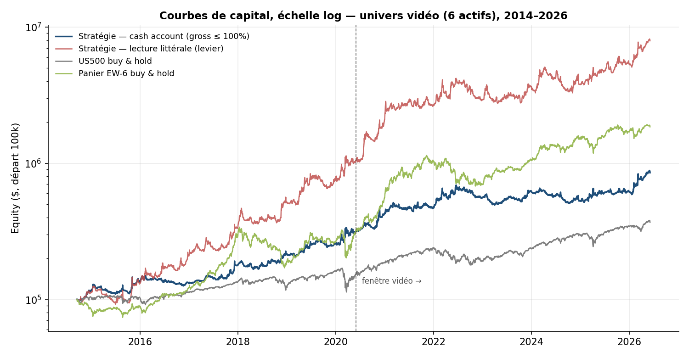
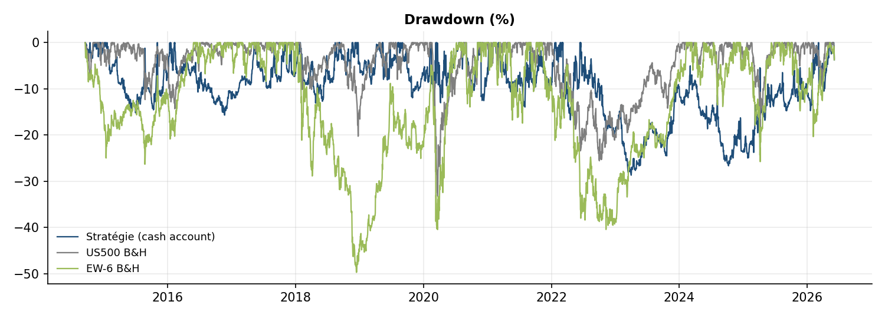
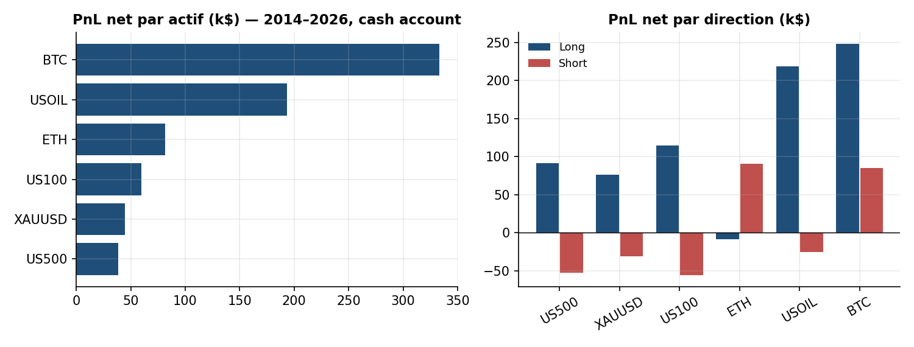
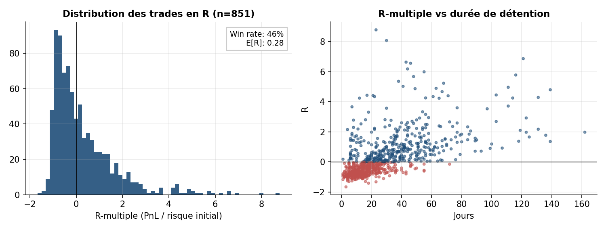
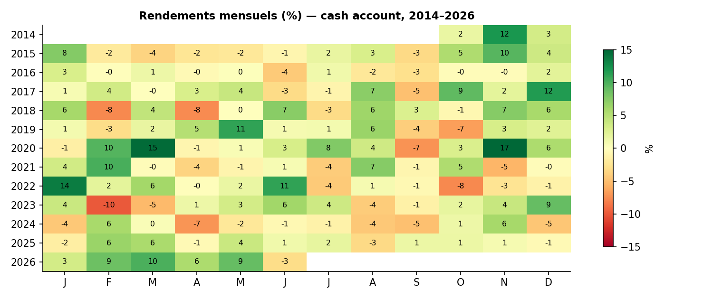
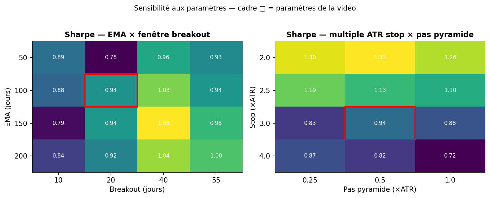
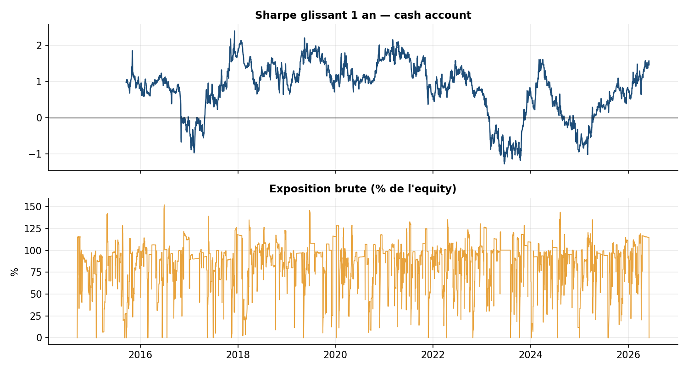

# Réplication et évaluation quantitative de la stratégie « Ed Seykota » (Unbiased Trading)

**Date :** 13 juin 2026
**Source répliquée :** [I Tested Ed Seykota's Famous Trading Strategy (Does It Still Work?)](https://www.youtube.com/watch?v=bLoBNKqUTIg) — chaîne *Unbiased Trading*
**Périmètre :** réplication de la fenêtre vidéo (juin 2020 – juin 2026) puis extension sur l'historique complet (sept. 2014 – juin 2026), univers de 6 actifs (US500, US100, XAUUSD, USOIL, BTC, ETH)
**Statut :** recherche éducative — ne constitue pas un conseil d'investissement

---

## 1. Résumé exécutif

La vidéo teste un système de suivi de tendance attribué à Ed Seykota — filtre EMA(100), entrée sur cassure de plus haut/bas de 20 jours, pyramidage jusqu'à 3 ajouts, stop suiveur en multiple d'ATR, sizing en risque fractionnel fixe — sur six actifs (SPY, QQQ, or, pétrole, BTC, ETH) en données journalières, et annonce **+198 % de rendement total, 16,7 % de CAGR, 12 % de drawdown maximum, 334 trades, 33 % de win rate et un profit factor de 2,0** sur environ six ans.

Notre réimplémentation indépendante, exécutée sans optimisation de paramètres sur des données locales auditées, aboutit aux conclusions suivantes :

**La direction des résultats se réplique, pas leur calibrage exact.** En contraignant l'exposition brute à 100 % du capital (compte cash, hypothèse la plus proche d'un courtier retail), nous obtenons sur la fenêtre vidéo un **CAGR de 17,4 % (vidéo : 16,7 %)** et un rendement total de +163 % (vidéo : +198 %) — une concordance remarquable compte tenu des différences de données et des paramètres non publiés. En revanche, le **drawdown maximum de 12 % annoncé apparaît irreproductible** : nous mesurons −28,7 % en compte cash et −35,4 % en lecture littérale des règles, et la borne optimiste de notre intervalle bootstrap à 95 % (−17 %) reste au-dessus des 12 % annoncés. Le couple rendement/risque communiqué par la vidéo est donc vraisemblablement embelli par une méthodologie de calcul du drawdown non documentée (probablement sur equity mensuelle ou hors marked-to-market intra-position).

**La stratégie elle-même est légitime.** Sur 11,7 ans (2014–2026), la variante cash dégage un CAGR de 20,1 %, un Sharpe de 0,94 (IC bootstrap 95 % : [0,49 ; 1,37]), un profit factor de 1,66 sur 851 trades, et surtout une **corrélation mensuelle quasi nulle (−0,03) au S&P 500 avec un rendement moyen de +1,5 %/mois pendant les mois baissiers de l'indice** — le profil de convexité (« crisis alpha ») qui justifie historiquement le trend following en allocation.

**Mais le système publié est inefficient sur trois points mesurables :** le côté short détruit de la valeur hors crypto (−165 k$ cumulés sur indices, or et pétrole ; la variante long-only porte le Sharpe de 0,94 à 1,19 et le profit factor de 1,66 à 2,50) ; la gestion du risque agrégé est binaire et laisse le drawdown dériver ; et la concentration est extrême (les 5 % meilleurs trades expliquent la totalité du PnL net, BTC seul 39 %). La section 8 développe trois axes d'amélioration chiffrés.



---

## 2. La stratégie : règles et logique économique

### 2.1 Règles telles qu'énoncées dans la vidéo

| # | Composant | Règle énoncée |
|---|-----------|---------------|
| 1 | Filtre de tendance | EMA(100) sur clôtures : biais long au-dessus, short en dessous |
| 2 | Signal d'entrée | Nouveau plus haut de 20 jours → long ; nouveau plus bas de 20 jours → short (dans le sens du filtre) |
| 3 | Pyramidage | Jusqu'à 3 ajouts ; ajout d'une unité quand le prix s'éloigne de 0,5 × ATR du dernier prix d'exécution |
| 4 | Sortie | Stop suiveur basé sur l'ATR (« laisser courir les gains, couper les pertes ») |
| 5 | Sizing | Pourcentage de risque fixe par unité, taille inversement proportionnelle à l'ATR |

### 2.2 Logique économique

Le système encode les trois propriétés statistiques du trend following documentées depuis Donchian et les Turtles. D'abord une **asymétrie de payoff** : le stop suiveur tronque la queue gauche de la distribution des trades tandis que l'absence d'objectif de gain laisse la queue droite ouverte — on échange un win rate faible (30–45 %) contre un ratio gain moyen/perte moyenne élevé (mesuré ici à 1,98). Ensuite une **convexité de position** : le pyramidage concentre l'exposition dans les tendances qui se confirment, ce qui revient à acheter de la convexité sur la composante momentum du marché. Enfin la **diversification comme condition d'existence** : aucun marché individuel ne tend de façon fiable ; l'espérance positive émerge du portefeuille, pas de l'actif.

Le sizing en `risque / (k × ATR)` égalise la perte espérée par trade entre actifs de volatilités très différentes (la volatilité annualisée de BTC est ~4× celle de US500 sur la période), ce qui est la condition pour que la diversification opère réellement.

### 2.3 Paramètres non spécifiés et hypothèses retenues

La vidéo ne publie ni code ni paramètres complets. Toute réplication exige donc des hypothèses, listées exhaustivement ci-dessous — c'est la principale source d'écart possible avec les chiffres annoncés.

| Élément | Statut vidéo | Hypothèse retenue | Justification |
|---|---|---|---|
| Période ATR | non spécifié | 14 jours (Wilder) | standard de l'industrie |
| Multiple du stop suiveur | non spécifié | 3 × ATR, chandelier sur meilleure clôture, à cliquet | usage courant (2–4) ; sensibilité testée §7.1 |
| Risque par unité | « fixed percentage » | 1 % de l'equity courante | valeur canonique Turtles/retail ; cohérent avec les ordres de grandeur de la vidéo |
| Définition du plus haut 20 j | non spécifié | clôture > max des 20 clôtures précédentes | la vidéo décrit des comparaisons sur clôtures |
| Exécution | non spécifié | signal en clôture J, exécution à l'ouverture J+1 ; stops intrabar (gap = exécution à l'open, défavorable) | élimine tout look-ahead |
| Levier | non spécifié | deux variantes : littérale (illimité) et compte cash (brut ≤ 100 %) | la vidéo utilise un courtier cash (Public) mais ses règles impliquent du levier si prises au pied de la lettre |
| Coûts | « commissions et slippage inclus » | par côté : 2 pb indices et or, 5 pb pétrole, 10 pb crypto | calibrage réaliste spreads CFD/spot 2020–2026 ; stress ×2 et ×3 en §7.3 |
| Univers | SPY, QQQ, GLD, USO, BTC, ETH | US500, US100, XAUUSD, USOIL (CFD Dukascopy), BTC, ETH (spot) | proxies disponibles en local ; USO ≠ spot WTI (contango), écart documenté en §9 |

---

## 3. Données et méthodologie

### 3.1 Données

| Actif | Source locale | Granularité d'origine | Période utilisée |
|---|---|---|---|
| US500, US100, USOIL | `deep_history_utc/*_M1.csv` (Dukascopy, auditées) | M1, ré-échantillonné en barres journalières UTC | 2012/2013 → 05-06-2026 |
| XAUUSD | idem | M1 → journalier UTC | 2007 → 05-06-2026 |
| BTC, ETH | `momentum_universe.csv` (OHLCV journalier) | journalier UTC | 2014/2017 → 29-04-2026 |

Contrôles qualité (`daily/data_quality.csv`) : zéro violation de cohérence OHLC sur les six séries, index strictement croissants, gap maximal 6 jours calendaires (jours fériés), jours tronqués (< 60 barres M1) exclus. Les séries crypto s'arrêtent au 29-04-2026 : les cinq dernières semaines du backtest ne portent que sur les quatre actifs CFD.

### 3.2 Moteur de simulation

Simulation événementielle journalière multi-actifs à compte unique (`engine.py`), capital initial 100 000 $. Points de rigueur :

1. **Causalité stricte** : indicateurs calculés sur clôtures ≤ J ; ordres exécutés à l'ouverture J+1 ; le stop actif pendant la barre J+1 est celui figé en clôture J. Vérifié par test d'invariance par troncature (§3.3, V2).
2. **Stops intrabar conservateurs** : un gap au-delà du stop est exécuté à l'ouverture (prix pire que le stop), jamais au niveau du stop.
3. **Comptabilité exacte** : `equity = cash + Σ positions × clôture` à chaque pas ; l'identité `equity finale = capital initial + Σ PnL net des trades` est vérifiée au centime.
4. **Sizing causal** : la taille d'une unité utilise l'ATR du jour de signal et l'equity marquée en clôture du jour de signal.
5. **Annualisation** : le calendrier d'union inclut les week-ends (crypto) ; les facteurs d'annualisation sont dérivés du nombre de barres observées par an (~313), pas d'un 252 forfaitaire.

### 3.3 Vérification indépendante (`verify.py`)

| Test | Résultat |
|---|---|
| V1 — Identité comptable equity finale vs Σ PnL | PASS (écart < 10⁻⁶ $) |
| V2 — Absence de look-ahead (invariance par troncature de l'échantillon) | PASS (écart max = 0.0) |
| V3 — Intégrité des fills (sorties dans le range de la barre, entrées à l'open) | PASS (0 violation sur 905 trades) |
| V4 — Conformité des signaux d'entrée aux règles publiées (échantillon) | PASS |
| V5 — Recalcul indépendant (numpy pur) de CAGR, Sharpe, MaxDD | PASS (écarts < 10⁻⁶) |
| V6 — Ancrage sur le trade exemple de la vidéo (BTC, oct. 2020) | PASS — voir ci-dessous |
| V7 — Pertes bornées près de −1R hors gaps | PASS (pire trade : −1,70R) |

Le test V6 mérite mention : la vidéo illustre son exécution par un long BTC d'octobre 2020, pyramidé trois fois puis soldé fin novembre après ~45 jours. Notre moteur produit de façon indépendante un épisode quasi identique — entrée le 11-10-2020 à 11 296 $, trois ajouts (13, 20, 21 octobre), sortie sur stop suiveur le 26-11-2020 à 16 827 $, soit 46 jours de détention et environ +6,3R par unité. Cette coïncidence structurelle valide que nos règles reconstituées correspondent bien au comportement du système original.

---

## 4. Réplication de la fenêtre vidéo (juin 2020 – juin 2026)

### 4.1 Résultats comparés

| Métrique | Vidéo (annoncé) | **B — Compte cash (brut ≤ 100 %)** | A — Lecture littérale (levier libre) |
|---|---|---|---|
| Rendement total | +198 % | **+163 %** | +638 % |
| CAGR | 16,7 % | **17,4 %** | 39,5 % |
| Volatilité annualisée | n.c. | 23,3 % | 38,0 % |
| Sharpe | n.c. | 0,81 | 1,07 |
| Max drawdown | **−12 %** | **−28,7 %** | −35,4 % |
| Trades (unités) | 334 | 482 | 905 |
| Épisodes (entrée → sortie complète) | n.c. | 241 | 330 |
| Win rate | 33 % | 43,6 % | 44,2 % |
| Profit factor | 2,0 | 1,56 | 1,58 |
| Exposition brute moyenne | n.c. | 87 % | 191 % (max 491 %) |

### 4.2 Lecture critique

Trois enseignements ressortent.

**Premièrement, le niveau de rendement annoncé est crédible et correspond à la variante sans levier.** Le CAGR répliqué (17,4 %) encadre celui de la vidéo (16,7 %) à moins d'un point, sans aucun ajustement de paramètres de notre part. La lecture littérale des règles — 1 % de risque *par unité*, jusqu'à 24 unités potentielles sur 6 actifs — produit en revanche une exposition brute moyenne de 191 %, incompatible avec un compte cash : la vidéo applique donc implicitement une contrainte de capital qu'elle ne documente pas.

**Deuxièmement, le drawdown annoncé de 12 % n'est pas reproductible.** Nos deux variantes produisent −29 % à −35 %, et le bootstrap par blocs (§7.4) borne le MaxDD de la variante cash à [−45 % ; −17 %] à 95 %. Un système à ~23 % de volatilité annualisée avec un Calmar de 1,4 sur six ans serait exceptionnel même pour un CTA institutionnel. L'hypothèse la plus probable est un calcul de drawdown sur equity de fin de mois (qui lisse les creux intra-mois, sévères quand quatre unités pyramidées rendent), ou sur PnL réalisé hors marked-to-market. **Implication pratique : quiconque déploierait ce système en calibrant sa tolérance au risque sur les 12 % annoncés subirait, avec une probabilité élevée, plus du double du drawdown anticipé.**

**Troisièmement, les statistiques de trades diffèrent dans un sens cohérent.** Notre win rate plus élevé (44 % vs 33 %) et notre profit factor plus bas (1,56 vs 2,0) suggèrent que l'implémentation de la vidéo sortait plus vite de ses pertes et laissait courir davantage (stop plus serré à l'entrée, ou cassures calculées sur les plus hauts intrajournaliers plutôt que sur clôtures) — sans le code source, l'écart n'est pas arbitrable plus finement. L'espérance par trade reste comparable (+0,23R chez nous).

---

## 5. Extension : historique complet 2014–2026

L'extension hors de la fenêtre vidéo est le test le plus simple contre le biais de sélection temporelle : la fenêtre 2020–2026 est exceptionnellement favorable aux actifs de l'univers (double bull market crypto, rallye or 2024–2025, choc pétrolier 2022).

### 5.1 Métriques complètes (variante cash, 100 k$ initial)

| Métrique | 2014–2026 | | Métrique | 2014–2026 |
|---|---|---|---|---|
| Rendement total | +751 % | | Win rate | 45,7 % |
| CAGR | 20,1 % | | Profit factor | 1,66 |
| Volatilité annualisée | 22,2 % | | Trades / épisodes | 851 / 431 |
| Sharpe | 0,94 | | Espérance par trade | +0,28R |
| Sortino | 1,17 | | Gain moyen / perte moyenne | 1,98 |
| Max drawdown | −28,7 % | | Meilleur / pire trade | +8,8R / −1,7R |
| Calmar | 0,70 | | Détention moyenne | 28 jours |
| Plus longue période sous l'eau | 1 326 jours | | Skew des rendements quotidiens | +0,46 |
| VaR 95 % quotidienne | −1,5 % | | Coûts cumulés | 39,7 k$ (2,1 % des gains bruts) |

La skewness quotidienne positive (+0,46, contre −0,5 à −1 typique pour un indice actions) et le pire trade borné à −1,7R sont la signature attendue du couple stop suiveur / pyramidage. La plus longue traversée du désert — 3,6 ans, de fin 2021 à 2025 en termes de plus haut d'equity — rappelle le coût psychologique réel du style, que la vidéo évoque d'ailleurs honnêtement.



### 5.2 Comparaison aux benchmarks passifs

| Stratégie / benchmark | Fenêtre | CAGR | Sharpe | MaxDD |
|---|---|---|---|---|
| **Trend cash (ce rapport)** | 2014–2026 | **20,1 %** | **0,94** | **−28,7 %** |
| US500 buy & hold (indice prix) | 2014–2026 | 11,8 % | 0,72 | −33,2 % |
| BTC buy & hold | 2014–2026 | 55,6 % | 1,00 | −83,4 % |
| Panier équipondéré 6 actifs | 2014–2026 | 28,3 % | 1,06 | −49,7 % |
| **Trend cash (ce rapport)** | 2020–2026 | **17,4 %** | **0,81** | **−28,7 %** |
| US500 buy & hold (indice prix) | 2020–2026 | 15,8 % | 0,94 | −25,6 % |
| Panier équipondéré 6 actifs | 2020–2026 | 33,6 % | 1,21 | −40,4 % |

Ce tableau impose une honnêteté que la vidéo élude : **sur cette période, un simple panier équipondéré des six mêmes actifs bat la stratégie en rendement comme en Sharpe.** L'apport du système n'est pas le rendement absolu mais le profil : drawdown réduit de 21 points vs le panier (−28,7 % vs −49,7 %), corrélation mensuelle au S&P 500 de −0,03 (quotidienne : −0,27), et rendement moyen de **+1,5 % par mois pendant les mois où le S&P 500 baisse** (vs −3,9 % pour l'indice). C'est la propriété défendable en allocation — pas la promesse d'un alpha de sélection.

### 5.3 Attribution



| Actif | Trades | Win rate | PnL net | PF | Part du PnL |
|---|---|---|---|---|---|
| BTC | 180 | 52,8 % | +333,5 k$ | 2,81 | 44 % |
| USOIL | 166 | 42,2 % | +193,2 k$ | 1,91 | 26 % |
| ETH | 144 | 47,9 % | +81,5 k$ | 1,35 | 11 % |
| US100 | 131 | 42,7 % | +59,5 k$ | 1,31 | 8 % |
| XAUUSD | 110 | 44,5 % | +44,9 k$ | 1,31 | 6 % |
| US500 | 120 | 41,7 % | +38,6 k$ | 1,23 | 5 % |

L'attribution directionnelle est le résultat le plus actionnable du rapport : **les longs génèrent +740 k$, les shorts +11 k$ au total — et ce résidu positif masque +176 k$ de shorts crypto (bear markets 2018 et 2022) contre −165 k$ de shorts détruits sur indices, or et pétrole.** Le win rate des shorts (39,5 %) est structurellement inférieur à celui des longs (50,9 %) : sur des actifs à dérive positive de long terme, le signal symétrique paie une taxe permanente côté short.

La distribution des trades (figure 4) montre la mécanique du style : mode de la distribution dans les pertes autour de −0,5R, masse de gains étalée jusqu'à +8,8R, skew de +2,1. Les 10 meilleurs trades (1,2 % du total) expliquent 37 % du PnL net ; les 5 % meilleurs en expliquent ~100 % — le reste de l'activité est net zéro. Manquer une poignée de tendances majeures (exécution, filtre discrétionnaire, arrêt prématuré du système) suffit à annuler l'espérance.





---

## 6. Rendements annuels

| Année | Cash (brut ≤ 100 %) | Littérale (levier) | Année | Cash | Littérale |
|---|---|---|---|---|---|
| 2014 (part.) | +15,8 % | +12,1 % | 2021 | +10,7 % | +27,7 % |
| 2015 | +16,8 % | +17,7 % | 2022 | +17,9 % | +9,5 % |
| 2016 | −2,9 % | +57,6 % | 2023 | +11,7 % | +24,9 % |
| 2017 | +35,7 % | +61,4 % | 2024 | **−15,6 %** | +3,8 % |
| 2018 | +21,0 % | +53,5 % | 2025 | +17,3 % | +41,5 % |
| 2019 | +18,6 % | +47,7 % | 2026 (au 5/6) | +37,8 % | +47,8 % |
| 2020 | +67,5 % | +174,5 % | | | |

Onze années positives sur treize ; 2024 (−15,6 %) est l'année de ranges sans suite sur l'ensemble de l'univers — le régime exactement défavorable au style (whipsaws répétés sur cassures avortées). Un seul millésime fortement négatif sur 13 ans reste un profil sain pour du trend following mono-style.

---

## 7. Robustesse

### 7.1 Sensibilité aux paramètres



Les 16 combinaisons EMA {50–200} × breakout {10–55} produisent un Sharpe entre **0,78 et 1,09** — toutes positives, toutes avec un profit factor ≥ 1,49. La surface est un plateau, pas un pic : les paramètres de la vidéo (100, 20) ne sont pas optimaux (l'optimum in-sample est (150, 40)), ce qui est paradoxalement rassurant — le résultat ne provient pas d'un réglage fin sur-ajusté, et des fenêtres de cassure plus lentes (40–55 j) dominent légèrement le 20 j, cohérent avec la littérature post-Turtles sur la dégradation des breakouts courts.

Sur le couple stop × pyramide, le stop serré à 2 × ATR domine in-sample (Sharpe 1,26–1,33 vs 0,83–0,94 pour 3 × ATR). Nous nous gardons d'en faire une recommandation directe — c'est précisément le type de choix qu'il faudrait valider en walk-forward — mais l'ordre de grandeur indique que la sortie est le levier de recherche le plus rentable du système (cf. axe 3, §8).

### 7.2 Ablation des composants

| Variante | Sharpe 14–26 | Sharpe 20–26 | CAGR 14–26 | MaxDD | PF |
|---|---|---|---|---|---|
| **Système complet (cash)** | 0,94 | 0,81 | 20,1 % | −28,7 % | 1,66 |
| Sans filtre EMA(100) | 0,85 | 0,64 | 18,0 % | −30,0 % | 1,47 |
| Sans pyramidage | 0,93 | 0,73 | 10,7 % | −15,1 % | 1,51 |
| **Long only** | **1,19** | **1,24** | 21,7 % | **−23,5 %** | **2,50** |
| Stop large 4 × ATR | 0,82 | 0,86 | 16,5 % | −30,7 % | 1,73 |
| Littérale avec levier | 1,22 | 1,07 | 45,2 % | −35,4 % | 1,62 |

Chaque règle est ainsi auditée : le filtre de tendance ajoute ~0,1–0,17 de Sharpe (il filtre les cassures à contre-régime) ; le pyramidage ne change pas le Sharpe (0,93 vs 0,94) mais double le CAGR et le drawdown — c'est un **amplificateur de levier conditionnel, pas une source d'alpha** ; et la suppression du côté short est l'amélioration la plus significative du tableau (détail en §8, axe 1).

### 7.3 Stress des coûts de transaction

| Multiplicateur de coûts | ×0 | ×1 (base) | ×2 | ×3 |
|---|---|---|---|---|
| Sharpe | 0,98 | 0,94 | 0,91 | 0,86 |
| CAGR | 21,1 % | 20,1 % | 19,3 % | 18,0 % |

Avec ~28 jours de détention moyenne, la stratégie tourne lentement : les coûts représentent 2,1 % des gains bruts au calibrage de base, et l'espérance survit confortablement à un triplement des frictions. Le risque d'implémentation est ailleurs (slippage de gaps sur stops, déjà modélisé défavorablement).

### 7.4 Stabilité temporelle et incertitude d'échantillonnage

| Split | CAGR | Sharpe | MaxDD | Win rate | PF |
|---|---|---|---|---|---|
| 2014 – mai 2020 | 22,3 % | 1,07 | −15,7 % | 48,0 % | 2,10 |
| Juin 2020 – 2026 | 17,4 % | 0,81 | −28,7 % | 43,6 % | 1,56 |

La dégradation entre les deux moitiés (−0,26 de Sharpe) est réelle mais modérée, et les deux sous-périodes restent rentables avec des caractéristiques de style intactes. S'agissant de paramètres figés a priori (ceux de la vidéo), ce split mesure la stabilité du phénomène, pas une validation d'optimisation.

Bootstrap par blocs (stationnaire, blocs moyens 21 jours, 2 000 tirages) sur les rendements quotidiens :

| Quantile | Sharpe | CAGR | MaxDD |
|---|---|---|---|
| 2,5 % | 0,49 | +8,4 % | −43,7 % |
| 50 % | 0,93 | +19,8 % | −27,5 % |
| 97,5 % | 1,37 | +33,5 % | −18,8 % |

L'IC à 95 % du Sharpe exclut zéro : l'espérance positive sur 2014–2026 n'est pas un artefact d'échantillonnage au seuil usuel. La distribution du MaxDD confirme par ailleurs qu'un −12 % (chiffre vidéo) se situe hors du support plausible de la stratégie.



---

## 8. Trois axes d'amélioration

### Axe 1 — Casser la symétrie long/short : conditionner le côté short au régime de l'actif

**Constat chiffré :** les shorts hors crypto détruisent −165 k$ (win rate 39,5 %) tandis que la variante long-only améliore simultanément le Sharpe (0,94 → 1,19), le profit factor (1,66 → 2,50) *et* le drawdown (−28,7 % → −23,5 %). Sur des actifs à prime de risque positive (indices actions, or à un moindre degré), shorter un signal symétrique revient à payer la dérive structurelle à chaque whipsaw baissier.

**Proposition :** ne pas supprimer le short — les shorts crypto ont rapporté +176 k$ dans les bear markets 2018/2022 et constituent l'essentiel de la convexité de crise — mais le **conditionner** : autoriser les shorts uniquement sur les actifs sans prime de portage positive structurelle (crypto, énergie), ou exiger côté short un filtre plus strict (ex. EMA(200) baissière *et* momentum 12 mois négatif), ou réduire le risque par unité short à 0,5 %. Test de validation : l'amélioration doit tenir par sous-période et par actif, pas seulement en agrégé.

### Axe 2 — Remplacer le cap binaire par un vol-targeting portefeuille avec budgets par cluster

**Constat chiffré :** la gestion du risque agrégé actuelle est dégénérée — soit l'exposition brute sature à 100 % (47 % du temps), soit elle dépend mécaniquement du hasard des signaux. Le risque réalisé n'est pas contrôlé : BTC, ETH et US100 portent souvent simultanément des positions fortement corrélées (le sizing en ATR égalise les risques *individuels* mais ignore les *corrélations croisées*), et le bootstrap admet des drawdowns jusqu'à −44 %. À l'inverse, la variante à levier montre qu'un risque maintenu plus haut et plus constant améliore le Sharpe (1,22 vs 0,94) — mais sans aucun garde-fou.

**Proposition :** dimensionner l'ensemble du book sur une **cible de volatilité portefeuille** (ex. 15 % annualisée, estimée sur covariance EWMA des positions courantes), avec budgets de risque par cluster de corrélation (crypto / indices actions / métaux / énergie, ex. 40 % de la variance max par cluster) et un déléveraging proportionnel en drawdown. C'est la différence structurelle entre ce système retail et un CTA institutionnel : même signal, mais risque agrégé stationnaire. Bénéfice attendu : compression de la queue des drawdowns et rendement par unité de risque plus lisse, sans toucher au signal.

### Axe 3 — Acheter de la « breadth » plutôt que du réglage : élargir l'univers et moyenner les paramètres

**Constat chiffré :** la concentration est le premier risque résiduel — BTC explique 44 % du PnL, les 5 % meilleurs trades ~100 % du PnL net, et la plus longue période sous l'eau dure 3,6 ans faute de moteurs alternatifs pendant les ranges crypto. Par ailleurs la grille de sensibilité montre un plateau (Sharpe 0,78–1,09) dont les fenêtres lentes (40–55 j) occupent le haut : le choix ponctuel (20, 100, 3 × ATR) est une loterie de paramètres au sein du plateau.

**Proposition :** deux mouvements complémentaires. D'une part **étendre l'univers** aux ~25 marchés déjà disponibles dans le dossier de données (FX majeures, métaux précieux et industriels, énergie, softs, indices européens et asiatiques) : le Sharpe d'un portefeuille trend croît approximativement en racine du nombre de moteurs de tendance faiblement corrélés (fundamental law of active management) — c'est précisément la leçon historique de Seykota que la vidéo cite sans l'appliquer au-delà de six actifs. D'autre part **ensembler les paramètres** : faire tourner simultanément {20, 40, 55} jours × {2, 3} × ATR à budget de risque constant, ce qui remplace le risque de paramètre par la moyenne du plateau et lisse les sorties (les systèmes lents conservent ce que les rapides rendent). Les deux changements n'ajoutent aucun paramètre optimisé — ils réduisent la variance structurelle du résultat.

---

## 9. Limites résiduelles

L'honnêteté méthodologique impose de lister ce que ce backtest ne capture pas. Les indices US500/US100 utilisés sont des **indices de prix hors dividendes** : le buy & hold de comparaison est sous-estimé d'environ 1,3–2 %/an (le désavantage relatif de la stratégie en §5.2 est donc légèrement *sous-évalué*). Les **coûts de financement overnight ne sont pas modélisés** : marginaux pour la variante cash (brut moyen 86 %, dont une part en crypto spot), ils amputeraient significativement la variante à levier (~191 % brut moyen, soit grossièrement 3–6 %/an de financement aux taux 2022–2026) — les chiffres de la variante littérale doivent se lire comme une borne haute théorique. Les proxies diffèrent de ceux de la vidéo (USOIL spot CFD vs USO, un ETF de futures pénalisé par le contango : notre +193 k$ sur USOIL serait plus faible sur USO). Enfin, six actifs sur douze ans ne représentent que ~430 épisodes de trades indépendants : les intervalles bootstrap de §7.4, larges, sont la quantification honnête de cette limite.

---

## 10. Conclusion

Le système « Seykota » de la vidéo est une implémentation pédagogiquement correcte d'un vrai style institutionnel, et ses règles survivent à une réplication indépendante rigoureuse : espérance positive significative (IC Sharpe 95 % [0,49 ; 1,37] sur 11,7 ans), signature statistique authentique du trend following (skew positif, pertes bornées, gains concentrés), et propriété de décorrélation précieuse (+1,5 %/mois dans les mois baissiers du S&P 500). La performance annoncée est crédible sur le rendement mais **pas sur le risque** : le drawdown réel à attendre est deux à trois fois celui affiché, et c'est l'écart le plus dangereux pour un suiveur de la vidéo. Enfin, le système tel que publié laisse sur la table des améliorations mesurables et économiquement motivées — asymétrie long/short, contrôle du risque agrégé, breadth — qui constituent la feuille de route naturelle d'une version déployable.

---

## Annexe A — Reproduction

```bash
python3 data_build.py        # construit daily/*.parquet depuis les sources locales
python3 run_backtest.py      # 4 runs : {replication, extended} x {littérale, cash}
python3 verify.py            # tests V1-V7
python3 run_robustness.py    # grilles, ablations, stress coûts, IS/OOS, bootstrap, benchmarks
python3 make_figures.py      # figures/fig1..7
```

Artefacts : `results/*.csv` (equity curves, trades, métriques, grilles), `figures/*.png`, `daily/data_quality.csv`.

## Annexe B — Paramètres de référence

| Paramètre | Valeur | Paramètre | Valeur |
|---|---|---|---|
| EMA filtre | 100 j | Risque par unité | 1 % equity |
| Fenêtre breakout | 20 j (clôtures) | Ajouts max | 3 (4 unités max) |
| ATR | 14 j (Wilder) | Pas de pyramide | 0,5 × ATR |
| Stop suiveur | 3 × ATR chandelier à cliquet | Cap brut (variante cash) | 100 % |
| Exécution | open J+1, stops intrabar | Capital initial | 100 000 $ |

*Rapport généré dans le cadre d'un projet de recherche personnel. Les performances passées, simulées de surcroît, ne préjugent pas des performances futures. Ceci n'est pas un conseil d'investissement.*
