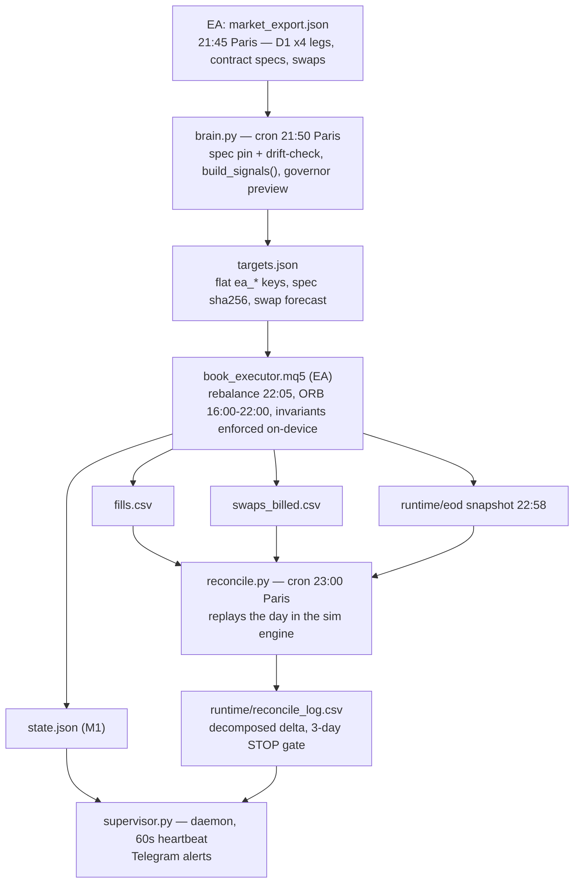

# Architecture — the live system, end to end

This document maps how the deployed FTMO book actually runs: what computes the signal, what
executes it, what state each component reads and writes, and what happens when the repository
changes. It describes the system in `ftmo_live/`. It does not repeat the research methodology
(`docs/RESEARCH_METHOD.md`) or the strategy history (root `README.md`).

Everything below is sourced from the tracked code (`ftmo_live/brain.py`, `ftmo_live/lib/`,
`ftmo_live/mt5/book_executor.mq5`, `ftmo_live/supervisor.py`, `ftmo_live/reconcile.py`,
`.github/workflows/auto-merge.yml`) and from one verified operational audit,
`Multi_Asset/research/active/orb_cost_funded_2026-08/AUDIT_PR429_2026-08-18.md`, which checked
the deployment mechanism against the live VPS crontab and is cited explicitly where used.

---

## 1. The chain, in one picture

Signal computation (Python) and order execution (MQL5 on the EA) are two separate processes on
two separate clocks. `brain.py` never sends an order — it only writes `targets.json`. The EA
never computes a signal — it only reads `targets.json` and re-derives the position size from its
own live equity at fill time (the "governor" step is re-applied on the EA side, not just
previewed by `brain.py`; see `ftmo_live/DOC_SIGNAL_PIPELINE.md` §0).

## 2. Source of truth, file by file

| File | Written by | Read by | Is the source of truth for |
|---|---|---|---|
| `market_export.json` | EA, 21:45 Paris | `brain.py` | D1 history + contract specs + swap points, as seen by MT5 |
| `targets.json` | `brain.py` | EA (rebalance), `supervisor.py`, `reconcile.py` | The intended position, the spec hash the brain ran against, the swap forecast |
| `state.json` | EA, throttled to ~1/minute | `supervisor.py`, `reconcile.py`, `watchdog_mt5.sh` | Live EA state: positions, floors, breaker status, `kill`, heartbeat mtime |
| `fills.csv` | EA, on every fill | `reconcile.py`, audits | What actually executed: price, slippage, timestamp |
| `swaps_billed.csv` | EA | `reconcile.py`, supervisor swap gate | Swap actually charged by the broker, per symbol per night |
| `runtime/eod/*.json` | EA snapshot, 22:58 Paris | `reconcile.py` | End-of-day equity/position snapshot used as the reconciliation anchor |
| `runtime/reconcile_log.csv` | `reconcile.py`, cron 23:00 Paris | `supervisor.py`, human audit | The decomposed daily delta (signal / cost / timing / micro / residual) and the STOP recommendation |
| `runtime/brain_status.json` | `brain.py` | `supervisor.py` | Whether the last brain run succeeded, and why not if it didn't |
| `MQL5/Files/spec_v22.sha256` | deployed manually (§3) | EA on `OnInit` | The one file the EA checks before it will trade at all |
| `FLAT` (kill-file) | dropped manually (or by an alert response) in the EA's `Files` dir | EA, checked every tick | Whether the EA is allowed to hold or open positions |

`state.json` is the EA's live view of itself; `targets.json` is `brain.py`'s intended view. They
are reconciled nightly, never assumed to agree in real time — this is why `reconcile.py` exists
as a distinct nightly process rather than a real-time check.

## 3. The spec chain sealed by hash

The strategy specification (`data/ftmo_portfolio/v22/spec_v22.yaml`, currently pinned at
`v2.2.2`, sha `3e7626f6…`) is not read directly by the EA. It is compiled once into
`data/ftmo_portfolio/v22/ea/spec_v22.mqh` (a generated MQL5 header, pinned sha
`d8d3dcb1ad88…`, `PIN_MQH_SHA256` in `ftmo_live/lib/__init__.py:35`), and that header is compiled
into the EA binary (`book_executor.ex5`).

Two checks close the loop:

- **At `OnInit`** (`ftmo_live/mt5/book_executor.mq5:1668`), the EA refuses to initialise unless
  `MQL5/Files/spec_v22.sha256` on disk equals `SPEC_SHA256` compiled into the binary. This file
  has to be deposited manually alongside the compiled EA — nothing copies it there automatically
  (§5).
- **At every rebalance** (`book_executor.mq5:955`), the EA checks that `targets.json` carries the
  same `ea_spec_sha256` as its own compiled `SPEC_SHA256`. If `brain.py` ran against a different
  spec than the one the EA was compiled with, the EA marks the targets `BAD_SHA` and does not
  act on them.

Python-side, `ftmo_live/lib/spec.py` never re-parses the yaml itself — it imports the pinned
loader `data/ftmo_portfolio/v22/ea/brain.py` (commit `79c6912`) under the name `v22ea_brain` and
delegates to it (`spec.py:17-24`), so there is exactly one place that decides what the frozen spec
says.

This means: a spec change requires re-generating the `.mqh`, recompiling the EA, redeploying the
binary to the VPS, and redepositing the sha256 file — in that order. Changing the yaml alone does
nothing until the rest of the chain is redone.

## 4. Deployment model — the VPS pulls, it does not get pushed to

There is no CD pipeline. The VPS repository (`/home/algo/projects/Algo_claude`, branch `main`)
is kept current by `git pull --rebase --autostash origin main`, run from inside
`scripts/fetch_alpha_sources.sh:68` on a `*/30 * * * *` cron (a second, slower pull happens at
`30 6 * * 1-5` from `scripts/fetch_arxiv.sh:33`). Both scripts exist to run the alpha-scraping
routines — the repo-wide pull is a side effect of them, not a dedicated deploy step.

**Consequence: merging a PR that touches `ftmo_live/*.py` deploys it within 30 minutes**, the next
time a cron-invoked script re-reads the file from disk. This is true for `brain.py`, `reconcile.py`,
`monday_restamp.py`, and every module under `ftmo_live/lib/` — each of these is invoked fresh by
cron (via `scripts/run_with_env.sh`) at every scheduled run, so the next invocation after a pull
reads the new code automatically.

**It is not true for `supervisor.py`.** It is started once as a long-lived daemon
(`screen -dmS ftmo_supervisor ... supervisor.py --daemon`, see `ftmo_live/README.md` §Install) and
keeps running the code it loaded at start. A `git pull` updates the file on disk but not the
process already holding it in memory — the daemon has to be killed and restarted by hand for a
supervisor change to take effect. The same applies to any other process started once and left
running rather than re-invoked by cron.

**MT5 itself is not part of the pull.** Nothing copies `ftmo_live/mt5/book_executor.mq5`,
its compiled `.ex5`, or `spec_v22.mqh`/`spec_v22.sha256` into the Wine MT5 installation
(`~/.wine/drive_c/Program Files/.../MQL5/Experts/ftmo_live/`, `MQL5/Files/`) — every audit of this
path found only documentation describing a manual copy step
(`ftmo_live/README.md` §Install, `ftmo_live/RUNBOOK_BURNIN_SWING.md`), never a script. A merge
touching the `.mq5`/`.ex5` files changes what is sitting in the git repo on the VPS; it changes
nothing MT5 reads until someone manually recompiles and redeploys.

**CI catches most of this, not all of it.** `.github/workflows/auto-merge.yml` hard-fails (blocks
auto-merge) on any PR touching `Futures/live/`, `Portfolio/`, `strategies/`, `.github/`, or any
`*.mq5` file (`auto-merge.yml:56-57`), and separately restricts auto-merge to PRs that touch only
`_automation/` (`auto-merge.yml:83`). **`ftmo_live/` itself is not in the hard-fail path list.** A
PR that only edits `ftmo_live/brain.py` or `ftmo_live/lib/*.py` — live Python that the 30-minute
pull deploys — is blocked from auto-merge solely by the `_automation/`-only rule, and is not
labelled `needs-human-review` the way a `Futures/live/`-touching PR would be. This gap was found
and documented in `Multi_Asset/research/active/orb_cost_funded_2026-08/AUDIT_PR429_2026-08-18.md`
§F; it has not been closed as of this writing (one-line fix: add `ftmo_live/` to the `SENSITIVE`
regex).

## 5. Alerting and supervision layer

- **`supervisor.py --daemon`**: 60-second heartbeat loop. Reads `state.json`, `runtime/reconcile_log.csv`,
  `runtime/brain_status.json`. Sends Telegram alerts (`tg.py`) on stale heartbeat, invariant
  breaches, unreconciled swap deltas, or a missed brain run. Also produces the scheduled morning
  (`--report morning`, cron 08:30 Paris) and evening (`--report evening`, cron 22:20 Paris)
  digests.
- **`watchdog_mt5.sh`**: cron `*/3`. Restarts MT5/Wine only when the broker link is actually down
  (dead process or no broker socket), not merely when the heartbeat is quiet — quiet heartbeats are
  normal around the server rollover and in overnight tick gaps. See
  `ftmo_live/WATCHDOG_INCIDENT_2026-06-15.md` for the incident that produced this distinction.
- **`reconcile.py`**: cron 23:00 Paris. Replays the day through the same simulation engine used in
  research (`ftmo_live/lib/replay.py`), decomposes the gap between real and modelled P&L into
  signal / cost / timing / micro / residual, and recommends STOP after **3 consecutive**
  unexplained days (tolerance: $5 + 1 bp × turnover + 0.5 bp × gross book).
- **`tg.py`**: the only egress to Telegram. Refuses to run if `TELEGRAM_BOT_TOKEN` matches a
  sha256 blocklist of previously-exposed tokens (`ftmo_live/config/token_blocklist.sha256`).

## 6. Kill switch

Dropping a file named `FLAT` in the EA's `MQL5/Files/` directory makes the EA flatten every open
position, cancel pending orders, set `kill=1` in `state.json`, and refuse to open anything new —
checked on every tick (`book_executor.mq5:1705-1717`). The heartbeat keeps running while killed
(supervisor still sees a live EA, just a disarmed one). Removing `FLAT` re-arms the EA on the next
tick; it does not replay anything it skipped. This is documented in `ftmo_live/README.md` §Procédure
KILL and is the mechanism behind the emergency stop scripts `touch_stop.sh` / `remove_stop.sh` at
the repo root.

## 7. Where to go for more detail

- `ftmo_live/README.md` — install steps, crontab (exact lines), secrets rotation, burn-in gate,
  known sim-vs-live divergences (micro-ORB trail, GER40 lot quantization, restart-day swap
  aggregation).
- `ftmo_live/DOC_SIGNAL_PIPELINE.md` — the signal and sizing pipeline itself, layer by layer, with
  file:line references into `engine.py` and `lib/governor.py`.
- `ftmo_live/RUNBOOK_BURNIN_SWING.md`, `ftmo_live/WATCHDOG_INCIDENT_2026-06-15.md`,
  `ftmo_live/RECONCILE_OPTA_2026-06-19.md` — incident-driven operational history; each documents a
  failure mode and the fix that followed.
- `Multi_Asset/research/active/orb_cost_funded_2026-08/AUDIT_PR429_2026-08-18.md` — the most
  recent independent audit of the deployment mechanism itself (what a merge does and does not
  touch), verified against the live VPS crontab and CI configuration.
