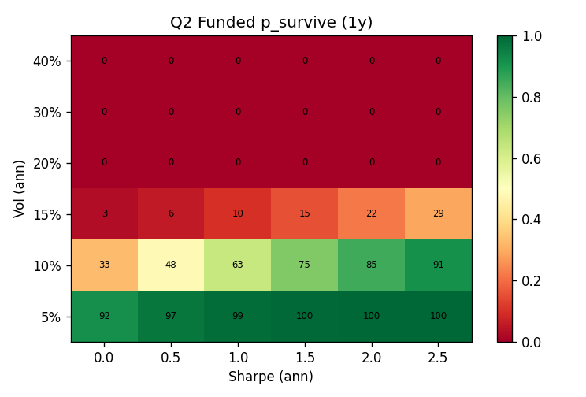
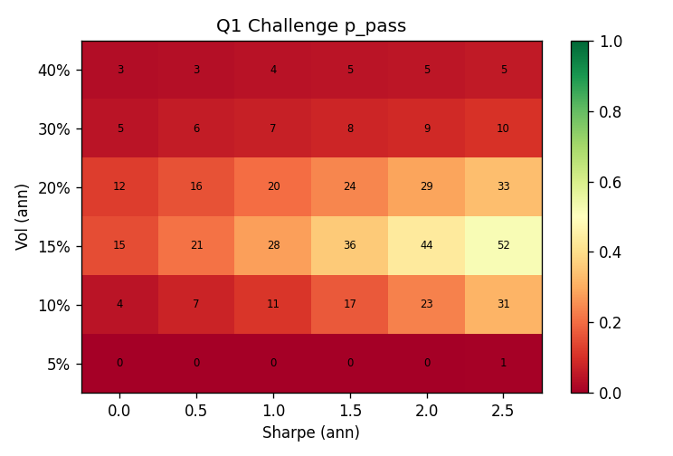

# STUDY — The FTMO-compatible strategy profile (characterisation)
**Date:** 2026-06-20 · **Type:** characterisation (no strategy built, no deployment, live book read-only).
**Pre-registration:** `PREREGISTRATION.md` (frozen before results). **Engine:** `engine.py` (clean re-implementation of the canonical FTMO rules, cross-checked vs `Portfolio/risk/propfirm_canonical.py`). **Maps:** `run_q1q2.py`, `results/fig_*.png`. MC: 20,000 paths/cell, seed 20260620.

> **Compass, not a strategy.** Output = the *quantified* profile a candidate must have to clear BOTH FTMO stages, + a family ranking, so future research targets candidates that can win instead of re-testing overnight variants that fail for the same reason.

## 0. Verdict (one paragraph)
A single always-on configuration **cannot** satisfy both stages — the challenge's optimal vol band (~15%) sits squarely in the funded death zone (survival < 30% above 15% vol). Compatibility is only reachable by a strategy that is **(1) deleverageable** (vol is a per-stage *mode*: ~15% for the challenge sprint, ≤ 8% for funded survival), **(2) short-hold / hard-stopped** so its intraday adverse excursion is small (the daily barrier is the binding funded constraint and it is *intraday*), **(3) intermittent** (presence ≤ ~0.4 → cumulative DD ≤ ~8%), **(4) tail-decorrelated from the existing book** (worst-day co-occurrence ρ ≤ ~0.3), with **(5) a high per-active-day edge** (SR ≥ ~1.5) so it still contributes despite low presence. Ranked families that fit: **fast intraday mean-reversion (hard-stopped) > concentrated defined-risk event > short-term breakout > carry/relative-value (reject).**

## 1. The six lessons, now quantified (all pre-registered hypotheses confirmed)

| # | Lesson | Quantified result |
|---|---|---|
| H-A | challenge rewards a vol band | p_pass peaks at **vol ≈ 15%** (15–52% across SR), collapses above (20% → 24%, 40% → 5%) and below (5% → ~0%). |
| H-B | funded survival is vol/DD-governed, not SR | survival cliff in vol: **5% → ~99%, 10% → 63–91%, 15% → 3–29%, ≥20% → 0%**. SR only shifts it secondarily. |
| H-C | intermittency beats standalone Sharpe | at fixed active-day vol, **presence 1.0 → 9% survival; 0.4 → 51%; 0.2 → 80%** (extraction barely falls). Lower presence → lower σ_ann → survival. |
| H-D | the daily (intraday) barrier binds | intraday-excursion multiplier **m: 1.0 → 36% survival, 1.5 → 15%, 2.5 → 0%**; daily-bust share rises with m. The close-tail (ν) matters less than the *intraday* path. |
| H-E | the two stages reward opposite axes | challenge-optimal vol (~15%) is the funded death zone; funded-optimal vol (≤ 8%) barely passes the challenge → **single-config intersection ≈ empty**. |
| H-F | tail-decorrelation is a hard requirement | book + candidate survival: **ρ_tail 0.0 → 0.94, 0.3 → 0.80, 0.6 → 0.54, 0.9 → 0.26** (book alone 0.71). A tail-decorrelated sleeve *raises* survival; a tail-correlated one destroys it. |

**Refinement to encode:** which barrier binds in funded is **vol-dependent** — at the low vol needed to survive (≤ 10%) busts are ~all **floor / slow-bleed**; at the book's high always-on vol they are ~all **daily / intraday** (daily-bust share: 10% vol → 0%, 20% → 75%, 40% → 99%). The lesson "daily binds" is true *in the book's high-vol regime*; the design implication is identical (keep vol low and intraday excursion small).

## 2. Q1 — the challenge-compatible profile (speed without bust)
- **Vol:** target **12–18% (peak ~15%)**. Too low (≤ 8%) cannot reach +10% inside 63 trading days; too high (≥ 25%) busts the daily/floor en route.
- **Speed/edge:** p_pass rises monotonically with SR at the optimal vol (vol 15%: SR 0 → 2.5 gives 15% → 52%). **Need SR ≥ ~1.5** to make the sprint reliable; the book's stated 70–87% implies an effective challenge SR above the grid top (vm-leverage + edge).
- **Daily tail:** keep the intraday excursion small — at vol 15%, m 1.0 → p_pass 0.40 but m 2.5 → 0.06. **Hard intraday stops are required even for the sprint.**
- **Challenge target profile:** vol ~15%, SR ≥ 1.5, intraday-m ≤ 1.5, presence high enough to act often (the sprint wants frequent at-bats).

## 3. Q2 — the funded-compatible profile (survive + extract)
- **Vol:** **≤ 8% for ≥ ~85% survival** (10% is the knee: 63–91%; ≥ 15% is fatal). This is the single most important number.
- **Cumulative DD:** survival collapses as median cum-DD approaches the **~9–10%** floor; keep **cum-DD ≤ ~8%**.
- **Presence:** **≤ ~0.4** (intermittency). At fixed active-day behaviour, dropping presence lowers σ_ann and lifts survival from 9% → 80% while extraction holds ($1,255 → $852). The book "rewards low always-on risk," not Sharpe.
- **Intraday excursion m ≤ ~1.5** (short holds, hard stops) — the binding daily barrier is intraday.
- **Tail-decorrelation:** **ρ_tail ≤ ~0.3** with the existing book (worst-day co-occurrence). Adding a tail-decorrelated sleeve *improves* book survival (0.71 → 0.94); a correlated one destroys it (→ 0.26).
- **Extraction:** extract to $10k each EOD (no cushion has value — the floor is not the binding barrier in the survivable regime). Confirmed: extraction peaks E[extracted] at vol 10–15% without touching survival.

## 4. Q3 — the intersection (the profile that clears BOTH)
The single-config intersection is **empty at useful levels** (H-E). Compatibility requires a strategy with these **quantified, simultaneous** properties:

| Axis | Required value | Why |
|---|---|---|
| **Vol — as a per-stage MODE** | ~15% (challenge) → **≤ 8%** (funded) | the two stages' optima don't overlap; the edge must be **deleverageable** and survive at low vol |
| **Per-active-day edge (SR)** | **≥ 1.5** | contributes in both modes; passes the sprint without needing fatal vol |
| **Presence-in-position** | **≤ 0.4** | intermittency → low cum-DD → funded survival |
| **Cumulative drawdown** | **≤ 8%** | the funded survival cliff sits below the −10% floor |
| **Intraday excursion m** | **≤ 1.5** (short holds, hard stops) | the daily barrier is intraday and binding |
| **Tail-decorrelation vs book** | **ρ_tail ≤ 0.3** | else it co-busts the daily with the book |

In words: **deleverageable, short-hold/hard-stopped, intermittent, tail-decorrelated, high per-trade edge.** This is the exact photographic negative of the overnight-drift family (always-on, full-vol, 8-hour holds → high m, family-tail-correlated) — which is *why* that family is structurally incompatible and cannot be patched.

## 5. Q4 — family ranking against the quantified profile (conceptual review, not tested)

| Rank | Family | Presence | Intraday m | Deleverageable | Tail-decorr | Verdict |
|---|---|---|---|---|---|---|
| **1** | **Fast intraday mean-reversion, hard-stopped** | low ✓ | low ✓ (short holds + hard stops) | ✓ | likely ✓ (different mechanism) | **Best fit** — matches every funded axis; needs a real MR edge (look on indices/FX, not the trend commodities where it was weak) |
| 2 | **Concentrated, defined-risk scheduled-event** | very low ✓ | ⚠ (event shocks → big intraday) unless **defined-risk/options** | ✓ | ✓ | Strong **if** risk is capped at entry; needs an event calendar |
| 3 | **Short-term breakout / momentum** | medium ✓ | ⚠ (whipsaw adverse excursion) | ✓ | partial | Medium fit; the intraday-m risk is the concern |
| 4 | **Carry / relative-value** | high ✗ | high ✗ (negative tail = deep adverse day) | ✗ | ✗ | **Reject** — always-on + negative tail = daily death |
| — | Overnight-drift (incumbent) | high ✗ | high ✗ (8h hold) | ✗ (vol-cut kills edge) | ✗ (family-correlated) | Reference NON-fit — violates all funded axes |

**First feasibility study to commission:** *fast intraday mean-reversion with hard intraday stops*, researched on **equity indices / FX** (where mean-reversion and the intraday-momentum literature actually live — the trend commodities were shown edge-less for non-overnight). Filter any candidate on the §4 table *before* a full study.

## 6. Strategic implication
The marginal improvement to the book is **not** another sleeve on these instruments and **not** sizing — it is a candidate from a **different family that fits §4**, or **multi-account architecture** (run separate funded accounts so each carries one tail-decorrelated sleeve at low vol, rather than stacking correlated risk in one floor-skimming book). The compass now filters on numbers: a candidate worth a full study must show **vol-deleverageable to ≤8%, presence ≤0.4, intraday-m ≤1.5, cum-DD ≤8%, ρ_tail ≤0.3, SR ≥1.5** — anything that cannot is a re-run of the overnight failure.

*Reproduce:* `python ftmo_profile_study/run_q1q2.py` · *Pre-reg:* `PREREGISTRATION.md` · *Engine:* `engine.py`.
*No strategy was built; live book (ftmo_live/, EA) untouched; no deployment.*
