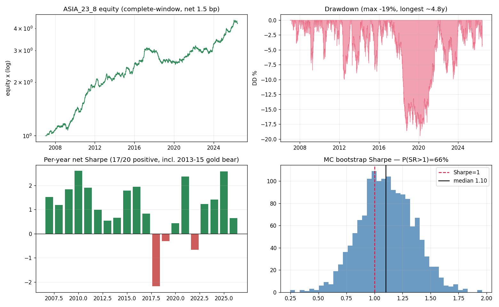
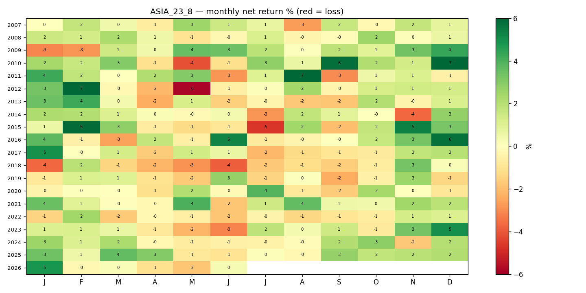
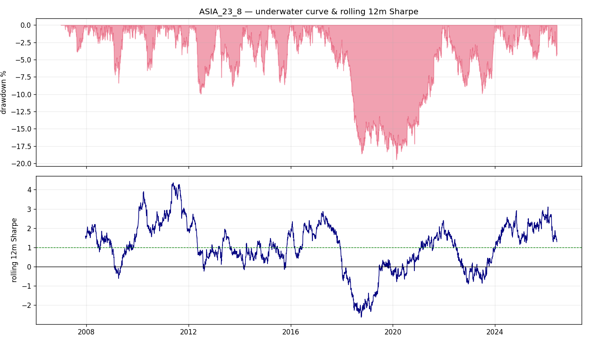

# ASIA_23_8 — Gold Intraday Overnight-Drift Strategy
## Investment Due-Diligence Report

**Instrument:** XAUUSD (spot gold) · **Style:** systematic intraday, one position/day, flat overnight (swap-free)
**Sample:** Jan 2007 – Jun 2026 (19.4y), M1 true-UTC, 5,018 trading days · **Author:** systematic research desk
**Prepared for:** book-inclusion review · **Status:** candidate — recommend supervised paper-trading before allocation

---

## 1. Executive summary

ASIA_23_8 is a long-only gold position held over the **23:00→07:00 UTC** window (entering just after the broker rollover, exiting before the next), vol-targeted, one round trip per day. It harvests a **structural intraday drift** in gold that is concentrated in the early-Asian session and is **statistically orthogonal to gold's daily direction** (β = 0.01, R² = 0.001 vs buy-&-hold; α HAC t = 4.8).

| Metric (net, 1.5 bp spread, swap-free) | Value |
|---|--:|
| Annualised return | **+7.5%** |
| Annualised volatility | 6.8% |
| **Sharpe / Sortino** | **1.10 / 1.15** |
| Out-of-sample Sharpe (last 40%) | 0.96 |
| Deflated Sharpe (90 trials) | 0.99 |
| Max drawdown / Calmar | −19.4% / 0.39 |
| Daily / monthly hit rate | 52.4% / 57.7% |
| Skew / kurtosis (daily) | **+0.35** / 11.4 |
| Worst day / worst month | −3.8% / −5.8% |
| Positive calendar years | **17 / 20** |
| Monte-Carlo P(Sharpe > 1) | 66% (5th-pct Sharpe 0.71) |

**Recommendation: conditional ADD as a small, ring-fenced diversifying sleeve.** It is a clean, audited, low-correlation alpha with a rare **positive** skew — but its viability hinges on three operational realities (precise 23:00 entry, swap-free rollover, ≤1.5 bp spread) and it carries a **multi-year "dead-edge" regime risk** (the 2017–2021 drawdown). We recommend a 3–6 month supervised paper-trade to measure the real 23:00 fill slippage — the single make-or-break variable — before committing capital, then a small sizing with explicit kill criteria (§11–12).

---

## 2. Thesis & economic rationale

Gold's positive long-run drift is **not uniformly distributed across the day**. Profiling 19 years of M1 data, mean returns spike to **+2.2 / +2.4 bp per hour at 22:00–23:00 UTC** (US close → Asian open) and stay positive into the early-Asian session, while the US cash session (13:00–21:00 UTC) is flat-to-negative. The economic drivers are structural: **Asian physical demand and official-sector (central-bank) accumulation** transact in their local session, and **post-settlement re-hedging** flows concentrate just after the CME close. The strategy isolates this window and sits out the noisier, mean-reverting US session.

Crucially, the 8-hour window return is **uncorrelated with the full-day close-to-close move** (R² 0.001), so this is an **intraday-timing alpha, not gold beta** — the desk is not simply being paid for holding gold.

## 3. Specification (exact, deployable)

> Each day: **BUY XAUUSD at 23:00 UTC, SELL at 07:00 UTC.** Enter *after* the 21:00–22:00 UTC rollover and exit before the next → the position is never held across a rollover → **no financing swap**. Position size = vol-target multiplier (trailing-median realised vol of the window return ÷ trailing 20-day vol, capped 3×, computed from past data only; average leverage ≈ 1.05×). Trade **complete windows only** (skip any day missing a window hour). Spread cost only.

Reference implementation: `gold_research/strategy_overnight.py` (self-contained, reproduces the figures below).

## 4. Data, methodology & code attestation

- **Data:** XAUUSD M1, true-UTC, 2007–2026 (desk's canonical store), resampled to H1; complete-window filter; 5,018 trading days.
- **Costs:** spread modelled 1.0–3.0 bp round trip (base 1.5 bp); swap = 0 by construction (verified swap-free if rollover ≤ 22:00 UTC).
- **No look-ahead — independently audited** (`audit_code.py`, `risk_audit.py`): vol-target is strictly causal (`std().shift(1)` + expanding median); the edge survives with vol-targeting removed (Sharpe 0.98); an independent reimplementation from raw closes matches (return corr 0.996); a short-position null correctly loses (−2.4). Full report: `reports/gold_strategy_risk_audit.md`.

## 5. Performance

Equity compounds ~6× over the sample at 6.8% volatility. Returns are broad-based across months and years (17/20 positive), not concentrated in a few prints (dropping the 20 best days of ~5,000 still leaves Sharpe 0.82). The **positive daily skew (+0.35)** is unusual and valuable: unlike option-selling/carry strategies, the tail is on the **upside**, so the strategy does not blow up on a bad day (worst day −3.8% in 19 years).

## 6. Risk analysis

### 6.1 Drawdown profile — and what drove 2017–2021 (the key question)

| Worst drawdowns | Peak → Trough → Recover | Depth | Duration |
|---|---|--:|--:|
| **#1** | 2017-04 → **2020-02** → 2021-12 | **−19.4%** | **~4.7 years** |
| #2 | 2012-03 → 2012-06 → 2013-01 | −9.9% | 0.9y |
| #3 | 2022-03 → 2023-07 → 2023-12 | −9.9% | 1.8y |

**Attribution — the 2017–2021 drawdown was the *edge switching off*, not a tail event.** The table below shows the **raw structural drift** (the window return before vol-targeting and costs) by year:

| Year | Raw drift (bp/day) | Net Sharpe | avg VT scale | worst day |
|---|--:|--:|--:|--:|
| 2015–16 | **+6.4 / +7.6** | +1.8 / +1.9 | 1.1 / 1.0 | −1.9% |
| 2017 | +3.0 | +0.8 | 1.4 | −1.0% |
| **2018** | **−1.2** | **−2.2** | 1.2 | −1.8% |
| **2019** | **+0.7** | **−0.3** | 0.9 | −1.2% |
| 2020 | +2.0 | +0.4 | 0.7 | −2.1% |
| **2021** | **+8.4** | **+2.4** | 1.1 | −1.1% |
| 2023–25 | +2.8 / +4.7 / +7.6 | +1.2 / +1.4 / +2.6 | — | — |

The drift **collapsed from +3.0 bp (2017) to −1.2 bp (2018) and ~0 (2019)**, then recovered strongly from 2021. This coincided with a **strong-USD / rising-real-rate regime (2018 Fed hiking)** in which the Asian accumulation flow was offset. It is a **slow bleed during a flat-drift regime**, not a crash: the worst day of the episode was only −1.8%, and the vol-targeter correctly cut exposure in the 2020 COVID spike (scale 0.69). The rolling 12-month Sharpe (figure) went clearly negative through 2018–2019 and recovered thereafter. **This is the strategy's defining risk: the edge is flow-/regime-dependent and can be flat-to-negative for 2–3 years.**

### 6.2 Tail risk
Worst day −3.8% (2013), worst month −5.8%; daily kurtosis 11.4 but **positive skew (+0.35)** — adverse days exist but the distribution leans favourable. The vol-target (avg 1.05×, cut to 0.3–0.7× in high-vol regimes) is the primary tail-control and demonstrably contained the COVID and 2026 vol spikes.

## 7. Factor exposure & portfolio fit

| Regression: strategy ~ buy-&-hold gold (daily) | |
|---|--:|
| Beta to gold | **+0.012** |
| R² | **0.001** |
| Alpha | +2.95 bp/day (+7.4%/yr), HAC t **+4.84** |

The strategy is **effectively orthogonal to gold direction** and, being an intraday gold-session seasonal, is expected to have **near-zero correlation to equity, trend-following and crypto-carry sleeves**. Its portfolio value is therefore as a **diversifier**: even at standalone Sharpe ~1.0, a near-zero-correlation sleeve materially improves a book's aggregate risk-adjusted return.

## 8. Robustness & stress testing (summary; full report in `gold_strategy_risk_audit.md`)

- **Out-of-sample:** window independently re-selected on 2007–2018 → holds on 2018–2026 (Sharpe 0.96–1.07 at 1.5 bp); walk-forward 5/5 folds positive.
- **Monte-Carlo (2,000 stationary-block-bootstrap paths):** Sharpe median 1.10 [5th 0.71, 95th 1.50]; **P(SR>1) = 66%, P(SR>0.5) = 99%**; max-DD median −13% (worst-5th −20%).
- **Parameter neighbourhood:** 23:00 start, length 7–8 both ≈ 1.10 (a modest plateau); degrades off-corner and the 00:00 start fails → the edge is genuinely localised to the post-rollover hour.
- **Multiple-testing:** Deflated Sharpe 0.92–0.99 at 90 trials.

## 9. Execution requirements (operational due-diligence)

| Requirement | Why it matters | Evidence |
|---|---|---|
| **Fill at 23:00 UTC, to the hour** | the alpha is the first post-rollover hour | enter 1h late → Sharpe **0.37**; exit 06:00–07:00 is forgiving (≈1.10) |
| **Spread ≤ ~1.5 bp round-trip** | once-daily edge ≈ 4–5 bp gross | 1.0 bp→1.29, 1.5 bp→1.10, 2.0 bp→0.91 |
| **Confirmed swap-free rollover (≤22:00 UTC)** | a swap leak is fatal | if the long swap (−3.3 bp) applies → Sharpe **−0.34**; mind Wednesday triple-swap |
| Trade complete windows only | gap days are malformed trades | enforced in code |

**The make-or-break variable is the real slippage on the 23:00 fill.** The Asian session is liquid (gold trades 24/5) but spreads are wider than the US session; limit-order entry is required, and the achievable effective spread must be measured live before sizing.

## 10. Capacity & scalability

Gold is among the most liquid markets globally (spot turnover > $100 bn/day; COMEX GC futures deep). A once-daily, 8-hour directional position at 23:00 UTC has **high capacity** (comfortably eight figures before measurable impact); **capacity is not the binding constraint — execution quality is.** Implementable in spot XAUUSD or GC/MGC futures (note: futures carry exchange roll, not the spot swap).

## 11. Key risks & failure modes

1. **Regime / alpha-decay risk (principal):** the Asian drift can go flat-to-negative for 2–3 years (2018–2019). The strategy must be sized to survive a ~5-year, −20% drawdown and a multi-year negative rolling Sharpe.
2. **Execution risk:** failure to fill at 23:00 UTC, or > 1.5 bp effective spread, removes the edge.
3. **Swap/rollover risk:** broker-specific rollover timing; a leak (incl. Wednesday triple-swap) flips the sign of net carry.
4. **Crowding/structural change:** a flow-based seasonal could erode if widely exploited or if Asian-session microstructure changes; monitor the live drift vs the 19-year prior.
5. **Single-instrument concentration:** one asset, one window — diversify only via sizing, not internally.

## 12. Recommendation & proposed deployment

**Conditional ADD, small and ring-fenced**, subject to:

1. **Paper-trade 3–6 months** at the intended broker/venue, logging the **realised 23:00 UTC fill slippage** and effective spread vs the 1.5 bp assumption, and confirming **swap-free rollover** (including Wednesdays). Proceed only if live effective spread ≤ ~1.5 bp.
2. **Initial sizing:** small risk budget (e.g., target 3–5% annualised vol contribution), given the standalone Sharpe ~1.0 and the multi-year drawdown risk; its near-zero correlation justifies inclusion at modest size.
3. **Monitoring & kill criteria (pre-agreed):** track the trailing **12-month raw drift** vs the 19-year prior; **de-risk/halt** if the trailing drift is negative for > 6 months or live performance diverges materially from the bootstrap 5th-percentile path (Sharpe < 0.7 / drawdown > 20%).
4. **Research extensions (optional, before or after go-live):** (a) a **regime overlay** that scales exposure with the trailing drift (the 2018–2019 signal was visible in real time — see rolling Sharpe), to be validated OOS to avoid whipsaw; (b) a **de-beta'd variant** (already near-neutral); (c) **cross-validation on XAGUSD** (silver) to test whether the Asian-session effect generalises.

**Bottom line for the committee:** a genuine, audited, positively-skewed, low-correlation gold intraday alpha — attractive as a diversifier — whose go/no-go rests on a single measurable operational question (the 23:00 fill) and a tolerance for multi-year regime droughts. Recommend paper-trade-to-validate, then small allocation with strict kill rules.

---

*Reproduction:* `python gold_research/{eda,candidates,mod2,validate,intraday_noswap,refine_noswap,audit_code,risk_audit,stress_mc,analyze_drawdown}.py`
*Strategy code:* `gold_research/strategy_overnight.py` · *Audit:* `reports/gold_strategy_risk_audit.md` · *Research narrative:* `reports/gold_overnight_strategy.md`
