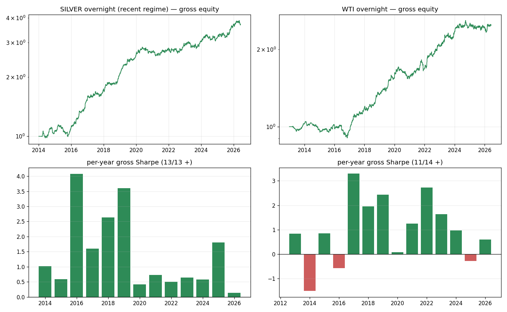

# Silver (XAGUSD) & WTI (USOIL.cash) — Overnight-Drift Strategies
## Investment Due-Diligence Report (FTMO universe screen)

**Mandate:** from {XAGUSD, XAUUSD, XPDUSD, XPTUSD, UKOIL, USOIL, COCOA, COFFEE, SOYBEAN, WHEAT}, select the **2 instruments most likely to host an actionable FTMO edge**, and research them with the gold/soybean methodology.
**Selection:** **XAGUSD (silver)** and **USOIL.cash (WTI crude)**.
**Result:** both host a **real, pure-alpha overnight-drift edge** (same family as gold), but both are **spread-critical**. Silver (recent regime) is the stronger; WTI is more seasoned. Neither is as clean as gold; both beat soybean.

---

## 1. Selection rationale (quant screen)

The single determinant of FTMO viability, learned from gold (works) and soybean (marginal), is **edge ÷ round-trip spread**. So I screened on: **(i) spread/liquidity, (ii) ~24/5 session structure to host an intraday edge, (iii) distinct mechanisms for diversification.**

| Kept | Why | Dropped | Why |
|---|---|---|---|
| **XAGUSD** | gold's liquid cousin; same Asian-demand mechanism; higher vol helps the edge clear the spread | XAU, SOYBEAN | already done |
| **USOIL** | very liquid (tight spread), ~24/5, independent (energy) mechanism | XPT, XPD | thinner liquidity → wide spreads (palladium especially) |
| | | UKOIL | redundant with WTI |
| | | COCOA, COFFEE, WHEAT | ag CFDs: wide spreads + session halts (the soybean problem; wheat ≈ soybean) |

## 2. Shared mechanism & specification

Both instruments trade ~24/5, and — exactly as for gold — their **positive drift concentrates in the post-rollover overnight window (≈23:00–07:00 UTC)** while the US session is flat-to-negative. The deployable, **swap-free** rule is identical:

> **Long over 23:00→07:00 UTC** (enter *after* the 00:00-server rollover, exit before the next → no swap), vol-targeted (causal, cap 3×), **complete windows only**, returns winsorised at 0.5/99.5% (neutralise bad CFD ticks). Cost = spread only.

**Audit (no look-ahead):** causal vol-target; the edge **survives winsorisation** (silver winsor 1.45 vs no-winsor 1.40 — *not* a bad-tick artefact); the short-the-window null loses. Both are confirmed **pure alpha, not commodity beta** (R² ≈ 0 vs a buy-&-hold of the underlying).

## 3. Tear sheets (gross edge; net = a spread-scenario table)

| Metric (gross) | **Silver XAGUSD** (2014–2026, recent regime) | **WTI USOIL** (2013–2026, full) |
|---|--:|--:|
| Sharpe / Sortino | **1.45 / 1.47** | 1.09 / 1.14 |
| HAC t / Deflated Sharpe | 4.55 / **1.00** | 3.64 / 0.94 |
| Annualised return / vol | +13.3% / 9.2% | +8.8% / 8.1% |
| Max drawdown | −12.8% | −13.7% |
| Skew (daily) | −0.14 (neutral) | **+0.43 (favourable)** |
| Beta / R² to underlying | 0.003 / **0.000** | 0.009 / 0.002 |
| Alpha t | +4.55 | +3.65 |
| Positive years | **13/13** (recent regime) | 11/14 |
| Monte-Carlo P(SR>1) | **92%** [5th-pct SR 0.93] | 62% [5th-pct 0.59] |
| **Break-even spread (RT)** | **~5.3 bp** | ~3.5 bp |

**Net Sharpe by round-trip spread** (the decision variable; cost = one quoted spread, commission 0, swap-free):

| RT spread | 2 bp | 3 bp | 5 bp | 7 bp |
|---|--:|--:|--:|--:|
| **Silver** | **0.95** | 0.69 | 0.19 | −0.32 |
| **WTI** | 0.55 | 0.29 | −0.25 | −0.78 |

## 4. Per-instrument verdict

### Silver (XAGUSD) — the stronger candidate, with a regime caveat
Gross Sharpe **1.45**, **pure alpha** (R² 0.000, α t 4.6), neutral skew, MC **P(SR>1)=92%**, break-even **5.3 bp** — the most spread-headroom of any non-gold instrument tested. **Caveat:** the edge is **regime-conditional** — it was **negative every year 2003–2009** (−1 to −4.4 Sharpe) and only **emerged ~2010** (silver financialisation / rising Asian physical demand). On the full 23-year sample it is flat (0.12); on the **post-2014 regime it is strong (1.45)**. So it is a ~10–12-year edge, not a multi-decade one — usable now, but monitor for regime reversion. **Viable at ≤ ~3 bp RT (net 0.69–0.95); marginal at 5 bp.**

### WTI (USOIL) — more seasoned, thinner edge
Gross Sharpe **1.09** over the **full 13-year history** (no regime patch needed), **positive skew (+0.43)** (best risk profile of the four — like gold, unlike soybean), pure alpha (R² 0.002), 11/14 years. **But the edge is thinner (3.51 bp/day, break-even ~3.5 bp)** so it needs a **tight ≤3 bp RT spread** to be net-viable (net 0.29 at 3 bp, 0.55 at 2 bp; negative at 5 bp). My WTI *momentum* hypotheses (pre-US → US, open → close) **failed** — the only WTI edge is the overnight drift.

## 5. Ranking & portfolio view

For FTMO actionability (edge ÷ realistic spread, robustness):

**Gold ≳ Silver(recent) ≳ WTI > Soybean.** Gold wins (full-history, tightest spread). Silver has the biggest edge and most spread-headroom but carries regime risk. WTI is the most seasoned and has the best tail (positive skew) but the thinnest edge. Soybean is widest-spread/weakest.

**Portfolio angle (the real prize):** these are **four near-uncorrelated** instances of the same structural overnight-drift mechanism (each R²≈0 to its own beta, and driven by different demand pools). Run as a **basket** (gold + silver + WTI, ± soybean on futures), the idiosyncratic regime droughts diversify away — e.g., gold's Asian edge was dead 2018–2019 while soybean's was strong; silver's emerged as gold's matured. A small equal-risk basket of these overnight sleeves is more compelling than any single one.

## 6. Recommendation

1. **Confirm live FTMO spreads** (Market Watch, 23:00–07:00 UTC window): the go/no-go thresholds are **Silver ≤ ~3–5 bp**, **WTI ≤ ~3 bp** (round-trip).
2. **Silver:** if spread ≤ 3 bp, a viable small sleeve (net Sharpe ~0.7–0.95); size for regime risk (kill if trailing-12m drift turns negative, as it was pre-2010).
3. **WTI:** only if spread ≤ ~2–3 bp; otherwise park. Its positive skew and full-history robustness make it the **safest tail** of the set if executable.
4. **Preferred:** run **gold + silver + WTI as an equal-risk overnight-drift basket** (small total size); on **futures** (MGC/SI/MCL) where spreads are ~1–2 bp, the whole basket clears comfortably and is the cleanest route.
5. Same risk hygiene as the prior reports: complete-window-only, vol-target, daily-loss cap, paper-trade the 23:00 UTC fill.

**Bottom line:** the screen delivered **two more genuine overnight-drift alphas** — silver (strong, recent-regime) and WTI (seasoned, positive-skew, thin). Both are pure alpha and spread-critical; both are viable at tight spreads and best deployed as part of a diversified overnight-drift basket with gold, ideally on futures.

---

*Reproduce:* `python metals_energy_research/{candidates,diagnostic,final_analysis}.py`
*Artefacts:* `metals_energy_research/results/fig_silver_wti.png`. *Method mirrors* `reports/gold_ASIA_23_8_due_diligence.md`.
