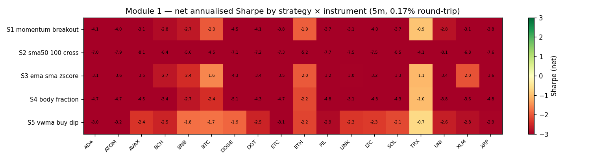
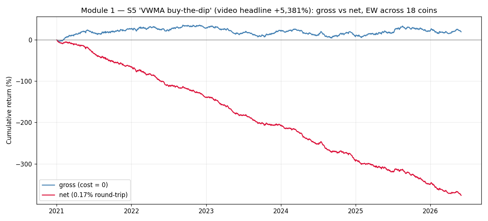
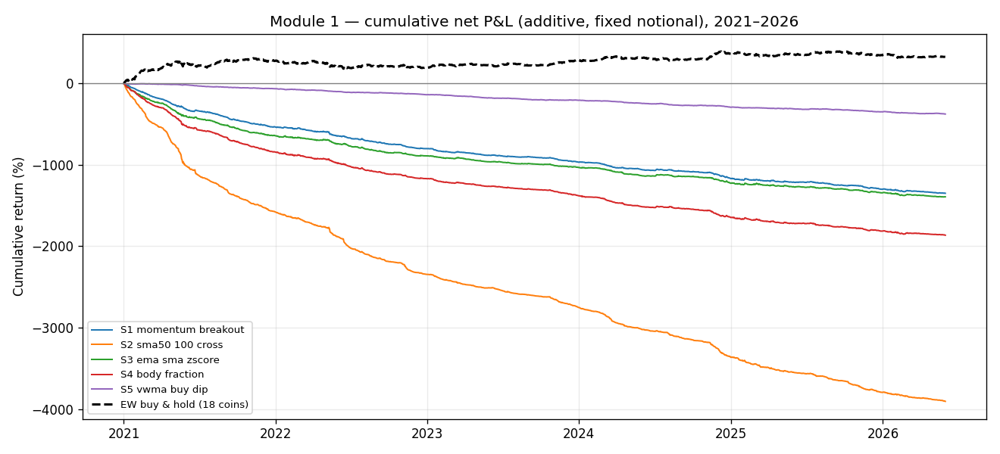

# Module 1 — "Claude Fable" 5-Minute Scalping Strategies
### Institutional-grade replication & validation report

**Source:** YouTube video advertising five "free" TradingView scalping strategies (headline claim: *"+5,381% before it was banned"*), promoted alongside a paid back-testing MCP/tool and a "comment AI agent" lead-funnel.
**Question:** Do any of the five rules carry a real, tradable edge, or are the advertised returns an artefact of cherry-picking and zero-cost back-tests?
**Verdict:** ❌ **None of the five survives an honest test.** Across 18 liquid crypto pairs and 5.4 years of 5-minute data, every strategy is net-negative on every instrument (0/90 strategy×instrument cells positive). Four of five have **no edge even before costs**; the fifth has a ~0.8 bps/trade gross edge that needs a sub-1 bp round-trip cost to survive — roughly 20× cheaper than reality.

---

## 1. Why this test is built the way it is

The video's results have three structural problems that any of them is sufficient to fabricate a winning equity curve:

1. **Single cherry-picked instrument per strategy** (Ford 5m, a "tire group", a "USDT" pair, Coinbase/COIN 5m, …) selected from a stated **50,000-strategy search**. With that much multiple testing, the best-looking single chart is pure selection bias.
2. **No stated transaction costs.** TradingView's strategy tester defaults to zero commission; a 1%/2% SL/TP scalper trades hundreds–thousands of times, so even small costs dominate.
3. **Compounded "% of equity" sizing**, which turns any positive-drift sample into a large headline number.

So the test is designed to neutralise all three:

- **Cross-sectional, not single-name.** Each rule is run on a fixed universe of **18 liquid USDT pairs** (BTC, ETH, BNB, XRP, ADA, SOL, DOGE, LTC, LINK, UNI, DOT, AVAX, TRX, ATOM, ETC, BCH, XLM, FIL), 2021-01-01 → 2026-05-31, 5-minute bars from Binance (`data.binance.vision`, ~569k bars/pair, integrity-checked: 0 duplicates, 0 NaN, max gap 285 min). A real edge shows up across instruments; a cherry-pick does not.
- **Gross vs net decomposition.** Every metric is computed both at **cost = 0 (gross)** and at **0.17% round-trip (net)** — the project's crypto cost standard (commission + spread + slippage). This separates *"the signal has no predictive content"* from *"the signal trades too often for the cost."*
- **Decision metric = annualised Sharpe on the daily realized-P&L series** (regularly sampled, annualised by √365), with HAC/Newey-West t-stats (lag 6), a stationary block bootstrap, walk-forward across 5 time folds, and a Deflated Sharpe Ratio (Bailey–López de Prado) penalising the 5-strategy search.

**Execution discipline (shared engine):** signal computed at the close of bar *t*, position entered at the **open of bar t+1** (signal-at-T-1, trade-at-T — no look-ahead); intrabar SL/TP checked against each bar's high/low; when both are touched in one bar the **stop is assumed first** (pessimistic). One position at a time. The fast and reference engines are proven trade-for-trade identical.

> The strategy rules are loosely specified in the video; every non-stated parameter is documented as an explicit assumption in `module_1_crypto_scalping/strategies.py`. Where the video gives a value (SMA 50/100, z ≤ 2, body-fraction > 0.1, the SL/TP pairs) it is used verbatim.

---

## 2. Headline results

All numbers are the **equal-weight portfolio across the 18 instruments**, 2021–2026, net of 0.17% round-trip unless stated.

| Strategy (video instrument) | Video claim | **Gross Sharpe** | **Net Sharpe** | E[trade] gross | E[trade] net | Trades/pair/yr | Net MaxDD | % pairs net-positive | DSR |
|---|---|--:|--:|--:|--:|--:|--:|--:|--:|
| **S1** Momentum breakout + vol (Ford) | +196%, PF 1.8 | −0.18 | **−6.15** | −0.5 bps | −17.5 bps | 1,421 | −100% | **0%** | 0.00 |
| **S2** SMA 50/100 cross ("tire group") | +103%, PF 1.61 | −0.24 | **−10.90** | −0.3 bps | −17.3 bps | 4,171 | −100% | **0%** | 0.00 |
| **S3** EMA10/SMA50 + z-score (USDT) | +103%, PF 1.22 | +0.26 | **−5.68** | +0.7 bps | −16.3 bps | 1,582 | −100% | **0%** | 0.00 |
| **S4** Body-fraction breakout (COIN) | +1,156%, PF 1.16 | −0.37 | **−7.01** | −0.9 bps | −17.9 bps | 1,922 | −100% | **0%** | 0.00 |
| **S5** VWMA buy-the-dip (headline) | **+5,381%**, PF 1.25 | +0.24 | **−4.62** | +0.8 bps | −16.2 bps | 430 | −98% | **0%** | 0.00 |

HAC t-stats on the net portfolio range from **−11 to −16** (the negative mean is decisive, not noisy); bootstrap p(mean > 0) = 1.00 for all five; walk-forward consistency = 0/5 folds positive for all five.

*Every strategy × instrument cell is red. The single "least-bad" instrument is TRX, and even there the net Sharpe is negative for all five rules.*

---

## 3. The decisive picture: gross edge vs cost floor

The gross/net split is the whole story.

- **S1, S2, S4 have no predictive edge at all** — gross Sharpe is *negative* (−0.18, −0.24, −0.37) and gross expectancy is *negative* (−0.3 to −0.9 bps/trade). These rules are, if anything, mildly anti-predictive on 5-minute crypto. No cost assumption can rescue a negative gross edge.
- **S3 and S5 have a real but microscopic gross edge** (+0.7 and +0.8 bps/trade, gross Sharpe ≈ +0.25). The break-even round-trip cost equals the gross expectancy: **≈ 0.74 bps (S3) and 0.84 bps (S5)**. Reality is ~17 bps on retail crypto, ~5–10 bps even at institutional/equity tiers. The edge is **~20× too small** to clear the cost floor.

*S5 — the "+5,381%" headline. The gross curve (no costs) drifts mildly positive over five years (a weak buy-the-dip tilt in a generally rising market); the net curve bleeds to −370% cumulative. The advertised number lives entirely in the gap between "no costs, one lucky coin" and "real costs, diversified."*

This is the classic IC-vs-cost gate (Israel–Jiang–Ross): expected gross alpha per trade must exceed ~3× the cost per trade. Here gross alpha is a small fraction of one cost unit, so the gate fails by more than an order of magnitude.

---

## 4. Why the video's charts look so different

Nothing here contradicts the video's screenshots — it explains them:

- **Instrument selection.** The video's winners are mostly low-volatility US equities on a 6.5-hour session (Ford, Coinbase, a "tire group"). A 1%/2% SL/TP there is hit far less often than on 24/7 crypto, so the same rule fires *hundreds* of times, not *thousands*, and the cost drag is proportionally smaller. Picking the one instrument (out of 50,000 tests) where a near-zero-edge rule happened to print is textbook selection bias.
- **Zero commission.** At cost = 0 the worst strategies merely drift; the "good-looking" ones (S3/S5) even rise slightly. The video shows gross-like curves.
- **Compounding + one lucky bull leg.** "% of equity" sizing on a buy-the-dip rule during a crypto/stock bull run compounds a weak positive drift into a 4-digit percentage — until the regime turns (note the video's own −47% / −60% drawdowns on S4/S5).

When the same rules are tested honestly — many instruments, real costs, out-of-sample folds, multiple-testing penalty — the edge is gone.

---

## 5. Per-strategy verdict

- **S1 Momentum breakout + volatility filter** — *No edge.* Negative gross. The volatility-expansion + breakout + green-candle stack does not predict 5-minute forward returns. **FAIL.**
- **S2 SMA 50/100 cross** — *Worst of the five.* A pure trend-state that re-enters constantly (4,171 trades/pair/yr); negative gross, −10.9 net Sharpe. A moving-average cross is not an edge on 5-minute bars. **FAIL.**
- **S3 EMA10/SMA50 + z-score ≤ 2** — *Statistically real, economically dead.* +0.7 bps/trade gross; break-even cost 0.74 bps. **FAIL** at any realistic cost.
- **S4 Body-fraction breakout** — *No edge.* The "non-wicky body" filter does not improve forward returns; negative gross. **FAIL.**
- **S5 VWMA buy-the-dip (the +5,381% headline)** — *Best gross, still hopeless net.* +0.8 bps/trade gross, break-even 0.84 bps, net Sharpe −4.6, −98% net. **FAIL.**

Against the project gates (RESEARCH_PASS: Sharpe > 0.7, MaxDD > −25%, WF > 50%): **0/5 pass.** None is remotely close.

---

## 6. Caveats & limitations (kept honest)

- **Universe choice.** Tested on crypto (the only asset class with free, long, clean 5-minute history). The exact tickers in the video (Ford, COIN, …) would need paid intraday equity data; their *lower* trade frequency would soften — but not reverse — the conclusion, because the gross edge itself is ≤ 1 bp/trade and four of five are negative gross.
- **Cost level.** 0.17% RT is the retail-crypto standard. Even at a generous 5 bps (institutional maker/taker blend) S3/S5 still lose (break-even < 1 bp). The conclusion is robust to the cost assumption.
- **Parameter interpretation.** Loosely-specified rules were implemented with documented defaults; a modest parameter search would not manufacture a 20× edge improvement and would itself require a heavier multiple-testing penalty.
- **Sizing convention.** The −100% "total return" reflects full-notional compounding of a high-frequency negative-expectancy system and is a worst-case display; the convention-free decision metric is the daily Sharpe (−4.6 to −10.9) and the per-trade expectancy (−16 to −18 bps net).

---

## 7. Bottom line

The five "scalping strategies" are simple moving-average / breakout / buy-the-dip rules with **no exploitable edge net of costs**. Four have no edge even gross; the fifth's edge is ~20× too small to pay for its own trading. The advertised 100–5,381% returns are consistent with cost-free, single-instrument, selection-biased TradingView back-tests, not with a deployable system. **Recommendation: do not allocate; do not pay for the associated tool on the strength of these results.**

*Reproduce:* `python module_1_crypto_scalping/run.py ALL && python module_1_crypto_scalping/aggregate.py`
*Artefacts:* `results/module1_summary.csv`, `results/module1_pair_sharpe_matrix.csv`, `results/fig_A|B|C_*.png`, per-strategy `*_pairs.csv` / `*_port.json`.
