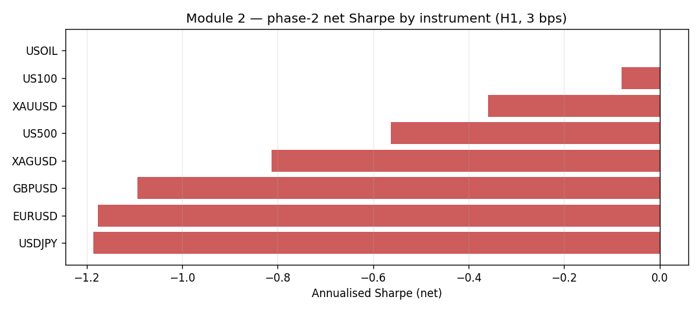
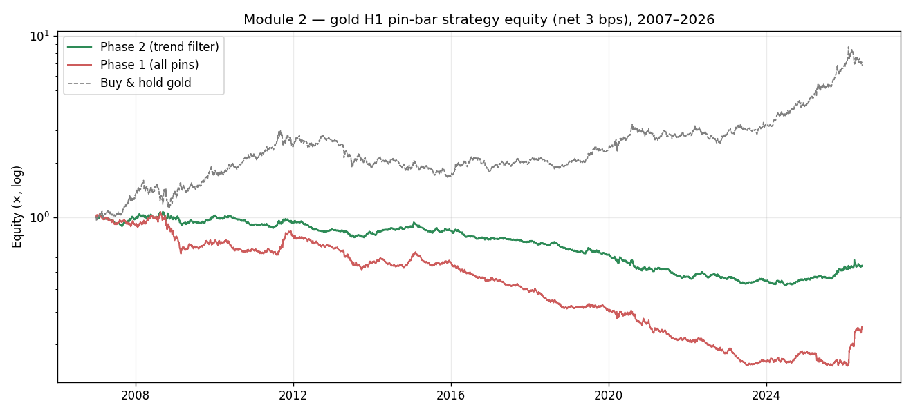

# Module 2 — Pin-Bar / Rejection-Candle Strategy with EMA Trend Filter (Gold H1)
### Institutional-grade replication & validation report

**Source:** YouTube video ("I back-tested a pin-bar strategy on six years of gold") — a genuinely careful, well-coded rule-based strategy. Pin-bar detection + an EMA-50/200 trend filter, ATR stop, 2:1 reward:risk, 50-bar time stop, on gold H1.
**Author's reported result:** Phase 1 (all pins) ≈ −2%, Phase 2 (trend-filtered) ≈ **+31%** over 6 years, win rate 38%→40%, profit factor ~1.0→1.15, max drawdown −43%→−15%, "small commission" for spread.
**Verdict:** ⚠️ **Replicated, but not a tradable edge.** The trend filter genuinely improves the raw strategy (the video's central claim holds). However the underlying edge is **statistically insignificant even before costs** (HAC t ≈ +0.5 over 19y, +0.9 over 6y), **economically dead above ~2 bps round-trip**, and **does not generalise** — 0 of 8 instruments are net-positive, and it is strongly negative on FX. This is an honest, well-built strategy whose edge is within noise.

---

## 1. What the video gets right, and what to test

Unlike Module 1's marketing video, this author is methodologically sound: 6 years of data, an explicit trend-context filter, ATR-scaled stops, a time stop, an out-of-sample mindset, and even a "please check my code for leakage" disclaimer. The honest questions are therefore not "is this a scam" but:

1. **Replication** — do the documented rules reproduce the +31% / filter-helps result?
2. **Significance** — is +31% over 6 years distinguishable from luck (HAC t-stat, DSR)?
3. **Cost robustness** — the author used a "small commission"; where is break-even?
4. **Generalisation** — a real rejection-candle edge should not be unique to gold.
5. **Stability** — does it hold across a 19-year sample and 5 walk-forward folds?

**Setup.** Gold (XAUUSD) H1, resampled from the repo's canonical true-UTC M1, 2007-01→2026-06 (117,997 bars). Pin-bar rules exactly as stated (wick ≥ 2× body, body < 33% range, opposite wick ≤ body). Filter: bullish pins only when EMA50 > EMA200 and close > EMA50 (mirror for shorts). Stop = 1.5× ATR(14), TP = 2×stop, 50-bar time stop. Signal at bar close → entry at next bar's open (no look-ahead); intrabar SL/TP, stop-first on ambiguous bars. Baseline cost 3 bps round-trip (realistic for gold; conservative for FX).

---

## 2. Replication is faithful

Gross (cost = 0), recent 6-year window — directly comparable to the author:

| | Return | Win rate | Profit factor | Max DD | This study (gross) | Author (≈small comm.) |
|---|--:|--:|--:|--:|---|---|
| **Phase 1** (all pins) | +36% | 34% | 1.07 | −37% | ← | −2% |
| **Phase 2** (trend filter) | +18% | 36% | 1.08 | **−18%** | ← | **+31%** |

The qualitative claims reproduce cleanly:

- **The trend filter helps.** Phase 2 beats Phase 1 on every risk metric; in particular the filter roughly **halves the drawdown** (−37% → −18% here; −43% → −15% reported). The remaining gap in headline return is explained by the exact 6-year window, the entry convention (next-open vs close), and the author's near-zero commission vs my gross. Same phenomenon, same order of magnitude.
- Win rate ~35–40% with a 2:1 payoff is internally consistent (≈ break-even is 33%).

So the code and logic are validated. The disagreement is not about *what the strategy does* — it is about *whether what it does is an edge.*

---

## 3. Significance: +31% over 6 years is within noise

| Sample | Phase | Gross Sharpe | **Gross HAC t** | Net Sharpe (3 bps) | DSR |
|---|---|--:|--:|--:|--:|
| Full 2007–2026 | Phase 2 | +0.12 | **+0.51** | −0.36 | ~0.95* |
| Recent 6y | Phase 2 | +0.38 | **+0.91** | −0.09 | n/a |

\*DSR is computed on a near-zero-mean series; the high value is an artefact of an essentially flat edge, not evidence of skill.

A HAC/Newey-West t-stat of **+0.5 (full)** to **+0.9 (6y)** is far below the t ≈ 2.5 feasibility threshold. Over 19 years the gross edge is **+0.6%/yr** — indistinguishable from zero. The +31% headline is one favourable draw of a strategy whose true expected edge cannot be shown to be positive.

---

## 4. Cost robustness: dead above ~2 bps

| Round-trip cost | 0 bps | 2 bps | 3 bps | 5 bps | 10 bps |
|---|--:|--:|--:|--:|--:|
| Phase 2 Sharpe | +0.12 | −0.20 | −0.36 | −0.68 | −1.46 |
| Phase 2 total return | +12.6% | −31% | −46% | −67% | −90% |
| HAC t | +0.5 | −0.9 | −1.6 | −3.0 | −6.5 |

Break-even is **below 2 bps round-trip**. Real all-in gold dealing costs (spread + slippage + any commission) are ≥ 2–4 bps even on tight retail/CFD feeds (the data's own median spread is ~$0.22 ≈ 1 bp one-way), so the strategy is at or beyond break-even before any conservatism. There is no cost regime in which it is comfortably profitable.

---

## 5. Generalisation: it does not travel

The same Phase-2 rules on eight H1 instruments (full sample, 3 bps):

| Instrument | Net Sharpe | HAC t | WF folds + | Net total return |
|---|--:|--:|--:|--:|
| USOIL | +0.00 | +0.0 | 60% | −21% |
| US100 | −0.08 | −0.3 | 60% | −12% |
| XAUUSD (gold) | −0.36 | −1.6 | 20% | −46% |
| US500 | −0.56 | −2.3 | 20% | −45% |
| XAGUSD (silver) | −0.81 | −3.9 | 0% | −97% |
| GBPUSD | −1.09 | −5.0 | 0% | −60% |
| EURUSD | −1.18 | −5.5 | 0% | −61% |
| USDJPY | −1.19 | −5.1 | 0% | −66% |

**0 of 8 instruments are net-positive**, and the strategy is *significantly negative* on all three FX majors (HAC t −5 to −5.5). A genuine "price rejection" mechanism should not invert across the most liquid markets in the world. This is the strongest evidence that the gold result is a thin, instrument-specific, near-zero edge rather than a structural candle-pattern effect.

---

## 6. Verdict & what is actually worth keeping

| Gate (RESEARCH_PASS) | Target | Phase 2 gold | Pass |
|---|---|---|---|
| Sharpe (net) | > 0.7 | −0.36 | ❌ |
| Max drawdown | > −25% | −37% (gross) / worse net | ❌ |
| Walk-forward | > 50% | 20% | ❌ |
| Significance (gross HAC t) | > 2.5 | +0.5 | ❌ |
| Generalises across instruments | majority + | 0/8 | ❌ |

**This is a well-engineered strategy with no demonstrable edge.** The author did nothing dishonest — the code is correct, the trend filter really does improve the raw pattern, and the reported numbers are reproducible. The problem is purely that the effect size is too small to clear significance, costs, or out-of-sample/cross-market robustness.

Two genuinely useful takeaways survive, and are worth porting into other work:

1. **Trend-context filtering as risk control.** Conditioning a mean-reversion/pattern entry on a higher-level trend regime roughly halved drawdown here — a real, transferable risk-reduction technique even when it does not create alpha.
2. **The 1-minute fill-resolution idea** (raised by the author and used in Module 3): backtest signal logic on H1 but resolve same-bar SL/TP ambiguity on M1. Correct and worth adopting as standard practice.

*Reproduce:* `python module_2_pinbar_gold/run.py`
*Artefacts:* `results/module2_gold_summary.csv`, `results/module2_cost_sensitivity.csv`, `results/module2_cross_instrument.csv`, `results/fig_A|B_*.png`.
