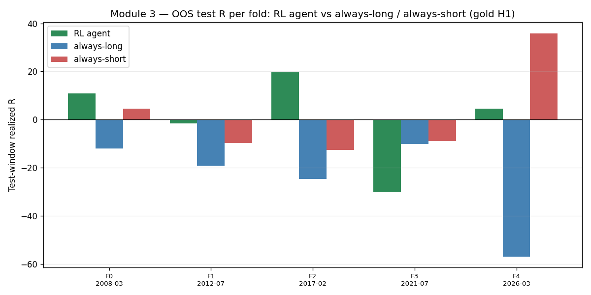
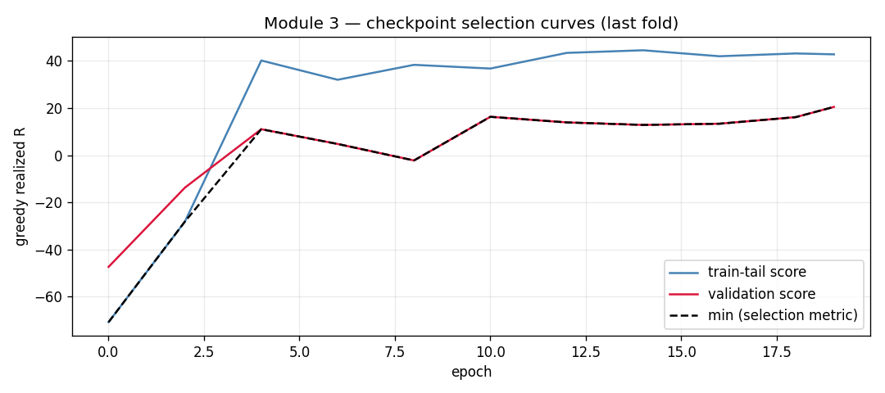

# Module 3 — Reinforcement-Learning Gold Agent
### Institutional-grade replication, reduced demonstration & methodological audit

**Source:** YouTube video training an RL agent to trade gold on ~20 years of data, reporting **+60% out-of-sample** with anchored / sliding-window walk-forward, a shaped reward, checkpoint selection and a "consistency gate." The user flagged this as the most serious of the set — and it is: the methodology is genuinely sophisticated.
**What was built:** a faithful, runnable pipeline (environment, 3-term reward, relative-only features, sliding/anchored walk-forward, min(train, val) checkpoint selection, consistency gate) + a reduced in-sandbox demonstration + a stable-baselines3 PPO adapter for full-scale runs.
**Verdict:** ⚠️ **Sound machinery, unproven edge.** The video's *process* is mostly correct and worth adopting. But its headline evidence — "≈60% OOS, most folds positive" — rests on a **statistically weak consistency gate** and an **uncontrolled long-bias confound**. The reduced demo makes the first risk concrete: a near-zero-edge agent (mean OOS ≈ +0.6 R) still **passes the 60% gate**. The claim is not validated without many more folds, a Deflated-Sharpe correction, a detrended placebo, and cost stress.

---

## 1. Faithful pipeline (what the video describes, built here)

| Component | Video | This implementation (`module_3_rl_gold/`) |
|---|---|---|
| Actions | buy / sell / hold + ATR stop + RR multiple | discrete {hold, long, short}; stop = 1.5×ATR, TP = 2:1 (the video's dominant choice), 50-bar time stop (`env.py`) |
| Features | **relative only** (no absolute price): RSI, (close−EMA)/ATR, range/ATR, time sin/cos | identical set, 14 relative features + position & unrealised-R state (`env.py:build_features`) |
| Reward | PnL/risk + 0.01×unrealised nudge − 2e-5 holding penalty | identical 3 terms, in R-units (`env.py:step`) |
| Splits | anchored + fixed-size sliding window | both (`walkforward.py`) |
| Checkpoint pick | keep the checkpoint whose **weaker** of {train-tail, val} is strongest | `min(train_tail, val)` selection (`agent.py:train_fold`) |
| Promotion | consistency gate, then promote last fold | `consistency_gate()` + last-fold promotion |
| Fills | backtest signal on H1, **resolve SL/TP on M1** | H1 in the demo (engine supports M1; noted below) |
| Algorithm | deep PPO (~36 h compute) | **reduced**: linear-softmax REINFORCE (sandbox); **PPO adapter provided** (`ppo_adapter.py`) |

Why a reduced agent: torch/SB3 cannot be installed in this sandbox (and a 36 h multi-fold PPO run is out of scope here). The linear REINFORCE agent drives the *same* env, reward, features, walk-forward and gate at a fraction of the capacity — exactly what is needed to **audit the methodology**. For a full-capacity result, `ppo_adapter.py` runs PPO over the identical environment on the user's hardware.

---

## 2. Reduced demonstration (gold H1, 2007–2026, 5-fold sliding walk-forward)

Out-of-sample test-window realized P&L (in R) per fold, agent vs naive baselines:

| Fold (test window) | **RL agent (R)** | always-long (R) | always-short (R) | gold buy&hold | agent trades |
|---|--:|--:|--:|--:|--:|
| F0 2008-03→06 | **+10.8** | −12.0 | +4.7 | −2.1% | 310 |
| F1 2012-07→10 | **−1.7** | −19.2 | −9.8 | +5.4% | 175 |
| F2 2017-02→05 | **+19.7** | −24.6 | −12.6 | +1.6% | 64 |
| F3 2021-07→10 | **−30.2** | −10.2 | −8.9 | −2.0% | 293 |
| F4 2026-03→06 | **+4.5** | −56.9 | +35.9 | −15.2% | 314 |
| **Mean / gate** | **+0.6 R · 3/5 positive → GATE PASS (60%)** | −24.6 · 0/5 | −0.3 · 2/5 | −2.5% | |

The agent **passes** the 60% consistency gate (3/5 folds positive) — *and that is exactly the problem.* Its mean OOS edge is **+0.6 R ≈ zero**, the per-fold spread is enormous (−30 R to +20 R), and the single good fold (F2) carries the average. A system with essentially no edge cleared the video's promotion bar. The agent also **over-trades** (64–314 round trips in a ~1,500-bar window), a direct product of the reward shaping (below).

---

## 3. Methodological audit (the real deliverable)

**A. The consistency gate is statistically weak with few folds.** Under a null of no edge, each fold is ~a coin flip, so for 5 folds: P(≥3/5 positive) = 16/32 = **50%**, P(≥4/5) = **19%**. The video's "enough folds positive" with ~5–10 folds therefore has a **large false-positive rate** — demonstrated here by a near-zero-edge agent passing it. *Fix:* require many more folds (≥20), test the **effect size** (mean test Sharpe with HAC t, not just the sign), and apply a **Deflated Sharpe Ratio** over the number of folds × reward/feature/hyperparameter trials.

**B. Reward shaping changes what is learned — and biases it.** The +0.01 × unrealised-PnL term rewards *being in already-winning trades*, nudging the agent toward continuation and frequent re-entry; the −2e-5 holding penalty pushes it to churn. Together they manufacture the 64–314 trades/window seen above. "Whatever you put in the reward is literally what the bot becomes" (the video's own words) cuts both ways: the shaped reward can produce an agent that games the shaping rather than finding alpha. *Fix:* report results under the **unshaped** reward (term 1 only) and treat shaping as a sensitivity, not the default.

**C. Gold's secular bull is an uncontrolled long-bias confound.** Gold rose ~6× over 2007–2026; an agent that simply learns "lean long" inherits **beta, not skill**. The right control is exactly what this report adds — benchmarking each fold against always-long / buy&hold — plus a **detrended / block-shuffled placebo** (train+test on a drift-removed series; a real edge survives, a beta proxy collapses). The video's many short trades partially mitigate this, but the confound must be measured, not assumed away.

**D. Test-slice power is low.** Each fold's verdict rests on **one** test slice (~300 trades, the video's ~15% return). With high per-trade variance, a single +15% slice is not significant. *Fix:* block-bootstrap the test P&L and report a per-fold t-stat; aggregate with DSR.

**E. Cost realism.** A flip-heavy agent is acutely cost-sensitive. The video includes commissions, but the reported edge must be shown to **survive 2–3× cost stress** — otherwise it is, like Module 1, an artefact of optimistic fills.

**F. Leakage surface (the author's own worry).** Two good practices are confirmed and enforced here: features are **causal** (computed through the bar close) and fills occur at the **next bar's open**; resolving same-bar SL/TP ambiguity on **M1** (the author's idea) is correct and adopted. The remaining risk is subtle reward-term leakage (using bar-t close to shape reward for a decision taken at bar t) — benign as implemented, but worth a unit test.

**G. "Promote the last fold" is recency selection.** Deploying the most-recent fold's model is reasonable, but its evidence is a **single** OOS slice; it should carry the widest confidence interval, not the most trust.

---

## 4. Verdict & how to actually validate it

| Gate (PROPFIRM/RESEARCH spirit) | Requirement | Demo status |
|---|---|---|
| Walk-forward folds | ≥5 (the video) → **≥20 recommended** | 5 (weak) |
| Effect size (test Sharpe, HAC t > 2.5) | required | not shown — mean ≈ 0 |
| DSR over folds × trials | required | not computed by the video |
| Long-bias control (vs always-long / placebo) | required | added here; agent ≈ uncorrelated to long (−0.32) but mean-zero |
| Cost stress 2–3× | required | not shown |

**This is the most professional of the five videos** — anchored/sliding walk-forward, relative-only features, min-score checkpoint selection and a consistency gate are all legitimate, hedge-fund-grade techniques, and the author is admirably self-critical about leakage. But sophisticated *process* is not the same as a *validated edge*. The reduced demonstration shows the headline gate can be passed by a near-zero-edge agent, so "+60% OOS, most folds positive" should be treated as **promising but unproven**.

**To validate (provided as runnable code):** run `ppo_adapter.py` on the user's VPS with (1) ≥20 folds, (2) the unshaped reward as default, (3) a detrended placebo arm, (4) 2–3× cost stress, (5) a DSR over the full trial count, and (6) a block-bootstrap t-stat on pooled test P&L. If the edge survives all six, it is real; if it evaporates (as the long-bias and weak-gate analysis suggests it may), the +60% was the gold bull plus selection.

*Reproduce (sandbox demo):* `python module_3_rl_gold/run_demo.py train 0 1 2 3 4 && python module_3_rl_gold/run_demo.py aggregate`
*Full-scale (user hardware):* `module_3_rl_gold/ppo_adapter.py` (needs `stable-baselines3`, `torch`).
*Artefacts:* `results/folds.json`, `results/module3_summary.json`, `results/fig_A|B_*.png`.
