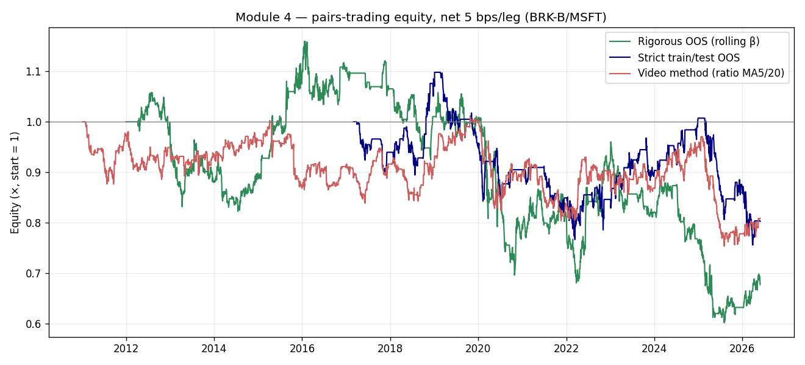

# Module 4 — Pairs Trading / Mean Reversion (BRK-B vs MSFT)
### Institutional-grade replication & validation report

**Source:** YouTube "pairs trading" tutorial — find two highly-correlated equities, confirm a stationary spread via cointegration/ADF, trade a z-score of the price ratio (MA5/MA20 bands) back to the mean. Headline pair: **Berkshire Hathaway B (BRK-B) vs Microsoft (MSFT)**, daily.
**The author's own conclusion:** *"this entire model … was not very successful."*
**Verdict:** ❌ **Confirmed not tradable** — and for instructive reasons. The workflow contains two textbook errors (spurious price-level correlation, and in-sample cointegration selection that does not survive out-of-sample), and even after fixing them the spread-reversion P&L is **net-negative across every variant**. This matches the project's prior on this family (lesson **L27**: the cointegrated-spread "beta trap"; repo research history: *pairs cointegration 0/19 qualify*).

---

## 1. The two methodological errors, made visible

**Error 1 — correlation on prices, not returns.** The video eyeballs a correlation "≈ 0.97" and calls the pair tightly linked. That is a *price-level* correlation between two upward-trending series — a spurious correlation (both go up over 15 years). The decision-relevant quantity is the **daily-return** correlation:

| Pair | Price-level corr (video's number) | **Return corr (correct)** |
|---|--:|--:|
| BRK-B / MSFT | ~0.97 | **0.49** |

A 0.49 return correlation is moderate, not the near-lockstep the video implies. (The empirically *most* correlated pair in the universe is SPY/BRK-B at 0.77 — unsurprising, since BRK-B trades like a diversified index.)

**Error 2 — in-sample cointegration selection (look-ahead).** Running ADF/cointegration on the *whole* history and then trading that same history means the pair was chosen *because* its spread happened to mean-revert over the sample. Decomposing it:

| Cointegration test | p-value | Reading |
|---|--:|---|
| BRK-B/MSFT, **full sample 2011–2026** | **0.003** | "passes" — looks cointegrated |
| BRK-B/MSFT, **median within-year** | **0.39** | within any given year, *not* cointegrated |
| Fraction of individual years cointegrated (5%) | **1 / 16 (6%)** | ≈ the false-positive rate |
| Universe pairs cointegrated full-sample (5%) | **7 / 66** | ≈ chance (5% × 66 ≈ 3) — none persistent |

The full-sample "pass" is an artefact of the entire window; a trader standing at any point in time, using only past data, would **not** find a stationary spread. This is exactly the look-ahead the video bakes in.

---

## 2. Honest backtests: all net-negative

Three variants, BRK-B/MSFT daily, dollar-neutral, **net of 5 bps per leg**, signal at t-1 / trade at t:

| Variant | Round trips | **Gross Sharpe** | **Net Sharpe** | HAC t | Ann. return | Total return | Max DD | WF folds + |
|---|--:|--:|--:|--:|--:|--:|--:|--:|
| **Rigorous OOS** (rolling 252-d hedge β, z₆₀, ±2/0.5) | 32 | −0.12 | **−0.15** | −0.6 | −1.9% | −32% | −48% | 40% |
| **Strict train/test** (β from first 40%, trade last 60%) | 44 | −0.07 | **−0.15** | −0.5 | −1.7% | −20% | −31% | 40% |
| **Video method** (ratio MA5/MA20 z, ±1 bands) | 184 | +0.16 | **−0.11** | −0.4 | −1.0% | −19% | −25% | 20% |

Reading the curves: a rolling-β reversion strategy *did* drift up in 2012–2016 (when BRK-B and MSFT still moved together), then **bleeds from 2020 onward** as MSFT's mega-cap tech re-rating permanently decoupled the two — the "spread" stopped reverting and started trending. No variant ends above water. The video method shows a small *gross* edge (+0.16 Sharpe) consistent with a weak reversion tendency, but its 184 round trips convert that into a **net loss** once realistic equity costs are applied.

---

## 3. Why it fails — the structural reason (L27)

Two equities are not bound by any arbitrage relationship (no creation/redemption, no physical convergence). Their "spread" is just a long/short of two businesses whose relative value can drift indefinitely with fundamentals — precisely what BRK-B vs MSFT did post-2020. So:

- **There is no force that *must* pull the spread back.** Statistical cointegration over one window is not a structural anchor; it expires when the regime changes (here, the tech re-rating).
- **The hedge ratio is itself non-stationary** — re-estimating β each year moves it materially, so even the "market-neutral" construction carries a residual directional (beta) exposure (lesson L27: the beta trap survives hedging).
- **Costs dominate a weak signal.** The only variant with positive gross Sharpe trades 184 times; 5 bps/leg turns +0.16 gross into −0.11 net.

This is consistent with the repo's earlier equity work (*pairs cointegration: 0/19 qualify; Gatev distance Sharpe −0.44*). Naïve two-equity stat-arb is a well-known dead end at retail scale.

---

## 4. Verdict

| Gate (RESEARCH_PASS) | Target | Best variant | Pass |
|---|---|---|---|
| Net Sharpe | > 0.7 | −0.11 | ❌ |
| Significance (HAC t) | > 2.5 | −0.6 | ❌ |
| Walk-forward | > 50% | 40% | ❌ |
| OOS cointegration stability | persistent | 1/16 years | ❌ |

**The strategy is a good teaching example and a poor trading system** — the author's own verdict, now quantified. The genuinely useful lessons to carry forward: (i) always correlate **returns**, never price levels; (ii) test cointegration **out-of-sample / per-period**, never on the same sample you trade; (iii) a real reversion edge needs a structural convergence mechanism (ETF arb, index inclusion, hard-linked instruments), which two unrelated equities do not have.

*Reproduce:* `python module_4_pairs_trading/run.py`
*Artefacts:* `results/module4_diagnostics.json`, `results/module4_backtests.csv`, `results/module4_per_year_coint.csv`, `results/fig_A|B|C_*.png`.
