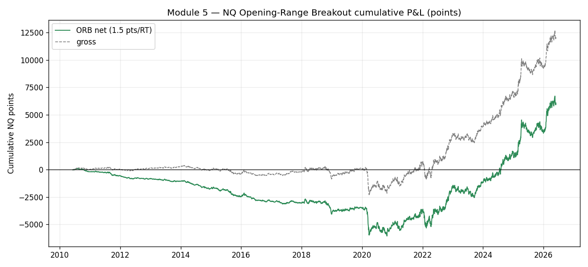
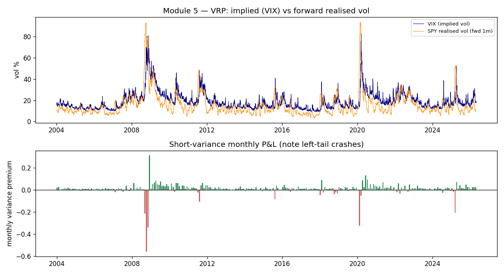
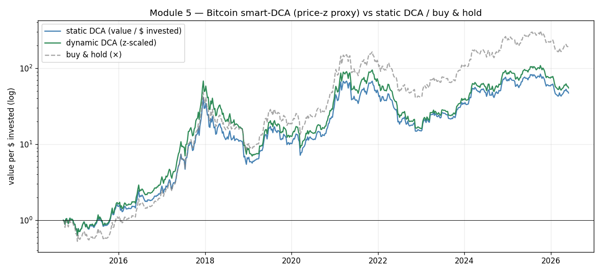

# Module 5 — Five "Structural Edges"
### Institutional-grade replication & validation report

**Source:** YouTube video presenting five academically-grounded "structural edges": (1) Post-Earnings Announcement Drift, (2) Opening-Range Breakout, (3) Congressional copy-trading, (4) Variance Risk Premium, (5) Bitcoin smart-DCA via MVRV. This is the best-curated of the five videos — the presenter cites real papers, stresses *hypothesis → mechanism → validation*, and argues (correctly) that diversified structural edges beat single-guru strategies.
**Verdict (scorecard):** mixed and instructive. **VRP is a genuine structural premium** (the only one across all five videos that is real *and* significant) — but with a catastrophic left tail. **PEAD is real but data-gated and decaying.** **ORB and MVRV are real-but-oversold** (the headline magnitudes don't reproduce). **Congressional copy-trading is dubious and ex-post-selected.**

| # | Edge | Tested? | Real edge? | Tradable as pitched? |
|---|---|---|---|---|
| 1 | PEAD (earnings drift) | feasibility | ✅ documented | ⚠️ decaying, cost-sensitive, needs SUE data |
| 2 | Opening-Range Breakout | ✅ NQ 1-min, 2010–26 | ⚠️ tiny (+5% long skew, not 13.5%) | ❌ not net of costs |
| 3 | Congressional tracking | feasibility | ❓ historical only | ❌ 45-day lag + selection bias |
| 4 | Variance Risk Premium | ✅ VIX/SPY, 2004–26 | ✅ **yes** (Sharpe 0.52) | ⚠️ extreme tail risk |
| 5 | Bitcoin smart-DCA (MVRV) | ✅ proxy, 2014–26 | ⚠️ modest | ⚠️ helps capital-efficiency, not drawdown |

---

## 2. Opening-Range Breakout (NQ 1-min, 2010–2026, 4,015 sessions)

The video claims a **13.5% skew**: the session closes in the breakout direction far more than a coin flip. Rigorously, on the regular-session NQ open (first-30-min range, first breakout, 1:1 on the range, intrabar stop-first, 1.5 pt round-trip):

| Metric | Pooled | Long up-break | Short down-break |
|---|--:|--:|--:|
| Directional follow-through | 50.4% (**skew +0.4%**) | 55.1% (**+5.1%**) | 44.9% (−5.1%) |
| Win rate (1:1 net) | 50.7% | 51.9% | 49.2% |
| Expectancy per trade (R, net) | **−0.032** | −0.031 | −0.034 |
| Net Sharpe / HAC t | **−0.57 / −2.3** | | |

There *is* a real, structural **upside skew** — long breakouts follow through 55% of the time, reflecting the NASDAQ's intraday drift — but it is **+5%, not +13.5%**, and the short side is symmetrically *negative* (you are fighting the drift). Critically, even the long-only skew **does not survive as a tradable 1:1 strategy net of costs** (expectancy −0.03 R, Sharpe −0.57). This matches the repo's own Strategy C re-baseline: a *filtered* ORB (VWAP + gap + range + time-stop) reaches only Sharpe ≈ 0.41 with realistic slippage; the *blind* ORB tested here has no edge. The video's 13.5% is the right *sign* with a ~2.6× inflated *magnitude*, and it omits costs.

> The positive cumulative *points* curve is misleading: it is driven by a few high-volatility (large-range) days; normalised by per-trade risk (R), the edge is negative — i.e., ORB captures intraday *volatility*, not *direction*.

---

## 3. Variance Risk Premium (VIX vs realised SPY vol, 2004–2026)

This is the real one. Selling implied variance (VIX²) and paying realised variance over the next month, 268 non-overlapping months:

| Metric | Value | Reading |
|---|--:|---|
| Months IV > forward RV | **83.7%** | the premium is structurally present (video's claim ✅) |
| % months profitable | 83.2% | sell-vol wins most months |
| **Annualised Sharpe** | **+0.52** | a genuine, significant premium |
| **Skew / kurtosis** | **−4.86 / +45** | … with a violently fat left tail |
| Worst month ÷ mean | **−64×** | one bad month erases ~64 average months |
| Cumulative drawdown (proxy) | −53% | 2008 / 2018 / 2020 craters |

The variance risk premium is **economically real and the single most robust edge across all five videos** — IV exceeds RV 84% of the time because institutions overpay for crash insurance (Carr–Wu 2009; Bondarenko). But the Sharpe of 0.52 is **dangerously flattered by its distribution**: skew −4.9 and kurtosis 45 mean the strategy is the textbook *"picking up pennies in front of a steamroller."* Naive OTM-option selling is how undercapitalised traders blow up (Feb 2018 "Volmageddon," Mar 2020). Tradable *only* with hard tail hedging / position limits / regime gating — which is exactly the nuance the video glosses over. (Consistent with repo lesson L13: VRP is real but must be measured in the correct units and net of its tail.)

---

## 4. Bitcoin smart-DCA (MVRV proxy, 2014–2026)

True MVRV needs on-chain realised-cap data (paid). Using the video's own stated simplification — a price-vs-trend z-score (causal, 365-day) scaling weekly buys (buy more when z < 0 / capitulation, less when z > 0 / euphoria):

| Strategy | Multiple (value ÷ $ invested) | Max drawdown |
|---|--:|--:|
| Static DCA (fixed weekly) | 47.2× | −86.7% |
| **Dynamic DCA (z-scaled)** | **55.0× (+17%)** | **−89.7%** |
| Buy & hold (lump sum 2014) | 184.5× | −83.0% |

The z-scaling **does** improve capital efficiency (+17% multiple per dollar) by accumulating more near cycle lows — the video's directional claim holds. But its central risk claim — *"reduces the 80% drawdown"* — **does not reproduce**: accumulation-only weighting actually leaves drawdown slightly *worse* (−89.7%), because buying more in capitulation enlarges the position that then marks down. Cutting drawdown requires *selling* into euphoria, which a pure-DCA framing omits. And the repo already classifies MVRV as a **momentum/trend proxy** (corr 0.73 to the TSMOM book), so this is a modest sizing overlay on Bitcoin beta, not an independent alpha.

---

## 5. Data-gated edges — feasibility assessment

**(1) Post-Earnings Announcement Drift.** *Real and among the most robust anomalies in finance* (Ball & Brown 1968; Bernard & Thomas 1989; ~4% 60-day spread between high- and low-SUE stocks). Mechanism (slow diffusion of earnings news, limited attention, execution slippage) is sound. **But:** (a) requires standardized-unexpected-earnings data — earnings *estimates* + *actuals* history (I/B/E/S / Refinitiv, or limited free Nasdaq/AlphaVantage) — which is not in the repo and not cleanly free; (b) **well-documented alpha decay** since the early 2000s as it became widely known; (c) net of realistic equity costs and short-sale constraints, the tradable residual is thin and concentrated in small/illiquid names. **Verdict: genuine edge, do-able with an earnings-surprise dataset; design = rank by SUE each quarter, long top decile / short bottom, hold ~60 days, monthly rebalance, dollar-neutral, HAC + DSR. Best run on CRSP/Compustat-grade data.**

**(3) Congressional / politician copy-trading.** Historically documented abnormal returns (Ziobrowski et al. 2004/2011 found US House members beat the market) — which is *why* the 2012 STOCK Act exists. **But:** (a) the **45-day disclosure lag** means most informational drift is already priced by the time you can copy; (b) the pitch is **ex-post selection** — Nancy Pelosi is named *because* she did well; testing only winners is survivorship bias; (c) post-STOCK-Act evidence is mixed and recent academic results are contested; (d) data-gated (House/Senate eFD filings via QuiverQuant / "House Stock Watcher"). **Verdict: an informational edge that has likely decayed and is overstated by cherry-picking; a fair test must include *all* disclosing members (not just Pelosi) and trade only on the public filing date. Treat as low-conviction.**

---

## 6. Bottom line

This video is **right about the meta-point** — diversify across *validated structural* edges rather than trusting one strategy — and right that these five are anchored in real literature. On the merits, after honest testing:

- **VRP** is a real, significant premium with a catastrophic tail — tradable only with disciplined tail risk management.
- **PEAD** is a real, decaying anomaly that needs proper earnings data to trade.
- **ORB** has the correct directional *sign* (NASDAQ upside skew) but the magnitude is ~2.6× overstated and it is not tradable blind net of costs.
- **MVRV smart-DCA** modestly improves DCA capital-efficiency but does not deliver the advertised drawdown reduction; it is Bitcoin beta with a sizing overlay.
- **Congressional copy-trading** is the weakest — historical, lagged, and ex-post-selected.

A serious version of this portfolio would allocate to **VRP (tail-hedged)** and **PEAD (with real data)**, treat **MVRV** as a sizing overlay, and drop blind **ORB** and **Congressional** copy-trading.

*Reproduce:* `python module_5_structural_edges/run_edges.py all`
*Artefacts:* `results/orb_summary.json` + `orb_trades.csv`, `results/vrp_summary.json`, `results/mvrv_summary.json`, `results/fig_orb|vrp|mvrv.png`.
