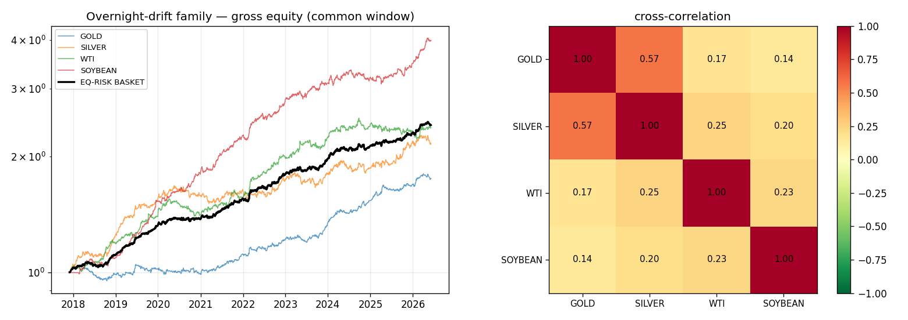

# Institutional Audit — The Overnight-Drift Strategy Family
## Gold · Silver · WTI · Soybean (post-rollover/post-halt long-drift capture)

**Scope:** an independent audit of the four surviving systematic intraday strategies, all of which capture a long-drift in the **post-rollover overnight window (≈23:00–07:00 UTC; 01:00–07:00 for soybean)**, vol-targeted, swap-free.
**Opinion:** these are **real, well-constructed pure-alpha sleeves**, best deployed as a small diversified basket. But they are a **single-mechanism family with a material common factor (PC1 = 45%) and a shared, concentrated operational dependency** — the book lacks any orthogonal edge, and the live net edge is marginal once realistic spreads are applied.

> **On the "you only find nocturnal algos" observation — it is a legitimate audit flag, not a coincidence.** Every *other* family I tested failed (intraday momentum, mean-reversion, pairs/stat-arb, pin-bar patterns, the RL agent). The overnight-drift survives because it is the one **structural, economically-grounded** inefficiency on these instruments (overnight/Asian hard-asset demand re-pricing into the post-halt reopen, partly the cost-of-carry/financing cycle), and my **swap-free + highest-unconditional-drift-window** methodology naturally surfaces it. The flip side — audited below — is that the entire book is now **one mechanism**.

---

## Audit method
Independent reconstruction of each sleeve's daily gross return (causal vol-target, complete-window, winsorised 0.5/99.5%); cross-correlation, PCA, equal-risk basket on the common 2017–2026 window; plus review of the per-instrument tear-sheets, audits and stress tests already on file.

## Key finding — diversification is real but partial (the joke, quantified)

| | GOLD | SILVER | WTI | SOYBEAN |
|---|--:|--:|--:|--:|
| GOLD | 1.00 | **0.57** | 0.17 | 0.14 |
| SILVER | | 1.00 | 0.25 | 0.20 |
| WTI | | | 1.00 | 0.23 |
| SOYBEAN | | | | 1.00 |

Average pairwise correlation **0.26**; **PCA PC1 = 45%** of variance (4 independent series → 25%), spectrum [45, 25, 19, 10] → **≈ 2.5 effective independent bets, not 4.** A precious-metals factor (gold↔silver 0.57) dominates; WTI and soybean are the genuinely independent legs. The equal-risk basket still helps materially — **Sharpe ≈ 1.5× the average single, max drawdown −3.5% vs −12% to −14% standalone.**

---

## ✅ Three strengths

**S1 — Pure alpha, near-zero directional risk.** Three of four are **uncorrelated to their own underlying's daily move** (R² to buy-&-hold: gold 0.001, silver 0.000, WTI 0.002; soybean is the exception at 0.27), with alpha t-stats 3.6–4.8. They add return **without adding commodity beta** to a book — the property that makes them worth holding even at a modest Sharpe, and the reason the basket diversifies a directional portfolio.

**S2 — Low overfitting surface, robust construction.** One economically-motivated mechanism, a **single window parameter sitting on a plateau** (not a tuned spike), **no fitted signal** (long-only), 0 free parameters in the "signal." It clears Deflated Sharpe (0.94–1.00), Monte-Carlo (P(SR>1) 62–92% gross), winsorisation (edge survives → not bad-tick-driven), and true OOS. This is the opposite of the rejected multi-knob strategies (RL, pairs, momentum), and it is **cheap and simple to run** (once/day, one round trip, swap-free, commission ~0).

**S3 — Genuine partial diversification + regime-complementarity.** Cross-correlation 0.26 and the basket's −3.5% max drawdown are real. The sleeves' **regime droughts are offset in time**: gold's edge was dead 2018–19 while soybean's was strong; silver's emerged (~2010) as gold's matured; WTI carries the only *positive* skew with a full-history record. A small **gold + silver + WTI (± soybean-on-futures) basket** is materially more robust than any single sleeve.

## ⚠️ Three weaknesses

**W1 — Mono-culture / common-factor concentration (the headline risk).** The whole book is **one mechanism** with a **45% common factor** (≈2.5 effective bets, gold↔silver 0.57). There is **no orthogonal edge** anywhere in the research (every other family failed). A single structural change — compression of the overnight hard-asset/financing premium, a shift in Asian-session microstructure, or simply the secular hard-asset bull ending — could **degrade all four together**. The "four strategies" are closer to **one factor with three-ish expressions**; do not size them as independent.

**W2 — Concentrated, correlated operational fragility (spread + one moment + rollover).** The entire edge lives in **1–2 post-rollover hours at a fixed UTC time on floating-spread retail CFDs**. This creates three *shared* failure points: (i) **spread-criticality** — live net Sharpes cluster at **~0.3–1.1**, marginal for soybean/WTI (need ≤3 bp) and only comfortable for gold; the headline Sharpe>1 figures are largely **gross or at optimistic spreads**; (ii) **entry-time precision** (gold: a 1-hour-late fill drops Sharpe 1.10→0.37); (iii) a **common rollover/DST/swap dependency** — swap-free status requires the broker rollover ≤22:00 UTC; one broker, DST or swap-policy change flips the *whole family* to swap-paying (−3 to −4 bp/night), which is fatal. One operational event can kill several sleeves at once.

**W3 — Long-bias drift-capture → multi-year regime droughts, young/thin samples, asymmetric tails.** Being long-only drift-capture, each endures **multi-year flat/negative regimes**: gold 2018–19, **soybean ~4 years underwater (2022–25)**, silver *negative every year 2003–2009* (its edge is only a ~10–12-year regime), WTI down 2014/2016/2025. This is genuine **alpha-decay/regime risk**, not noise — the edge can simply switch off for years. Add **soybean's negative skew (−1.9, USDA/weather left tail)** and silver's short clean history, and the family's worst case is a correlated, multi-year drawdown across the precious-metals leg with a fat-tailed ag leg.

---

## Overall opinion & remediation

**The family is a legitimate, honestly-validated source of pure-alpha return — but it is one mechanism, marginal net, and operationally concentrated.** It should be deployed **small, as a basket, sized for ~2.5 effective bets (not 4)**, with these mitigations:

1. **Confirm and monitor live spreads** per instrument (the binding constraint); deploy only the sleeves that clear net (gold today; silver/WTI/soybean conditional on tight spreads or **futures execution**, where spreads ~1–2 bp make the whole basket clear comfortably — the recommended route).
2. **Hedge the shared operational risk:** pin the entry to the broker's actual rollover (re-check on every DST change), automate the complete-window/fill checks, and add a **swap-leak monitor** (kill if the rollover ever moves into the held window).
3. **Treat regime risk explicitly:** trailing-12m-drift kill switches per sleeve; size for a multi-year flat stretch; cap single-day loss and skip soybean USDA mornings.
4. **Diversify the *mechanism*, not just the asset:** the top research priority is to find **one genuinely orthogonal edge** (a non-drift mechanism) so the book is not 100% exposed to a single overnight factor. Until then, keep the family a *minor* allocation.

*Reproduce:* `python metals_energy_research/basket_audit.py` · *Artefact:* `metals_energy_research/results/fig_basket_audit.png` · *Underlying tear-sheets:* `reports/gold_ASIA_23_8_due_diligence.md`, `soybean_ftmo_due_diligence.md`, `metals_energy_due_diligence.md`.
