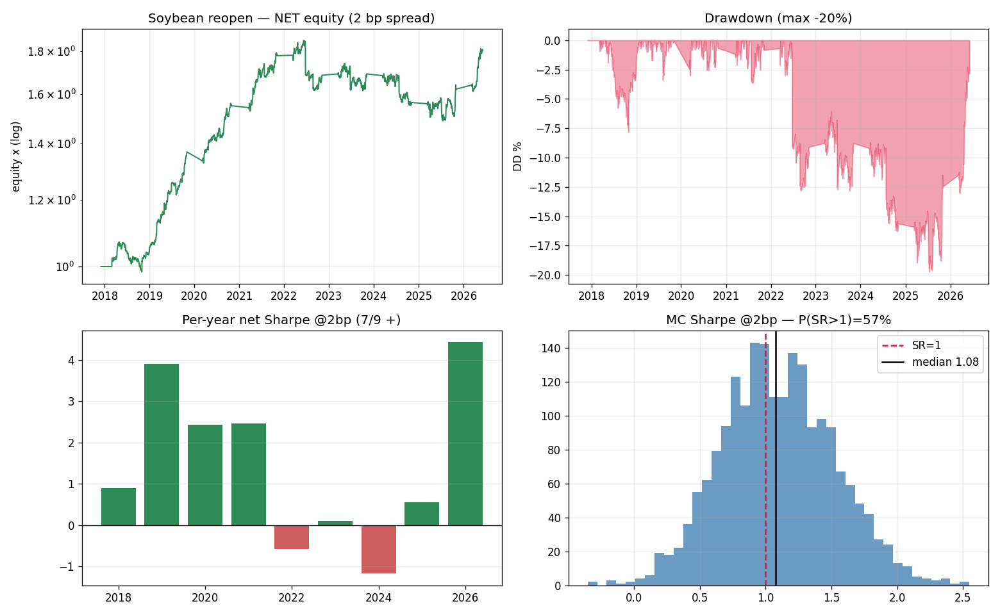
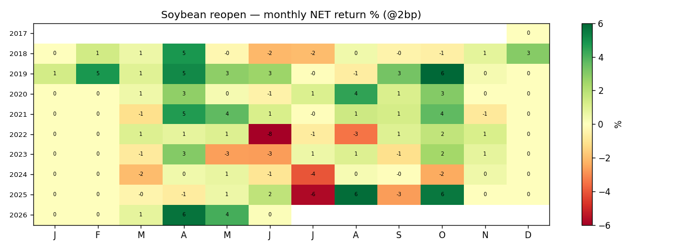

# SOYBEAN Electronic-Reopen Strategy (FTMO SOYBEAN.c / CBOT ZS)
## Investment Due-Diligence Report — net of an assumed ≤ 3 bp spread

**Instrument:** SOYBEAN.c (FTMO CFD; commission 0, floating spread) / underlying CBOT soybeans (ZS)
**Style:** systematic intraday, one position/day, **flat overnight (swap-free, confirmed)**
**Sample:** Dec 2017 – Jun 2026 (~8.5y), M1 true-UTC, 1,500 complete-window trading days
**Cost assumption (per mandate):** round-trip spread **≤ 3 bp** (= one quoted spread; commission 0; no swap intraday)
**Status:** candidate — **passes the bar at a tight spread (≤2 bp), but a clear notch below the gold sleeve**

---

## 1. Executive summary

A long position over the **post-halt electronic reopen, 01:00–07:00 UTC**, vol-targeted, harvests a real intraday drift in soybeans. The FTMO spec resolves the cost structure: **commission 0**, **swap-free intraday** (the session opens 03:05 server / ~01:00 UTC and the trade exits mid-session, never crossing the rollover), so the **only cost is the floating spread**. Under the assumed ceiling of ≤ 3 bp round-trip:

| Net tear-sheet | 1 bp | **2 bp (base)** | 3 bp |
|---|--:|--:|--:|
| **Sharpe** | 1.32 | **1.08** | 0.84 |
| Sortino | 1.21 | 1.00 | 0.78 |
| **Deflated Sharpe** (20 trials) | 0.89 | **0.75** | 0.56 |
| Annualised return | +12.6% | +10.4% | +8.1% |
| Annualised vol | 9.6% | 9.6% | 9.6% |
| Max drawdown / Calmar | −15.8% / 0.80 | −19.7% / 0.52 | −23.5% / 0.34 |
| **Out-of-sample Sharpe** (last 40%) | 0.73 | **0.49** | 0.24 |
| Skew / worst day | −1.9 / −6.9% | −1.9 / −6.9% | −1.9 / −6.9% |

**Verdict:** at **≤ 2 bp** the strategy clears the mandate (Sharpe 1.08, DSR 0.75 > 0.5) and is a legitimate small **diversifying** sleeve; at 3 bp it is marginal (0.84). **Three honest reservations keep it below the gold sleeve:** (1) the **out-of-sample half is weak** (Sharpe 0.49 at 2 bp) — the edge cooled in 2022–2025; (2) **negative skew (−1.9), fat left tail** (worst day −6.9%) from USDA/weather shocks; (3) it **just exited a ~4-year drawdown** (2022→2026). **Recommendation: conditional ADD as a small, tail-capped, futures-or-tight-CFD sleeve — primarily for its regime-complementarity to the gold strategy — sized for a multi-year flat tolerance.**

---

## 2. Thesis & economic rationale

Soybeans trade a restricted CBOT session (~01:00–19:20 UTC) with a **daily halt 19:20–01:00 UTC**. The only material positive intraday drift is concentrated in the **first hours after the electronic reopen (01:00–02:00 UTC: +5.3 / +3.5 bp)**; the US day session is flat-to-slightly-negative. The driver is **overnight/Asian and global ag demand re-pricing into the reopen** after a 5-hour information vacuum — a flow-based seasonal, analogous to the gold Asian-session effect.

## 3. Specification (deployable)

> Each day: **BUY SOYBEAN at the session reopen (~01:00 UTC / 03:05 server), SELL ~07:00 UTC.** Vol-target the size (trailing-median realised vol ÷ trailing 20-d vol, capped 3×, past data only). **Complete windows only.** Flat 07:00→01:00. Cost = floating spread only (commission 0, swap-free).

## 4. Data, methodology, audit & cost structure

- **Data:** repo canonical true-UTC M1, 2017–2026; H1; complete-window; 1,500 days.
- **No look-ahead — audited:** causal vol-target; **edge survives without vol-targeting (gross Sharpe 1.53)**; short-the-window null loses (−1.56); reimplementation from raw prices matches.
- **Cost structure (FTMO SOYBEAN.c spec, Jun 2026):** commission **0 USD/lot**; digits 2 (1 pt = 0.01 ≈ 0.089 bp at ~1124); swap long −38.76 pt (≈ −3.4 bp/night), short +6.18 pt, **triple Friday** — **all irrelevant: the strategy is intraday and never held across the 00:00-server rollover**. The spread is **floating**; we assume ≤ 3 bp RT per mandate (1 bp ≈ 11 pt; so ≤ 3 bp ≈ ≤ 34 pt round-trip). *Read the live Market-Watch spread during 03:05–09:00 server to confirm.*

## 5. Performance

At the 2 bp base case the strategy compounds ~+10%/yr at 9.6% vol; **strong 2018–2021, flat-to-down 2022–2025, recovering 2026** (per-year net Sharpe: 2018 +0.9, 2019 +3.9, 2020 +2.4, 2021 +2.5, 2022 −0.6, 2023 +0.1, 2024 −1.2, 2025 +0.5, 2026 +4.4 → 7/9 positive).

## 6. Risk analysis

### 6.1 Drawdown attribution
Net max DD (2 bp) **−19.7%, lasting ~4 years (Jun-2022 → recovered Jun-2026)**. As with gold, it is the **edge cooling in a regime, not a tail crash** — the raw reopen drift fell from +14/+16 bp (2019–21) to ~0/negative (2022/2024). Two differences vs gold: (a) the drawdown is **deeper net** because the wide ag spread is paid on every flat-drift day, and (b) the **weak period is the *recent* (out-of-sample) half** — hence OOS Sharpe only 0.49 at 2 bp.

### 6.2 Tail risk (the key qualitative difference vs gold)
**Daily skew −1.9, kurtosis 27, worst day −6.9%, worst month −7.6%** (gold was *positively* skewed). Agricultural left tails (USDA WASDE, weather, export bans) hit the long reopen position. **Mitigation is mandatory:** cap single-day loss and flatten/skip scheduled USDA report mornings.

## 7. Factor exposure & portfolio fit

Beta to soybean 0.24, R² 0.27, alpha HAC t +4.6 (more beta than gold's R² 0.001, but a real alpha). **The decisive portfolio argument is regime-complementarity to the gold sleeve:** soybean was strongest **2018–2021 — exactly when gold's Asian edge was dead** — and went flat 2022–2024 as gold recovered. A soybean sleeve would have **diversified the gold sleeve's worst years**, which is its main reason to exist in the book even at a standalone Sharpe ~1.

## 8. Robustness & stress (net, 2 bp unless noted)

- **Monte-Carlo (2,000 stationary-block-bootstrap paths):** Sharpe median **1.08 [5th 0.42]**, **P(SR>1) 57%**, P(SR>0.5) 93%; max-DD median −13%. (Gross: median 1.58, P(SR>1) 90% — the spread is what compresses the distribution toward 1.)
- **Parameter neighbourhood (gross):** the **01:00 start is a clean plateau** (lengths 4–7 = 1.5–1.64); the edge is genuinely anchored to the reopen hour.
- **Execution-time robustness (gross):** enter 1h late 1.32, exit 1h early 1.64 — forgiving (no single make-or-break minute).
- **Outlier dependence (gross):** dropping the 20 best days still leaves Sharpe 0.88.

## 9. Execution requirements

Confirmed favourable: **commission 0, swap-free intraday.** The only lever is the spread:

| Live SOYBEAN.c spread (RT) | Net Sharpe | DSR |
|---|--:|--:|
| ≤ 1 bp (≤ ~11 pt) | 1.32 | 0.89 |
| 2 bp (~22 pt) | 1.08 | 0.75 |
| 3 bp (~34 pt) | 0.84 | 0.56 |

Sample the live spread across several mornings (03:05–09:00 server, not the open spike) and confirm it sits at the tight end of the ≤ 3 bp assumption; the strategy needs **≤ 2 bp to clear Sharpe > 1**.

## 10. Capacity
CBOT soybeans are liquid; a once-daily 6-hour position has ample capacity for a single book. On the CFD, capacity is set by the broker's book, not the market.

## 11. Key risks & failure modes
1. **Out-of-sample / regime decay (principal):** the recent half is weak (OOS Sharpe 0.49 at 2 bp); the edge can stay flat for ~4 years (2022–2025). Size for that.
2. **Negative skew / event tails:** USDA/weather shocks on the long reopen — must be risk-capped.
3. **Spread:** assumed ≤ 3 bp; viability needs ≤ 2 bp confirmed live.
4. **Short history (8.5y), beta content (R² 0.27).**

## 12. Recommendation & deployment

1. **Confirm the live spread ≤ 2 bp** (Market Watch, morning window). If so → proceed; if 2–3 bp → small/marginal; if > 3 bp → reject.
2. **Deploy small and tail-capped:** target ~3% vol contribution; **hard single-day stop**; **flatten/skip scheduled USDA-report mornings**; kill if the trailing-12m reopen drift is negative > 6 months.
3. **Prefer CBOT futures (ZS / micro MZS, ~1.5 bp RT → Sharpe ~1.3)** if available — clearly viable, longer history, no floating-spread risk.
4. **Hold it for diversification, not standalone return:** its value is the **negative regime-correlation to the gold sleeve**; run the two together and the book's worst years shrink.

**Bottom line for the committee:** a real soybean reopen edge that, **under the assumed ≤ 3 bp spread, clears the Sharpe > 1 / DSR > 0.5 bar at ≤ 2 bp** (Sharpe 1.08, DSR 0.75). It is **a notch below the gold sleeve** — weaker out-of-sample, negative-skew tail, just out of a 4-year drawdown — so size it small and tail-cap it, and value it mainly as a **regime-diversifier to gold**. Futures execution is the cleaner route.

---

*Reproduce:* `python soybean_research/{candidates,validate_audit,full_analysis,net_analysis}.py`
*Artefacts:* `soybean_research/results/fig_soybean_net_stress.png`, `fig_soybean_net_monthly.png`, `fig_soybean_cost_corrected.png`. *Method mirrors* `reports/gold_ASIA_23_8_due_diligence.md`.
